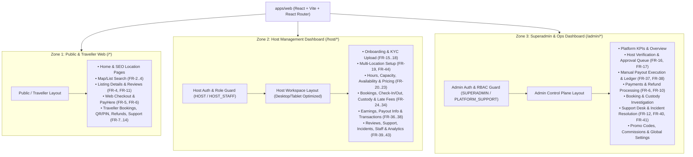

# Application Architecture Boundaries

**Document Status:** Baseline Architecture — Phase 0A
**Source Reference:** [luggage-storage-frs.pdf](../product/source/luggage-storage-frs.pdf)
**Related Documents:**
- [System Architecture Overview](system-architecture.md)
- [Product Scope and Application Boundaries](../product/product-scope-and-boundaries.md)
- [User Roles and Actor Model](../product/user-roles-and-actors.md)
- [Backend Domain Architecture Overview](backend-domain-overview.md)

---

## 1. Purpose

This document defines the structural boundaries between the mobile applications (`apps/mobile`), the web application (`apps/web`), the backend API (`apps/api`), and the shared monorepo packages (`packages/*`). It explains how a shared mobile codebase produces separate Traveller and Host applications, how a single web codebase cleanly isolates three distinct web experiences, and how client-server responsibilities are separated.

---

## 2. Monorepo Workspace Topology

The project uses **pnpm workspaces** and **Turborepo** to manage all applications and shared libraries in a single repository:

```text
luggage-storage/
├── apps/
│   ├── mobile/                 # React Native + Expo (Traveller & Host app variants)
│   ├── web/                    # React + Vite (Public Website, Host Dashboard, Superadmin Dashboard)
│   └── api/                    # Node.js + Fastify Modular Monolith Backend
│
├── packages/
│   ├── shared-types/           # Domain DTOs, enums, booking/payment states, role types
│   ├── validation/             # Shared Zod schemas (auth, booking, location, pricing, etc.)
│   ├── api-client/             # Typed REST client & TanStack Query hooks/keys
│   ├── config/                 # Shared ESLint, TypeScript (tsconfig), and formatting configs
│   └── i18n/                   # Shared localization dictionaries, currency/date formatters
│
├── docs/                       # Product, Architecture, Domain, Database & UX specifications
├── turbo.json
└── pnpm-workspace.yaml
```

---

## 3. Mobile Application Architecture (`apps/mobile`)

### 3.1 Shared Codebase with Separate Application Identities
Rather than maintaining two separate React Native repositories (which duplicates authentication, API client setup, map wrappers, design tokens, and build tooling), `apps/mobile` is architected as a **single Expo project configured for dual application variants**:

| Attribute | Traveller Mobile Application | Host Mobile Application |
| :--- | :--- | :--- |
| **App Variant Variable** | `APP_VARIANT=traveller` | `APP_VARIANT=host` |
| **Android Package Name** | `com.<brand>.traveller` | `com.<brand>.host` |
| **iOS Bundle Identifier** | `com.<brand>.traveller` | `com.<brand>.host` |
| **App Store / Play Store Listing** | Dedicated Traveller Store Listing | Dedicated Host Partner Store Listing |
| **Primary Actor** | Traveller (`ACT-01`) | Host (`ACT-02`) & Host Staff (`ACT-03` — `Later`) |
| **Root Route Group** | `(traveller)/*` | `(host)/*` |
| **Shared Mobile Layer** | Auth screens, UI primitives, MapLibre wrapper, camera/QR utilities, push notification registration, localization, TanStack Query & Zustand infrastructure | Same shared mobile foundation |

### 3.2 How Variant Separation Works
1. **Dynamic Expo Config (`app.config.ts`):** Reads `process.env.APP_VARIANT` (`traveller` or `host`) at build/start time to set the app name, icon, splash screen, bundle identifier, Android package name, deep-link scheme, and required native permissions.
2. **EAS Build Profiles (`eas.json`):** Defines separate development, preview, and production build profiles for `traveller` and `host` on both Android and iOS, enabling cloud compilation via Expo EAS from a Windows machine.
3. **Expo Router Navigation Boundary:** At startup, the root layout inspects the active variant (or switches into a unified role-switcher mode during local development if desired) and mounts only the route tree belonging to that application identity (`(auth)` + `(traveller)` vs. `(auth)` + `(host)`).

### 3.3 Mobile Client Responsibility Boundaries
- **Owns:**
  - Presentation of all Traveller (`FR-1`–`FR-14`) and Host (`FR-15`–`FR-44`) mobile screens, including both functional MVP screens and `Later` UI-complete screens.
  - Device hardware interactions: GPS coordinate acquisition (`expo-location`), camera capture for KYC documents (`FR-16`), location photos (`FR-19`), and luggage check-in evidence (`FR-29`), QR code scanning (`expo-camera`), and push token registration (`expo-notifications`).
  - Client-side form validation (`React Hook Form` + `Zod`) for immediate user feedback.
  - Optimistic UI state and cache invalidation (`TanStack Query` + `Zustand`).
- **Does NOT Own (Strictly Prohibited on Client):**
  - Calculating authoritative booking prices, discounts, commissions, or late fees (`FR -5`, `FR-32`, `FR-38`).
  - Storing PayHere merchant secrets or verifying payment completion without backend confirmation (`FR-6`).
  - Generating or validating booking QR/PIN tokens locally without server verification (`FR-7`, `FR-8`, `FR-27`, `FR-30`).

---

## 4. Web Application Architecture (`apps/web`)

### 4.1 Single React + Vite Codebase with Three Isolated Experience Zones
`apps/web` is a single-page application built with **React, Vite, TypeScript, Tailwind CSS, shadcn/ui, and React Router**. Internally, it is partitioned into **three strictly separated route, layout, and authorization zones**:



### 4.2 Separation & Security Rules for `apps/web`
1. **Route & Bundle Isolation:** Each zone (`Public`, `Host`, `Admin`) uses route-level code splitting (`React.lazy`) so public travellers never download Superadmin dashboard code or components.
2. **Layout & Navigation Separation:**
   - **Public/Traveller Zone:** Consumer marketplace header, search bar, currency/language selectors (`FR-14`), and traveller booking drawer.
   - **Host Dashboard (`/host/*`):** Partner sidebar navigation, location switcher (for multi-location hosts under `FR-44`), approval status banner (`FR-17`), and operational alerts.
   - **Superadmin Dashboard (`/admin/*`):** High-density enterprise navigation, verification/payout/refund queues, audit indicators, and role badge.
3. **Client Guard vs. Server Enforcement:** Route guards in React Router protect navigation UX, but **every `/api/v1/host/*` and `/api/v1/admin/*` backend endpoint independently verifies JWT/session validity, role membership, and resource ownership on the server**.

---

## 5. Backend API Boundary (`apps/api`)

All three frontend experiences communicate with the backend exclusively through versioned, documented REST endpoints exposed by **Fastify**:

| API Namespace | Consuming Applications | Auth & Role Requirement | Primary Domain Coverage |
| :--- | :--- | :--- | :--- |
| `/api/v1/public/*` | Traveller Mobile, Public Web | Public (Rate-limited) | Location search (`FR-2`), map pins (`FR-3`), listing details (`FR-4`), public reviews (`FR-11`), availability/price preview (`FR-5`), localization metadata |
| `/api/v1/auth/*` | All Apps | Public / Authenticated | Registration, login, Google/Apple OAuth (`FR-1`), token refresh, password reset, session management |
| `/api/v1/traveller/*` | Traveller Mobile, Public Web | `TRAVELLER` | Profile (`FR-2`), booking creation (`FR-6`), payment initiation (`FR-6`), QR/PIN retrieval (`FR-7`), directions (`FR-7`), active/history bookings (`FR-9`), cancellation/refund status (`FR-10`), reviews (`FR-12`), support (`FR-12`), favourites (`FR-13`) |
| `/api/v1/host/*` | Host Mobile, Host Web Dashboard | `HOST` or `HOST_STAFF` (Scoped) | Host registration/KYC (`FR-15`–`FR-18`), multi-location CRUD (`FR-19`, `FR-44`), hours/capacity/availability/pricing (`FR-20`–`FR-23`), booking dashboard & acceptance (`FR-24`–`FR-26`), check-in/out & evidence (`FR-27`–`FR-32`), earnings/payout settings/transactions (`FR-36`–`FR-38`), support/incidents (`FR-40`, `FR-41`), staff (`FR-42`), analytics (`FR-43`) |
| `/api/v1/admin/*` | Superadmin Web Dashboard | `SUPERADMIN` or `PLATFORM_SUPPORT` | Host approval (`FR-17`), manual payouts (`FR-37`), refund execution (`FR-10`), commission & promo configuration (`FR-13`), support & incident management (`FR-12`, `FR-40`, `FR-41`), review moderation, system audit logs |
| `/api/v1/webhooks/*` | External Providers (PayHere) | Cryptographic Signature Verification | Asynchronous payment notifications (`FR-6`) |

---

## 6. Shared Packages Architecture (`packages/*`)

To prevent drift between Mobile, Web, and Backend, shared logic is extracted into strictly typed workspace packages:

| Package | Imported By | What It Contains | What Is Prohibited Inside It |
| :--- | :--- | :--- | :--- |
| `@luggage/shared-types` | `mobile`, `web`, `api` | Domain DTO interfaces, booking/payment/custody state enums, role constants, ISO currency/country types, screen registry types | Node.js APIs, DOM APIs, React Native APIs, database schemas |
| `@luggage/validation` | `mobile`, `web`, `api` | Shared **Zod** schemas for forms and API payloads (registration, location setup, capacity rules, booking request, review submission) | Database queries, secret keys |
| `@luggage/api-client` | `mobile`, `web` | Typed HTTP client wrapper and reusable `TanStack Query` hooks/query-key factories derived from OpenAPI/Zod contracts | Server-side Fastify code or Drizzle ORM imports |
| `@luggage/i18n` | `mobile`, `web`, `api` | Translation keys (`BCP 47`), currency formatting helpers (`ISO 4217`), timezone-aware date/time formatting utilities (`IANA`) | Platform-specific storage adapters |
| `@luggage/config` | `mobile`, `web`, `api` | Shared `tsconfig.json` bases, ESLint rules, Prettier configuration | Runtime application code |

---

## 7. End-to-End Responsibility Separation Summary

| Concern | Mobile & Web Clients (`apps/mobile`, `apps/web`) | Backend Modular Monolith (`apps/api`) | Database & Storage (`PostgreSQL`, `R2`) |
| :--- | :--- | :--- | :--- |
| **Screen & UI Completeness** | Renders 100% of FRS screens (`MVP`, `Later`, `Recommended`, `Depends`) with clear status indicators | Provides functional APIs for MVP screens and safe capability flags for `Later` screens | Stores persistent domain records |
| **Input Validation** | Pre-validates forms via `@luggage/validation` (Zod) for UX responsiveness | Enforces authoritative schema and business-rule validation on every request | Enforces `NOT NULL`, `CHECK`, `UNIQUE`, and `FOREIGN KEY` constraints |
| **Pricing & Discounts** | Displays breakdown returned by API | Calculates base price, category/duration rules, promo discounts, commissions, and stores immutable `PriceSnapshot` | Persists exact integer minor units + `ISO 4217` currency code |
| **Capacity & Availability** | Displays available slots/bags | Executes atomic capacity reservation and schedule validation | Enforces row-level transactional locking on `capacity_pools` |
| **Luggage Custody** | Captures QR scan, PIN input, and check-in photos | Verifies token validity, booking state, and actor ownership; records custody transition | Persists immutable `check_in_records`, `check_out_records` (DB) and evidence media (R2) |
| **Payments & Payouts** | Launches PayHere checkout; displays earnings and payout status | Verifies PayHere webhook signatures; calculates host balances; records Superadmin manual payouts (`FR-37`) | Appends immutable double-entry/audit ledger records |

