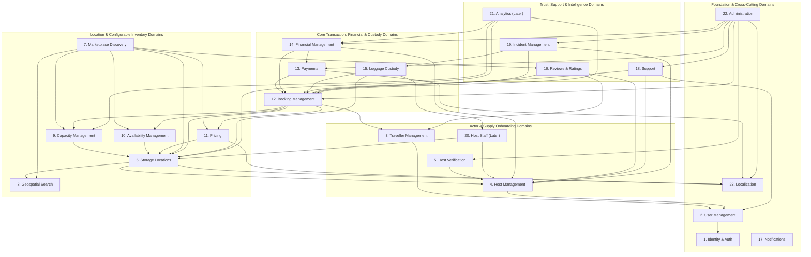

# Backend Domain Architecture Overview

**Document Status:** Baseline Architecture — Phase 0A
**Source Reference:** [luggage-storage-frs.pdf](../product/source/luggage-storage-frs.pdf)
**Related Documents:**
- [System Architecture Overview](system-architecture.md)
- [Application Architecture Boundaries](application-boundaries.md)
- [Product Scope and Application Boundaries](../product/product-scope-and-boundaries.md)
- [User Roles and Actor Model](../product/user-roles-and-actors.md)
- [Assumptions and Open Questions](../product/assumptions-and-open-questions.md)

---

## 1. Purpose & Modular Monolith Design Rules

The backend (`apps/api`) is structured as a **Modular Monolith** built on **Node.js, TypeScript, Fastify, Drizzle ORM, and PostgreSQL + PostGIS**.

To prevent the monolith from degenerating into tightly coupled spaghetti code, all **23 business domains** adhere to five architectural rules:
1. **Explicit Module Boundary:** Each domain owns its tables, domain entities, services, and REST routes inside `apps/api/src/modules/<domain>/`.
2. **No Cross-Module Table Mutations:** A module may never directly `INSERT`, `UPDATE`, or `DELETE` records in another module's database tables. Cross-domain mutations occur strictly via exported domain service interfaces or internal domain events.
3. **Separation of Booking, Payment, and Custody:** What a traveller reserves (`Booking`), what the traveller pays (`Payment` / `Finance`), and what bags the host physically holds (`Custody`) are distinct domains with independent state machines.
4. **Configuration-Driven Engines:** `Capacity`, `Availability`, `Pricing`, and `Booking` domains operate on versioned host configurations rather than hardcoded constants.
5. **Global-Ready Primitives:** Every domain uses `ISO 3166-1` country codes, `ISO 4217` currency codes, `BCP 47` locales, `IANA` timezones, `UTC` timestamps, and `E.164` phone numbers.

---

## 2. Backend Domain Dependency Diagram

---

## 3. Detailed Domain Specifications (All 23 Domains)

---

### 3.1 Identity and Authentication (`identity`)
- **FRS Traceability:** `FR -1 Account Registration & Login`, `FR-15 Host Registration`, `FR-42 Staff Accounts`.
- **Primary Responsibility:** Authenticating users across email/password and OAuth providers (Google, Apple), issuing/verifying sessions or tokens, managing password resets/OTPs, and enforcing role/permission checks.
- **What It Owns:** Auth credentials, OAuth provider links, active sessions/refresh tokens, OTP/verification challenges, security audit events.
- **What It Does Not Own:** Traveller personal preferences (`travellers`), Host business profiles (`hosts`), or KYC identity documents (`host-verification`).
- **Depends On:** `notifications` (for verification emails/OTPs).
- **Consumed By:** Traveller Mobile, Host Mobile, Public Web, Host Web Dashboard, Superadmin Web Dashboard.
- **Important Architectural Considerations:**
  - The specific authentication provider/strategy is pending owner approval (`OQ-001`).
  - Must support linking Google and Apple OAuth accounts to the same underlying user identity (`FR -1`).
  - Must support MFA enforcement for Superadmin and Platform Staff accounts.

---

### 3.2 User Management (`users`)
- **FRS Traceability:** `FR -1`, `FR-2`, `FR-14`, `FR-15`, `FR-42`.
- **Primary Responsibility:** Managing the core, role-agnostic `User` identity, contact details (`E.164` phone, email), account status, and role assignments (`TRAVELLER`, `HOST`, `HOST_STAFF`, `PLATFORM_SUPPORT`, `SUPERADMIN`).
- **What It Owns:** `users` records, global user preferences (preferred language/currency codes), role bindings, and account activation/suspension flags.
- **What It Does Not Own:** Password verification (`identity`), booking history (`bookings`), or host business entities (`hosts`).
- **Depends On:** `identity`, `localization`.
- **Consumed By:** All client applications.
- **Important Architectural Considerations:**
  - Designed so a single human user can hold both `TRAVELLER` and `HOST` contexts without registering duplicate accounts (subject to `OQ-007` owner confirmation).

---

### 3.3 Traveller Management (`travellers`)
- **FRS Traceability:** `FR-2 Traveller Profile`, `FR-13 Favourite Hosts` (`Later`).
- **Primary Responsibility:** Managing traveller-specific profile attributes, emergency/travel contact details, and saved favourite hosts/locations.
- **What It Owns:** `traveller_profiles`, `favourite_hosts` / `favourite_locations` (`Later` backend, UI-complete initial release).
- **What It Does Not Own:** Core authentication (`identity`), bookings (`bookings`), or reviews (`reviews`).
- **Depends On:** `users`, `locations` (for favourites reference).
- **Consumed By:** Traveller Mobile, Public Web, Superadmin Dashboard.
- **Important Architectural Considerations:**
  - `FR-13 Favourite Hosts` is marked `Later` in the FRS; the UI screens must exist in the initial release while full backend persistence/sync can be activated in Phase 11 (or provided as a lightweight table early).

---

### 3.4 Host Management (`hosts`)
- **FRS Traceability:** `FR-15 Host Registration`, `FR-17 Host Approval`, `FR-18 Host Profile`, `FR-44 Multiple Locations`.
- **Primary Responsibility:** Managing the Host partner organization/business entity, host onboarding lifecycle (`APPLICANT`, `PENDING_APPROVAL`, `APPROVED`, `REJECTED`, `SUSPENDED`), and business-level profile information.
- **What It Owns:** `hosts` (business name, host archetype, legal entity type, primary business contact, approval status), and the 1-to-many ownership relationship to `StorageLocations` (`FR-44`).
- **What It Does Not Own:** KYC document inspection workflows (`host-verification`), individual physical location configurations (`locations`), or payout ledgers (`finance`).
- **Depends On:** `users`, `localization`.
- **Consumed By:** Host Mobile, Host Web Dashboard, Superadmin Web Dashboard, Public Web / Traveller Mobile (public host summary).
- **Important Architectural Considerations:**
  - Must support diverse host types (small retail shop, hotel, restaurant, travel agency, dedicated storage business, and multi-branch chains like Barista under `FR-44`).
  - A Host cannot publish bookable locations until `FR-17 Host Approval` transitions the host to `APPROVED`.

---

### 3.5 Host Verification (`host-verification`)
- **FRS Traceability:** `FR-16 Identity/Business Verification`, `FR-17 Host Approval`.
- **Primary Responsibility:** Managing the submission, secure storage reference, review queue, and approval/rejection audit trail for host identity (KYC) and business registration documents.
- **What It Owns:** `host_verification_submissions`, `verification_documents` (metadata & Cloudflare R2 object keys), reviewer notes, approval/rejection timestamps, and country-specific verification checklists.
- **What It Does Not Own:** The Host profile itself (`hosts`) or raw object storage infrastructure (`Cloudflare R2` integration adapter).
- **Depends On:** `hosts`, `users` (admin reviewer), `notifications`, `Cloudflare R2`.
- **Consumed By:** Host Mobile, Host Web Dashboard, Superadmin Web Dashboard.
- **Important Architectural Considerations:**
  - Verification requirements vary by country and host type (individual vs. registered company — `OQ-002`).
  - Uploaded KYC documents in Cloudflare R2 must never be publicly accessible; access is strictly via short-lived pre-signed URLs issued only to the owning Host or authorized Platform Admin/Support reviewers.

---

### 3.6 Storage Locations (`locations`)
- **FRS Traceability:** `FR-4 Host Details`, `FR-7 Directions`, `FR-19 Storage Location Setup`, `FR-44 Multiple Locations`.
- **Primary Responsibility:** Managing physical storage location entities belonging to a Host, including address, coordinates, description, photos, available facilities, storage restrictions, and location publication status.
- **What It Owns:** `storage_locations`, `location_addresses` (country-aware), `location_media` (R2 photo references), `location_facilities`, `location_restrictions`, and location-level `IANA` timezone.
- **What It Does Not Own:** Dynamic capacity pools (`capacity`), operating schedules (`availability`), or pricing rules (`pricing`).
- **Depends On:** `hosts`, `geospatial`, `localization`, `Cloudflare R2`.
- **Consumed By:** All client applications.
- **Important Architectural Considerations:**
  - A single Host may own one or many `StorageLocations` (`FR-44`).
  - Supports approximate vs. exact address disclosure rules (`FR -4 Host Details` notes *"Address/approximate location"*, while `FR -7 Directions` navigates to the Host location — see `OQ-012`).

---

### 3.7 Marketplace Discovery (`marketplace`)
- **FRS Traceability:** `FR -2 Location Search`, `FR-3 Map View`, `FR -3 Host Listings`, `FR-4 Filters`, `FR -4 Host Details`.
- **Primary Responsibility:** Orchestrating traveller-facing search, filtering, sorting, map pin aggregation, and listing detail read models across active, approved storage locations.
- **What It Owns:** Read-optimized search query pipelines, filter/sort composition (by distance, price, opening hours, rating, availability, facilities), and public listing projection DTOs.
- **What It Does Not Own:** The underlying source tables for locations (`locations`), capacity (`capacity`), hours (`availability`), pricing (`pricing`), or reviews (`reviews`).
- **Depends On:** `locations`, `geospatial`, `capacity`, `availability`, `pricing`, `reviews`, `localization`.
- **Consumed By:** Traveller Mobile, Public Website.
- **Important Architectural Considerations:**
  - Only returns locations where both the parent `Host` is `APPROVED` (`FR-17`) and the `StorageLocation` is `ACTIVE`.
  - Combines spatial filtering (`geospatial`) with real-time schedule (`availability`) and inventory (`capacity`) checks when a traveller filters by specific drop-off/collection times (`FR-5`).

---

### 3.8 Geospatial Search (`geospatial`)
- **FRS Traceability:** `FR -2 Location Search`, `FR-3 Map View`, `FR-4 Filters` (distance), `FR -7 Directions`.
- **Primary Responsibility:** Providing PostGIS spatial indexing, radius/bounding-box queries, distance calculation, geocoding abstraction, and navigation link generation.
- **What It Owns:** PostGIS spatial query helpers (`ST_DWithin`, `ST_Distance`, bounding-box queries) and the external geocoding/routing provider adapter.
- **What It Does Not Own:** Host business metadata (`locations`) or UI map rendering (`MapLibre` on clients).
- **Depends On:** PostgreSQL + PostGIS, External Map/Geocoding Provider (`OQ-018`).
- **Consumed By:** `locations`, `marketplace`, Traveller Mobile, Public Website, Host Mobile/Web (pin placement).
- **Important Architectural Considerations:**
  - Uses `GEOGRAPHY(Point, 4326)` with `GiST` spatial indexes for accurate meter/kilometer distance queries across any country globally.

---

### 3.9 Capacity Management (`capacity`)
- **FRS Traceability:** `FR-5 Availability Check`, `FR-21 Storage Capacity`, `FR-28 Bag Verification`.
- **Primary Responsibility:** Managing configurable storage inventory models for each location and executing atomic capacity reservations and releases.
- **What It Owns:** `capacity_pools`, `bag_categories` (e.g., small, medium, large, special/oversized), `storage_zones` (e.g., Zone A, Zone B), `capacity_rules` (count-based, category-based, unit-based, zone-based), `capacity_reservations`, and `capacity_adjustments`.
- **What It Does Not Own:** Operating hours (`availability`), pricing (`pricing`), or the booking record itself (`bookings`).
- **Depends On:** `locations`.
- **Consumed By:** `marketplace`, `bookings`, Host Mobile, Host Web Dashboard, Superadmin Dashboard.
- **Important Architectural Considerations:**
  - Must support simple total-bag counts for small shops as well as multi-category and multi-zone pools for larger storage operators without separate code paths (detailed specification in Phase 0B).
  - Temporary capacity reservations created during checkout (`FR-6`) must be atomic, concurrency-safe, and automatically expired by background workers if payment is not completed within the hold window.

---

### 3.10 Availability Management (`availability`)
- **FRS Traceability:** `FR-5 Availability Check`, `FR-20 Opening Hours`, `FR-22 Availability Management`.
- **Primary Responsibility:** Managing location operating schedules and evaluating whether a location can accept a drop-off, store luggage across a period, and release luggage at a requested collection time.
- **What It Owns:** `operating_schedules` (weekly recurring schedules, split shifts), `availability_exceptions` (blocked dates/times, holiday hours, temporary closures, emergency stop-bookings under `FR-22`), and schedule evaluation logic.
- **What It Does Not Own:** Physical bag capacity counts (`capacity`) or pricing (`pricing`).
- **Depends On:** `locations` (specifically the location's `IANA` timezone).
- **Consumed By:** `marketplace`, `bookings`, Host Mobile, Host Web Dashboard.
- **Important Architectural Considerations:**
  - Explicitly distinguishes between (1) general business opening hours, (2) permitted luggage drop-off hours, (3) permitted luggage collection hours, and (4) temporary booking blocks (`FR-20`, `FR-22`).
  - All schedule evaluations are performed in the storage location's local `IANA` timezone while persisting absolute instants in `UTC`.

---

### 3.11 Pricing (`pricing`)
- **FRS Traceability:** `FR -5 Price Calculation`, `FR -13 Promo Codes`, `FR-23 Pricing`, `FR-32 Late Collection Handling`.
- **Primary Responsibility:** Managing host pricing configurations, promotional discount rules, late collection fee formulas, and executing authoritative server-side price calculations.
- **What It Owns:** `pricing_policies` (versioned), pricing rate tables (per bag, hourly, daily, per bag category, duration tiers), `promo_codes` / `campaigns` (`FR -13`), and immutable `price_snapshots`.
- **What It Does Not Own:** Payment processing (`payments`) or commission ledger balances (`finance`).
- **Depends On:** `locations`, `capacity` (bag categories), `localization` (currency).
- **Consumed By:** `marketplace`, `bookings`, `custody` (late fees), Traveller Mobile, Host Mobile, Public Web, Host Web, Superadmin Web.
- **Important Architectural Considerations:**
  - **Server-Authoritative Rule:** Clients never calculate authoritative prices. The `pricing` domain computes the itemized breakdown and persists an immutable `PriceSnapshot` tied to the booking so subsequent host price edits never alter existing bookings.
  - All monetary values are stored in integer minor units (e.g., cents/sata) or fixed-precision decimal alongside an `ISO 4217` currency code (`LKR` initially).

---

### 3.12 Booking Management (`bookings`)
- **FRS Traceability:** `FR-6 Booking`, `FR-7 Booking Confirmation`, `FR-9 Active Booking`, `FR -9 Booking History`, `FR-10 Cancellation`, `FR-24 Booking Dashboard`, `FR-25 Booking Details`, `FR-26 Booking Acceptance` (`Depends`), `FR-31 Mark Booking Complete`, `FR-33 Booking History`, `FR-34 Cancellation Handling`.
- **Primary Responsibility:** Orchestrating the end-to-end reservation lifecycle, state machine transitions, booking policies (instant booking vs. host approval), booking references, and traveller/host cancellation rules.
- **What It Owns:** `booking_policies` (versioned per location), `bookings`, `booking_items` (selected bag counts/categories), `booking_events` (immutable state transition log), and booking reference codes.
- **What It Does Not Own:** Payment gateway communication (`payments`), physical luggage check-in/out records (`custody`), or host balance ledgers (`finance`).
- **Depends On:** `travellers`, `locations`, `capacity`, `availability`, `pricing`, `notifications`.
- **Consumed By:** Traveller Mobile, Host Mobile, Public Web, Host Web Dashboard, Superadmin Web Dashboard.
- **Important Architectural Considerations:**
  - Supports both **Instant Booking** and **Host Approval (`FR-26` — `Depends`)** modes via location-level `BookingPolicy` configuration (subject to `OQ-004`).
  - Enforces a strict state machine (`DRAFT/RESERVED` → `PAYMENT_PENDING` → `AWAITING_HOST_APPROVAL` / `CONFIRMED` → `CHECKED_IN` → `COMPLETED`, plus `CANCELLED`, `REJECTED`, `EXPIRED`, `OVERDUE`, `DISPUTED`).

---

### 3.13 Payments (`payments`)
- **FRS Traceability:** `FR -6 Online Payment`, `FR -10 Refund Status` (`Later/MVP`), `FR-32 Late Collection Handling` (additional charge collection).
- **Primary Responsibility:** Abstracting external payment gateway integrations (initially **PayHere**), initiating checkout sessions, verifying webhook notifications/checksums, handling payment idempotency, and tracking payment and refund execution states.
- **What It Owns:** `payments`, `payment_attempts`, `payment_webhook_events` (raw payload + signature verification log), `refund_requests`, and the `PaymentGatewayPort` interface + `PayHereAdapter`.
- **What It Does Not Own:** Booking state rules (`bookings`) or host commission/payout ledger balances (`finance`).
- **Depends On:** `bookings`, `localization`, External Payment Provider (`PayHere`).
- **Consumed By:** Traveller Mobile, Public Web, Superadmin Web Dashboard, `finance`.
- **Important Architectural Considerations:**
  - PayHere merchant secrets and checksum generation/verification reside strictly on the backend.
  - A booking is never transitioned to paid/confirmed based solely on a client browser/app redirect; server-verified PayHere webhook notification (`notify_url`) is mandatory.
  - Designed with a clean provider interface so future gateways (Stripe, Adyen, etc.) plug in per country without touching `bookings`.

---

### 3.14 Financial Management (`finance`)
- **FRS Traceability:** `FR -10 Refund Status`, `FR-36 Earnings Dashboard`, `FR-37 Payout Management` (manual payout via Superadmin dashboard), `FR-38 Transaction History`.
- **Primary Responsibility:** Managing the platform's internal financial ledger, calculating platform commissions vs. net host earnings, tracking host payable balances, storing host bank/payout beneficiary details, and recording Superadmin manual payouts.
- **What It Owns:** `commission_policies`, `ledger_entries` (immutable append-only financial journal), `host_balances` (pending, available/payable, paid out), `host_payout_accounts` (bank/payment details), and `payouts` (manual payout records, status, external bank reference, admin approver).
- **What It Does Not Own:** External card checkout capture (`payments`) or physical bag custody (`custody`).
- **Depends On:** `bookings`, `payments`, `hosts`, `users` (Superadmin), `notifications`.
- **Consumed By:** Host Mobile, Host Web Dashboard, Superadmin Web Dashboard.
- **Important Architectural Considerations:**
  - Directly implements `FR-37`: *"Bank/payment account and payout status - Will do a manual payout through a superadmin dashboard because of security reasons."*
  - Commercial/regulatory validation of collecting gross funds via PayHere and disbursing net host payouts manually is tracked as critical open item `OQ-003`.

---

### 3.15 Luggage Custody (`custody`)
- **FRS Traceability:** `FR-7 Booking Confirmation` (QR/PIN), `FR-8 Check-in / Bag Drop`, `FR -8 Check-out / Collection`, `FR-27 Check-in Traveller`, `FR-28 Bag Verification`, `FR-29 Check-in Evidence` (`Recommended`), `FR-30 Check-out Verification`, `FR-31 Mark Booking Complete`, `FR-32 Late Collection Handling`.
- **Primary Responsibility:** Managing the physical chain of custody for luggage from drop-off to collection, including cryptographic QR/PIN token verification, physical bag verification, check-in photo/tag evidence capture, overdue detection, and release verification.
- **What It Owns:** `custody_tokens` (hashed PINs and non-sensitive opaque QR identifiers), `luggage_items` / `bag_tags`, `check_in_records`, `custody_evidence` (R2 media references for photos/tags under `FR-29`), `check_out_records`, and `overdue_records` (`FR-32`).
- **What It Does Not Own:** Reservation scheduling (`bookings`) or payment gateway execution (`payments`).
- **Depends On:** `bookings`, `locations`, `pricing` (for overdue fee calculation under `FR-32`), `staff` (when a staff member performs check-in/out), `Cloudflare R2`.
- **Consumed By:** Traveller Mobile, Host Mobile, Public Web, Host Web Dashboard, Superadmin Web Dashboard.
- **Important Architectural Considerations:**
  - **Security:** QR codes contain only opaque random tokens (never PII or raw sequential IDs). PIN verification is server-side and rate-limited against brute-force guessing.
  - **Evidentiary Integrity:** Every check-in (`FR-27`–`FR-29`) and check-out (`FR-30`–`FR-31`) records the exact UTC timestamp, acting user (`Host` or `HostStaff`), verified method (`QR` or `PIN`), and attached photo/tag evidence.

---

### 3.16 Reviews and Ratings (`reviews`)
- **FRS Traceability:** `FR -11 Host Reviews & Ratings`, `FR-12 Leave Review` (*"Rate Host after collection and for app"*), `FR-39 Reviews & Ratings`.
- **Primary Responsibility:** Managing verified post-collection traveller reviews and star ratings for Hosts/StorageLocations, as well as traveller feedback/ratings for the platform application itself.
- **What It Owns:** `location_reviews` (rating, comment, booking reference, moderation status), `app_feedback` (per `FR-12` *"and for app"*), and aggregated location rating summaries.
- **What It Does Not Own:** Customer support dispute resolution (`support`).
- **Depends On:** `bookings` (verifies booking reached `COMPLETED` state before allowing a host review), `travellers`, `hosts`, `locations`.
- **Consumed By:** Traveller Mobile, Host Mobile, Public Web, Host Web Dashboard, Superadmin Web Dashboard.
- **Important Architectural Considerations:**
  - Only travellers who have completed a real booking (`COMPLETED`) at a location can publish a host review (`FR-12`).
  - Separates public Host/Location reviews (`FR -11`, `FR-39`) from internal App Feedback (`FR-12`).

---

### 3.17 Notifications (`notifications`)
- **FRS Traceability:** `FR-11 Notifications` (Traveller), `FR-35 Notifications` (Host).
- **Primary Responsibility:** Managing multi-channel notification dispatch (Push via Expo/FCM/APNs, Email, SMS, and In-App notification centre) and scheduled booking reminders.
- **What It Owns:** `notifications` (in-app inbox records and read status), `push_device_tokens`, `notification_preferences`, `notification_templates` (localized), and delivery logs.
- **What It Does Not Own:** Domain business triggers (emitted by `bookings`, `payments`, `custody`, `host-verification`, etc.).
- **Depends On:** `users`, `localization`, Expo Push API, External Email/SMS Provider (`OQ-019`).
- **Consumed By:** All client applications.
- **Important Architectural Considerations:**
  - Covers Traveller lifecycle alerts (`FR-11`: booking confirmation, drop-off reminder, collection reminder, overdue warning) and Host operational alerts (`FR-35`: new booking request, upcoming arrival, collection due, payout status).

---

### 3.18 Support (`support`)
- **FRS Traceability:** `FR -12 Customer Support` (*"Report issues or contact platform support. Should be seperated"*), `FR-40 Support` (*"Report traveller/booking/luggage issues"*).
- **Primary Responsibility:** Managing structured customer and host support tickets, preserving the FRS requirement that issue reporting and general platform support be cleanly separated.
- **What It Owns:** `support_tickets`, `support_messages`, ticket categories (`BOOKING_ISSUE`, `HOST_LUGGAGE_ISSUE`, `GENERAL_PLATFORM_SUPPORT`, `BILLING_INQUIRY`), and ticket assignment/resolution states.
- **What It Does Not Own:** Formal custody incident investigations (`incidents`) or public host reviews (`reviews`).
- **Depends On:** `users`, `bookings`, `hosts`, `locations`, `notifications`.
- **Consumed By:** Traveller Mobile, Host Mobile, Public Web, Host Web Dashboard, Superadmin Web Dashboard.
- **Important Architectural Considerations:**
  - Explicitly implements the `FR -12` mandate (*"Report issues or contact platform support. Should be seperated"*) and separates Traveller support queues (`FR -12`) from Host issue reporting (`FR-40`).

---

### 3.19 Incident Management (`incidents`)
- **FRS Traceability:** `FR-41 Incident Reporting` (*"Report lost/damaged/unclaimed luggage"*).
- **Primary Responsibility:** Managing high-priority operational and legal incident workflows when luggage is reported lost, damaged, tampered with, or unclaimed past maximum holding thresholds.
- **What It Owns:** `incidents` (severity, category: `LOST`, `DAMAGED`, `UNCLAIMED`, `SECURITY_BREACH`), `incident_evidence` (R2 links), investigation timeline logs, and resolution outcomes.
- **What It Does Not Own:** Standard check-in/out operations (`custody`) or routine support inquiries (`support`).
- **Depends On:** `custody` (locks and links check-in/out evidence from `FR-29`), `bookings`, `hosts`, `locations`, `users` (platform investigators), `Cloudflare R2`.
- **Consumed By:** Host Mobile, Host Web Dashboard, Superadmin Web Dashboard (and Traveller Mobile/Web if linked to a traveller claim).
- **Important Architectural Considerations:**
  - When an incident is opened on a booking, all associated `custody_evidence` (`FR-29`) and `booking_events` are preserved under legal hold (cannot be deleted or overwritten).

---

### 3.20 Host Staff (`staff`)
- **FRS Traceability:** `FR-42 Staff Accounts` (*"Allow employees to handle check-in/out — Later"*).
- **Primary Responsibility:** Managing employee memberships under a Host organization, assigning staff to specific `StorageLocations` (`FR-44`), and scoping their operational permissions (e.g., check-in/out execution).
- **What It Owns:** `host_staff_memberships`, `staff_invitations`, `staff_location_assignments`, and staff role scopes.
- **What It Does Not Own:** Internal platform administrator accounts (`administration`) or core authentication (`identity`).
- **Depends On:** `hosts`, `locations`, `users`, `identity`.
- **Consumed By:** Host Mobile, Host Web Dashboard, Superadmin Web Dashboard.
- **Important Architectural Considerations:**
  - Classified as **`Later`** in the FRS (`FR-42`).
  - In the initial release, all Staff Management UI screens exist in the Host Mobile and Host Web applications (per the UI-complete principle), and the `custody` schema includes an `acted_by_user_id` field so activating `FR-42` in Phase 11 requires zero breaking changes to check-in/out tables.

---

### 3.21 Analytics (`analytics`)
- **FRS Traceability:** `FR-43 Analytics` (*"Occupancy, bookings, revenue, busiest periods etc. — Later"*).
- **Primary Responsibility:** Aggregating and serving time-series and summary metrics for Host dashboards (occupancy rates, booking volume, gross/net revenue, peak hours/days) and Superadmin platform KPIs.
- **What It Owns:** Read-optimized analytical queries, materialized views / daily rollups (when activated).
- **What It Does Not Own:** Transactional booking records (`bookings`) or financial ledger entries (`finance`).
- **Depends On:** `bookings`, `finance`, `capacity`, `locations`.
- **Consumed By:** Host Mobile, Host Web Dashboard, Superadmin Web Dashboard.
- **Important Architectural Considerations:**
  - Host Analytics (`FR-43`) is classified as **`Later`** in the FRS. Initial release includes complete Host Analytics UI screens with clearly labeled preview states, while Superadmin operational KPIs for MVP oversight are served from live transactional aggregates.

---

### 3.22 Administration (`administration`)
- **FRS Traceability:** Cross-cutting platform governance (`FR-10`, `FR-12`, `FR-17`, `FR-37`, `FR-40`, `FR-41`).
- **Primary Responsibility:** Managing platform-level operational controls, internal admin/support staff permissions, system-wide policies, manual overrides, and comprehensive security/admin audit trails.
- **What It Owns:** `platform_staff_roles`, `system_settings`, `admin_audit_logs` (immutable record of every administrative action, approval, payout, refund, or override).
- **What It Does Not Own:** Domain-specific tables owned by `hosts`, `bookings`, or `finance` (it invokes their domain services under admin authorization).
- **Depends On:** `identity`, `users`, `host-verification`, `bookings`, `payments`, `finance`, `support`, `incidents`, `reviews`, `localization`.
- **Consumed By:** Superadmin Web Dashboard (`/admin/*`).
- **Important Architectural Considerations:**
  - Enforces role separation between **Platform Support/Ops Staff** and **Superadmin** (specifically restricting `FR-37` manual payout execution and global commission/system configuration to Superadmin, pending `OQ-011`).

---

### 3.23 Localization (`localization`)
- **FRS Traceability:** `FR-14 Multiple Languages` (`Later`), `FR -14 Multiple Currencies` (`Later`), Global-Ready Architecture Mandate.
- **Primary Responsibility:** Managing supported countries (`ISO 3166-1`), currencies (`ISO 4217`), languages/locales (`BCP 47`), timezones (`IANA`), exchange rate reference tables (for `Later` multi-currency display), and country-specific operational rules.
- **What It Owns:** `supported_countries`, `supported_currencies`, `supported_locales`, `exchange_rates` (`Later`), and country-level legal/tax/verification metadata.
- **What It Does Not Own:** User profile preferences (`users`) or location pricing rules (`pricing`).
- **Depends On:** None (foundational reference domain).
- **Consumed By:** All backend domains and all client applications.
- **Important Architectural Considerations:**
  - While `FR-14 Multiple Languages` and `FR -14 Multiple Currencies` are classified as `Later` in the FRS (initial Sri Lanka launch operates with English `en` and `LKR`), the `localization` domain is established in Phase 0/Phase 1 so no domain hardcodes `LK`, `LKR`, or `Asia/Colombo`.

