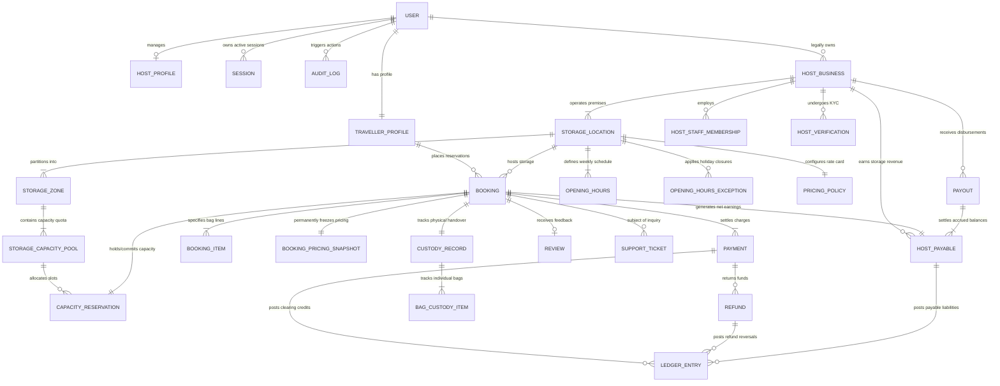

# Conceptual Entity Relationship Diagram (ERD)

**Project:** Global Luggage Storage Marketplace  
**Document Type:** Data Architecture Specification  
**Status:** Approved Phase 0C Baseline  
**Governing Documents:** FRS, Phase 0A Architecture, Phase 0B-D Functional Requirements, Domain Entity Catalogue (`domain-entity-catalogue.md`).

---

## 1. Executive Summary & Purpose

The Conceptual Entity Relationship Diagram represents the high-level business entities, their semantic associations, and structural cardinalities across the Global Luggage Storage Marketplace.

It abstracts away physical database implementation details (such as column data types, foreign key constraint names, and index structures) to focus strictly on domain relationships, aggregate boundaries, and data ownership.

---

## 2. Global Conceptual Domain Model

---

## 3. High-Level Entity Relationship Descriptions

### 3.1 Identity, Users & Staff
- A `USER` represents an authenticated identity. A user may act as a `TRAVELLER_PROFILE` or a `HOST_PROFILE` or both.
- A `HOST_BUSINESS` is owned by a primary `USER` and employs one or more staff members via `HOST_STAFF_MEMBERSHIP`.
- Staff memberships are assigned to specific `STORAGE_LOCATION` records, scoping staff permissions exclusively to designated physical premises.

### 3.2 Locations, Capacity & Schedules
- Each `HOST_BUSINESS` operates one or more `STORAGE_LOCATION` entities.
- A `STORAGE_LOCATION` defines its recurring operational availability via `OPENING_HOURS` (weekly recurring slots) and `OPENING_HOURS_EXCEPTION` (holiday closures / special hours).
- A location partitions its physical storage space into one or more `STORAGE_ZONE` records (e.g., reception locker, secure backroom, locking cage).
- Zones contain `STORAGE_CAPACITY_POOL` records that enforce either shared capacity (total units) or dedicated category limits.
- The `PRICING_POLICY` defines the base rates and category multipliers for the location.

### 3.3 Bookings & Commercial Transactions
- A `TRAVELLER_PROFILE` creates a `BOOKING` targeting a specific `STORAGE_LOCATION`.
- The booking contains one or more `BOOKING_ITEM` lines specifying quantities across standard bag categories (`BAG_SMALL`, `BAG_MEDIUM`, `BAG_LARGE`, `BAG_OVERSIZED`).
- A `CAPACITY_RESERVATION` is atomically held during checkout and permanently committed upon payment confirmation.
- When the booking transitions to `CONFIRMED`, an immutable `BOOKING_PRICING_SNAPSHOT` freezes all financial rates, applied discounts, taxes, and platform commission.

### 3.4 Payments, Custody & Financial Settlement
- A `BOOKING` has one or more `PAYMENT` attempts. Successful payment confirms the booking and triggers the creation of a `CUSTODY_RECORD` with unique QR secret and 6-digit PIN.
- The `CUSTODY_RECORD` tracks physical bag check-in, photographic condition evidence (`BAG_CUSTODY_ITEM`), secure storage, and collection checkout.
- Crucially, **physical custody is decoupled from financial disputes**. Disputed overdue fees do not block luggage return (`BR-035`, `BR-061`).
- Upon successful storage completion, a `HOST_PAYABLE` record accrues net earnings (85% of storage subtotal) in an immutable double-entry `LEDGER_ENTRY`.
- Eligible host payables are settled by Superadmin via batch or individual `PAYOUT` disbursements.
