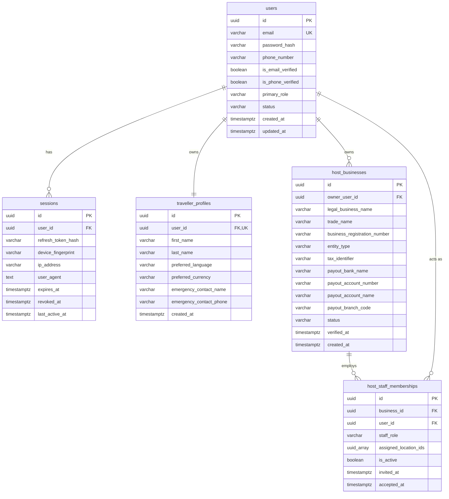
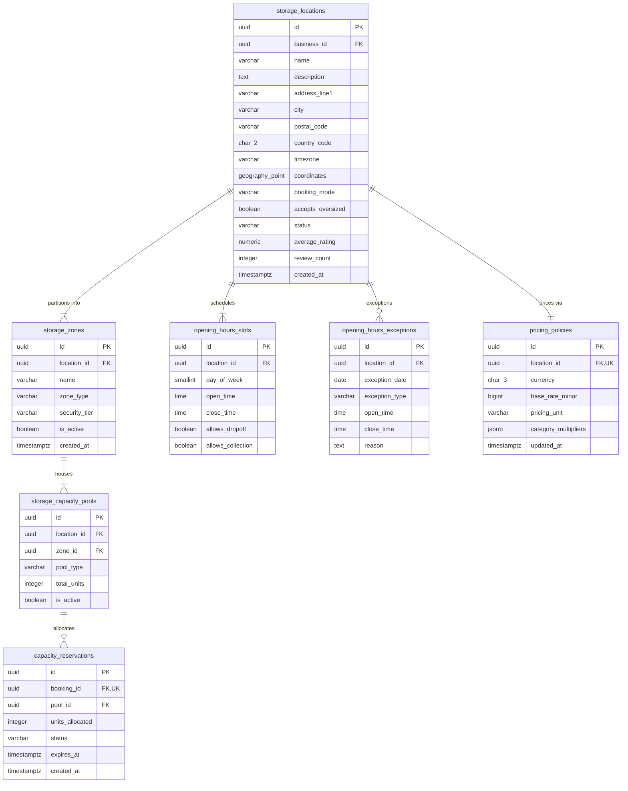
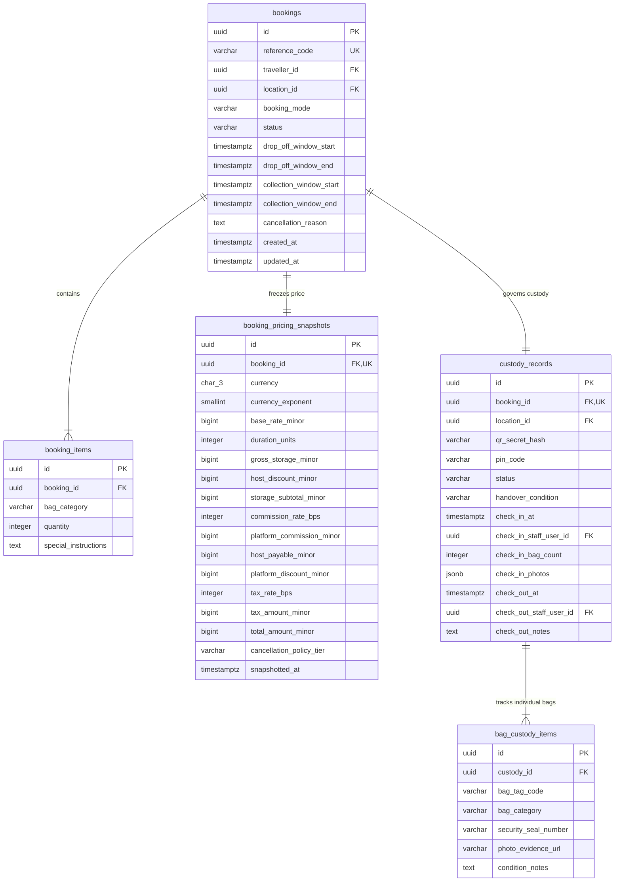
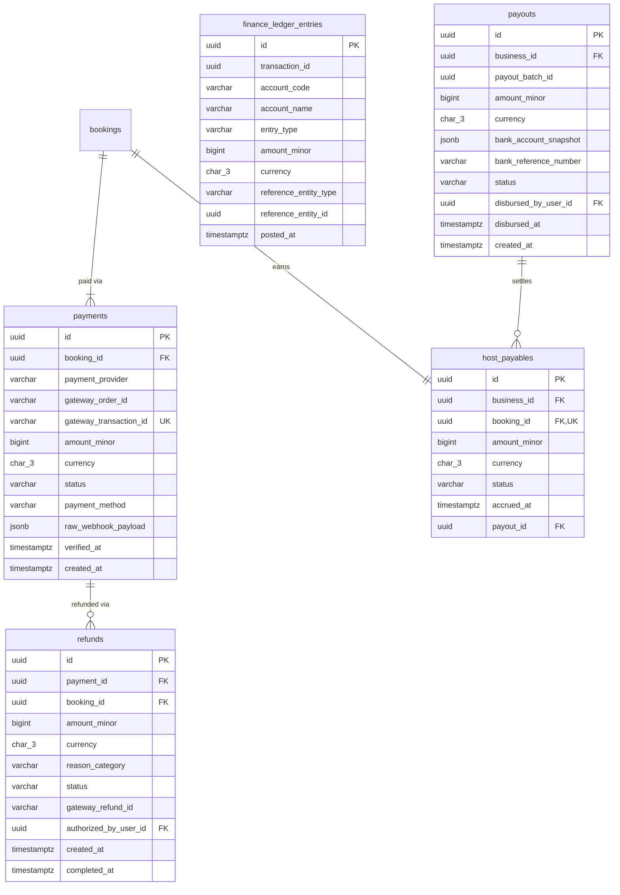
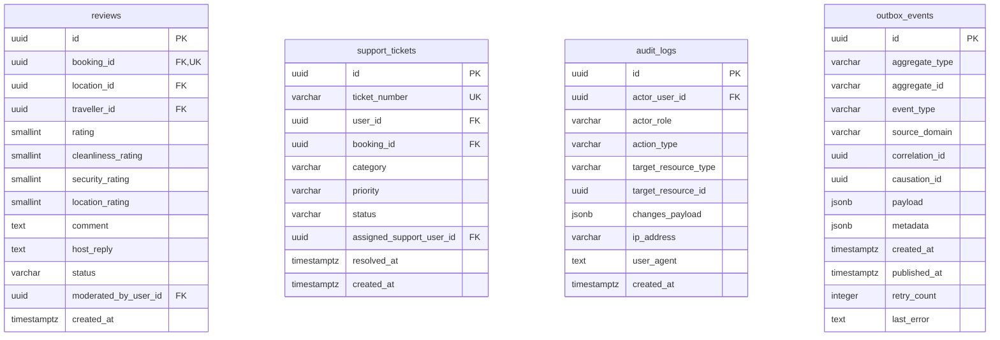

# Logical Entity Relationship Diagram (ERD)

**Project:** Global Luggage Storage Marketplace  
**Document Type:** Data Architecture Specification  
**Status:** Approved Phase 0C Baseline  
**Governing Documents:** FRS, Phase 0A Architecture, ADR-005 (PostgreSQL), Domain Entity Catalogue (`domain-entity-catalogue.md`), Global Data Standards (`global-data-standards.md`).

---

## 1. Executive Summary & Conventions

The Logical ERD models the database structures, foreign key constraints, column types, and cardinalities across the modular monolith.

### Technical Conventions:
- **Primary Keys:** `UUID` (UUIDv7 time-ordered, sortable identifiers).
- **Money Values:** `BIGINT` representing integer minor units (e.g., LKR cents).
- **Timestamps:** `TIMESTAMPTZ` storing UTC instants.
- **Geospatial:** `GEOGRAPHY(Point, 4326)` for WGS 84 coordinates.
- **Enums & States:** `VARCHAR(32)` or `VARCHAR(64)` backed by explicit database check constraints.

---

## 2. Domain Cluster 1: Identity, Accounts & Staff

---

## 3. Domain Cluster 2: Locations, Capacity & Schedules

---

## 4. Domain Cluster 3: Bookings, Snapshots & Custody

---

## 5. Domain Cluster 4: Payments, Refunds, Ledger & Payouts

---

## 6. Domain Cluster 5: Support, Reviews & Audit

