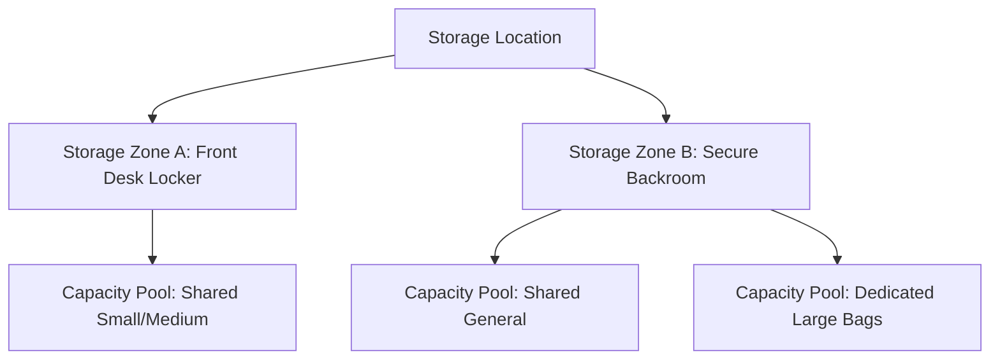

# Capacity and Availability Model

**Project:** Global Luggage Storage Marketplace  
**Document Type:** Domain Architecture Specification  
**Status:** Approved Phase 0C Baseline (Reconciled & Corrected)  
**Governing Documents:** FRS (`FR-005`, `FR-006`, `FR-007`, `FR-008`, `FR-009`, `FR-010`), Phase 0A Architecture, Business Rules Catalogue (`BR-005`–`BR-015`), Assumptions & Open Questions (`OQ-004`, `OQ-006`).

---

## 1. Executive Summary & Purpose

The Capacity and Availability domain is the core operational engine of the luggage-storage marketplace. It governs whether a host location can physically accept a specific volume and type of luggage during a requested arrival and collection time window.

Because host businesses range from small retail kiosks and boutique hotels to high-volume dedicated luggage storage facilities, the capacity model must support:
1. **Multi-Zone Physical Partitioning:** Storage locations can segment their physical space into distinct storage zones (e.g., front desk, secure backroom, locking cage, basement storage).
2. **Standardized Bag Categorization:** 4 standardized bag categories (Small, Medium, Large, Oversized) with host opt-in controls.
3. **Flexible Capacity Allocation:** Support for both shared capacity pools (any combination of bags up to a shared limit) and dedicated category limits.
4. **Time & Schedule Constraints:** Opening hours, holiday closures, collection buffer windows, and advance booking rules.
5. **Deterministic Concurrency Control:** Prevention of double-booking under concurrent load via parent pool row-level locking (`SELECT ... FOR UPDATE`), transaction isolation, and separate multi-stage TTL reservation holds (15m Host SLA vs. 10m Payment SLA).

---

## 2. Bag Categorization Architecture

To eliminate ambiguity between travellers and hosts regarding what constitutes a "bag", the platform defines four standardized bag tiers (`BR-007`, `BR-008`).

| Category Code | Name | Max Dimensions (H + W + D) | Max Weight | Typical Examples | Location Opt-In Policy |
| :--- | :--- | :--- | :--- | :--- | :--- |
| `BAG_SMALL` | Small Bag | Sum of dimensions <= 100 cm | <= 7 kg | Backpack, daypack, laptop bag, shopping tote, handbag | Mandatory (All locations must support) |
| `BAG_MEDIUM`| Standard Luggage | Sum of dimensions <= 140 cm | <= 20 kg | Cabin trolley, standard duffle, medium rolling suitcase | Mandatory (All locations must support) |
| `BAG_LARGE` | Large Suitcase | Sum of dimensions <= 165 cm | <= 32 kg | Check-in luggage, large hard-shell rolling trunk, golf bag | Mandatory (All locations must support) |
| `BAG_OVERSIZED`| Oversized / Special | Dimensions > 165 cm or weight > 32 kg | <= 50 kg | Surfboard, bicycle box, musical instrument case, ski bag | **Strictly Optional (Host must explicitly opt in)** |

### Rules & Invariants:
- **Mandatory Baseline Support:** Every storage location must accept `BAG_SMALL`, `BAG_MEDIUM`, and `BAG_LARGE` unless an entire storage zone is physically restricted by size.
- **Oversized Opt-In (`BR-008`):** Locations only appear in search results for oversized items if `accepts_oversized = TRUE` is explicitly configured on the location profile.

---

## 3. Spatial Partitioning: Locations, Zones & Pools

Storage space is structured hierarchically to reflect physical premises:



### 3.1 Entities and Definitions

1. **`StorageLocation`:** The physical premises (e.g., "Colombo Fort Travel Hub"). Possesses global coordinates, address, opening hours, and default policies.
2. **`StorageZone`:** A distinct physical room, closet, shelf system, or secure locker within the location.
   - `id`: UUID
   - `location_id`: UUID
   - `name`: String (e.g., "Reception Lockers", "Ground Floor Cage")
   - `security_features`: Array of enums (`CCTV`, `PADLOCK`, `STAFF_ONLY`, `CLIMATE_CONTROLLED`)
   - `is_active`: Boolean
3. **`StorageCapacityPool`:** The logical quota boundary defining limits within a zone or across the location.
   - **`SHARED` Pool:** Defines a total unit capacity (e.g., 20 units). Different bag sizes consume defined unit weights (e.g., Small = 1 unit, Medium = 1 unit, Large = 2 units, Oversized = 4 units).
   - **`DEDICATED` Pool:** Dedicated capacity slots exclusively reserved for a specific category (e.g., exactly 5 Large bags).

---

## 4. Multi-Stage Reservation TTL Lifecycle

Capacity reservation holds must accurately reflect operational business rules rather than assuming a universal expiration timer:

```
+-----------------------------------------------------------------------------------------+
| CAPACITY RESERVATION LIFECYCLE                                                          |
+-----------------------------------------------------------------------------------------+
| SCENARIO 1: INSTANT BOOKING                                                             |
| Step 1: Traveller clicks Checkout --> State: HELD_FOR_PAYMENT (TTL: 10 mins)            |
| Step 2: Payment Verified Webhook --> State: CONFIRMED (Permanent allocation)           |
|         OR Timer elapses (10m) --> State: RELEASED (Capacity returned to pool)          |
+-----------------------------------------------------------------------------------------+
| SCENARIO 2: HOST-APPROVAL BOOKING                                                       |
| Step 1: Traveller submits request --> State: HELD_FOR_HOST_APPROVAL (TTL: 15 mins)      |
| Step 2A: Host Rejects OR 15m elapses --> State: RELEASED (Capacity returned to pool)   |
| Step 2B: Host Approves within 15m --> State: HELD_FOR_PAYMENT (New TTL: +10 mins)       |
| Step 3: Traveller pays within 10m --> State: CONFIRMED (Permanent allocation)          |
|         OR Payment timer elapses (10m) --> State: RELEASED (Capacity returned to pool)  |
+-----------------------------------------------------------------------------------------+
```

---

## 5. Concurrency Control, Locking Scope & Overlap Engine

### 5.1 The Concurrency Challenge
Storage capacity is continuous and multi-day. A single booking may span 3 days across multiple opening windows. Concurrently, other travellers may request bookings for overlapping single-day or multi-day intervals.

### 5.2 Concurrency Mechanism Evaluation
1. **Why Not Date-Bucket Row Locking?**
   If the system locked individual date rows (e.g., `storage_capacity_buckets` for Monday, Tuesday, Wednesday), two concurrent multi-day booking transactions could lock dates in opposing order (e.g., Tx 1 locks Mon then Tue; Tx 2 locks Tue then Mon), causing PostgreSQL deadlock aborts.
2. **Approved Locking Strategy: Parent Capacity Pool Serialization**
   To provide bulletproof concurrency safety with zero deadlocks:
   - Every reservation attempt begins by locking the parent **`storage_capacity_pools`** row using `SELECT ... FOR UPDATE` under `READ COMMITTED` transaction isolation.
   - This serializes concurrent booking requests attempting to allocate space in the **same physical pool**.
   - Within the locked transaction, active overlapping holds (`HELD_FOR_HOST_APPROVAL`, `HELD_FOR_PAYMENT`, `CONFIRMED`) are summed across the requested interval $[T_{dropoff}, T_{collection}]$.
   - If `active_units + requested_units <= total_units`, the reservation record is inserted and the transaction commits immediately.
   - Transaction duration is sub-millisecond (in-memory row lock + single index scan + insert), ensuring high throughput even under heavy flash traffic.

### 5.3 Sequence Diagram: Multi-Stage Capacity Hold

```mermaid
sequenceDiagram
    autonumber
    actor Traveller as Traveller Client
    actor Host as Host Partner
    participant API as Booking & Capacity Engine
    participant DB as PostgreSQL (Capacity Pools)
    participant Sweeper as Background TTL Sweeper

    alt Instant Booking Flow
        Traveller->>API: POST /bookings (loc_id, bags, dates)
        API->>DB: BEGIN; SELECT FOR UPDATE ON storage_capacity_pools WHERE id = :pool_id;
        API->>DB: Query active holds overlapping [drop_off, collection]
        alt Capacity OK
            API->>DB: INSERT INTO capacity_reservations (status='HELD_FOR_PAYMENT', expires_at=NOW()+10m)
            API->>DB: COMMIT;
            API-->>Traveller: HTTP 201 (Booking PENDING_PAYMENT)
        else Capacity Exceeded
            API->>DB: ROLLBACK;
            API-->>Traveller: HTTP 409 Conflict (ERR_CAPACITY_EXHAUSTED)
        end
    else Host Approval Flow
        Traveller->>API: POST /bookings (Mode: HOST_APPROVAL)
        API->>DB: BEGIN; SELECT FOR UPDATE ON storage_capacity_pools WHERE id = :pool_id;
        API->>DB: INSERT INTO capacity_reservations (status='HELD_FOR_HOST_APPROVAL', expires_at=NOW()+15m)
        API->>DB: COMMIT;
        API-->>Host: Alert: New Booking Request (15m SLA)
        
        alt Host Approves within 15 Minutes
            Host->>API: POST /bookings/:id/accept
            API->>DB: UPDATE capacity_reservations SET status='HELD_FOR_PAYMENT', expires_at=NOW()+10m
            API-->>Traveller: Alert: Approved! Pay within 10 minutes
        else Host Rejects
            Host->>API: POST /bookings/:id/reject
            API->>DB: UPDATE capacity_reservations SET status='RELEASED'
            API-->>Traveller: Alert: Booking Request Declined
        else Timer Elapses without Decision
            Sweeper->>DB: Scan expired holds (expires_at < NOW())
            Sweeper->>DB: UPDATE capacity_reservations SET status='RELEASED'
            Sweeper->>DB: UPDATE bookings SET status='EXPIRED'
        end
    end
```

---

## 6. Concrete Scenarios & Validation Examples

### Scenario 1: Valid Multi-Bag Reservation (Instant Mode)
- **Location:** "Galle Fort Boutique Locker" (Pool Capacity = 15 units).
- **Current Active Load:** 8 units confirmed, 2 units held for payment (Total Active = 10 units).
- **Request:** Traveller requests 2 Medium bags (2 x 1 = 2 units) and 1 Large bag (1 x 2 = 2 units). Total = 4 units.
- **Evaluation:** $10 + 4 = 14 \le 15 \implies$ **VALID. State: `HELD_FOR_PAYMENT` (10m TTL).**

### Scenario 2: Host Approval Request & Payment Extension
- **Location:** "Kandy Railway Hub" (Host-Approval Mode).
- **Step 1:** Traveller submits request at 10:00:00.
  - Reservation inserted: `status = 'HELD_FOR_HOST_APPROVAL'`, `expires_at = 10:15:00`.
- **Step 2:** Host accepts at 10:07:30 (within 15m window).
  - Reservation updated: `status = 'HELD_FOR_PAYMENT'`, `expires_at = 10:17:30` (+10 mins).
- **Step 3:** Traveller completes payment at 10:12:00.
  - Webhook verified: Reservation updated to `status = 'CONFIRMED'`, `expires_at = NULL`.

### Scenario 3: Host Approval Timeout (15m Expiry)
- **Step 1:** Traveller submits request at 14:00:00 (`expires_at = 14:15:00`).
- **Step 2:** Host does not respond.
- **Step 3:** At 14:15:01, background sweeper locks expired reservation.
  - Reservation transitioned to `status = 'RELEASED'`.
  - Booking transitioned to `status = 'EXPIRED'`.
  - Capacity returned to pool immediately.

### Scenario 4: Schedule Exception (Holiday Closure)
- **Location:** "Colombo Central Kiosk". Regular hours: 08:00 - 20:00.
- **Exception Record:** 2026-12-25 (Christmas Day) -> Type: `CLOSURE`.
- **Request:** Drop-off 2026-12-24 at 15:00, Collection 2026-12-25 at 10:00.
- **Result:** **INVALID. Collection falls on closed holiday. HTTP 422 `ERR_LOCATION_CLOSED_ON_DATE`.**
