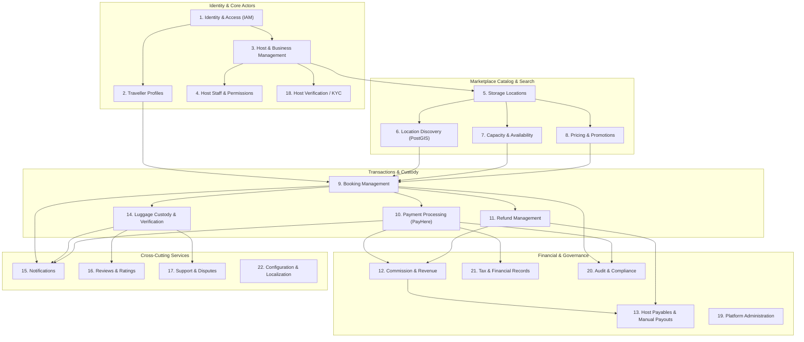

# Bounded Domain Contexts & Module Architecture

**Document Title:** Bounded Domain Contexts & Module Architecture  
**Project:** Global Luggage Storage Marketplace  
**Phase:** Phase 0C — Domain Architecture, Data Model & Master Screen Registry  
**Architectural Model:** Modular Monolith (Fastify + PostgreSQL/PostGIS + Drizzle ORM)  
**Initial Launch Market:** Sri Lanka (Global-Ready Architecture)  
**Status:** Authoritative Architecture Baseline  
**Related Documents:**
- [Domain Entity Catalogue](domain-entity-catalogue.md)
- [Domain Lifecycle Models](domain-lifecycle-models.md)
- [Domain Event Catalogue](domain-event-catalogue.md)
- [Capacity and Availability Model](capacity-and-availability-model.md)
- [Pricing and Financial Domain Model](pricing-and-financial-domain-model.md)
- [Permissions and Access Matrix](permissions-and-access-matrix.md)
- [Normalized Functional Requirements](../../product/functional-requirements.md)

---

## 1. Architectural Strategy & Modular Monolith Principles

To achieve cost-conscious operational efficiency for the initial Sri Lanka launch while ensuring long-term international expansion, the backend architecture is implemented as a **Modular Monolith** within `apps/api`. 

### 1.1 Structural Invariants
1. **Single Deployment Unit, Strict In-Process Boundaries:** All domains execute within a single Fastify Node.js process and persist to a shared PostgreSQL database, but maintain strict modular boundaries enforced via TypeScript module encapsulation and domain services.
2. **Database Schema Partitioning / Table Prefixing:** Each domain owns its dedicated table set (using logical domain table naming or schemas, e.g. `identity_*`, `booking_*`, `custody_*`, `ledger_*`). No domain may execute raw cross-domain SQL joins or mutate another domain's tables directly.
3. **Internal Ports & Service Contracts:** Cross-domain communication occurs strictly through strongly-typed TypeScript domain service interfaces and domain event dispatchers. Direct dependency on another module's internal repository classes is prohibited.
4. **Domain Event Decoupling:** Cross-domain side-effects (e.g. updating ledger balances upon payment, creating notifications upon booking confirmation, unlocking calendar capacity upon cancellation) are orchestrated via an asynchronous, in-process Event Bus (`DomainEventDispatcher`), backed by transactional Outbox persistence in PostgreSQL.
5. **No Premature Microservices:** The domain model is decoupled logically, allowing any domain to be extracted into an independent microservice in future international phases without restructuring business logic.

---

## 2. Bounded Context Map & Dependency Graph

---

## 3. Domain Decomposition & Specification (22 Bounded Modules)

### 3.1 Domain 1: Identity and Access Management (`identity`)
- **Purpose:** Manages core user authentication, credential security, token issuance, and password recovery.
- **Business Responsibilities:**
  - Self-managed user registration via email/password (`OQ-001`).
  - Cryptographic credential hashing using **Argon2id**.
  - Secure session creation, token rotation, and refresh token validation.
  - Email verification tokens and password-reset workflows.
  - Standard OAuth/OIDC adapters for optional future social login (Google, Apple).
- **Owned Entities:** `User`, `UserCredential`, `UserSession`, `AuthTokenRecord`.
- **Primary Commands:** `RegisterUser`, `AuthenticateUser`, `RotateSession`, `RevokeSession`, `RequestPasswordReset`, `ResetPassword`, `VerifyEmail`.
- **Domain Events Emitted:** `UserRegistered`, `UserAuthenticated`, `UserSessionRevoked`, `PasswordChanged`, `EmailVerified`.
- **Invariants:** 
  - Email addresses must be globally unique and stored in normalized lowercase.
  - Passwords must meet minimum entropy requirements and never be stored in plaintext.
  - Refresh tokens are single-use; token reuse triggers immediate family session revocation.
- **Dependencies:** None (foundational context).
- **Data Access & Role Boundaries:** Anonymous visitors, all authenticated actors.
- **External Integrations:** Transactional email provider for verification/reset tokens.
- **Related Requirements & Workflows:** `REQ-TRV-001`, `REQ-HST-001`, `WF-TRV-001`, `BR-001`, `BR-003`.
- **Pending Decisions:** Specific transactional email provider selection (`OQ-019`).

---

### 3.2 Domain 2: Traveller Profiles (`travellers`)
- **Purpose:** Manages consumer traveller identity details, communication preferences, and booking shortcuts.
- **Business Responsibilities:**
  - Maintains personal traveller profile details (full name, phone, avatar).
  - Stores user language preference (BCP 47) and currency display preference.
  - Manages saved favourite storage locations (`FR-13`).
  - Provides traveller dashboard overview aggregating active and past reservations.
- **Owned Entities:** `TravellerProfile`, `TravellerPreference`, `FavouriteLocation`.
- **Primary Commands:** `UpdateTravellerProfile`, `ToggleFavouriteLocation`, `SetTravellerPreferences`.
- **Domain Events Emitted:** `TravellerProfileUpdated`, `LocationFavourited`, `LocationUnfavourited`.
- **Invariants:**
  - A traveller profile is uniquely linked to exactly one `User` entity (`OQ-007`).
  - Telephone numbers must conform to international E.164 format.
- **Dependencies:** `identity`.
- **Data Access & Role Boundaries:** Traveller (`ACT-01`), Platform Support (`ACT-04` - read only), Superadmin (`ACT-05`).
- **External Integrations:** Cloudflare R2 (avatar storage).
- **Related Requirements & Workflows:** `REQ-TRV-002`, `REQ-TRV-024`, `WF-TRV-002`, `BR-002`, `BR-048`, `BR-049`.
- **Pending Decisions:** None.

---

### 3.3 Domain 3: Host and Business Management (`hosts`)
- **Purpose:** Manages commercial host partnerships, business legal entities, and operational profiles.
- **Business Responsibilities:**
  - Maintains host partner profiles, legal entity details, and business registration data (`FR-15`, `FR-16`).
  - Tracks host partner lifecycle status (`APPLIED`, `VERIFIED`, `APPROVED`, `SUSPENDED`, `DEACTIVATED`).
  - Captures host payout bank account details for manual disbursement (`FR-37`, `ADR-009`).
  - Manages multi-location organizational hierarchy for hosts operating multiple stores (`FR-44`).
- **Owned Entities:** `HostProfile`, `HostBusinessEntity`, `HostBankAccount`.
- **Primary Commands:** `SubmitHostApplication`, `UpdateHostBusinessDetails`, `ConfigureHostBankAccount`, `SuspendHost`, `ReactivateHost`.
- **Domain Events Emitted:** `HostApplicationSubmitted`, `HostStatusChanged`, `HostBankAccountUpdated`, `HostSuspended`.
- **Invariants:**
  - A host profile is linked to exactly one `User` entity (`OQ-007`).
  - Host bank details are stored securely and viewable only by the host and Superadmin (`BR-084`).
  - Storage locations cannot become publicly bookable until the host is in `APPROVED` status (`BR-057`).
- **Dependencies:** `identity`, `verification`.
- **Data Access & Role Boundaries:** Host Owner (`ACT-02`), Superadmin (`ACT-05`), Support Staff (`ACT-04` - read-only).
- **External Integrations:** Bank routing validation.
- **Related Requirements & Workflows:** `REQ-HST-001`, `REQ-HST-004`, `REQ-HST-030`, `WF-HST-001`, `WF-HST-016`, `BR-056`, `BR-057`, `BR-084`.
- **Pending Decisions:** Exact mandatory KYC checklist for Sri Lankan individuals vs businesses (`OQ-002`).

---

### 3.4 Domain 4: Host Staff and Permissions (`staff`)
- **Purpose:** Manages employee delegation, store-floor permissions, and staff invitations (`FR-42 Later`).
- **Business Responsibilities:**
  - Generates staff invitation links for host employees.
  - Associates staff accounts with specific storage locations.
  - Enforces role-based operational permissions restricted strictly to store-floor check-in, bag verification, and check-out.
  - Hides sensitive business financial earnings and bank account details from staff members (`BR-095`).
- **Owned Entities:** `HostStaffInvitation`, `HostStaffAssignment`.
- **Primary Commands:** `InviteStaffMember`, `AcceptStaffInvitation`, `RevokeStaffAccess`, `AssignStaffToLocation`.
- **Domain Events Emitted:** `StaffInvited`, `StaffEnrolled`, `StaffAccessRevoked`.
- **Invariants:**
  - Staff permissions are location-scoped; staff cannot view or operate bookings at locations they are not assigned to (`BR-094`).
  - Financial, payout, and bank settings endpoints must reject staff authentication tokens.
- **Dependencies:** `identity`, `hosts`, `locations`.
- **Data Access & Role Boundaries:** Host Owner (`ACT-02`), Host Staff (`ACT-03`).
- **External Integrations:** Transactional email for staff invitations.
- **Related Requirements & Workflows:** `REQ-HST-028`, `WF-STF-001`, `WF-STF-002`, `WF-STF-003`, `BR-094`, `BR-095`.
- **Pending Decisions:** Fine-grained staff permission toggles (`OQ-017`).

---

### 3.5 Domain 5: Storage Locations (`locations`)
- **Purpose:** Manages physical storage facility attributes, security features, photos, and location-level policies.
- **Business Responsibilities:**
  - Manages storage location listings (storefront name, description, address, coordinates, amenities).
  - Handles photo uploads and photo gallery management (`FR-18`).
  - Configures security facilities (CCTV, locked room, 24/7 security guard) and storage restrictions (`FR-20`).
  - Configures location-specific booking modes (`INSTANT` vs `HOST_APPROVAL`) and overdue grace periods (`OQ-004`, `OQ-015`).
  - Enforces address privacy masking for public discovery (`OQ-012`).
- **Owned Entities:** `StorageLocation`, `LocationAmenity`, `LocationPhoto`, `LocationPolicyConfig`.
- **Primary Commands:** `CreateStorageLocation`, `UpdateStorageLocation`, `UploadLocationPhoto`, `ConfigureLocationPolicies`, `SetLocationStatus`.
- **Domain Events Emitted:** `LocationCreated`, `LocationUpdated`, `LocationDeactivated`.
- **Invariants:**
  - A storage location must belong to an approved host before being published (`BR-057`).
  - Every location must specify a valid PostGIS geographical coordinate (`SRID 4326`) within host country boundaries (`BR-061`).
- **Dependencies:** `hosts`.
- **Data Access & Role Boundaries:** Host Owner (`ACT-02`), Guest/Traveller (masked view), Superadmin (`ACT-05`).
- **External Integrations:** Cloudflare R2 (photo storage), MapLibre / Geocoding provider.
- **Related Requirements & Workflows:** `REQ-HST-005`, `REQ-HST-008`, `REQ-TRV-007`, `WF-HST-003`, `BR-010`, `BR-014`, `BR-061`.
- **Pending Decisions:** Map tile & geocoding vendor selection (`OQ-018`).

---

### 3.6 Domain 6: Location Discovery and Geospatial Search (`discovery`)
- **Purpose:** Powers marketplace spatial discovery, coordinate indexing, bounding-box querying, and faceted filtering.
- **Business Responsibilities:**
  - Spatial radius search around traveller GPS coordinates or search destinations using PostGIS `ST_DWithin` (`FR-2`, `FR-3`).
  - Filters results by availability, price range, bag category acceptance, opening hours, and amenities (`FR-4`).
  - Computes spatial distance (km) and travel bearing from search origin (`BR-007`).
  - Applies address privacy sanitization to prevent leaking exact storefront coordinates prior to confirmed booking (`OQ-012`).
- **Owned Entities:** Geospatial search read-models and materialized views (`location_search_index`).
- **Primary Commands:** `ExecuteGeospatialSearch`, `RebuildLocationSearchIndex`.
- **Domain Events Consumed:** `LocationCreated`, `LocationUpdated`, `LocationCapacityChanged`.
- **Invariants:**
  - Public search endpoints must return generalized area coordinates, withholding exact street numbers (`OQ-012`).
  - Only locations in `ACTIVE` status belonging to `APPROVED` hosts are returned in search results.
- **Dependencies:** `locations`, `capacity`, `pricing`.
- **Data Access & Role Boundaries:** Anonymous Visitors, Travellers (`ACT-01`).
- **External Integrations:** PostGIS spatial extension.
- **Related Requirements & Workflows:** `REQ-TRV-003`, `REQ-TRV-004`, `REQ-TRV-005`, `REQ-TRV-006`, `WF-TRV-003`, `WF-TRV-004`, `BR-007`, `BR-008`, `BR-009`, `BR-010`.
- **Pending Decisions:** Jitter radius default confirmation (`OQ-012`).

---

### 3.7 Domain 7: Storage Capacity and Availability (`capacity`)
- **Purpose:** Models physical inventory, operating schedules, capacity pools, and concurrent reservation holds.
- **Business Responsibilities:**
  - Manages weekly operating hours, daily opening/closing schedules, and temporary holiday closures (`FR-19`, `FR-22`).
  - Configures capacity allocations across the four standard bag categories: Small, Medium, Large, Oversized (`OQ-006`).
  - Manages atomic, time-limited capacity reservation holds (`CapacityReservation`) during checkout and host approval (`FR-21`, `REQ-IMPL-004`).
  - Validates inventory availability across the entire scheduled storage interval (`FR-5`).
  - Automatically releases expired reservation holds via background sweeping workers.
- **Owned Entities:** `OperatingSchedule`, `ScheduleException`, `StorageCapacityPool`, `BagCategoryConfig`, `CapacityReservation`.
- **Primary Commands:** `ConfigureOperatingHours`, `SetCapacityAllocation`, `AcquireCapacityHold`, `ConfirmCapacityReservation`, `ReleaseCapacityHold`.
- **Domain Events Emitted:** `CapacityHoldAcquired`, `CapacityReserved`, `CapacityHoldReleased`, `CapacityExhausted`.
- **Invariants:**
  - Drop-off and collection timestamps must fall strictly within the location's open operating windows (`BR-017`).
  - Sum of active bookings and active reservation holds must never exceed configured capacity for any bag category or pool (`BR-066`).
  - Oversized items can only be booked at locations where oversized capacity is explicitly enabled (`OQ-006`, `BR-018`).
- **Dependencies:** `locations`.
- **Data Access & Role Boundaries:** Host Owner (`ACT-02`), Booking Engine (`internal`).
- **External Integrations:** None.
- **Related Requirements & Workflows:** `REQ-TRV-008`, `REQ-HST-006`, `REQ-HST-007`, `REQ-IMPL-004`, `WF-HST-004`, `WF-HST-005`, `WF-HST-006`, `BR-016`, `BR-017`, `BR-018`, `BR-024`, `BR-066`, `BR-067`.
- **Pending Decisions:** None.

---

### 3.8 Domain 8: Pricing and Promotions (`pricing`)
- **Purpose:** Manages storage rate policies, duration multipliers, itemized quotes, and promotional discounts.
- **Business Responsibilities:**
  - Computes server-authoritative price breakdowns based on bag categories and storage duration (`FR-5`, `FR-23`).
  - Generates tamper-proof, cryptographic price quote tokens with short expiration TTLs (`BR-024`).
  - Validates and applies platform promotional discount codes (`FR -13 Promo Codes`).
  - Enforces discount funding ownership rules: platform-funded vs. host-funded vs. shared (`OQ-005`, `BR-021`).
  - Produces immutable itemized calculation snapshots (base price, duration multiplier, promo deduction, tax, platform commission).
- **Owned Entities:** `LocationPriceRule`, `PromoCampaign`, `PromoCode`, `PriceQuoteSnapshot`.
- **Primary Commands:** `SetLocationPricing`, `GeneratePriceQuote`, `ApplyPromoCode`, `SnapshotPriceBreakdown`.
- **Domain Events Emitted:** `PriceQuoteGenerated`, `PromoCodeApplied`.
- **Invariants:**
  - All monetary values are calculated and stored strictly in **integer minor units** (`LKR`, exponent = 2) (`OQ-008`, `BR-025`).
  - Client-submitted prices are strictly prohibited; pricing is computed exclusively on the server (`BR-020`).
  - Platform-funded promotions must never silently reduce host payout earnings (`OQ-005`).
- **Dependencies:** `locations`, `capacity`.
- **Data Access & Role Boundaries:** Travellers (`ACT-01`), Host Owners (`ACT-02`), Superadmin (`ACT-05`).
- **External Integrations:** None.
- **Related Requirements & Workflows:** `REQ-TRV-009`, `REQ-TRV-025`, `REQ-HST-009`, `REQ-IMPL-003`, `WF-TRV-005`, `BR-020`, `BR-021`, `BR-022`, `BR-024`.
- **Pending Decisions:** None.

---

### 3.9 Domain 9: Booking Management (`bookings`)
- **Purpose:** Core transaction orchestrator managing the end-to-end reservation lifecycle across both booking modes.
- **Business Responsibilities:**
  - Creates and tracks bookings across their full state lifecycle (`Instant` and `Host Approval` modes) (`OQ-004`).
  - Coordinates with `capacity` to hold inventory and `payments` to verify transaction completion.
  - Enforces host approval SLA timers (default 15 minutes) and post-approval traveller payment timers (default 10 minutes) (`OQ-004`).
  - Issues secure custody access tokens (QR code and backup numeric PIN) upon confirmation (`FR-7`, `FR-8`).
  - Preserves immutable historical snapshots of pricing, commission, cancellation terms, and bag manifests.
- **Owned Entities:** `Booking`, `BookingItem`, `BookingStateHistory`, `BookingAccessPass`.
- **Primary Commands:** `CreateInstantBooking`, `SubmitApprovalBookingRequest`, `AcceptBookingRequest`, `RejectBookingRequest`, `ConfirmBooking`, `CancelBooking`, `CompleteBooking`.
- **Domain Events Emitted:** `BookingRequested`, `BookingConfirmed`, `BookingRejected`, `BookingCancelled`, `BookingExpired`, `BookingCompleted`.
- **Invariants:**
  - Instant bookings transition to `CONFIRMED` only upon verified payment webhook receipt (`BR-026`).
  - Host-approval bookings capture zero funds until host accepts the request (`OQ-004`).
  - Every booking stores an immutable snapshot of all commercial, commission, and policy parameters active at reservation time (`REQ-IMPL-003`).
- **Dependencies:** `travellers`, `hosts`, `locations`, `capacity`, `pricing`, `identity`.
- **Data Access & Role Boundaries:** Traveller (`ACT-01`), Host Owner (`ACT-02`), Host Staff (`ACT-03`), Superadmin (`ACT-05`).
- **External Integrations:** None.
- **Related Requirements & Workflows:** `REQ-TRV-010`, `REQ-TRV-012`, `REQ-TRV-016`, `REQ-TRV-017`, `REQ-HST-010`, `REQ-HST-011`, `REQ-HST-012`, `REQ-HST-019`, `REQ-IMPL-005`, `WF-TRV-006`, `WF-TRV-007`, `WF-HST-008`, `BR-023`, `BR-026`, `BR-069`, `BR-070`.
- **Pending Decisions:** None.

---

### 3.10 Domain 10: Payment Processing (`payments`)
- **Purpose:** Manages online payment intents, gateway handoffs, webhook signature verification, and transaction idempotency.
- **Business Responsibilities:**
  - Manages payment transactions through a decoupled provider port (`PaymentGatewayPort`) (`REQ-IMPL-007`).
  - Integrates PayHere gateway for LKR checkout, generating pre-signed form parameters and merchant hashes (`ADR-008`).
  - Processes server-to-server webhook notifications with cryptographic MD5 signature verification and idempotency keys (`REQ-IMPL-006`).
  - Reconciles payment statuses (`PENDING`, `SUCCEEDED`, `FAILED`, `EXPIRED`).
  - Emits confirmed payment events to trigger booking confirmation and ledger entries.
- **Owned Entities:** `PaymentTransaction`, `PaymentWebhookLog`, `PaymentIdempotencyKey`.
- **Primary Commands:** `InitiatePayment`, `ProcessPaymentWebhook`, `ExpirePayment`.
- **Domain Events Emitted:** `PaymentInitiated`, `PaymentSucceeded`, `PaymentFailed`.
- **Invariants:**
  - A client-side redirect or browser return URL is **never** accepted as proof of payment; only authenticated server-to-server webhook confirmations transition payment status to `SUCCEEDED` (`BR-026`).
  - Webhook processing must be strictly idempotent; duplicate deliveries must not credit balances or confirm bookings multiple times (`REQ-IMPL-006`).
  - Monetary values stored strictly as integer minor units (`LKR`) (`OQ-008`, `BR-025`).
- **Dependencies:** `bookings`.
- **Data Access & Role Boundaries:** Backend System (`internal`), Traveller (`ACT-01`), Superadmin (`ACT-05`).
- **External Integrations:** PayHere Payment Gateway (conditional on written marketplace approval `OQ-003`).
- **Related Requirements & Workflows:** `REQ-TRV-011`, `REQ-IMPL-006`, `REQ-IMPL-007`, `WF-TRV-006`, `BR-025`, `BR-026`, `BR-027`, `BR-028`.
- **Pending Decisions:** **Mandatory Launch Gate Blocker:** Written approval from PayHere for marketplace collection model (`OQ-003`).

---

### 3.11 Domain 11: Refund Management (`refunds`)
- **Purpose:** Manages customer refund eligibility, authorization, execution tracking, and financial reversal records.
- **Business Responsibilities:**
  - Evaluates cancellation requests against approved customer cancellation policy tiers (`OQ-009`, `BR-035`).
  - Enforces the explicit **7-stage refund lifecycle** (`REQUESTED` $\rightarrow$ `AUTHORIZED` $\rightarrow$ `INITIATED` $\rightarrow$ `PROCESSING` $\rightarrow$ `SUCCEEDED` / `FAILED` / `MANUAL_REVIEW_REQUIRED`) (`OQ-013`, `BR-036`).
  - Executes refunds through the gateway adapter or records manual refund portal execution.
  - Handles Superadmin exception overrides for duplicate charges, safety incidents, or platform errors (`OQ-009`).
  - Reconciles refund confirmations with the financial ledger.
- **Owned Entities:** `RefundRecord`, `RefundAuditEntry`.
- **Primary Commands:** `RequestRefund`, `AuthorizeRefund`, `RejectRefund`, `InitiateRefund`, `RecordRefundSuccess`, `RecordRefundFailure`, `FlagRefundManualReview`.
- **Domain Events Emitted:** `RefundRequested`, `RefundAuthorized`, `RefundInitiated`, `RefundSucceeded`, `RefundFailed`.
- **Invariants:**
  - A refund request is never marked as completed upon submission; it must complete the full state lifecycle (`BR-036`).
  - A host cannot retroactively alter cancellation policy rules on confirmed bookings (`BR-035`).
  - Refund transactions must reverse platform commission and host payable balances proportionally in the ledger (`REQ-IMPL-011`).
- **Dependencies:** `bookings`, `payments`, `revenue`.
- **Data Access & Role Boundaries:** Traveller (`ACT-01`), Superadmin (`ACT-05`). Support Staff (`ACT-04` - cannot authorize refunds `OQ-011`).
- **External Integrations:** PayHere Refund API / Portal.
- **Related Requirements & Workflows:** `REQ-TRV-018`, `REQ-TRV-019`, `REQ-HST-020`, `REQ-IMPL-008`, `WF-TRV-012`, `WF-ADM-004`, `BR-035`, `BR-036`, `BR-037`.
- **Pending Decisions:** Payment gateway automated refund API capabilities, timing, and fee deduction confirmation (`OQ-013`).

---

### 3.12 Domain 12: Commission and Platform Revenue (`revenue`)
- **Purpose:** Calculates platform take-rates, promotional deductions, and platform earnings.
- **Business Responsibilities:**
  - Calculates platform commission strictly against eligible storage service subtotals, starting at 15% baseline (`OQ-005`, `BR-020`).
  - Excludes statutory taxes from the commission calculation base (`OQ-005`).
  - Absorbs payment processing gateway fees within platform operating costs (not charged to hosts in MVP) (`OQ-005`).
  - Enforces promotional discount absorption rules (platform-funded vs host-funded) (`BR-021`).
  - Maintains immutable revenue transaction entries for financial auditability.
- **Owned Entities:** `CommissionPolicy`, `CommissionRecord`, `RevenueTransaction`.
- **Primary Commands:** `CalculateBookingCommission`, `RecordRevenueTransaction`, `AdjustCommissionForRefund`.
- **Domain Events Emitted:** `CommissionCalculated`, `CommissionReversed`.
- **Invariants:**
  - Commission is calculated on storage subtotal after host-funded discounts and before platform-funded promotions (`OQ-005`).
  - Integer minor-unit arithmetic must guarantee zero rounding leakage.
- **Dependencies:** `pricing`, `bookings`, `payments`.
- **Data Access & Role Boundaries:** Backend System (`internal`), Superadmin (`ACT-05`).
- **External Integrations:** None.
- **Related Requirements & Workflows:** `REQ-HST-022`, `REQ-IMPL-011`, `BR-020`, `BR-021`.
- **Pending Decisions:** Commercial commission rates revisit before international expansion (`OQ-005`).

---

### 3.13 Domain 13: Host Payables and Manual Payouts (`payouts`)
- **Purpose:** Tracks host net earnings, maintains payable ledger balances, and manages Superadmin manual bank payout execution.
- **Business Responsibilities:**
  - Records net host earnings as payable liabilities upon verified booking payment (`FR-36`, `FR-37`).
  - Maintains running host payable balances and monthly earnings summaries (`FR-38`).
  - Provides Superadmin payout processing interface with bank account details, reference tracking, and disbursement logging (`ADR-009`).
  - Generates downloadable host payout settlement statements (`REQ-HST-024`).
- **Owned Entities:** `HostPayableBalance`, `HostPayableEntry`, `PayoutBatch`, `PayoutRecord`.
- **Primary Commands:** `AccrueHostPayable`, `InitiatePayoutBatch`, `RecordPayoutDisbursement`, `CancelPayoutRecord`.
- **Domain Events Emitted:** `HostPayableAccrued`, `PayoutDisbursed`, `PayoutCancelled`.
- **Invariants:**
  - MVP payouts are processed manually by Superadmin via corporate bank transfer; provider automated split payouts are not assumed (`ADR-009`, `OQ-003`).
  - Every payout record must capture amount, currency (`LKR`), date, recipient bank account, external bank transfer reference, and authorizing Superadmin ID (`BR-083`, `BR-084`).
  - Support Staff are strictly prohibited from initiating or executing payouts (`OQ-011`, `BR-096`).
- **Dependencies:** `hosts`, `bookings`, `revenue`, `payments`.
- **Data Access & Role Boundaries:** Host Owner (`ACT-02` - view own earnings), Superadmin (`ACT-05` - authorize and execute).
- **External Integrations:** Corporate banking portal (manual execution).
- **Related Requirements & Workflows:** `REQ-HST-022`, `REQ-HST-023`, `REQ-HST-024`, `REQ-IMPL-011`, `WF-HST-015`, `WF-ADM-003`, `BR-082`, `BR-083`, `BR-084`, `BR-085`.
- **Pending Decisions:** Invoicing & withholding tax requirements on host payouts (`OQ-010`).

---

### 3.14 Domain 14: Luggage Custody and Handover (`custody`)
- **Purpose:** Governs physical custody transfer, verification tokens, bag count reconciliation, check-in photo evidence, and overdue tracking.
- **Business Responsibilities:**
  - Verifies booking check-in via dynamic QR code or backup numeric PIN (`FR-27`, `OQ-014`).
  - Enforces mandatory physical bag count and category reconciliation at check-in and check-out (`FR-28`, `FR-30`, `OQ-014`).
  - Captures optional or mandatory luggage photographs at check-in, uploaded to private Cloudflare R2 storage (`FR-29`, `OQ-014`).
  - Generates collection release tokens and executes bag return verification (`FR-31`).
  - Detects overdue luggage when collection deadline + grace period passes (`FR-32`).
  - Submits in-app overdue fee payment requests (`OQ-015`).
  - **Decoupled Custody Guarantee:** Strictly decouples physical luggage return from overdue fee settlement, guaranteeing travellers can retrieve their property even if fees are unpaid or disputed (`OQ-015`, `BR-079`).
- **Owned Entities:** `CustodyRecord`, `CustodyBagItem`, `CustodyEvidencePhoto`, `OverdueChargeRecord`.
- **Primary Commands:** `VerifyCheckInToken`, `ReconcileBagCount`, `UploadCustodyPhoto`, `ConfirmCheckIn`, `VerifyCheckOutToken`, `ConfirmCheckOut`, `FlagBookingOverdue`, `RequestOverduePayment`.
- **Domain Events Emitted:** `CustodyTransferredToCheckIn`, `CustodyTransferredToCheckOut`, `LuggageFlaggedOverdue`, `OverduePaymentRequested`.
- **Invariants:**
  - Custody handoff requires verified QR/PIN tokens; brute-force attempts are rate-limited (`BR-071`).
  - Check-in/check-out cannot complete if physical bag counts mismatch reservation without an authorized exception record (`BR-072`).
  - **No Possessory Lien:** Overdue fee disputes or non-payment must never block physical luggage return (`OQ-015`, `BR-079`).
- **Dependencies:** `bookings`, `locations`.
- **Data Access & Role Boundaries:** Traveller (`ACT-01`), Host Owner (`ACT-02`), Host Staff (`ACT-03`), Superadmin (`ACT-05`).
- **External Integrations:** Cloudflare R2 (evidence storage), mobile camera (`expo-camera`).
- **Related Requirements & Workflows:** `REQ-TRV-014`, `REQ-TRV-015`, `REQ-HST-013`, `REQ-HST-014`, `REQ-HST-015`, `REQ-HST-016`, `REQ-HST-017`, `REQ-HST-018`, `WF-TRV-009`, `WF-TRV-011`, `WF-HST-009`, `WF-HST-011`, `WF-HST-012`, `BR-071`, `BR-072`, `BR-073`, `BR-074`, `BR-076`, `BR-077`, `BR-078`, `BR-079`.
- **Pending Decisions:** None.

---

### 3.15 Domain 15: Notifications (`notifications`)
- **Purpose:** Manages multichannel transactional message dispatch (push notifications, SMS, transactional email).
- **Business Responsibilities:**
  - Dispatches booking confirmation passes with QR/PIN codes (`FR-7`, `FR-11`).
  - Sends immediate push/SMS alerts to hosts for incoming approval booking requests (`REQ-HST-021`, `OQ-004`).
  - Sends collection reminders before collection deadlines (`FR-11`).
  - Sends overdue luggage warning notifications to both travellers and hosts (`FR-32`).
  - Manages user device notification tokens (`expo-notifications`) and notification preference settings.
- **Owned Entities:** `NotificationRecord`, `NotificationDeviceToken`, `NotificationTemplate`.
- **Primary Commands:** `QueueNotification`, `DispatchNotification`, `RegisterDeviceToken`.
- **Domain Events Consumed:** `BookingConfirmed`, `BookingRequested`, `LuggageFlaggedOverdue`, `PayoutDisbursed`.
- **Invariants:**
  - Critical transactional notifications (confirmations, security alerts, overdue warnings) cannot be disabled by marketing opt-outs (`BR-042`).
  - Notification dispatch failures must be queued with exponential backoff retries (`BR-043`).
- **Dependencies:** `identity`, `bookings`.
- **Data Access & Role Boundaries:** Backend System (`internal`), Travellers, Hosts.
- **External Integrations:** Expo Push Service, Transactional Email Provider, Sri Lanka SMS Gateway.
- **Related Requirements & Workflows:** `REQ-TRV-012`, `REQ-TRV-020`, `REQ-HST-021`, `WF-TRV-010`, `BR-042`, `BR-043`, `BR-044`, `BR-045`.
- **Pending Decisions:** SMS gateway selection for `+94` (`OQ-020`), transactional email provider (`OQ-019`).

---

### 3.16 Domain 16: Reviews and Feedback (`reviews`)
- **Purpose:** Manages post-collection host ratings, written reviews, moderation, and public reputation metrics.
- **Business Responsibilities:**
  - Allows travellers with completed bookings to submit 1-to-5 star ratings and written reviews for storage locations (`FR-12`, `FR-24`).
  - Computes and caches average ratings and review counts per storage location (`BR-051`).
  - Provides a moderation queue for Superadmin to review reported abusive or fraudulent reviews (`REQ-IMPL-009`).
  - Supports private application feedback separation from public host storefront ratings (`FR -12`, `OQ-016`).
- **Owned Entities:** `HostReview`, `ReviewReport`, `AppFeedback`.
- **Primary Commands:** `SubmitHostReview`, `SubmitAppFeedback`, `ReportReview`, `ModerateReview`.
- **Domain Events Emitted:** `ReviewSubmitted`, `ReviewModerated`.
- **Invariants:**
  - Only authenticated travellers who have a `COMPLETED` booking at that specific location may submit a review (`BR-050`).
  - Exactly one review is permitted per completed booking reservation.
- **Dependencies:** `bookings`, `locations`, `travellers`.
- **Data Access & Role Boundaries:** Traveller (`ACT-01`), Host Owner (`ACT-02`), Superadmin (`ACT-05`).
- **External Integrations:** None.
- **Related Requirements & Workflows:** `REQ-TRV-021`, `REQ-TRV-022`, `REQ-HST-025`, `REQ-IMPL-009`, `WF-TRV-013`, `WF-SUP-004`, `BR-050`, `BR-051`, `BR-052`, `BR-053`.
- **Pending Decisions:** None.

---

### 3.17 Domain 17: Support and Disputes (`support`)
- **Purpose:** Manages user help tickets, luggage incident reports, and operational dispute investigations (`FR -12`, `FR-40`, `FR-41`).
- **Business Responsibilities:**
  - Provides ticket intake channels for booking issues, account inquiries, and host support (`OQ-016`).
  - Manages formal luggage incident reporting (lost, stolen, damaged, or abandoned luggage) (`FR-41`).
  - Places immediate legal holds on booking audit logs and check-in photos upon incident creation (`REQ-IMPL-010`).
  - Routes support tickets to Support Staff (`ACT-04`) for triage and escalates refund/payout actions to Superadmin (`ACT-05`) (`OQ-011`).
- **Owned Entities:** `SupportTicket`, `TicketMessage`, `LuggageIncidentReport`, `IncidentLegalHold`.
- **Primary Commands:** `CreateSupportTicket`, `AssignSupportTicket`, `AddTicketMessage`, `CreateIncidentReport`, `ResolveIncidentReport`.
- **Domain Events Emitted:** `SupportTicketCreated`, `IncidentReported`, `LegalHoldApplied`.
- **Invariants:**
  - When an incident report is filed, related custody evidence photos and booking logs are permanently locked against deletion (`REQ-IMPL-010`).
  - Support staff can investigate and recommend resolutions, but cannot authorize financial disbursements directly (`OQ-011`, `BR-096`).
- **Dependencies:** `bookings`, `custody`, `identity`.
- **Data Access & Role Boundaries:** Travellers, Hosts, Support Staff (`ACT-04`), Superadmin (`ACT-05`).
- **External Integrations:** Transactional email / ticketing notifications.
- **Related Requirements & Workflows:** `REQ-TRV-023`, `REQ-HST-026`, `REQ-HST-027`, `REQ-IMPL-010`, `WF-TRV-014`, `WF-SUP-002`, `WF-SUP-003`, `BR-090`, `BR-091`, `BR-092`, `BR-093`.
- **Pending Decisions:** Operational support queue separation confirmation (`OQ-016`).

---

### 3.18 Domain 18: Host Verification / KYC (`verification`)
- **Purpose:** Manages partner identity verification, business document collection, and compliance review workflows (`FR-16`, `FR-17`).
- **Business Responsibilities:**
  - Collects national identity documents (NIC / Passport) for individuals and business registration certificates (BRC) for commercial entities (`FR-16`).
  - Stores identity documents in private, encrypted Cloudflare R2 object storage.
  - Provides administrative KYC verification review queue.
  - Implements host re-verification triggers when legal entity name or ownership details are modified post-approval (`REQ-IMPL-001`).
- **Owned Entities:** `HostKycSubmission`, `HostIdentityDocument`, `KycVerificationAudit`.
- **Primary Commands:** `SubmitKycDocuments`, `ReviewKycSubmission`, `ApproveHostKyc`, `RejectHostKyc`, `TriggerReVerification`.
- **Domain Events Emitted:** `KycSubmitted`, `KycApproved`, `KycRejected`, `ReVerificationTriggered`.
- **Invariants:**
  - Host identity documents are classified as sensitive PII and accessible only to authorized administrative roles (`BR-058`).
  - Support Staff can review and recommend KYC approval, but final host activation is reserved for Superadmin (`OQ-011`, `BR-096`, `BR-097`).
- **Dependencies:** `hosts`, `identity`.
- **Data Access & Role Boundaries:** Host Owner (`ACT-02`), Platform Support (`ACT-04` - review only), Superadmin (`ACT-05` - final approval).
- **External Integrations:** Cloudflare R2 (encrypted private bucket).
- **Related Requirements & Workflows:** `REQ-HST-002`, `REQ-HST-003`, `REQ-IMPL-001`, `WF-HST-002`, `WF-SUP-001`, `WF-ADM-001`, `BR-058`, `BR-059`, `BR-060`.
- **Pending Decisions:** Exact document checklist for Sri Lankan individuals vs companies (`OQ-002`).

---

### 3.19 Domain 19: Platform Administration (`admin`)
- **Purpose:** High-level platform governance, role permission assignment, global settings, and emergency system overrides.
- **Business Responsibilities:**
  - Manages administrative user accounts and RBAC permission assignments (`FR-44`).
  - Provides platform-wide emergency stop-booking controls and host suspension tools.
  - Configures platform promotional campaigns and default commission policies (`OQ-005`, `OQ-011`).
  - Oversees financial reconciliation summaries and operational performance metrics.
- **Owned Entities:** `AdminUser`, `RolePermission`, `PlatformSettingRecord`.
- **Primary Commands:** `AssignRolePermissions`, `UpdatePlatformSetting`, `TriggerEmergencyStopBooking`.
- **Domain Events Emitted:** `PlatformSettingUpdated`, `EmergencyStopBookingTriggered`.
- **Invariants:**
  - Every privileged administrative mutation must record an immutable audit entry with actor, timestamp, and justification (`BR-098`, `BR-099`).
  - Superadmin role permissions cannot be assigned or altered by non-superadmin accounts.
- **Dependencies:** `identity`, `audit`.
- **Data Access & Role Boundaries:** Superadmin (`ACT-05`) exclusively.
- **External Integrations:** None.
- **Related Requirements & Workflows:** `REQ-HST-029`, `WF-ADM-001`, `WF-ADM-002`, `BR-097`, `BR-098`, `BR-099`.
- **Pending Decisions:** None.

---

### 3.20 Domain 20: Audit and Compliance (`audit`)
- **Purpose:** Centralized, append-only security and operational audit logging across all domains.
- **Business Responsibilities:**
  - Captures immutable audit records for authentication events, role escalations, host approvals, refunds, payouts, and ledger mutations.
  - Preserves before-and-after state snapshots for compliance and dispute resolution.
  - Provides administrative search and filter tools across system audit logs.
- **Owned Entities:** `SystemAuditLogEntry`, `SecurityEventRecord`.
- **Primary Commands:** `RecordAuditLog`, `QueryAuditLogs`.
- **Domain Events Consumed:** All domain mutation events.
- **Invariants:**
  - Audit log tables are strictly append-only; update and delete operations are rejected at the database permission level.
  - Audit logs must be retained in accordance with statutory compliance periods (`BR-080`).
- **Dependencies:** None (autonomous logging port).
- **Data Access & Role Boundaries:** Superadmin (`ACT-05`), Compliance Officers.
- **External Integrations:** None.
- **Related Requirements & Workflows:** `REQ-IMPL-010`, `WF-ADM-005`, `BR-098`, `BR-099`.
- **Pending Decisions:** None.

---

### 3.21 Domain 21: Tax and Financial Records (`finance`)
- **Purpose:** Manages the immutable double-entry financial ledger, tax snapshots, and financial statements (`OQ-010`, `REQ-IMPL-011`).
- **Business Responsibilities:**
  - Implements an append-only, double-entry financial ledger tracking gross payments, platform commissions, gateway fee allocations, and host payable accruals (`REQ-IMPL-011`).
  - Implements the **four-layer tax architecture**: Layer A (platform capability), Layer B (configured jurisdiction rules), Layer C (legal classification), Layer D (launch compliance gate) (`OQ-010`).
  - Generates immutable tax calculation snapshots on bookings and invoices.
  - Produces monthly host billing statements and tax deduction records (`REQ-HST-024`).
- **Owned Entities:** `LedgerAccount`, `LedgerJournalEntry`, `LedgerTransactionLine`, `TaxSnapshotRecord`.
- **Primary Commands:** `PostJournalEntry`, `SnapshotTaxCalculation`, `GenerateMonthlyStatement`.
- **Domain Events Consumed:** `PaymentSucceeded`, `RefundSucceeded`, `PayoutDisbursed`.
- **Invariants:**
  - Sum of debits must exactly equal sum of credits for every posted journal entry ($\sum \text{Debits} \equiv \sum \text{Credits}$) (`REQ-IMPL-011`).
  - Posted ledger journal lines cannot be updated or deleted; reversals require explicit offsetting entries.
  - Monetary values stored strictly as integer minor units (`LKR`, exponent = 2) (`OQ-008`).
- **Dependencies:** `payments`, `revenue`, `payouts`, `refunds`.
- **Data Access & Role Boundaries:** Superadmin (`ACT-05`), Financial Auditors.
- **External Integrations:** None.
- **Related Requirements & Workflows:** `REQ-HST-024`, `REQ-IMPL-011`, `BR-040`, `BR-041`, `BR-086`.
- **Pending Decisions:** **Mandatory Launch Gate:** Professional Sri Lankan legal and tax advisory on agency vs principal supply and VAT/SSCL liability (`OQ-010`).

---

### 3.22 Domain 22: Configuration and Localization (`localization`)
- **Purpose:** Manages platform global configuration, multi-language dictionaries, multi-currency tables, and country presets (`FR-14`).
- **Business Responsibilities:**
  - Maintains ISO 3166 country registry, default launch country preset (`LK`), and national phone dialing codes (`+94`).
  - Maintains ISO 4217 currency registry, specifying currency codes, minor unit exponents, and symbol display rules (`OQ-008`).
  - Manages internationalization translation dictionaries (BCP 47 language codes, e.g. `en`, `si`, `ta`).
  - Configures timezone definitions (IANA timezone `Asia/Colombo`).
- **Owned Entities:** `CountryConfig`, `CurrencyConfig`, `TranslationDictionary`, `LocalePreference`.
- **Primary Commands:** `UpdateCountryConfig`, `SetPlatformDefaultCurrency`, `SyncTranslationDictionary`.
- **Domain Events Emitted:** `LocalizationUpdated`.
- **Invariants:**
  - Initial launch enforces `LK` as sole country and `LKR` as sole booking/settlement currency (`OQ-008`, `BR-025`).
  - Currency exponent must follow ISO 4217 standard dynamically (no hardcoded two-decimal assumption) (`OQ-008`).
- **Dependencies:** None.
- **Data Access & Role Boundaries:** All actors (read-only), Superadmin (`ACT-05` - management).
- **External Integrations:** Translation pipeline.
- **Related Requirements & Workflows:** `REQ-TRV-026`, `REQ-TRV-027`, `WF-ADM-006`, `BR-054`, `BR-055`.
- **Pending Decisions:** Multi-currency activation deferred post-launch (`OQ-008`).

---

## 4. Cross-Domain Interaction Invariants & Guardrails

To maintain loose coupling and protect domain boundaries, the following architectural invariants are enforced:

| Inter-Domain Boundary | Interaction Protocol | Decoupling Mechanism | Strict Invariant |
| :--- | :--- | :--- | :--- |
| **Booking $\rightarrow$ Capacity** | Command via Domain Service (`CapacityService.hold`) | Atomic DB Row Lock (`SELECT FOR UPDATE`) | Concurrent requests for the same slot must never over-allocate capacity. Hold has 15-min TTL. |
| **Booking $\rightarrow$ Payment** | Event (`BookingRequested`) & Webhook Handler | Webhook Signature Check & Idempotency Key | Booking transitions to `CONFIRMED` only upon verified payment webhook receipt (`BR-026`). |
| **Custody $\rightarrow$ Booking** | Command via Custody Port (`CustodyService.checkIn`) | Status Guard in State Machine | Custody cannot be initiated unless booking status is `CONFIRMED`. |
| **Custody $\rightarrow$ Payment (Overdue)** | Decoupled Workflows (`OQ-015`) | Independent State Machines | **No Possessory Lien:** Physical luggage return cannot be conditioned on overdue fee payment (`BR-079`). |
| **Payment $\rightarrow$ Financial Ledger** | Async Event (`PaymentSucceeded`) | Transactional Outbox Pattern | Every completed financial transaction produces an immutable double-entry journal entry. |
| **Support $\rightarrow$ Privileged Domains** | Support Review vs Superadmin Execution | Fastify Server-Side RBAC Permission Guards | Support staff cannot approve hosts, execute payouts, or authorize refunds (`OQ-011`). |

