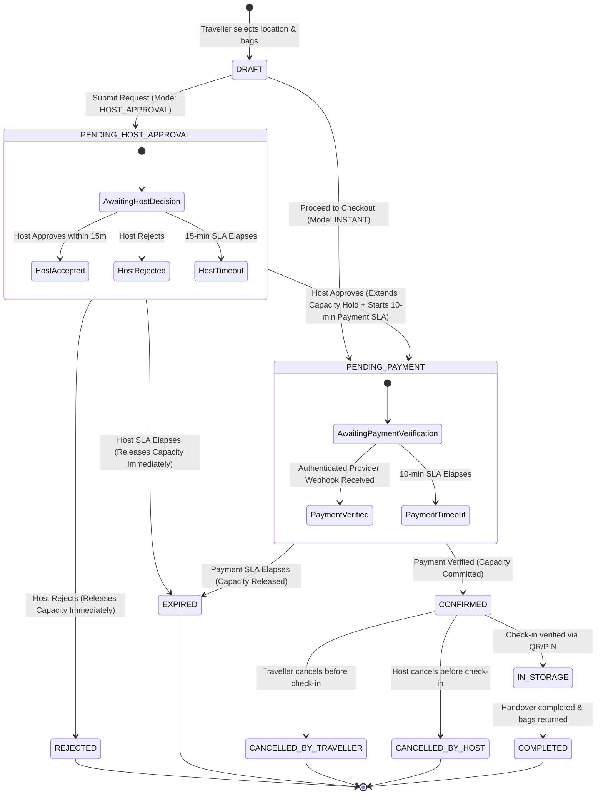
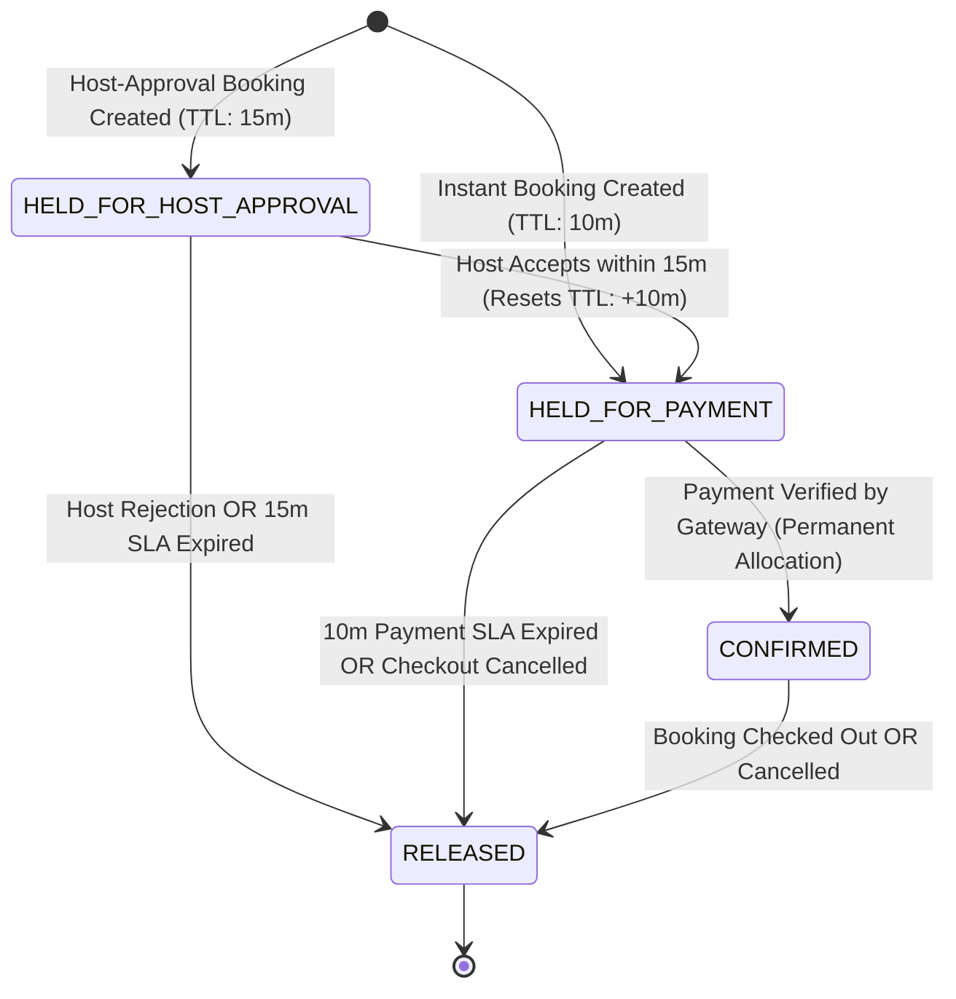
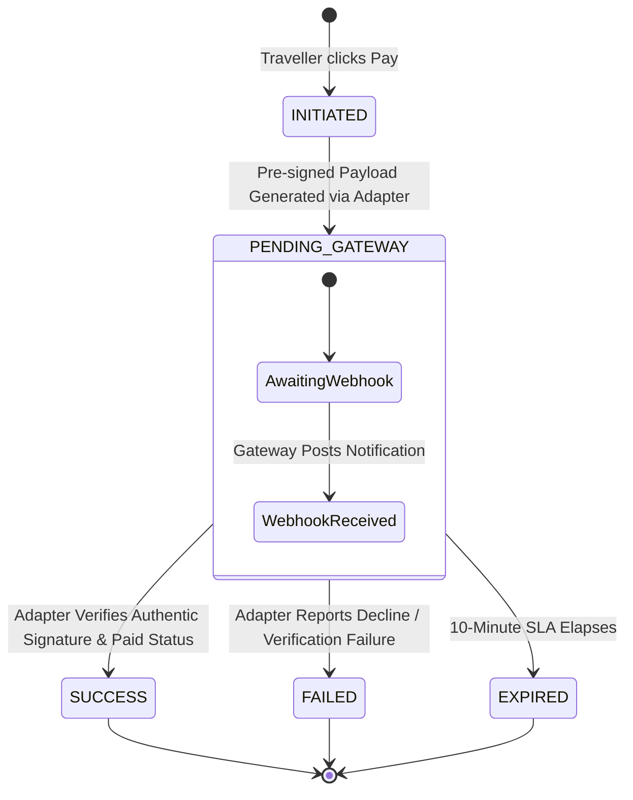
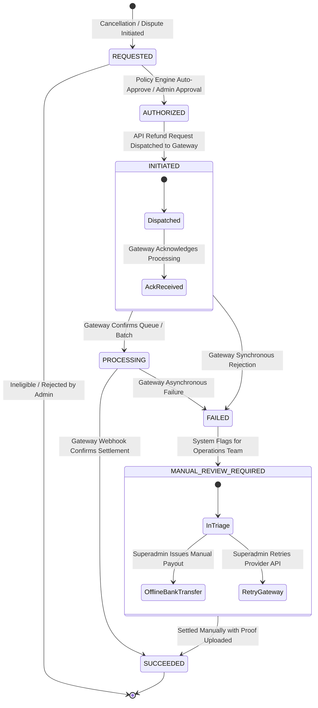
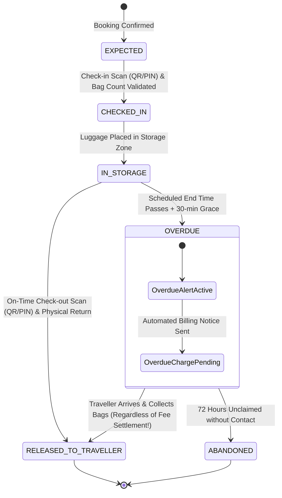
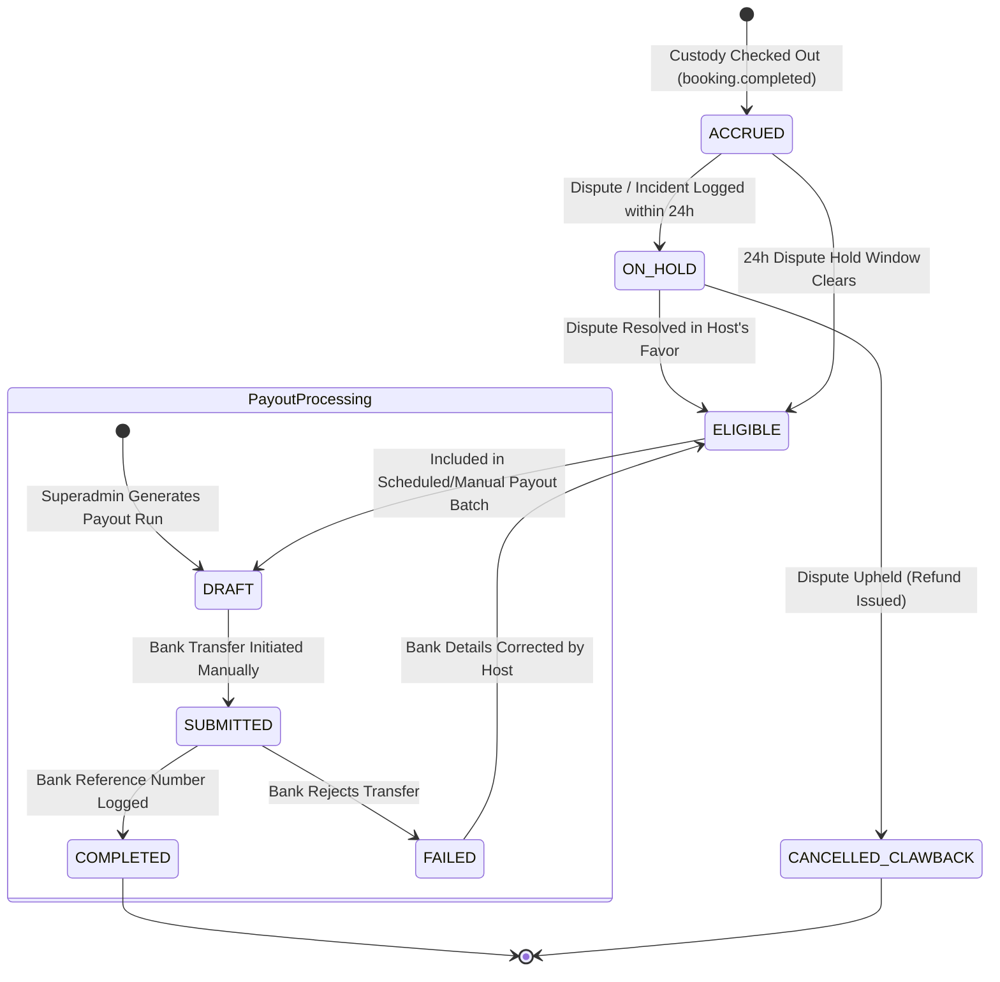

# Domain Lifecycle Models

**Project:** Global Luggage Storage Marketplace  
**Document Type:** Domain Architecture Specification  
**Status:** Approved Phase 0C Baseline (Reconciled & Corrected)  
**Governing Documents:** FRS, Phase 0A Architecture, Phase 0B-D Normalization Baseline, Business Rules Catalogue (`BR-001`–`BR-100`), Assumptions and Open Questions Register (`OQ-001`–`OQ-022`).

---

## 1. Executive Summary & Architectural Principles

This document establishes the formal lifecycle specifications and state machines for the core operational entities in the Global Luggage Storage Marketplace. 

In accordance with the approved Modular Monolith architecture (ADR-001, ADR-005) and domain boundaries (`domain-boundaries.md`), **each operational domain maintains an independent, loosely coupled lifecycle**. Under no circumstances are distinct business concerns collapsed into a single entity or combined state machine.

### Core Architectural Guardrails:
1. **Decoupled Custody & Financials:** Physical luggage custody and financial settlement are strictly decoupled. A dispute over overdue fees, baggage discrepancies, or secondary surcharges **shall never prevent or delay the physical return of luggage to the verified traveller** (`BR-035`, `BR-036`, `BR-061`, `BR-062`). The platform strictly prohibits any possessory lien or hostage luggage mechanism. Custody state reflects physical possession; financial debt is tracked exclusively in the Billing and Dispute domains.
2. **Payment-Provider Independence:** The payment lifecycle is modeled around an abstract, provider-agnostic domain contract. A client-side browser redirect, return URL query parameter, or frontend confirmation screen is **never** accepted as proof of payment (`BR-016`, `BR-017`). Payment confirmation requires an authentic, cryptographically verified, idempotent server-to-server notification delivered via an active payment adapter. Specific gateway capabilities (e.g., PayHere written marketplace approval under `OQ-003`, automated refunds under `OQ-013`) remain conditional launch gates.
3. **Multi-Stage Refund Processing:** A refund request is an intent, not a settled financial event. Refunds follow a mandatory 7-stage lifecycle with explicit failure and manual review states (`BR-023`–`BR-028`).
4. **Deterministic Multi-Stage Capacity Locking:** Checking capacity and booking creation are isolated through atomic row-level database locking with distinct Time-To-Live (TTL) reservation holds:
   - 15-minute host approval response window (`BR-005`).
   - 10-minute traveller payment window (`BR-006`).
   - Explicit extension upon host acceptance to prevent overselling under concurrent load (`BR-009`, `BR-010`).
5. **Double-Entry Host Payable Accounting:** Host earnings are not derived from raw booking statuses. They are recorded in an immutable financial ledger once storage custody is completed (`BR-040`, `BR-041`), with manual Superadmin disbursement during the initial launch phase (`ADR-008`, `OQ-003`).

---

## 2. Booking Lifecycle

The Booking domain manages the traveller's reservation journey. The system supports two distinct booking modes:
- **Instant Booking (`INSTANT`):** The storage location has auto-approval enabled. Capacity is temporarily held for payment, and the traveller proceeds directly to payment checkout.
- **Host-Approval Booking (`HOST_APPROVAL`):** The host must review and explicitly accept the booking request before any payment transaction is initiated.

### 2.1 State Definitions

| State | Classification | Description |
| :--- | :--- | :--- |
| `DRAFT` | Transient | Traveller is configuring dates, times, and bag counts; no capacity held. |
| `PENDING_HOST_APPROVAL` | Active Pending | Created under `HOST_APPROVAL` mode. Capacity is reserved under `HELD_FOR_HOST_APPROVAL` (15m SLA). Awaiting host decision. |
| `PENDING_PAYMENT` | Active Pending | Capacity is reserved under `HELD_FOR_PAYMENT` (10m SLA). Payment checkout is unlocked. Awaiting traveller payment completion. |
| `CONFIRMED` | Terminal Active | Payment verified via authenticated provider notification. Capacity permanently allocated. QR and PIN issued to traveller. |
| `REJECTED` | Terminal Inactive | Host rejected the booking request during `PENDING_HOST_APPROVAL`. Capacity released immediately. |
| `EXPIRED` | Terminal Inactive | Timer elapsed without required action (host approval SLA expired or traveller payment SLA expired). Capacity released. |
| `CANCELLED_BY_TRAVELLER`| Terminal Inactive | Traveller cancelled booking prior to check-in. Subject to cancellation policy refund evaluation. |
| `CANCELLED_BY_HOST` | Terminal Inactive | Host cancelled confirmed booking prior to check-in. Triggers 100% full refund and host penalty review. |
| `IN_STORAGE` | Active Operations | Luggage successfully checked in and currently in host custody. Handled via Custody domain coordination. |
| `COMPLETED` | Terminal Successful | Luggage safely collected, checked out, and physically returned to traveller. Triggers host payable ledger accrual. |

### 2.2 Mermaid State Machine: Booking Lifecycle



### 2.3 Booking State Transition Table

| Current State | Event / Trigger | Guard Conditions | Target State | Side Effects & Domain Actions |
| :--- | :--- | :--- | :--- | :--- |
| `DRAFT` | `SUBMIT_REQUEST` | Location requires host approval; valid operating window; capacity available. | `PENDING_HOST_APPROVAL` | Creates capacity hold (`HELD_FOR_HOST_APPROVAL`, TTL = 15m); schedules SLA timer `EVT_HOST_APPROVAL_TIMEOUT`; sends push/SMS alert to host. |
| `DRAFT` | `PROCEED_CHECKOUT` | Location supports instant booking; valid operating window; capacity available. | `PENDING_PAYMENT` | Creates capacity hold (`HELD_FOR_PAYMENT`, TTL = 10m); schedules SLA timer `EVT_PAYMENT_TIMEOUT`; initializes Payment session. |
| `PENDING_HOST_APPROVAL` | `HOST_ACCEPT` | Host staff/owner role; SLA timer not expired. | `PENDING_PAYMENT` | Transitions capacity hold to `HELD_FOR_PAYMENT` with new TTL = 10m; schedules `EVT_PAYMENT_TIMEOUT`; dispatches payment link to traveller. |
| `PENDING_HOST_APPROVAL` | `HOST_REJECT` | Host staff/owner role; SLA timer not expired; rejection reason provided. | `REJECTED` | Releases capacity hold immediately (`RELEASED`); cancels SLA timer; emits `booking.rejected`; notifies traveller. |
| `PENDING_HOST_APPROVAL` | `TIMEOUT_EXPIRED` | System clock >= SLA expiration time (15 mins default). | `EXPIRED` | Releases capacity hold immediately (`RELEASED`); emits `booking.expired`; notifies traveller and host. |
| `PENDING_PAYMENT` | `PAYMENT_VERIFIED`| Authenticated webhook received from payment provider; checksum/signature valid; amount matches booking total. | `CONFIRMED` | Converts capacity hold to permanent reservation (`CONFIRMED`); generates secure QR and 6-digit PIN; emits `booking.confirmed`; schedules check-in reminders. |
| `PENDING_PAYMENT` | `TIMEOUT_EXPIRED` | System clock >= payment window expiration (10 mins default); payment not confirmed. | `EXPIRED` | Releases capacity hold immediately (`RELEASED`); emits `booking.expired`; cancels payment session; notifies traveller. |
| `CONFIRMED` | `TRAVELLER_CANCEL` | Traveller role; Check-in time has not passed; luggage not in storage. | `CANCELLED_BY_TRAVELLER` | Releases capacity reservation (`RELEASED`); evaluates refund tier via Refund domain (`BR-023`–`BR-028`); emits `booking.cancelled`. |
| `CONFIRMED` | `HOST_CANCEL` | Host owner role or Superadmin; mandatory justification code; luggage not in storage. | `CANCELLED_BY_HOST` | Releases capacity reservation (`RELEASED`); initiates 100% full refund to traveller; logs incident against host reliability score; emits `booking.cancelled_by_host`. |
| `CONFIRMED` | `CHECK_IN_VERIFIED`| Scanned QR or entered PIN matches booking secret; bag count matches; performed by host staff/owner. | `IN_STORAGE` | Emits `custody.checked_in`; records check-in timestamp; sends confirmation push notification to traveller. |
| `IN_STORAGE` | `CHECK_OUT_VERIFIED`| Handover verified via QR/PIN scanning; bags physically returned to traveller. | `COMPLETED` | Emits `custody.released`; emits `booking.completed`; calculates final duration; accrues host payable credit in ledger; opens review submission window. |

---

## 3. Capacity Reservation Lifecycle & Concurrency Architecture

The Capacity domain manages spatial and bag-count allocations across storage locations and zones. To guarantee zero double-booking under high concurrency, capacity operations follow an explicit multi-stage reservation lifecycle.

### 3.1 State Definitions & Distinct Expiry Rules

To resolve the discrepancy between host response windows and traveller checkout timers, the capacity engine distinguishes distinct held states:

| State | Expiry SLA / TTL | Trigger Event | Next Permitted States |
| :--- | :--- | :--- | :--- |
| `HELD_FOR_HOST_APPROVAL`| Exactly **15 Minutes** (`BR-005`) | Traveller submits request for `HOST_APPROVAL` booking. | `HELD_FOR_PAYMENT` (Host Accepts)<br>`RELEASED` (Host Rejects or 15m Timeout) |
| `HELD_FOR_PAYMENT` | Exactly **10 Minutes** (`BR-006`) | Traveller initiates instant checkout OR host accepts pending request. | `CONFIRMED` (Payment Verified)<br>`RELEASED` (10m Timeout or Abandonment) |
| `CONFIRMED` | Permanent until check-out / cancellation | Authenticated server-to-server payment notification verified. | `RELEASED` (Completed, Cancelled) |
| `RELEASED` | Terminal | Expiry sweeper, host rejection, cancellation, or checkout. | None |

### 3.2 Mermaid State Machine: Capacity Reservation



### 3.3 Concurrency Control & Database Locking Architecture

#### The Concurrency Problem
A storage location operates with a finite capacity quota (e.g., 20 shared bag units). Under peak booking load, multiple travellers may attempt to reserve overlapping date ranges simultaneously. Without strict serialization, two concurrent transactions could both read available capacity, pass validation, and insert reservations that collectively exceed total location capacity.

#### Evaluation of `SELECT FOR UPDATE` & Transaction Boundaries
1. **Locking Target & Granularity:**
   - In a multi-zone, multi-day model, locking individual date buckets creates risk of deadlocks when concurrent bookings lock overlapping date ranges in different chronological order.
   - **Approved Solution:** To guarantee absolute concurrency safety without distributed deadlocks, the transaction locks the parent **`storage_capacity_pools`** row:
     ```sql
     -- Architectural Concurrency Locking Model (PostgreSQL)
     BEGIN TRANSACTION ISOLATION LEVEL READ COMMITTED;

     -- 1. Explicitly lock the capacity pool row to serialize concurrent reservations for this physical space
     SELECT id, total_units, is_active 
     FROM storage_capacity_pools 
     WHERE id = :pool_id AND is_active = TRUE
     FOR UPDATE;

     -- 2. Query active commitments and holds overlapping the requested window [drop_off, collection]
     SELECT COALESCE(SUM(cr.units_allocated), 0) AS active_units
     FROM capacity_reservations cr
     JOIN bookings b ON cr.booking_id = b.id
     WHERE cr.pool_id = :pool_id
       AND cr.status IN ('HELD_FOR_HOST_APPROVAL', 'HELD_FOR_PAYMENT', 'CONFIRMED')
       AND (b.drop_off_window_start < :req_collection AND b.collection_window_end > :req_drop_off);

     -- 3. Invariant Evaluation: active_units + requested_units <= total_units
     -- If violated, ROLLBACK and return HTTP 409 Conflict (ERR_CAPACITY_EXHAUSTED).

     -- 4. Insert Reservation Record with state-appropriate TTL
     -- If mode = HOST_APPROVAL: expires_at = NOW() + INTERVAL '15 minutes'
     -- If mode = INSTANT: expires_at = NOW() + INTERVAL '10 minutes'
     INSERT INTO capacity_reservations (id, booking_id, pool_id, units_allocated, status, expires_at)
     VALUES (:res_id, :booking_id, :pool_id, :units, :held_status, :expires_at);

     COMMIT;
     ```
2. **Deadlock Prevention:** Because every transaction locks the single `storage_capacity_pools` row before evaluating any reservation overlaps, transactions across that pool execute in strict FIFO order, completely eliminating circular lock waits.

### 3.4 TTL Sweeper & Stale Reservation Reconciliation
- An asynchronous background sweeper runs every 30 seconds.
- **Query:** `SELECT id, booking_id, status FROM capacity_reservations WHERE status IN ('HELD_FOR_HOST_APPROVAL', 'HELD_FOR_PAYMENT') AND expires_at < NOW() FOR UPDATE SKIP LOCKED;`
- **Action:**
  1. Updates `capacity_reservations.status = 'RELEASED'`.
  2. Updates associated `bookings.status = 'EXPIRED'`.
  3. Emits `booking.expired` domain event.
- **Race Condition Handling (Confirmation vs. Expiry):**
  If a payment webhook arrives at the exact instant the sweeper is processing an expired hold:
  The payment handler and sweeper both execute `SELECT ... FOR UPDATE` on the reservation record. If the payment webhook commits first, status becomes `CONFIRMED` and `expires_at` is cleared; the sweeper sees `CONFIRMED` and ignores it. If the sweeper commits first, the payment webhook detects status is already `RELEASED`; the payment handler marks payment as `ORPHANED_SUCCESS` and immediately triggers an automated full refund to the traveller.

---

## 4. Payment-Provider Independence & Lifecycle

The Payment domain governs financial intake while remaining decoupled from third-party gateway specifics.

### 4.1 Architectural Abstraction: The `PaymentGatewayPort`

The marketplace modular monolith interacts with payment gateways exclusively through an abstract interface:

```typescript
// Provider-Agnostic Interface Contract (Decoupled from PayHere/Stripe)
export interface PaymentGatewayPort {
  initiatePayment(request: PaymentInitiationRequest): Promise<PaymentInitiationResult>;
  verifyNotification(rawPayload: unknown, headers: Record<string, string>): Promise<NormalizedPaymentNotification>;
  processRefund(request: RefundInstructionRequest): Promise<RefundInstructionResult>;
  checkHealth(): Promise<GatewayHealthStatus>;
}
```

### 4.2 State Definitions

| State | Classification | Description |
| :--- | :--- | :--- |
| `INITIATED` | Transient | Payment record created with a unique internal transaction ID and idempotency key. |
| `PENDING_GATEWAY` | Active In-Flight | Pre-signed gateway payload generated or traveller redirected to hosted form. Awaiting gateway processing. |
| `SUCCESS` | Terminal Success | Authenticated server-to-server notification received, cryptographically verified, and settled. |
| `FAILED` | Terminal Failure | Gateway reported card decline, fraud block, customer cancellation, or communication timeout. |
| `EXPIRED` | Terminal Inactive | Session expired without payment confirmation within configured SLA. |

### 4.3 Mermaid State Machine: Payment Lifecycle



### 4.4 Verification & Idempotency Rules (`BR-016`, `BR-017`, `BR-018`)
1. **Cryptographic Verification:** Every incoming provider webhook is passed to `PaymentGatewayPort.verifyNotification()`. The active adapter validates the provider-specific signature or checksum. Invalid signatures result in immediate `HTTP 400 Bad Request` and security logging.
2. **Idempotent Webhook Deduplication:** The handler checks `payments` for existing records matching `gateway_transaction_id`. Duplicate posts immediately return `HTTP 200 OK` without triggering side effects.
3. **Provider Launch Gates:** PayHere marketplace authorization (`OQ-003`) and refund automation (`OQ-013`) remain conditional launch gates. If PayHere marketplace approval is not granted, the `PaymentGatewayPort` is bound to an alternative approved aggregator without changing the payment lifecycle.

---

## 5. Refund Lifecycle

Refunds represent the return of settled funds to the traveller. In strict compliance with financial control principles, refunds follow an explicit 7-stage lifecycle (`BR-023`–`BR-028`).

### 5.1 State Definitions

| State | Stage | Description |
| :--- | :--- | :--- |
| `REQUESTED` | Stage 1 | Cancellation or dispute logged; refund eligibility calculated by policy engine. |
| `AUTHORIZED` | Stage 2 | Refund approved by system rules (automatic cancellation before SLA) or Superadmin. |
| `INITIATED` | Stage 3 | Outbound refund instruction dispatched to the payment gateway adapter. |
| `PROCESSING` | Stage 4 | Gateway acknowledged receipt of refund instruction; banking network settlement pending. |
| `SUCCEEDED` | Stage 5 (Terminal) | Gateway confirmed successful credit to traveller's original payment method. |
| `FAILED` | Stage 6 (Terminal) | Gateway rejected refund instruction (expired token, closed card, provider API error). |
| `MANUAL_REVIEW_REQUIRED` | Stage 7 (Operational) | Dispatched upon failure; requires Superadmin manual reconciliation and offline settlement. |

### 5.2 Mermaid State Machine: Refund Lifecycle



---

## 6. Luggage Custody Lifecycle & Separation from Financial Disputes

The Custody domain governs **strictly physical possession, security tagging, verification, and handover of traveller property** (`BR-030`–`BR-036`, `BR-061`, `BR-062`).

### 6.1 Physical Custody State Definitions

| State | Classification | Description |
| :--- | :--- | :--- |
| `EXPECTED` | Initial | Booking confirmed; luggage has not yet arrived at the storage location. |
| `CHECKED_IN` | Active Custody | Traveller arrived; QR/PIN scanned; bag count verified; custody transferred to host. |
| `IN_STORAGE` | Active Custody | Luggage securely placed in designated storage zone/racks under host supervision. |
| `OVERDUE` | Active Custody Alert| Scheduled collection window elapsed without check-out; custody remains active with host. |
| `RELEASED_TO_TRAVELLER`| Terminal Physical| Bags physically returned to verified traveller. Physical custody complete and ended. |
| `ABANDONED` | Exception Physical | 72 hours elapsed past collection without contact; bags moved to secure legal holding. |

### 6.2 Mermaid State Machine: Custody Lifecycle



### 6.3 Decoupling Invariant: Zero Possessory Lien (`BR-035`, `BR-061`, `BR-062`)
> **CRITICAL MARKETPLACE INVARIANT:**  
> Under no circumstances shall host staff or platform administrators withhold, impound, or refuse to release luggage to a verified traveller due to unpaid overdue fees or disputed secondary charges.
>
> **Operational Protocol:**
> 1. When a traveller presents valid check-out credentials (QR or PIN), the host **MUST release the bags**.
> 2. The custody state machine transitions directly to **`RELEASED_TO_TRAVELLER`**. Physical custody is formally terminated.
> 3. If overdue storage charges are unpaid or disputed:
>    - The custody handover records an operational condition metadata: `handover_condition = 'UNPAID_FEES_PENDING'`.
>    - An event `custody.released_with_unpaid_fees` is emitted to the Billing and Support domains.
>    - The financial billing engine creates an outstanding `AdditionalPaymentRequest` and flags the traveller account for administrative collection.
>    - **The physical luggage is never detained.** Detention of luggage constitutes illegal conversion and detention of personal property under applicable law.

---

## 7. Host Payable and Payout Lifecycle

The Host Payable and Payout lifecycles govern the marketplace's financial obligations to partner businesses (`BR-040`–`BR-044`).

### 7.1 State Definitions

| State | Entity | Description |
| :--- | :--- | :--- |
| `ACCRUED` | Host Payable | Storage completed; net host earnings (85% of subtotal) calculated and credited to ledger. |
| `ON_HOLD` | Host Payable | Host payable frozen due to open fraud investigation, customer dispute, or KYC suspension. |
| `ELIGIBLE` | Host Payable | Booking completion confirmed and mandatory dispute hold window (24 hours) cleared. |
| `DRAFT` | Payout Batch | Superadmin initiates a payout batch for approved hosts with eligible balances. |
| `SUBMITTED` | Payout Batch | Bank transfer file/details exported; Superadmin executes manual bank transfer. |
| `COMPLETED` | Payout Batch | Bank transaction reference recorded; host ledger debited; payout advice generated. |
| `FAILED` | Payout Batch | Bank rejected transfer (invalid account number, closed account, branch code error). |

### 7.2 Mermaid State Machine: Host Payable & Payout Lifecycle



---

## 8. Cross-Lifecycle Coordination & Event Matrix

| Producing Domain Event | Target Domain | Command / Action Triggered | Target Lifecycle State Impact |
| :--- | :--- | :--- | :--- |
| `booking.created` | Capacity | `RESERVE_CAPACITY` | Creates `HELD_FOR_HOST_APPROVAL` (15m) or `HELD_FOR_PAYMENT` (10m). |
| `booking.host_accepted`| Capacity | `EXTEND_RESERVATION` | Extends capacity hold to `HELD_FOR_PAYMENT` with new 10m TTL. |
| `booking.host_accepted`| Payment | `INITIALIZE_CHECKOUT` | Generates payment session; starts 10m payment timer. |
| `booking.host_rejected`| Capacity | `RELEASE_RESERVATION` | Transitions reservation from `HELD_FOR_HOST_APPROVAL` to `RELEASED`. |
| `payment.verified` | Booking | `CONFIRM_BOOKING` | Transitions booking from `PENDING_PAYMENT` to `CONFIRMED`. |
| `payment.verified` | Capacity | `COMMIT_RESERVATION` | Transitions reservation from `HELD_FOR_PAYMENT` to `CONFIRMED`. |
| `payment.verified` | Custody | `GENERATE_CREDENTIALS`| Creates `CustodyRecord` in `EXPECTED` state; issues QR and PIN. |
| `custody.checked_in` | Booking | `START_STORAGE` | Transitions booking from `CONFIRMED` to `IN_STORAGE`. |
| `custody.released` | Booking | `COMPLETE_BOOKING` | Transitions booking from `IN_STORAGE` to `COMPLETED`. |
| `custody.released` | Revenue / Finance | `ACCRUE_HOST_EARNINGS`| Records 85% host payable credit and 15% commission in ledger. |
| `custody.released` | Capacity | `RELEASE_RESERVATION` | Releases physical capacity allocation back to available pool (`RELEASED`). |
| `booking.cancelled` | Capacity | `RELEASE_RESERVATION` | Releases capacity allocation immediately (`RELEASED`). |
| `booking.cancelled` | Refund | `EVALUATE_REFUND` | Calculates refund eligibility and initiates Refund lifecycle. |
| `refund.succeeded` | Revenue / Finance | `REVERSE_ACCRUAL` | Adjusts ledger entries to deduct refunded amounts from revenue. |
