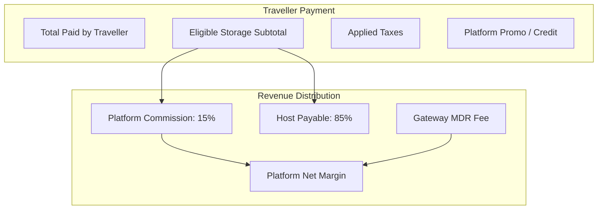

# Pricing and Financial Domain Model

**Project:** Global Luggage Storage Marketplace  
**Document Type:** Domain Architecture Specification  
**Status:** Approved Phase 0C Baseline (Reconciled & Corrected)  
**Governing Documents:** FRS (`FR-011`, `FR-012`, `FR-013`, `FR-014`), ADR-008, ADR-010, Business Rules Catalogue (`BR-019`–`BR-029`, `BR-040`–`BR-044`), Assumptions & Open Questions (`OQ-003`, `OQ-005`, `OQ-008`, `OQ-010`, `OQ-013`).

---

## 1. Executive Summary & Core Financial Invariants

The Pricing and Financial Domain Model defines the architectural mechanics for calculating booking prices, distributing marketplace revenue, managing payment deductions, and maintaining immutable financial records.

### Mandatory Architecture Invariants:
1. **Exact Integer Minor-Unit Arithmetic:** All currency values, calculations, ledger entries, and financial records **must use integer minor units** (e.g., LKR cents, where LKR 1,300.00 is stored and calculated as `130000`). Binary floating-point arithmetic (`FLOAT`, `DOUBLE`, `REAL`) is strictly forbidden (`BR-020`, `BR-089`).
2. **Approved Platform Commission Base:** The platform commission is fixed at **15% of the eligible storage subtotal** (gross storage price after host discounts, excluding taxes and platform fees) (`BR-021`, `BR-041`).
3. **Gateway Fee Absorption:** In the initial launch market (Sri Lanka), payment gateway merchant discount rates (MDR, e.g., PayHere processing fees) **are absorbed by the platform** from its commission revenue. Gateway fees are **never** deducted from the host's earned payable balance (`BR-042`).
4. **Promotion Funding Attribution:** Discounts are strictly tracked by funding source:
   - **Host-Funded Discounts:** Deducted directly from the storage subtotal before calculating the 15% platform commission and host earnings.
   - **Platform-Funded Promotions:** Absorbed entirely by the platform. The host receives their full 85% share based on the pre-promotion storage subtotal (`BR-022`).
5. **Decoupled Tax Architecture:** Tax capability is engineered into the system but remains decoupled from legal compliance decisions via a 4-layer taxonomy (`BR-029`, `BR-096`, `OQ-010`).
6. **Immutable Historical Snapshotting:** When a booking is confirmed, all pricing components (base rates, category multipliers, discounts, commission rate, applied taxes, and currency codes) are permanently snapshotted in `booking_pricing_snapshots`. Subsequent pricing rule modifications by the host or platform **never alter existing bookings** (`BR-020`).

---

## 2. Itemized Financial Breakdown Structure

The financial domain strictly distinguishes each component of a transaction:



### 2.1 Formal Financial Definitions

| Financial Term | Technical Representation | Definition & Calculation |
| :--- | :--- | :--- |
| **Base Storage Rate** | `base_rate_minor` | Baseline price per bag unit per storage duration unit configured by the host. |
| **Duration Units** | `duration_units` | Number of chargeable storage intervals (e.g., calendar days or 24-hour blocks). |
| **Category Multiplier** | `category_multiplier_bps` | Basis points multiplier (10,000 bps = 1.00x) applied to specific bag sizes. |
| **Host-Funded Discount** | `host_discount_minor` | Volume or multi-day discounts conceded by the host. |
| **Storage Subtotal** | `storage_subtotal_minor` | Total storage price after host discounts. Base for commission calculation. |
| **Platform Commission** | `platform_commission_minor` | Exactly $\lfloor \text{StorageSubtotal} \times 0.15 \rfloor$. Paid to marketplace. |
| **Host Payable** | `host_payable_minor` | Exactly $\text{StorageSubtotal} - \text{PlatformCommission}$ ($85\%$ of subtotal). |
| **Platform-Funded Promo**| `platform_discount_minor` | Promo code discount subsidised by marketplace marketing. Subtracted from traveller total. |
| **Taxes / VAT / SSCL** | `tax_amount_minor` | Configured jurisdictional taxes (Layer B) applied to the transaction. |
| **Total Paid by Traveller**| `total_amount_minor` | $\text{StorageSubtotal} + \text{TaxAmount} - \text{PlatformDiscount}$. Settled via Gateway. |
| **Gateway Processing Fee**| `gateway_fee_minor` | Fee charged by payment provider (e.g., $2.9\% + \text{LKR } 30$). Absorbed by platform. |
| **Net Platform Revenue** | `net_platform_revenue_minor`| $\text{PlatformCommission} - \text{PlatformDiscount} - \text{GatewayFee}$. |

---

## 3. The 4-Layer Tax Architecture (`BR-029`, `BR-096`, `OQ-010`)

To ensure global readiness without pre-empting legal classification or accounting decisions in any jurisdiction, tax is partitioned into four independent layers:

- **Layer A: Platform Technical Capability:** The data model and calculation engine support zero-rate, inclusive, and exclusive percentage and fixed taxes per country, jurisdiction, and service category.
- **Layer B: Configured Jurisdictional Rules:** Configured tax tables specify rates per jurisdiction (e.g., Sri Lanka VAT @ 18%, SSCL @ 2.5%, or Exempt status).
- **Layer C: Legal & Corporate Classification:** The formal legal characterization of whether the platform is a principal merchant, an intermediary marketplace agent, or an electronic service supplier (`OQ-010`).
- **Layer D: Launch Compliance Gate:** The verified configuration certified by local tax counsel prior to market launch. For Sri Lanka initial launch, tax calculations default to exempt/zero until tax counsel signs off on registration status.

---

## 4. Promotion & Discount Mechanics

Discounts are funded either by the host or by the platform:

```
+--------------------------------------------------------------------------+
| SCENARIO A: HOST-FUNDED MULTI-DAY DISCOUNT (10% OFF ON 3+ DAYS)         |
| Gross Rate: LKR 3,000  -->  Host Discount: LKR 300                       |
| Storage Subtotal = LKR 2,700                                             |
| Platform Commission (15%) = LKR 405                                      |
| Host Payable (85%) = LKR 2,295                                           |
| Traveller Pays: LKR 2,700                                                |
+--------------------------------------------------------------------------+

+--------------------------------------------------------------------------+
| SCENARIO B: PLATFORM-FUNDED PROMO CODE ("WELCOME10" - LKR 300 OFF)       |
| Gross Rate: LKR 3,000  -->  Storage Subtotal = LKR 3,000                 |
| Platform Commission (15%) = LKR 450                                      |
| Host Payable (85%) = LKR 2,550  <-- HOST RECEIVES FULL 85% OF GROSS!     |
| Platform Promo Subsidy = LKR 300                                         |
| Traveller Pays: LKR 2,700                                                |
| Platform Net Margin = LKR 450 - LKR 300 - Gateway Fee = Net Contribution |
+--------------------------------------------------------------------------+
```

---

## 5. End-to-End Concrete LKR Calculation Examples

### Example 1: Standard Single-Day Booking (2 Standard Bags)
- **Currency:** `LKR` (Exponent = 2; integer minor units in cents).
- **Location Base Rate:** LKR 1,300.00 per standard bag per day (`130000` cents).
- **Duration:** 1 Day (`duration_units = 1`).
- **Items:** 2 `BAG_MEDIUM` (Multiplier = 1.00x).
- **Discounts:** None.
- **Tax Configuration:** 0% (Layer D default pending tax counsel confirmation).
- **Calculations:**
  1. $\text{Storage Subtotal} = 2 \times 130000 \times 1 = 260000\text{ cents}$ (LKR 2,600.00).
  2. $\text{Platform Commission} = \lfloor 260000 \times 0.15 \rfloor = 39000\text{ cents}$ (LKR 390.00).
  3. $\text{Host Payable} = 260000 - 39000 = 221000\text{ cents}$ (LKR 2,210.00).
  4. $\text{Tax Amount} = 0\text{ cents}$.
  5. $\text{Total Paid by Traveller} = 260000 + 0 = 260000\text{ cents}$ (LKR 2,600.00).
  6. $\text{Gateway Fee (Est. 3% absorbed by platform)} = \lfloor 260000 \times 0.03 \rfloor = 7800\text{ cents}$ (LKR 78.00).
  7. $\text{Net Platform Revenue} = 39000 - 7800 = 31200\text{ cents}$ (LKR 312.00).

### Example 2: Multi-Bag, Multi-Day with Oversized Bag & Host Discount
- **Location Base Rate:** LKR 1,000.00 (`100000` cents).
- **Duration:** 3 Days.
- **Items:**
  - 1 `BAG_SMALL` (Multiplier = 0.80x $\implies$ LKR 800.00/day $\implies$ `80000` cents).
  - 1 `BAG_OVERSIZED` (Multiplier = 1.50x $\implies$ LKR 1,500.00/day $\implies$ `150000` cents).
- **Host Multi-Day Discount:** 10% off total storage for 3+ days.
- **Calculations:**
  1. $\text{Gross Storage per Day} = 80000 + 150000 = 230000\text{ cents}$.
  2. $\text{Gross Storage for 3 Days} = 230000 \times 3 = 690000\text{ cents}$ (LKR 6,900.00).
  3. $\text{Host Discount (10%)} = \lfloor 690000 \times 0.10 \rfloor = 69000\text{ cents}$ (LKR 690.00).
  4. $\text{Storage Subtotal} = 690000 - 69000 = 621000\text{ cents}$ (LKR 6,210.00).
  5. $\text{Platform Commission (15%)} = \lfloor 621000 \times 0.15 \rfloor = 93150\text{ cents}$ (LKR 931.50).
  6. $\text{Host Payable (85%)} = 621000 - 93150 = 527850\text{ cents}$ (LKR 5,278.50).
  7. $\text{Total Paid by Traveller} = 621000\text{ cents}$ (LKR 6,210.00).
  8. $\text{Gateway Fee (Est. 3% absorbed by platform)} = \lfloor 621000 \times 0.03 \rfloor = 18630\text{ cents}$ (LKR 186.30).
  9. $\text{Net Platform Revenue} = 93150 - 18630 = 74520\text{ cents}$ (LKR 745.20).

---

## 6. Overdue Storage Pricing & Secondary Charges

If a traveller fails to collect their bags by the scheduled collection time:
1. **Grace Period:** 30 minutes grace period with zero surcharge (`BR-032`).
2. **Overdue Fee Rate:** Charged at $1.5\times$ the daily prorated base rate per bag per 24-hour block or fraction thereof (`BR-033`).
3. **Billing Workflow:** An automated `AdditionalPaymentRequest` is generated. The traveller receives an SMS/email payment link.
4. **No Possessory Lien Invariant:** The host **must release the luggage** upon traveller presentation of check-out credentials even if the overdue payment remains uncollected (`BR-035`, `BR-061`).

---

## 7. Double-Entry General Ledger Balance Audit

Financial integrity is enforced via an append-only double-entry bookkeeping ledger (`finance_ledger_entries`). Every journal transaction **must strictly balance: $\sum \text{Debits} = \sum \text{Credits}$**.

### 7.1 Detailed Balanced Journal Templates

#### 1. Traveller Payment Captured (Instant or Approved Booking)
- Example: Traveller pays LKR 2,600.00 (`260000` cents) via payment gateway.
- `DEBIT 1010 Payment Gateway Clearing Account`: `260000`
- `CREDIT 2010 Traveller Booking Deposit Liability`: `260000`
- **Balance Check:** $\text{Debit } 260000 = \text{Credit } 260000$. (Balanced)

#### 2. Booking Storage Completed & Custody Released
- Storage completed. Platform earns 15% commission (`39000` cents). Host earns 85% payable (`221000` cents).
- `DEBIT 2010 Traveller Booking Deposit Liability`: `260000`
- `CREDIT 4010 Platform Commission Revenue`: `39000`
- `CREDIT 2020 Host Payable Liability`: `221000`
- **Balance Check:** $\text{Debit } 260000 = \text{Credit } (39000 + 221000) = 260000$. (Balanced)

#### 3. Payment Gateway MDR Fee Incurred (Platform Absorbs Fee)
- Gateway charges platform MDR (e.g. 3% = `7800` cents).
- `DEBIT 5010 Payment Gateway Processing Expense`: `7800`
- `CREDIT 1010 Payment Gateway Clearing Account`: `7800`
- **Balance Check:** $\text{Debit } 7800 = \text{Credit } 7800$. (Balanced)

#### 4. Manual Host Payout Disbursed
- Superadmin executes manual bank transfer to host (`221000` cents).
- `DEBIT 2020 Host Payable Liability`: `221000`
- `CREDIT 1020 Platform Bank Account`: `221000`
- **Balance Check:** $\text{Debit } 221000 = \text{Credit } 221000$. (Balanced)

#### 5. Full Pre-Dropoff Cancellation Refund
- Booking cancelled before check-in. 100% refund of `260000` cents returned to traveller.
- `DEBIT 2010 Traveller Booking Deposit Liability`: `260000`
- `CREDIT 1010 Payment Gateway Clearing Account`: `260000`
- **Balance Check:** $\text{Debit } 260000 = \text{Credit } 260000$. (Balanced)

#### 6. Platform-Funded Promo Code Applied
- Gross storage = LKR 3,000 (`300000` cents). Marketing code discount = LKR 300 (`30000` cents). Traveller pays `270000` cents.
- *Intake Entry:*
  - `DEBIT 1010 Payment Gateway Clearing Account`: `270000`
  - `DEBIT 5020 Marketing Promotion Expense`: `30000`
  - `CREDIT 2010 Traveller Booking Deposit Liability`: `300000`
  - **Balance Check:** $\text{Debit } (270000 + 30000) = \text{Credit } 300000$. (Balanced)
- *Completion Entry:*
  - Subtotal = `300000`. Commission (15%) = `45000`. Host Payable (85%) = `255000`.
  - `DEBIT 2010 Traveller Booking Deposit Liability`: `300000`
  - `CREDIT 4010 Platform Commission Revenue`: `45000`
  - `CREDIT 2020 Host Payable Liability`: `255000`
  - **Balance Check:** $\text{Debit } 300000 = \text{Credit } (45000 + 255000) = 300000$. (Balanced)
  - *Result:* Host receives their full 85% of gross! The platform subsidises the discount.

---

## 8. Immutable Pricing Snapshot Structure

When a booking transitions to `CONFIRMED`, the exact pricing calculation is serialized into `booking_pricing_snapshots`:

```json
{
  "booking_id": "b0f7e1b2-...",
  "currency": "LKR",
  "currency_exponent": 2,
  "pricing_model_version": "1.0",
  "base_rate_per_day_minor": 130000,
  "duration_days": 1,
  "items": [
    {
      "bag_category": "BAG_MEDIUM",
      "quantity": 2,
      "unit_rate_minor": 130000,
      "multiplier_bps": 10000,
      "line_total_minor": 260000
    }
  ],
  "gross_storage_minor": 260000,
  "host_discount_minor": 0,
  "storage_subtotal_minor": 260000,
  "commission_rate_bps": 1500,
  "platform_commission_minor": 39000,
  "host_payable_minor": 221000,
  "platform_discount_minor": 0,
  "tax_rate_bps": 0,
  "tax_amount_minor": 0,
  "total_amount_minor": 260000,
  "cancellation_policy_tier": "FLEXIBLE_24H",
  "snapshotted_at": "2026-11-07T03:54:00Z"
}
```
