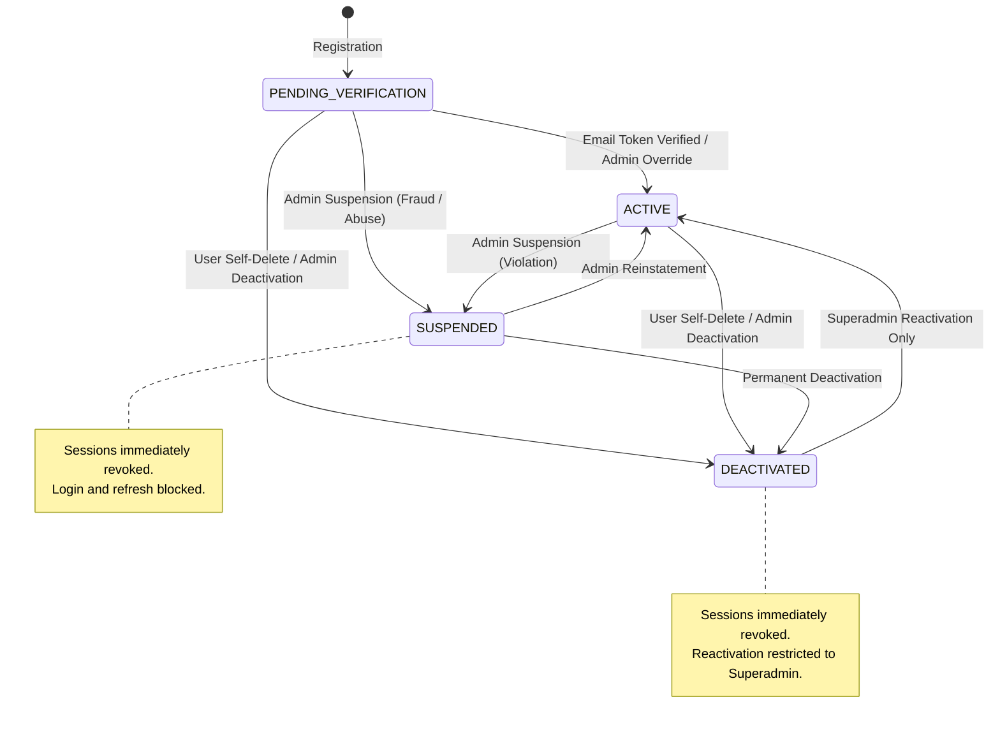
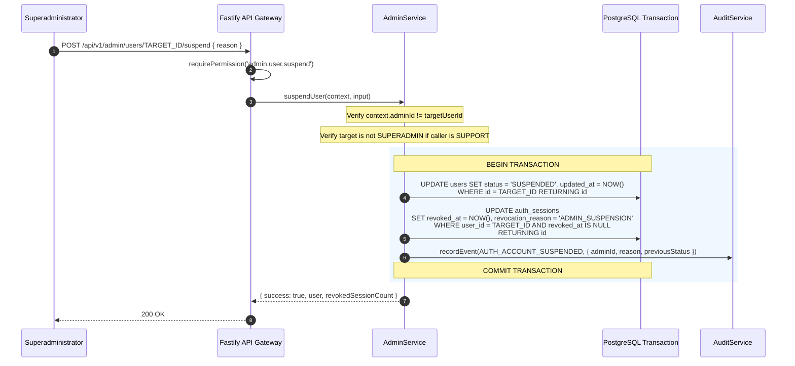

# Account Lifecycle & Administrative Governance Architecture

## 1. Executive Summary & Document Control

| Attribute | Specification Value |
| :--- | :--- |
| **Document ID** | `SEC-ARCH-ACCT-05` |
| **Title** | Account Lifecycle State Machine, Administrative Governance, and Invalidation Controls |
| **Scope** | Platform account provisioning, state transition enforcement, administrative interventions, atomic session revocation, and lifecycle auditability |
| **Status** | Implemented & Tested |
| **Authoritative Spec** | `docs/engineering/phase-1b-specification.md` (Sections 3, 6, 12, 17) |
| **Primary Code Artifacts** | [`admin.service.ts`](file:///d:/luggage-storage/luggage-storage/apps/api/src/modules/admin/admin.service.ts), [`admin.routes.ts`](file:///d:/luggage-storage/luggage-storage/apps/api/src/modules/admin/admin.routes.ts), [`auth.service.ts`](file:///d:/luggage-storage/luggage-storage/apps/api/src/modules/auth/auth.service.ts), [`0002_identity_schema.sql`](file:///d:/luggage-storage/luggage-storage/packages/database/src/migrations/0002_identity_schema.sql) |
| **Verification Test Suite** | [`admin.test.ts`](file:///d:/luggage-storage/luggage-storage/apps/api/src/tests/admin.test.ts), [`security.test.ts`](file:///d:/luggage-storage/luggage-storage/apps/api/src/tests/security.test.ts) |

---

## 2. Account State Machine & Permitted Transitions

User accounts transition across four strictly bounded states governed by application logic and database constraints:

### 2.1 State Definitions

| State Code | Operational Meaning | Login Permitted | Refresh Permitted | Profile Mutations Permitted |
| :--- | :--- | :---: | :---: | :---: |
| `PENDING_VERIFICATION` | Account registered but primary email has not yet been confirmed via verification token. Platform allows limited onboarding. | :white_check_mark: | :white_check_mark: | Limited |
| `ACTIVE` | Normal operating status. All authorized role capabilities enabled. | :white_check_mark: | :white_check_mark: | :white_check_mark: |
| `SUSPENDED` | Account administratively locked due to security incidents, suspicious behavior, or terms violations. All active sessions invalidated. | :x: (403 Forbidden) | :x: (403 Forbidden) | :x: (403 Forbidden) |
| `DEACTIVATED` | Account deactivated upon user request or permanent administrative action. All active sessions terminated. Reactivation requires explicit Superadmin action. | :x: (403 Forbidden) | :x: (403 Forbidden) | :x: (403 Forbidden) |

### 2.2 Transition Rules & Enforcement Invariants

1. **Terminal Guard on Deactivation**: Deactivated accounts cannot be placed into `SUSPENDED` state directly; they must either remain `DEACTIVATED` or undergo explicit administrative reactivation to `ACTIVE` by a Superadmin.
2. **Immediate Session Termination**: Moving an account to `SUSPENDED` or `DEACTIVATED` atomically invalidates all active sessions in the database within the same transaction.
3. **Audit Trail**: Every state transition emits an immutable security audit event containing actor ID, target user ID, reason, and previous state.

---

## 3. Administrative Lifecycle Operations

Administrative actions are exposed under `/api/v1/admin/users/:userId/*` and mediated by [`AdminService`](file:///d:/luggage-storage/luggage-storage/apps/api/src/modules/admin/admin.service.ts).

### 3.1 Account Suspension (`POST /api/v1/admin/users/:userId/suspend`)
- **Required Permission**: `admin.user.suspend` (Superadmin only).
- **Guarantees**:
  - **Self-Action Defense**: Superadmins cannot suspend their own account (`adminId === targetUserId` throws `400 Bad Request`).
  - **Privilege Separation**: Support personnel cannot suspend Superadmin accounts.
  - **Atomic Revocation**: All active sessions in `auth_sessions` are updated to `revoked_at = NOW()`, `revocation_reason = 'ADMIN_SUSPENSION'`.
  - **Audit Event**: Records `AUTH_ACCOUNT_SUSPENDED`.

### 3.2 Account Reinstatement (`POST /api/v1/admin/users/:userId/reinstate`)
- **Required Permission**: `admin.user.reinstate` (Superadmin only).
- **Guarantees**:
  - Only accounts in `SUSPENDED` state can be reinstated.
  - Target status transitions to `ACTIVE`.
  - Prior revoked sessions remain revoked; user must re-authenticate.
  - **Audit Event**: Records `AUTH_ACCOUNT_REINSTATED`.

### 3.3 Account Deactivation (`POST /api/v1/admin/users/:userId/deactivate`)
- **Required Permission**: `admin.user.deactivate` (Superadmin only).
- **Guarantees**:
  - Cannot deactivate own account.
  - Cannot deactivate the last Superadmin on the platform.
  - All active sessions terminated with `revocation_reason = 'ADMIN_DEACTIVATION'`.
  - **Audit Event**: Records `AUTH_ACCOUNT_DEACTIVATED`.

### 3.4 Account Reactivation (`POST /api/v1/admin/users/:userId/reactivate`)
- **Required Permission**: `admin.user.reactivate` (Superadmin only).
- **Guarantees**:
  - Reverses `DEACTIVATED` state back to `ACTIVE`.
  - Requires mandatory administrative justification reason.
  - **Audit Event**: Records `AUTH_ACCOUNT_REACTIVATED`.

### 3.5 Administrative Email Verification (`POST /api/v1/admin/users/:userId/verify-email`)
- **Required Permission**: `admin.user.verify_email` (Superadmin only).
- **Purpose**: Enables customer support escalation resolution when travellers or hosts cannot receive automated verification emails due to upstream email provider failures.
- **Guarantees**:
  - Atomically sets `is_email_verified = true`, `email_verified_at = NOW()`.
  - If account was `PENDING_VERIFICATION`, automatically transitions status to `ACTIVE`.
  - **Audit Event**: Records `AUTH_EMAIL_VERIFIED_BY_ADMIN`.

---

## 4. Atomic Invalidation Sequence Diagram

---

## 5. Implementation Evidence & Test Traceability

| Requirement | Implementation Artifact | Verification Test | Test Suite File |
| :--- | :--- | :--- | :--- |
| **Self-Suspension Defense** | [`adminService.suspendUser()`](file:///d:/luggage-storage/luggage-storage/apps/api/src/modules/admin/admin.service.ts#L247-L249) | `administrators cannot suspend their own account` | [`admin.test.ts`](file:///d:/luggage-storage/luggage-storage/apps/api/src/tests/admin.test.ts) |
| **Support Staff Boundary** | [`adminService.suspendUser()`](file:///d:/luggage-storage/luggage-storage/apps/api/src/modules/admin/admin.service.ts#L253-L258) | `support staff cannot suspend superadmin account` | [`admin.test.ts`](file:///d:/luggage-storage/luggage-storage/apps/api/src/tests/admin.test.ts) |
| **Atomic Session Revocation** | [`adminService.suspendUser()`](file:///d:/luggage-storage/luggage-storage/apps/api/src/modules/admin/admin.service.ts#L280-L290) | `suspending user revokes all active sessions immediately` | [`admin.test.ts`](file:///d:/luggage-storage/luggage-storage/apps/api/src/tests/admin.test.ts) |
| **Reinstatement State Check** | [`adminService.reinstateUser()`](file:///d:/luggage-storage/luggage-storage/apps/api/src/modules/admin/admin.service.ts) | `cannot reinstate account that is not suspended` | [`admin.test.ts`](file:///d:/luggage-storage/luggage-storage/apps/api/src/tests/admin.test.ts) |
| **Admin Email Verification** | [`adminService.verifyUserEmail()`](file:///d:/luggage-storage/luggage-storage/apps/api/src/modules/admin/admin.service.ts) | `admin verify email sets verified flag and activates user` | [`admin.test.ts`](file:///d:/luggage-storage/luggage-storage/apps/api/src/tests/admin.test.ts) |
| **Audit Event Recording** | [`auditService.recordEvent()`](file:///d:/luggage-storage/luggage-storage/apps/api/src/modules/audit/audit.service.ts#L122) | `all lifecycle transitions emit immutable audit events` | [`audit.test.ts`](file:///d:/luggage-storage/luggage-storage/apps/api/src/tests/audit.test.ts) |
