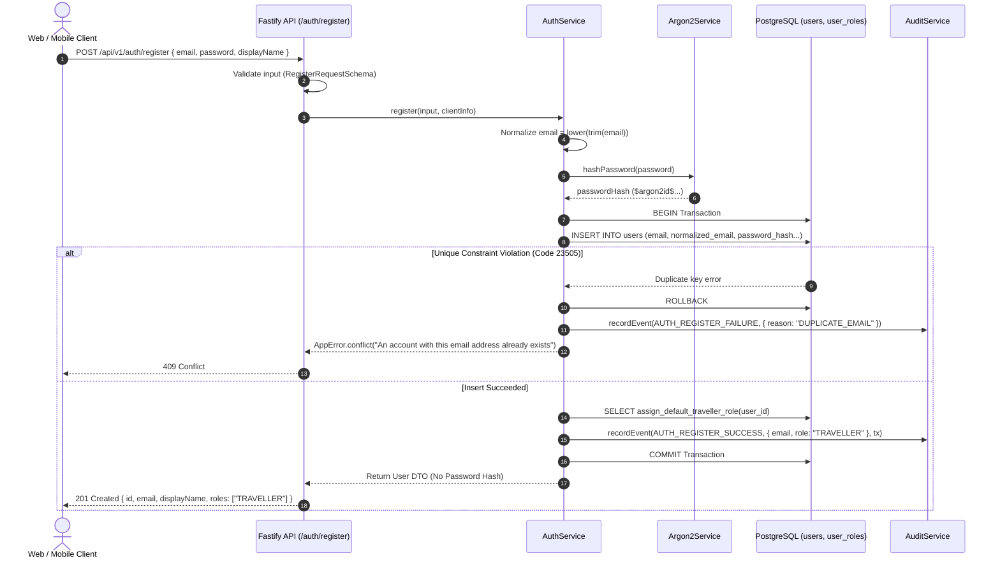
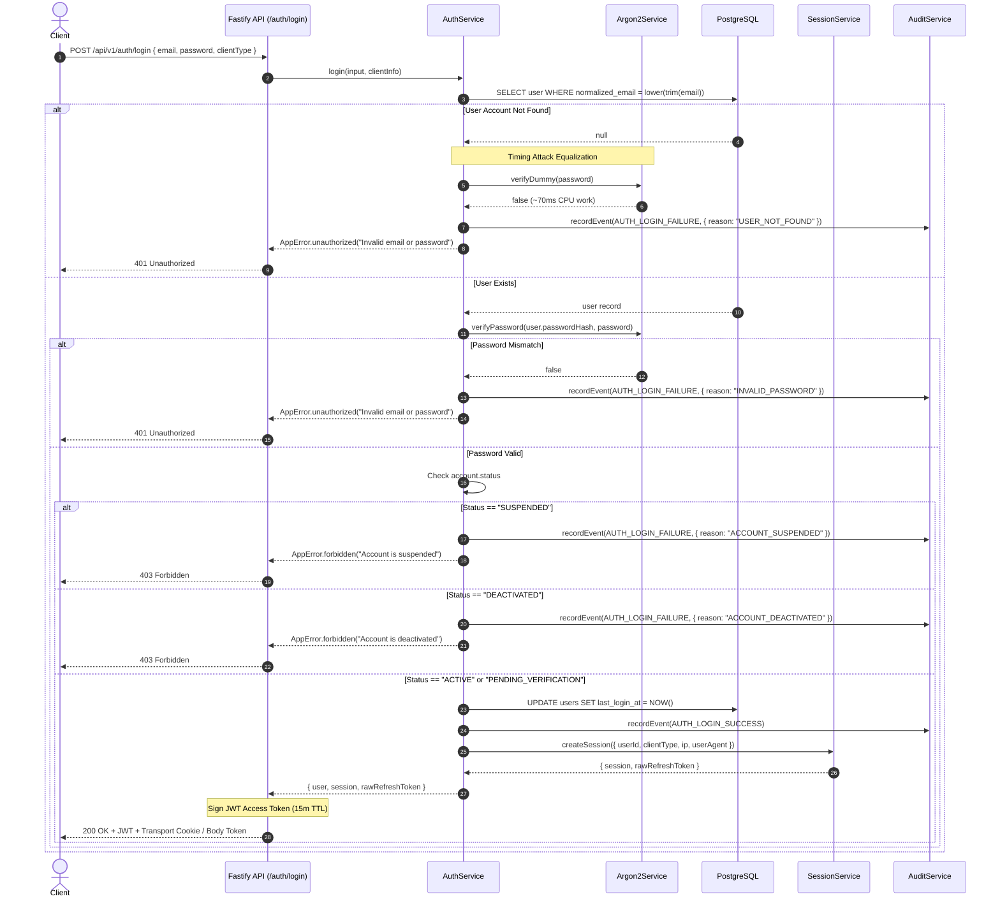

# Authentication Architecture & Credential Verification

**Document ID:** SEC-ARCH-AUTH-02  
**Status:** IMPLEMENTED & TESTED  
**Governing Specification:** [docs/engineering/phase-1b-specification.md](file:///d:/luggage-storage/luggage-storage/docs/engineering/phase-1b-specification.md) (Section 8, 14, 15)  
**Implementation References:**
- Auth Service: [`apps/api/src/modules/auth/auth.service.ts`](file:///d:/luggage-storage/luggage-storage/apps/api/src/modules/auth/auth.service.ts)
- Argon2id Service: [`apps/api/src/modules/auth/argon2.service.ts`](file:///d:/luggage-storage/luggage-storage/apps/api/src/modules/auth/argon2.service.ts)
- Auth Routes: [`apps/api/src/modules/auth/auth.routes.ts`](file:///d:/luggage-storage/luggage-storage/apps/api/src/modules/auth/auth.routes.ts)
- Auth Contracts: [`packages/contracts/src/auth/index.ts`](file:///d:/luggage-storage/luggage-storage/packages/contracts/src/auth/index.ts)
- Test Verification: [`apps/api/tests/auth.test.ts`](file:///d:/luggage-storage/luggage-storage/apps/api/tests/auth.test.ts) (43/43 passing), [`apps/api/tests/security-regression-suite.test.ts`](file:///d:/luggage-storage/luggage-storage/apps/api/tests/security-regression-suite.test.ts)

---

## 1. Purpose & Scope

This document specifies the authentication mechanics, credential verification pipeline, cryptographic algorithms, and timing-attack protections implemented for the Global Luggage Storage Marketplace.

The authentication subsystem is responsible for:
1. Secure account registration with default least-privilege role assignment (`TRAVELLER`).
2. Robust password verification using memory-hard Argon2id hashing.
3. User enumeration defense via timing equalization and generic error envelopes.
4. Account lifecycle gating (`PENDING_VERIFICATION`, `ACTIVE`, `SUSPENDED`, `DEACTIVATED`).
5. Dual transport credential delivery tailored for Web and Mobile platforms.

---

## 2. Cryptographic Password Hashing Engine (Argon2id)

The platform exclusively employs **Argon2id** (RFC 9106 / OWASP ASVS v4.0.3 Level 3 compliance) for password hashing. Argon2id combines data-independent memory access (defending against side-channel cache timing attacks) and data-dependent memory access (defending against GPU/ASIC brute-force search).

### 2.1 Implemented Algorithm Parameters
Extracted directly from [`argon2.service.ts`](file:///d:/luggage-storage/luggage-storage/apps/api/src/modules/auth/argon2.service.ts) and runtime configuration [`env.ts`](file:///d:/luggage-storage/luggage-storage/apps/api/src/config/env.ts):

| Parameter | Configuration Value | Security Purpose |
| :--- | :--- | :--- |
| **Algorithm Variant** | `argon2.argon2id` (`v=19`) | Hybrid protection against side-channel and GPU attacks |
| **Memory Cost ($m$)** | `65,536` KiB (64 MiB) | High memory-hardness; severely penalizes mass GPU cracking arrays |
| **Time Cost ($t$)** | `3` iterations | Execution depth ensuring >50ms evaluation time per attempt |
| **Parallelism ($p$)** | `4` threads | Utilizes multi-core architecture |
| **Salt Generation** | Cryptographically secure random | 16-byte random salt generated automatically by native Argon2 binding |

```typescript
// apps/api/src/modules/auth/argon2.service.ts
async hashPassword(password: string): Promise<string> {
  return argon2.hash(password, {
    type: argon2.argon2id,
    memoryCost: this.memoryCost, // 65536
    timeCost: this.timeCost,     // 3
    parallelism: this.parallelism // 4
  });
}
```

---

## 3. Registration Workflow & Security Guarantees



### 3.1 Security Controls in Registration
1. **Privilege Escalation Defense:** Client payloads attempting to inject administrative roles (e.g. `{ role: "SUPERADMIN" }`) are stripped by `RegisterRequestSchema`. Furthermore, the database table `user_roles` denies direct `INSERT` permissions to the runtime role `luggage_user`.
2. **Atomic Default Role Assignment:** The `TRAVELLER` role is assigned through restricted `SECURITY DEFINER` function `assign_default_traveller_role()`. Failure of role assignment triggers complete transaction rollback.
3. **Collision Resistance:** Duplicate email attempts trigger PostgreSQL error `23505` (`users_normalized_email_unique`), caught and returned as generic HTTP 409 Conflict without revealing database specifics.
4. **Zero Credential Disclosure:** Neither the plaintext password nor the Argon2id hash is returned in API responses or written to operational logs.

---

## 4. Authentication Workflow & Timing-Attack Mitigation



### 4.1 Timing Attack Equalization Engine
When an attacker probes the API with arbitrary email addresses, standard verification skips password hashing for non-existent users, responding in ~2ms compared to ~70ms for real accounts. This timing discrepancy enables automated user enumeration.

To eliminate this side channel, `AuthService` executes a precomputed dummy verification:
```typescript
// apps/api/src/modules/auth/argon2.service.ts
private readonly dummyHash =
  "$argon2id$v=19$m=65536,t=3,p=4$OkpQiS5qIYOlPqyrInPVNQ$dRyS0r+xsycTJbxFwObulB8i3QKZdoHk1ji5MMr3w5A";

async verifyDummy(password: string): Promise<boolean> {
  try {
    return await argon2.verify(this.dummyHash, password);
  } catch {
    return false;
  }
}
```
The dummy verification is parameterized identically (`m=65536, t=3, p=4`), ensuring identical server latency regardless of whether an account exists.

### 4.2 Account Lifecycle Gating
Accounts in `SUSPENDED` or `DEACTIVATED` state are blocked during authentication:
- `SUSPENDED` accounts return `403 Forbidden` (`Account is suspended`). Active sessions are concurrently invalidated upon suspension.
- `DEACTIVATED` accounts return `403 Forbidden` (`Account is deactivated`).
- `PENDING_VERIFICATION` accounts are permitted to authenticate to access verification workflows, but `isEmailVerified` is explicitly reported as `false`.

---

## 5. Dual Transport Model: Web vs Mobile

| Security Property | Web Browser Flow | Mobile Application Flow |
| :--- | :--- | :--- |
| **Access Token** | Retained in JavaScript in-memory state only | Retained in-memory in API client instance |
| **Refresh Token Transport** | Set via `Set-Cookie` HTTP response header | Delivered in JSON body (`data.refreshToken`) |
| **Cookie Attributes** | `HttpOnly: true`, `Secure: true` (prod), `SameSite: Strict`, `Path: /api/v1/auth` | Not applicable |
| **Refresh Token Storage** | Managed by browser cookie jar; inaccessible to JS | Persisted in hardware-backed `Expo SecureStore` |
| **XSS Vulnerability Impact** | Attacker cannot extract refresh token from cookies | In-memory token vulnerable only during runtime execution |
| **CSRF Defense** | `SameSite: Strict` attribute blocks cross-origin requests | Origin/CSRF not applicable to native mobile networking |

---

## 6. Implementation Evidence & Test Coverage

| Security Control | Code Reference | Test Evidence |
| :--- | :--- | :--- |
| **Argon2id Hash Generation** | [`argon2.service.ts`](file:///d:/luggage-storage/luggage-storage/apps/api/src/modules/auth/argon2.service.ts) (line 39) | [`auth.test.ts`](file:///d:/luggage-storage/luggage-storage/apps/api/tests/auth.test.ts) (Test 1) |
| **Timing Attack Mitigation** | [`auth.service.ts`](file:///d:/luggage-storage/luggage-storage/apps/api/src/modules/auth/auth.service.ts) (line 160) | [`security-regression-suite.test.ts`](file:///d:/luggage-storage/luggage-storage/apps/api/tests/security-regression-suite.test.ts) (Test 4) |
| **Duplicate Collision Defense** | [`auth.service.ts`](file:///d:/luggage-storage/luggage-storage/apps/api/src/modules/auth/auth.service.ts) (line 106) | [`auth.test.ts`](file:///d:/luggage-storage/luggage-storage/apps/api/tests/auth.test.ts) (Test 2, 3) |
| **Suspended Account Gating** | [`auth.service.ts`](file:///d:/luggage-storage/luggage-storage/apps/api/src/modules/auth/auth.service.ts) (line 207) | [`auth.test.ts`](file:///d:/luggage-storage/luggage-storage/apps/api/tests/auth.test.ts) (Test 8) |
| **Deactivated Account Gating** | [`auth.service.ts`](file:///d:/luggage-storage/luggage-storage/apps/api/src/modules/auth/auth.service.ts) (line 225) | [`auth.test.ts`](file:///d:/luggage-storage/luggage-storage/apps/api/tests/auth.test.ts) (Test 9) |
| **Default TRAVELLER Role** | [`0002_marvelous_hercules.sql`](file:///d:/luggage-storage/luggage-storage/apps/api/src/infrastructure/database/migrations/0002_marvelous_hercules.sql) (line 41) | [`auth.test.ts`](file:///d:/luggage-storage/luggage-storage/apps/api/tests/auth.test.ts) (Test 1) |
| **Audit Event Emission** | [`auth.service.ts`](file:///d:/luggage-storage/luggage-storage/apps/api/src/modules/auth/auth.service.ts) (lines 80, 163, 260) | [`audit-logging.test.ts`](file:///d:/luggage-storage/luggage-storage/apps/api/tests/audit-logging.test.ts) (Test 5, 6, 7) |

---

## 7. Residual Risks & Next Steps

1. **Residual Risk (Network Rate Limiting):** While brute-force attacks are constrained by Argon2id CPU costs (~70ms) and database indexing, edge rate limiting (IP-based throttling at reverse proxy / Cloudflare) is recommended before public DNS exposure.
2. **Residual Risk (MFA / 2FA):** Multi-factor authentication (SMS OTP or TOTP) is not included in Phase 1B and is scheduled as an enterprise enhancement in post-MVP phases.
