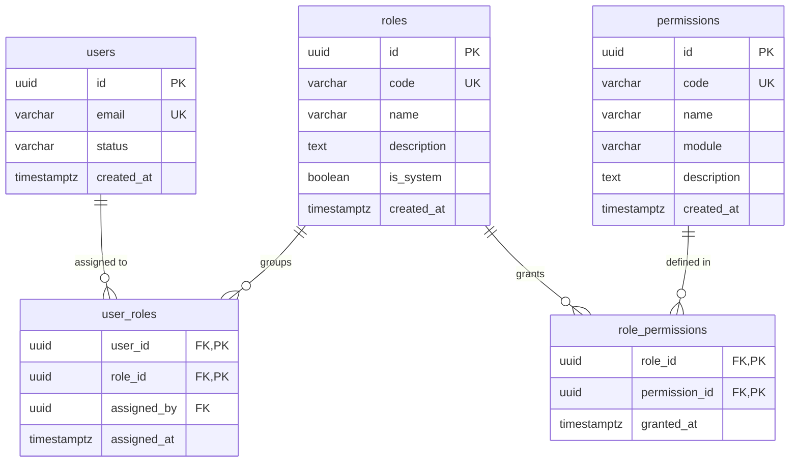
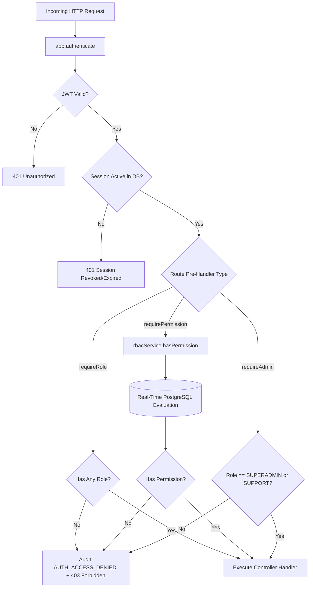

# Authorization & Role-Based Access Control (RBAC) Architecture

## 1. Executive Summary & Document Control

| Attribute | Specification Value |
| :--- | :--- |
| **Document ID** | `SEC-ARCH-RBAC-04` |
| **Title** | Role-Based Access Control (RBAC) and Granular Permission Architecture |
| **Scope** | Platform-wide role definitions, canonical permission catalogue, role-to-permission mappings, runtime evaluation decorators, database enforcement functions, and privilege separation boundaries |
| **Status** | Implemented & Tested |
| **Authoritative Spec** | `docs/engineering/phase-1b-specification.md` (Sections 5, 8, 14, 17) |
| **Primary Code Artifacts** | [`rbac.service.ts`](file:///d:/luggage-storage/luggage-storage/apps/api/src/modules/auth/rbac.service.ts), [`app.ts`](file:///d:/luggage-storage/luggage-storage/apps/api/src/app.ts), [`admin.routes.ts`](file:///d:/luggage-storage/luggage-storage/apps/api/src/modules/admin/admin.routes.ts), [`0003_system_roles.sql`](file:///d:/luggage-storage/luggage-storage/packages/database/src/migrations/0003_system_roles.sql), [`0004_permissions_and_rbac.sql`](file:///d:/luggage-storage/luggage-storage/packages/database/src/migrations/0004_permissions_and_rbac.sql) |
| **Verification Test Suite** | [`rbac.test.ts`](file:///d:/luggage-storage/luggage-storage/apps/api/src/tests/rbac.test.ts), [`security.test.ts`](file:///d:/luggage-storage/luggage-storage/apps/api/src/tests/security.test.ts) |

---

## 2. RBAC Domain Model & Relational Architecture

The platform authorization engine decouples users from permissions through an explicit role mapping hierarchy. Authorization is always resolved against specific permissions rather than raw role codes, enabling flexible privilege modeling.



---

## 3. Canonical Roles & Permission Catalogue

### 3.1 The 5 System Roles

Defined in migration [`0003_system_roles.sql`](file:///d:/luggage-storage/luggage-storage/packages/database/src/migrations/0003_system_roles.sql) and [`contracts/src/rbac`](file:///d:/luggage-storage/luggage-storage/packages/contracts/src/rbac/index.ts):

| Role Code | Role Name | System Role | Purpose & Operational Scope |
| :--- | :--- | :--- | :--- |
| `TRAVELLER` | Traveller | `true` | Default baseline role assigned automatically to every registered user. Grants access to personal profile, own bookings, and own sessions. |
| `HOST_OWNER` | Luggage Host Owner | `true` | Business partner operating luggage storage locations. Controls storage listings, pricing, staff assignment, and booking check-in/out. |
| `HOST_STAFF` | Luggage Host Staff | `true` | Operational personnel at a storage facility. Permitted to process bag drop-off, verify bag tags, and execute bag pick-up. |
| `SUPPORT` | Customer Support Agent | `true` | Read-only operational oversight, customer dispute investigation, ticket handling, and non-destructive assistance. |
| `SUPERADMIN` | Platform Superadministrator | `true` | Full unrestricted governance, system role assignment, administrative account suspension/reactivation, security audit inspection, and financial configuration. |

### 3.2 Canonical Permission Catalogue

Defined in migration [`0004_permissions_and_rbac.sql`](file:///d:/luggage-storage/luggage-storage/packages/database/src/migrations/0004_permissions_and_rbac.sql):

| Module | Permission Code | Description |
| :--- | :--- | :--- |
| **`identity`** | `identity.profile.read` | View personal profile information and preferences |
| **`identity`** | `identity.profile.update` | Update personal profile details, phone, and emergency contact |
| **`identity`** | `identity.session.read_own` | Inspect own active login sessions across devices |
| **`identity`** | `identity.session.revoke_own` | Terminate own specific login sessions or logout all |
| **`identity`** | `identity.password.change` | Authenticated password change with session revocation |
| **`admin`** | `admin.user.read` | Search, filter, and inspect detailed user records across the platform |
| **`admin`** | `admin.user.suspend` | Suspend active user accounts and revoke active sessions |
| **`admin`** | `admin.user.reinstate` | Reinstate previously suspended user accounts |
| **`admin`** | `admin.user.deactivate` | Deactivate accounts (reversible only by Superadmin) |
| **`admin`** | `admin.user.reactivate` | Reactivate deactivated accounts |
| **`admin`** | `admin.user.verify_email` | Administratively verify email addresses without verification token |
| **`admin`** | `admin.session.read_any` | Inspect active sessions for any user account |
| **`admin`** | `admin.session.revoke_any` | Administratively revoke any active session across the platform |
| **`admin`** | `admin.role.read` | Query system roles, role descriptions, and granted permissions |
| **`admin`** | `admin.role.assign` | Grant roles to user accounts (subject to privilege escalation bounds) |
| **`admin`** | `admin.role.revoke` | Remove assigned roles from user accounts |
| **`admin`** | `admin.permission.read` | Inspect canonical permission catalogue and role mappings |
| **`admin`** | `admin.audit.read` | Query and inspect immutable security audit event records |
| **`admin`** | `admin.platform.manage` | Configure marketplace parameters, fees, and operational policies |
| **`admin`** | `admin.kyc.manage` | Review and verify host KYC documentation and identity proofs |
| **`admin`** | `admin.financial.manage` | Manage payout batches, bank account connections, and platform balance |
| **`support`** | `support.ticket.read` | Inspect customer support tickets and user context |
| **`support`** | `support.ticket.update` | Update support ticket status, add internal notes, and resolve cases |

### 3.3 Role-to-Permission Mapping Matrix

| Permission Code | `TRAVELLER` | `HOST_OWNER` | `HOST_STAFF` | `SUPPORT` | `SUPERADMIN` |
| :--- | :---: | :---: | :---: | :---: | :---: |
| `identity.profile.read` | :white_check_mark: | :white_check_mark: | :white_check_mark: | :white_check_mark: | :white_check_mark: |
| `identity.profile.update` | :white_check_mark: | :white_check_mark: | :white_check_mark: | :white_check_mark: | :white_check_mark: |
| `identity.session.read_own` | :white_check_mark: | :white_check_mark: | :white_check_mark: | :white_check_mark: | :white_check_mark: |
| `identity.session.revoke_own` | :white_check_mark: | :white_check_mark: | :white_check_mark: | :white_check_mark: | :white_check_mark: |
| `identity.password.change` | :white_check_mark: | :white_check_mark: | :white_check_mark: | :white_check_mark: | :white_check_mark: |
| `support.ticket.read` | :x: | :x: | :x: | :white_check_mark: | :white_check_mark: |
| `support.ticket.update` | :x: | :x: | :x: | :white_check_mark: | :white_check_mark: |
| `admin.user.read` | :x: | :x: | :x: | :white_check_mark: | :white_check_mark: |
| `admin.session.read_any` | :x: | :x: | :x: | :white_check_mark: | :white_check_mark: |
| `admin.role.read` | :x: | :x: | :x: | :white_check_mark: | :white_check_mark: |
| `admin.permission.read` | :x: | :x: | :x: | :white_check_mark: | :white_check_mark: |
| `admin.user.suspend` | :x: | :x: | :x: | :x: | :white_check_mark: |
| `admin.user.reinstate` | :x: | :x: | :x: | :x: | :white_check_mark: |
| `admin.user.deactivate` | :x: | :x: | :x: | :x: | :white_check_mark: |
| `admin.user.reactivate` | :x: | :x: | :x: | :x: | :white_check_mark: |
| `admin.user.verify_email` | :x: | :x: | :x: | :x: | :white_check_mark: |
| `admin.session.revoke_any` | :x: | :x: | :x: | :x: | :white_check_mark: |
| `admin.role.assign` | :x: | :x: | :x: | :x: | :white_check_mark: |
| `admin.role.revoke` | :x: | :x: | :x: | :x: | :white_check_mark: |
| `admin.audit.read` | :x: | :x: | :x: | :x: | :white_check_mark: |
| `admin.platform.manage` | :x: | :x: | :x: | :x: | :white_check_mark: |
| `admin.kyc.manage` | :x: | :x: | :x: | :x: | :white_check_mark: |
| `admin.financial.manage` | :x: | :x: | :x: | :x: | :white_check_mark: |

---

## 4. Runtime Enforcement & Fastify Pre-Handlers

Authorization enforcement is centralized via Fastify decorators registered in [`app.ts`](file:///d:/luggage-storage/luggage-storage/apps/api/src/app.ts):



### 4.1 Real-Time DB Permission Resolution vs Token Claims
While the access token JWT contains a snapshot of user roles at the time of issuance, **all sensitive administrative and privilege-checked routes execute real-time PostgreSQL permission queries via [`rbacService.hasPermission()`](file:///d:/luggage-storage/luggage-storage/apps/api/src/modules/auth/rbac.service.ts#L44-L49)**.
- Query:
  ```sql
  SELECT DISTINCT p.code
  FROM permissions p
  INNER JOIN role_permissions rp ON p.id = rp.permission_id
  INNER JOIN user_roles ur ON rp.role_id = ur.role_id
  INNER JOIN users u ON ur.user_id = u.id
  WHERE ur.user_id = $1 AND u.status = 'ACTIVE'
  ORDER BY p.code ASC;
  ```
- **Security Guarantee**: Role revocations or account suspensions take effect **immediately**. There is no 15-minute token caching window during which a revoked user could perform unauthorized administrative operations.

---

## 5. Privilege Separation & Boundary Invariants

To eliminate privilege escalation, the following database and application boundaries are strictly enforced:

### 5.1 Default Role Provisioning Trigger
In migration `0003_system_roles.sql`, a PostgreSQL trigger executes immediately on user record creation:
```sql
CREATE OR REPLACE FUNCTION assign_default_traveller_role()
RETURNS TRIGGER AS $$
DECLARE
    traveller_role_id UUID;
BEGIN
    SELECT id INTO traveller_role_id FROM roles WHERE code = 'TRAVELLER';
    IF traveller_role_id IS NOT NULL THEN
        INSERT INTO user_roles (user_id, role_id)
        VALUES (NEW.id, traveller_role_id)
        ON CONFLICT DO NOTHING;
    END IF;
    RETURN NEW;
END;
$$ LANGUAGE plpgsql;

CREATE TRIGGER trg_user_default_role
AFTER INSERT ON users
FOR EACH ROW
EXECUTE FUNCTION assign_default_traveller_role();
```
- **Security Guarantee**: No user account can exist in an unassigned or unconstrained authorization state.

### 5.2 Superadmin Protection & Last-Superadmin Invariant
In migration `0003_system_roles.sql`, the platform enforces the preservation of platform administrative capability:
```sql
CREATE OR REPLACE FUNCTION prevent_last_superadmin_removal()
RETURNS TRIGGER AS $$
DECLARE
    superadmin_count INTEGER;
    superadmin_role_id UUID;
BEGIN
    SELECT id INTO superadmin_role_id FROM roles WHERE code = 'SUPERADMIN';
    IF OLD.role_id = superadmin_role_id THEN
        SELECT COUNT(*) INTO superadmin_count
        FROM user_roles
        WHERE role_id = superadmin_role_id;
        
        IF superadmin_count <= 1 THEN
            RAISE EXCEPTION 'Cannot revoke the last SUPERADMIN role from the platform.';
        END IF;
    END IF;
    RETURN OLD;
END;
$$ LANGUAGE plpgsql;
```
- **Self-Action Defense ([`rbac.service.ts`](file:///d:/luggage-storage/luggage-storage/apps/api/src/modules/auth/rbac.service.ts#L166-L168))**: Administrators cannot modify their own roles (`adminId === targetUserId` throws `AppError.badRequest`).
- **Support Boundary ([`rbac.service.ts`](file:///d:/luggage-storage/luggage-storage/apps/api/src/modules/auth/rbac.service.ts#L196-L202))**: Support staff are prevented from assigning `SUPERADMIN` or `SUPPORT` roles, and cannot suspend or deactivate Superadmin accounts.

### 5.3 Database Role Privileges (DML Revocation)
In migration `0004_permissions_and_rbac.sql`:
```sql
REVOKE ALL ON ALL TABLES IN SCHEMA public FROM luggage_user;
GRANT SELECT, INSERT, UPDATE, DELETE ON TABLE users, auth_sessions, user_roles, password_reset_tokens TO luggage_user;
GRANT SELECT ON TABLE roles, permissions, role_permissions TO luggage_user;
```
- **Security Guarantee**: The runtime application database user (`luggage_user`) possesses **read-only (`SELECT`) permissions** on `roles`, `permissions`, and `role_permissions`.
- Role assignments and revocations are permitted only via the `SECURITY DEFINER` stored functions `public.assign_user_role(...)` and `public.revoke_user_role(...)`. Direct `INSERT` or `DELETE` on catalog tables is denied at the database engine level.

---

## 6. Implementation Evidence & Test Traceability

| Control / Requirement | Code Artifact | Verification Test | Test Suite File |
| :--- | :--- | :--- | :--- |
| **Default `TRAVELLER` Assignment** | [`trg_user_default_role`](file:///d:/luggage-storage/luggage-storage/packages/database/src/migrations/0003_system_roles.sql) | `registration automatically assigns TRAVELLER role` | [`auth.test.ts`](file:///d:/luggage-storage/luggage-storage/apps/api/src/tests/auth.test.ts) |
| **Granular Permission Check** | [`app.decorate('requirePermission')`](file:///d:/luggage-storage/luggage-storage/apps/api/src/app.ts#L133-L160) | `requirePermission blocks requests lacking capability` | [`rbac.test.ts`](file:///d:/luggage-storage/luggage-storage/apps/api/src/tests/rbac.test.ts) |
| **Real-Time Permission DB Query** | [`rbacService.getEffectivePermissions()`](file:///d:/luggage-storage/luggage-storage/apps/api/src/modules/auth/rbac.service.ts#L28-L41) | `effective permissions update immediately on role change` | [`rbac.test.ts`](file:///d:/luggage-storage/luggage-storage/apps/api/src/tests/rbac.test.ts) |
| **Self-Role Modification Defense** | [`rbacService.assignRole()`](file:///d:/luggage-storage/luggage-storage/apps/api/src/modules/auth/rbac.service.ts#L166) | `administrators cannot assign or revoke roles from themselves` | [`rbac.test.ts`](file:///d:/luggage-storage/luggage-storage/apps/api/src/tests/rbac.test.ts) |
| **Last-Superadmin Invariant** | [`prevent_last_superadmin_removal()`](file:///d:/luggage-storage/luggage-storage/packages/database/src/migrations/0003_system_roles.sql) | `cannot revoke role from the only remaining superadmin` | [`security.test.ts`](file:///d:/luggage-storage/luggage-storage/apps/api/src/tests/security.test.ts) |
| **Support vs Superadmin Boundary** | [`adminService.suspendUser()`](file:///d:/luggage-storage/luggage-storage/apps/api/src/modules/admin/admin.service.ts#L253-L258) | `support staff cannot suspend superadmin account` | [`admin.test.ts`](file:///d:/luggage-storage/luggage-storage/apps/api/src/tests/admin.test.ts) |
| **Audit Access Denied** | [`app.ts`](file:///d:/luggage-storage/luggage-storage/apps/api/src/app.ts#L82-L97) | `permission denial records AUTH_ACCESS_DENIED audit event` | [`audit.test.ts`](file:///d:/luggage-storage/luggage-storage/apps/api/src/tests/audit.test.ts) |
