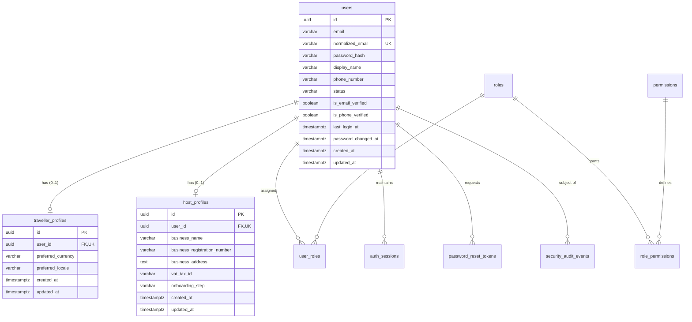
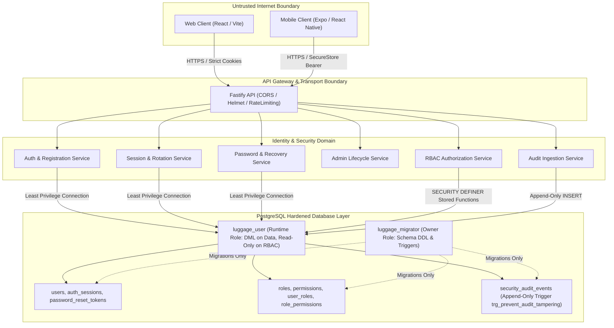

# Identity Domain Architecture & Data Model

**Document ID:** SEC-ARCH-ID-01  
**Status:** IMPLEMENTED & TESTED  
**Governing Specification:** [docs/engineering/phase-1b-specification.md](file:///d:/luggage-storage/luggage-storage/docs/engineering/phase-1b-specification.md) (Section 6, 7, 8)  
**Implementation References:**
- Schema: [`apps/api/src/infrastructure/database/schema/identity.ts`](file:///d:/luggage-storage/luggage-storage/apps/api/src/infrastructure/database/schema/identity.ts)
- Contracts: [`packages/contracts/src/identity/index.ts`](file:///d:/luggage-storage/luggage-storage/packages/contracts/src/identity/index.ts)
- Migrations: [`apps/api/src/infrastructure/database/migrations/0000_outgoing_thunderbolt_ross.sql`](file:///d:/luggage-storage/luggage-storage/apps/api/src/infrastructure/database/migrations/0000_outgoing_thunderbolt_ross.sql), [`0001_empty_puff_adder.sql`](file:///d:/luggage-storage/luggage-storage/apps/api/src/infrastructure/database/migrations/0001_empty_puff_adder.sql), [`0002_marvelous_hercules.sql`](file:///d:/luggage-storage/luggage-storage/apps/api/src/infrastructure/database/migrations/0002_marvelous_hercules.sql)
- Verification Suite: [`apps/api/tests/identity-database.test.ts`](file:///d:/luggage-storage/luggage-storage/apps/api/tests/identity-database.test.ts) (31/31 passing)

---

## 1. Purpose & Scope

This document specifies the authoritative security architecture of the unified **Identity Domain** for the Global Luggage Storage Marketplace. It describes the data structures, trust boundaries, persona decoupling models, and database-level integrity controls established in Phase 1B.

The Identity Domain is the foundational security boundary for the entire marketplace:
1. It establishes a single, unified credential root (`users`).
2. It decouples marketplace persona roles (`traveller_profiles`, `host_profiles`) from authentication credentials.
3. It provides centralized identity lifecycle and multi-role assignment across all platform touchpoints (Web, Mobile, Admin API).

---

## 2. Unified User Identity Architecture

The platform rejects fragmented user tables (e.g. separate `travellers` and `hosts` auth credentials). Instead, it implements a single, normalized `User` entity that owns credentials, security status, and multi-factor verification state.

### 2.1 Email Normalization & Account Collision Defense
To prevent account squatting, duplicate credential issuance, or collision bypass via case variations or trailing whitespace, the `users` table enforces dual email representation:
- **`email` (Display Email):** Preserves original user-entered casing (e.g. `John.Doe@Example.com`) for communications and UI display.
- **`normalized_email` (Canonical Index):** Evaluated strictly as `lower(trim(email))`.
- **Database Check Constraint:** `users_normalized_email_match_check` guarantees `normalized_email = lower(trim(email))`. Any SQL operation inserting an inconsistent value is rejected at the engine level.
- **Unique B-Tree Index:** `users_normalized_email_unique` enforces strict global uniqueness on `normalized_email`.

### 2.2 Persona Decoupling (`TravellerProfile` and `HostProfile`)
Per ADR-003 and ADR-010, the marketplace allows a single authenticated user to operate as both a Traveller and a Host without creating duplicate accounts:
- **Zero Credential Duplication:** Persona profile tables (`traveller_profiles`, `host_profiles`) contain zero passwords, salts, tokens, or email duplicates. They reference `users.id` through `ON DELETE CASCADE` foreign keys.
- **KYC & Onboarding Isolation:** The `host_profiles` entity encapsulates Phase 1B identity metadata (`business_name`, `vat_tax_id`, `onboarding_step`). It does not represent active business KYC approval, which is strictly partitioned into Phase 2.
- **Independent Context Updates:** Profile preferences (e.g. `preferred_currency`, `preferred_locale`) mutate independently of core authentication state.

---

## 3. Trust Boundaries & Separation of Responsibilities

### 3.1 Bounded Context Partitioning
1. **Identity & Authentication:** Manages credential verification, password hashing, session lifecycle, token generation, and account activation status.
2. **Authorization (RBAC):** Computes effective permissions for authenticated identities; evaluated in real-time on every request.
3. **Business Domains (Phase 2+):** Storage locations, luggage bookings, payments, and reviews. These domains rely strictly on the `User ID` authenticated by the Identity Domain and cannot mutate identity records.

---

## 4. Sensitive Data Inventory & Protection Responsibilities

| Data Element | Storage Location | Protection Mechanism | Classification |
| :--- | :--- | :--- | :--- |
| **Passwords** | `users.password_hash` | Argon2id (`v=19`, `m=64MB`, `t=3`, `p=4`). Plaintext never stored or logged. | CRITICAL SECRET |
| **Refresh Tokens** | `auth_sessions.refresh_token_hash` | SHA-256 cryptographic verifier hash only. Raw tokens never persisted. | SENSITIVE CREDENTIAL |
| **Password Reset Tokens** | `password_reset_tokens.token_hash` | SHA-256 cryptographic verifier hash only. Raw tokens delivered via decoupled adapter. | SENSITIVE CREDENTIAL |
| **PII (Email, Phone, Display Name)** | `users` | Normalized, unique index, protected by RBAC; never exposed in public responses. | CONFIDENTIAL PII |
| **Security Audit Logs** | `security_audit_events` | Immutable database trigger (`trg_prevent_audit_tampering`). Deep metadata redaction. | AUDIT TRAIL |

---

## 5. Traceability & Implementation Evidence

| Architecture Requirement | Implementation Evidence | Automated Test Verification |
| :--- | :--- | :--- |
| **Unified User Model** | [`identity.ts`](file:///d:/luggage-storage/luggage-storage/apps/api/src/infrastructure/database/schema/identity.ts) (lines 14–47) | [`identity-database.test.ts`](file:///d:/luggage-storage/luggage-storage/apps/api/tests/identity-database.test.ts) (Test 1, 2) |
| **Normalized Email Constraint** | [`0001_empty_puff_adder.sql`](file:///d:/luggage-storage/luggage-storage/apps/api/src/infrastructure/database/migrations/0001_empty_puff_adder.sql) (line 2) | [`identity-database.test.ts`](file:///d:/luggage-storage/luggage-storage/apps/api/tests/identity-database.test.ts) (Test 3) |
| **Traveller Profile Decoupling** | [`identity.ts`](file:///d:/luggage-storage/luggage-storage/apps/api/src/infrastructure/database/schema/identity.ts) (lines 49–70) | [`identity-database.test.ts`](file:///d:/luggage-storage/luggage-storage/apps/api/tests/identity-database.test.ts) (Test 4, 5) |
| **Host Profile Decoupling** | [`identity.ts`](file:///d:/luggage-storage/luggage-storage/apps/api/src/infrastructure/database/schema/identity.ts) (lines 72–98) | [`identity-database.test.ts`](file:///d:/luggage-storage/luggage-storage/apps/api/tests/identity-database.test.ts) (Test 6, 7) |
| **Audit Immutability Trigger** | [`0002_marvelous_hercules.sql`](file:///d:/luggage-storage/luggage-storage/apps/api/src/infrastructure/database/migrations/0002_marvelous_hercules.sql) (lines 6–26) | [`identity-database.test.ts`](file:///d:/luggage-storage/luggage-storage/apps/api/tests/identity-database.test.ts) (Test 25–28) |
| **Runtime Role Least Privilege** | [`0002_marvelous_hercules.sql`](file:///d:/luggage-storage/luggage-storage/apps/api/src/infrastructure/database/migrations/0002_marvelous_hercules.sql) (lines 28–38) | [`identity-database.test.ts`](file:///d:/luggage-storage/luggage-storage/apps/api/tests/identity-database.test.ts) (Test 22–24) |

---

## 6. Residual Risks & Planned Evolution

1. **Residual Risk (PostGIS Geography Columns):** The `host_profiles` table currently captures text addresses; exact geolocation coordinates will be bound in Phase 2 via spatial indexing (`ST_Point` / PostGIS).
2. **Residual Risk (Data Retention & Deletion):** Hard permanent deletion of `users` records is intentionally disabled; soft-deactivation (`DEACTIVATED` state) is implemented to preserve referential integrity for financial auditability. Formal GDPR/CCPA erasure procedures remain subject to pending legal data governance approval.
