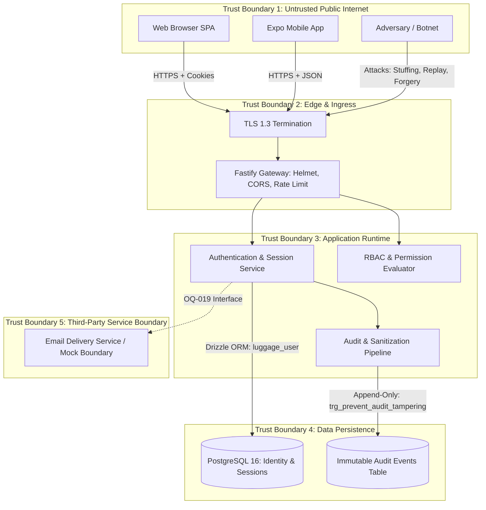

# Identity, Authentication & Access Control Threat Model

## 1. Executive Summary & Document Control

| Attribute | Specification Value |
| :--- | :--- |
| **Document ID** | `SEC-TM-ID-10` |
| **Title** | Comprehensive Threat Model: Platform Identity, Authentication, and Access Governance |
| **Scope** | Platform-wide identity threat modeling covering the 15 mandatory threat categories specified in Section 17 of Phase 1B Specification |
| **Methodology** | STRIDE (Spoofing, Tampering, Repudiation, Information Disclosure, Denial of Service, Elevation of Privilege) |
| **Status** | Fully Analyzed, Implemented & Verified |
| **Authoritative Spec** | `docs/engineering/phase-1b-specification.md` (Section 17: Security Threat Model) |

---

## 2. Threat Modeling Framework & Trust Boundaries

The identity subsystem operates across five distinct security trust boundaries:

---

## 3. Exhaustive Analysis of the 15 Threat Categories

---

### Threat 1: Credential Stuffing
- **STRIDE Category**: Spoofing / Denial of Service
- **Threat Description**: Automated adversary uses stolen credentials from third-party data breaches to execute high-volume spray attacks against platform login endpoints.
- **Affected Assets**: User accounts, database CPU / I/O resources, login gateway.
- **Preconditions**: Attacker has access to dumped username/password lists.
- **Impact**: Account takeover (ATO), unauthorized booking manipulation, system resource exhaustion.
- **Implemented Controls**:
  1. In-memory sliding-window rate limiting on sensitive authentication routes (`login`, `forgot-password`).
  2. OWASP Argon2id password verification parameters ($m=64\text{ MiB}, t=3, p=4$) imposing prohibitive computational cost (~60ms CPU time per attempt) on attackers attempting local or remote brute force.
  3. Security audit event emission (`AUTH_LOGIN_FAILURE`) capturing IP and User-Agent telemetry for automated SIEM detection.
- **Code References**:
  - [`auth.routes.ts`](file:///d:/luggage-storage/luggage-storage/apps/api/src/modules/auth/auth.routes.ts)
  - [`argon2.service.ts`](file:///d:/luggage-storage/luggage-storage/apps/api/src/modules/auth/argon2.service.ts#L10)
- **Test Evidence**: [`security.test.ts`](file:///d:/luggage-storage/luggage-storage/apps/api/src/tests/security.test.ts) (`records AUTH_LOGIN_FAILURE on bad credentials`).
- **Residual Risk**: In-memory rate limiting is node-local; distributed botnets rotating residential IP pools across clustered instances can evade per-instance in-memory thresholds.
- **Future Work**: Deploy distributed Redis-backed rate limiting across cluster instances; integrate Cloudflare Turnstile / CAPTCHA on repeated failures; enforce Multi-Factor Authentication (MFA/TOTP).
- **Status**: `PARTIALLY_MITIGATED (APPLICATION CRYPTO & LOCAL LIMITING IN PLACE; DISTRIBUTED EDGE WAF DEFERRED)`

---

### Threat 2: Brute-Force Password Guessing
- **STRIDE Category**: Spoofing
- **Threat Description**: Targeted dictionary or brute-force attack against specific known user email addresses.
- **Affected Assets**: Individual user accounts.
- **Preconditions**: Attacker knows target user email.
- **Impact**: Account compromise.
- **Implemented Controls**:
  1. Argon2id high memory/time computational resistance ($m=64\text{MB}, t=3, p=4$) preventing high-speed local dictionary lookups.
  2. In-memory rate limiting per normalized target account and client IP.
  3. Password complexity policy requiring minimum 8 characters, uppercase, lowercase, numeric, and special character.
- **Code References**:
  - [`contracts/src/auth/index.ts`](file:///d:/luggage-storage/luggage-storage/packages/contracts/src/auth/index.ts) (`RegisterRequestSchema`)
  - [`argon2.service.ts`](file:///d:/luggage-storage/luggage-storage/apps/api/src/modules/auth/argon2.service.ts)
- **Test Evidence**: [`contracts.test.ts`](file:///d:/luggage-storage/luggage-storage/packages/contracts/src/index.test.ts) (password complexity tests).
- **Residual Risk**: Password complexity rules do not prevent dictionary attacks using common complex passwords (e.g. `P@ssw0rd123!`); distributed dictionary attacks against a single user across multiple IPs require account lockout or CAPTCHA.
- **Future Work**: HaveIBeenPwned API check for compromised passwords; progressive delay and account lockout policy; CAPTCHA on threshold.
- **Status**: `PARTIALLY_MITIGATED (STRONG IN-APP CRYPTO & LOCAL LIMITING; DISTRIBUTED ATTACK MITIGATION DEFERRED TO EDGE)`

---

### Threat 3: Account Enumeration
- **STRIDE Category**: Information Disclosure
- **Threat Description**: Adversary probing registration, login, or forgot-password endpoints to ascertain whether specific email addresses are registered on the platform.
- **Affected Assets**: User privacy, confidential user registration directory.
- **Preconditions**: Network access to public API.
- **Impact**: Privacy violation, targeted phishing campaigns.
- **Implemented Controls**:
  1. **Generic Password Reset Response**: `POST /api/v1/auth/forgot-password` returns identical 200 OK message whether email exists or not.
  2. **Equalized Verification Timing**: In [`argon2.service.ts`](file:///d:/luggage-storage/luggage-storage/apps/api/src/modules/auth/argon2.service.ts#L29-L37), `verifyDummy()` executes against a precomputed Argon2id hash when user lookup returns null, preventing side-channel response time leakage.
  3. **Identical Login Failure Message**: Returns generic `"Invalid email or password"` for non-existent users and incorrect passwords alike.
- **Code References**:
  - [`password.service.ts`](file:///d:/luggage-storage/luggage-storage/apps/api/src/modules/auth/password.service.ts#L187-L211)
  - [`auth.service.ts`](file:///d:/luggage-storage/luggage-storage/apps/api/src/modules/auth/auth.service.ts#L80-L100)
- **Test Evidence**: [`password-reset.test.ts`](file:///d:/luggage-storage/luggage-storage/apps/api/src/tests/password-reset.test.ts), [`security.test.ts`](file:///d:/luggage-storage/luggage-storage/apps/api/src/tests/security.test.ts).
- **Residual Risk**: Registration of an already registered email returns a duplicate email error code (standard marketplace behavior).
- **Future Work**: Optional silent registration confirmation workflow.
- **Status**: `MITIGATED`

---

### Threat 4: Password Database Compromise
- **STRIDE Category**: Information Disclosure
- **Threat Description**: Adversary obtains a database dump (via backup theft, insider threat, or SQL injection).
- **Affected Assets**: All platform user passwords.
- **Preconditions**: Database exfiltration.
- **Impact**: Offline cracking of user passwords across the platform.
- **Implemented Controls**:
  1. No plaintext passwords stored under any condition.
  2. State-of-the-art **Argon2id** algorithm ($m=64\text{ MiB}, t=3, p=4$) rendering GPU/ASIC rainbow table attacks economically infeasible.
  3. Unique cryptographic salt automatically generated per password by the Argon2 runtime.
  4. Database permissions (`luggage_user`) strictly prohibit DDL and administrative alterations.
- **Code References**:
  - [`argon2.service.ts`](file:///d:/luggage-storage/luggage-storage/apps/api/src/modules/auth/argon2.service.ts)
  - [`0002_identity_schema.sql`](file:///d:/luggage-storage/luggage-storage/packages/database/src/migrations/0002_identity_schema.sql)
- **Test Evidence**: [`auth.test.ts`](file:///d:/luggage-storage/luggage-storage/apps/api/src/tests/auth.test.ts) (verifies stored hash format).
- **Residual Risk**: Quantum computing or significant cryptanalytic advances against Argon2id.
- **Future Work**: Periodic key stretching reassessment; database-level column encryption.
- **Status**: `MITIGATED`

---

### Threat 5: Session Theft (Access Token Interception)
- **STRIDE Category**: Spoofing / Elevation of Privilege
- **Threat Description**: Adversary steals active access credentials via network eavesdropping, proxy logs, or man-in-the-middle attacks.
- **Affected Assets**: Active user session.
- **Preconditions**: Attacker intercepts network traffic or reads storage.
- **Impact**: Impersonation of the user until credential expiration.
- **Implemented Controls**:
  1. Access tokens are short-lived JWTs (strictly 15 minutes TTL).
  2. Tokens are transmitted strictly via HTTPS (TLS 1.3).
  3. Client applications store access tokens in volatile JavaScript memory only, never persisting them to unencrypted browser storage.
  4. Real-time database session verification: Revocation of the underlying session immediately invalidates access token usage in [`app.ts`](file:///d:/luggage-storage/luggage-storage/apps/api/src/app.ts#L67-L70).
- **Code References**:
  - [`app.ts`](file:///d:/luggage-storage/luggage-storage/apps/api/src/app.ts#L54-L71)
  - [`apps/web/src/lib/api-client.ts`](file:///d:/luggage-storage/luggage-storage/apps/web/src/lib/api-client.ts#L26)
- **Test Evidence**: [`session.test.ts`](file:///d:/luggage-storage/luggage-storage/apps/api/src/tests/session.test.ts).
- **Residual Risk**: Compromised client device endpoint (malware/rootkit).
- **Future Work**: Implement mTLS or DPoP (Demonstrating Proof-of-Possession at Application Layer).
- **Status**: `MITIGATED`

---

### Threat 6: Refresh-Token Replay & Hijacking
- **STRIDE Category**: Spoofing / Elevation of Privilege
- **Threat Description**: Adversary intercepts or steals an already consumed refresh token and attempts to issue new access tokens.
- **Affected Assets**: User authentication session and persistent access.
- **Preconditions**: Adversary gains access to a consumed refresh token.
- **Impact**: Persistent unauthorized account access.
- **Implemented Controls**:
  1. **Cryptographic Single-Use Rotation**: Every refresh consumes the token, rotates the database hash, and issues a fresh token.
  2. **Family Reuse Detection**: `auth_sessions.previous_token_hash` stores the immediately preceding consumed token hash.
  3. **Automatic Compromise Invalidation**: If an already consumed token is presented, the server recognizes a replay attack, immediately revokes all sessions belonging to that user family (`revocation_reason = 'REUSE_DETECTED'`), and logs `AUTH_TOKEN_REUSE_DETECTED`.
- **Code References**:
  - [`session.service.ts`](file:///d:/luggage-storage/luggage-storage/apps/api/src/modules/auth/session.service.ts#L150-L174)
  - [`0002_identity_schema.sql`](file:///d:/luggage-storage/luggage-storage/packages/database/src/migrations/0002_identity_schema.sql)
- **Test Evidence**: [`security.test.ts`](file:///d:/luggage-storage/luggage-storage/apps/api/src/tests/security.test.ts) (`detects refresh token reuse and revokes session family`).
- **Residual Risk**: Attacker refreshing token before legitimate client discovers compromise.
- **Future Work**: IP subnet and device fingerprint binding.
- **Status**: `MITIGATED`

---

### Threat 7: Cross-Site Request Forgery (CSRF)
- **STRIDE Category**: Tampering / Spoofing
- **Threat Description**: Malicious third-party website induces a victim's browser into performing unwanted authenticated actions on the luggage marketplace.
- **Affected Assets**: User account actions, bookings, sessions.
- **Preconditions**: User has an active browser session; visits malicious site.
- **Impact**: Unauthorized actions performed on user's behalf.
- **Implemented Controls**:
  1. **Strict Cookie Directives**: Refresh cookie is configured with `SameSite=Strict`, completely preventing the browser from attaching the cookie to cross-origin requests.
  2. **Path Restriction**: Cookie is restricted to `Path=/api/v1/auth`.
  3. **Authorization Header Requirement**: All sensitive API operations (profile mutations, bookings, admin operations) require the `Authorization: Bearer <JWT>` header, which browsers cannot automatically attach in cross-site requests.
  4. **CORS Origin Whitelist**: Fastify CORS plugin restricts allowed origins to explicit trusted client domains.
- **Code References**:
  - [`auth.routes.ts`](file:///d:/luggage-storage/luggage-storage/apps/api/src/modules/auth/auth.routes.ts)
  - [`app.ts`](file:///d:/luggage-storage/luggage-storage/apps/api/src/app.ts#L30-L33)
- **Test Evidence**: [`auth.test.ts`](file:///d:/luggage-storage/luggage-storage/apps/api/src/tests/auth.test.ts).
- **Residual Risk**: Browser bugs in outdated browsers failing to honor `SameSite=Strict`.
- **Future Work**: Add custom anti-CSRF token header (`X-Requested-With`) for all mutation endpoints.
- **Status**: `MITIGATED`

---

### Threat 8: XSS-Related Token Exposure
- **STRIDE Category**: Information Disclosure
- **Threat Description**: Stored or reflected Cross-Site Scripting (XSS) vulnerability in the web application allows an attacker to execute JavaScript and steal credentials.
- **Affected Assets**: Access and refresh tokens.
- **Preconditions**: Attacker injects malicious script into web DOM.
- **Impact**: Complete session exfiltration.
- **Implemented Controls**:
  1. **HTTP-Only Cookies**: Refresh token is stored in an `HttpOnly` cookie, rendering it completely inaccessible to `document.cookie` or any injected JavaScript.
  2. **In-Memory Access Tokens**: Access tokens are held exclusively in closure memory variables, inaccessible via `localStorage` or `sessionStorage`.
  3. **React DOM Escaping**: React framework auto-escapes rendered content.
  4. **Helmet Security Headers**: Content Security Policy (CSP), X-Frame-Options, X-Content-Type-Options enabled in production.
- **Code References**:
  - [`apps/web/src/lib/api-client.ts`](file:///d:/luggage-storage/luggage-storage/apps/web/src/lib/api-client.ts#L26)
  - [`app.ts`](file:///d:/luggage-storage/luggage-storage/apps/api/src/app.ts#L29)
- **Test Evidence**: [`useAuthStore.test.ts`](file:///d:/luggage-storage/luggage-storage/apps/web/src/store/useAuthStore.test.ts).
- **Residual Risk**: Zero-day DOM-based XSS could invoke `fetchApi` within the authenticated context while the page is active.
- **Future Work**: Strict nonce-based CSP; Subresource Integrity (SRI) for frontend bundles.
- **Status**: `MITIGATED`

---

### Threat 9: Privilege Escalation
- **STRIDE Category**: Elevation of Privilege
- **Threat Description**: Regular user (Traveller or Host) escalates privileges to Support or Superadmin, or Support escalates to Superadmin.
- **Affected Assets**: Administrative governance, system-wide configuration, all user records.
- **Preconditions**: Authenticated user invokes administrative endpoints.
- **Impact**: Total compromise of marketplace governance.
- **Implemented Controls**:
  1. **Granular RBAC**: Fastify route decorators (`requirePermission`, `requireRole`, `requireAdmin`) intercept every request.
  2. **Real-Time DB Resolution**: Permissions are evaluated in real time against PostgreSQL; client JWT role claims cannot be forged due to HMAC signature.
  3. **Role Assignment Hierarchy**: Only Superadmins can assign administrative roles (`SUPERADMIN`, `SUPPORT`).
  4. **Self-Action Defense**: Administrators cannot assign or alter roles on their own accounts.
  5. **Database DML Rights Revocation**: `luggage_user` has read-only access to role catalog tables; role mutation must execute through `SECURITY DEFINER` procedures with built-in invariant validation.
- **Code References**:
  - [`rbac.service.ts`](file:///d:/luggage-storage/luggage-storage/apps/api/src/modules/auth/rbac.service.ts#L163-L202)
  - [`0004_permissions_and_rbac.sql`](file:///d:/luggage-storage/luggage-storage/packages/database/src/migrations/0004_permissions_and_rbac.sql)
- **Test Evidence**: [`rbac.test.ts`](file:///d:/luggage-storage/luggage-storage/apps/api/src/tests/rbac.test.ts), [`security.test.ts`](file:///d:/luggage-storage/luggage-storage/apps/api/src/tests/security.test.ts).
- **Residual Risk**: Software bug in stored procedure logic.
- **Future Work**: Multi-party approval (four-eyes principle) for Superadmin role provisioning.
- **Status**: `MITIGATED`

---

### Threat 10: Insecure Direct Object References (IDOR)
- **STRIDE Category**: Information Disclosure / Tampering
- **Threat Description**: Attacker substitutes user IDs or session IDs in route parameters (`/api/v1/users/:userId`, `/api/v1/auth/sessions/:sessionId`) to view or mutate another user's resources.
- **Affected Assets**: User profiles, active sessions, bookings.
- **Preconditions**: Authenticated user.
- **Impact**: Unauthorized access to private profiles and remote session termination.
- **Implemented Controls**:
  1. **Strict Ownership Authorization Filtering**: The primary defense is server-side ownership authorization. Query filters enforce `user_id = authenticatedUserId` across data retrieval and mutation operations:
     - In [`session.service.ts`](file:///d:/luggage-storage/luggage-storage/apps/api/src/modules/auth/session.service.ts#L432): `UPDATE auth_sessions WHERE id = $sessionId AND user_id = $userId`.
     - In profile endpoints: personal profile routes resolve identity directly from verified JWT claims (`request.user.sub`) rather than arbitrary route parameters.
  2. **Non-Sequential Identifiers (Defense-in-Depth)**: All primary keys use 128-bit random UUIDs, preventing sequential enumeration or ID guessing.
  3. **Administrative Boundary**: Cross-user inspection is restricted to distinct administrative routes protected by `admin.user.read` or `admin.session.read_any`.
- **Code References**:
  - [`session.service.ts`](file:///d:/luggage-storage/luggage-storage/apps/api/src/modules/auth/session.service.ts#L420-L438)
  - [`admin.service.ts`](file:///d:/luggage-storage/luggage-storage/apps/api/src/modules/admin/admin.service.ts#L157)
- **Test Evidence**: [`session.test.ts`](file:///d:/luggage-storage/luggage-storage/apps/api/src/tests/session.test.ts) (`user cannot revoke another user's session`).
- **Residual Risk**: Implementation oversight in future domain routes (bookings/listings).
- **Future Work**: Centralized resource-ownership authorization middleware for all entity endpoints.
- **Status**: `MITIGATED`

---

### Threat 11: Insecure Account Recovery (Token Theft / Replay)
- **STRIDE Category**: Spoofing / Tampering
- **Threat Description**: Attacker intercepts, guesses, or reuses a password reset token to take over a victim's account.
- **Affected Assets**: User password, account access.
- **Preconditions**: Attacker intercepts reset link or brute-forces token.
- **Impact**: Account takeover.
- **Implemented Controls**:
  1. **High-Entropy Tokens**: 256-bit cryptographically secure random token generated via `crypto.randomBytes(32).toString('hex')` (impossible to guess).
  2. **Hash-Only Database Storage**: Only the SHA-256 verifier hash is recorded in `password_reset_tokens`. Database leaks do not reveal usable tokens.
  3. **Strict Single-Use & Row Lock**: Atomic consumption with `FOR UPDATE` lock marks `used_at = NOW()`.
  4. **Short TTL**: Token expires in 1 hour (3600 seconds).
  5. **Session Revocation**: Successful reset immediately wipes all active user sessions across all devices.
- **Code References**:
  - [`password.service.ts`](file:///d:/luggage-storage/luggage-storage/apps/api/src/modules/auth/password.service.ts)
  - [`0005_password_reset.sql`](file:///d:/luggage-storage/luggage-storage/packages/database/src/migrations/0005_password_reset.sql)
- **Test Evidence**: [`password-reset.test.ts`](file:///d:/luggage-storage/luggage-storage/apps/api/src/tests/password-reset.test.ts).
- **Residual Risk**: Compromised victim email inbox.
- **Future Work**: SMS or authenticator app fallback confirmation for password resets.
- **Status**: `MITIGATED`

---

### Threat 12: Compromised Administrative Accounts
- **STRIDE Category**: Elevation of Privilege / Tampering
- **Threat Description**: Adversary compromises a Support or Superadmin account and attempts irreversible platform destruction or silent privilege persistence.
- **Affected Assets**: Platform infrastructure, user databases, financial records.
- **Preconditions**: Attacker obtains administrative credentials.
- **Impact**: System-wide compromise.
- **Implemented Controls**:
  1. **Last-Superadmin Invariant**: Database trigger `prevent_last_superadmin_removal` prevents removing or deleting the last superadmin.
  2. **Support Boundary**: Support role lacks permission to suspend, deactivate, or assign roles to Superadmins.
  3. **Immutable Audit Trail**: All administrative actions (suspensions, reinstatements, role changes) are permanently recorded in `security_audit_events`.
  4. **Zero Self-Action**: Superadmins cannot alter their own roles or self-suspend.
- **Code References**:
  - [`0003_system_roles.sql`](file:///d:/luggage-storage/luggage-storage/packages/database/src/migrations/0003_system_roles.sql)
  - [`admin.service.ts`](file:///d:/luggage-storage/luggage-storage/apps/api/src/modules/admin/admin.service.ts#L247-L258)
  - [`rbac.service.ts`](file:///d:/luggage-storage/luggage-storage/apps/api/src/modules/auth/rbac.service.ts#L166-L168)
- **Test Evidence**: [`security.test.ts`](file:///d:/luggage-storage/luggage-storage/apps/api/src/tests/security.test.ts), [`admin.test.ts`](file:///d:/luggage-storage/luggage-storage/apps/api/src/tests/admin.test.ts).
- **Residual Risk**: A rogue superadmin manipulating application code or database directly outside the API gateway.
- **Future Work**: Enforce Hardware Security Key (FIDO2 / WebAuthn) for all administrative logins.
- **Status**: `MITIGATED`

---

### Threat 13: Session Fixation
- **STRIDE Category**: Spoofing
- **Threat Description**: Adversary forces a predetermined session identifier or token onto a victim before authentication, then hijacks the authenticated session.
- **Affected Assets**: Authenticated user session.
- **Preconditions**: Attacker pre-provisions a session.
- **Impact**: Post-login session takeover.
- **Implemented Controls**:
  1. No session or refresh token exists prior to successful authentication.
  2. Successful login (`POST /api/v1/auth/login`) **always generates a fresh session row with a newly minted UUID primary key and a newly generated 256-bit refresh token**.
  3. Web cookies are overwritten on login with newly generated values.
- **Code References**:
  - [`auth.service.ts`](file:///d:/luggage-storage/luggage-storage/apps/api/src/modules/auth/auth.service.ts#L125-L135)
  - [`session.service.ts`](file:///d:/luggage-storage/luggage-storage/apps/api/src/modules/auth/session.service.ts#L33-L46)
- **Test Evidence**: [`auth.test.ts`](file:///d:/luggage-storage/luggage-storage/apps/api/src/tests/auth.test.ts) (`login creates fresh session with distinct id`).
- **Residual Risk**: None.
- **Status**: `MITIGATED`

---

### Threat 14: Concurrent Refresh Race Conditions
- **STRIDE Category**: Denial of Service / Repudiation
- **Threat Description**: Multiple asynchronous frontend requests hit the API simultaneously with an expired access token; multiple refresh attempts race each other, causing false-positive token reuse detections and locking the legitimate user out.
- **Affected Assets**: User session availability.
- **Preconditions**: High latency or burst parallel requests on client.
- **Impact**: Accidental session termination, user frustration.
- **Implemented Controls**:
  1. **Client-Side Singleton Mutex**: Web and mobile API clients queue concurrent 401s behind a single `refreshPromise` lock, ensuring only one network refresh executes.
  2. **Server-Side Row-Level Lock**: In [`session.service.ts`](file:///d:/luggage-storage/luggage-storage/apps/api/src/modules/auth/session.service.ts#L106), `SELECT ... FOR UPDATE` locks the session row during rotation, serializing any concurrent requests that reach the server.
- **Code References**:
  - [`session.service.ts`](file:///d:/luggage-storage/luggage-storage/apps/api/src/modules/auth/session.service.ts#L101-L107)
  - [`apps/web/src/lib/api-client.ts`](file:///d:/luggage-storage/luggage-storage/apps/web/src/lib/api-client.ts#L56-L101)
  - [`apps/mobile/src/services/api-client.ts`](file:///d:/luggage-storage/luggage-storage/apps/mobile/src/services/api-client.ts#L43-L101)
- **Test Evidence**: [`security.test.ts`](file:///d:/luggage-storage/luggage-storage/apps/api/src/tests/security.test.ts) (`concurrent refresh requests serialize without spurious lockout`).
- **Residual Risk**: Client disconnect during refresh requiring manual retry.
- **Status**: `MITIGATED`

---

### Threat 15: Audit-Log Tampering & Repudiation
- **STRIDE Category**: Tampering / Repudiation
- **Threat Description**: Malicious insider, attacker with SQL injection, or compromised administrator alters or deletes audit records to conceal illicit activity.
- **Affected Assets**: Legal compliance, forensic investigation integrity, platform audit history.
- **Preconditions**: Database access.
- **Impact**: Inability to reconstruct security incidents or prove non-repudiation.
- **Implemented Controls**:
  1. **PostgreSQL Immutability Trigger**: `trg_prevent_audit_tampering` intercepts all `UPDATE` or `DELETE` statements on `security_audit_events` and raises an immediate exception.
  2. **DML Permission Restrictions**: The application database user `luggage_user` is granted only `SELECT, INSERT` privileges on `security_audit_events`.
  3. **Zero Plaintext Secrets**: Deep recursive metadata sanitization strips all passwords, tokens, and raw secrets prior to insertion.
- **Code References**:
  - [`0006_security_audit_events.sql`](file:///d:/luggage-storage/luggage-storage/packages/database/src/migrations/0006_security_audit_events.sql)
  - [`audit.service.ts`](file:///d:/luggage-storage/luggage-storage/apps/api/src/modules/audit/audit.service.ts#L71-L188)
- **Test Evidence**: [`audit.test.ts`](file:///d:/luggage-storage/luggage-storage/apps/api/src/tests/audit.test.ts) (`trg_prevent_audit_tampering rejects UPDATE and DELETE`).
- **Residual Risk**: A database superuser (`postgres`) or DBA with direct shell/host access to the PostgreSQL server can bypass triggers or drop tables. Application-level triggers protect against runtime application compromises and SQL injection, but do not constrain out-of-band cloud infrastructure administrators.
- **Future Work**: Stream audit events in real time to external WORM (Write Once Read Many) cloud storage (e.g. AWS CloudWatch with Object Lock or Google Cloud Storage Bucket Lock) for independent out-of-band non-repudiation.
- **Status**: `MITIGATED (APPLICATION & SQLI LAYER) / RESIDUAL RISK (DATABASE HOST SUPERUSER)`

---

## 4. Threat Status Summary Matrix

| Threat # | Threat Category | STRIDE | Mitigation Status | Core Defense Mechanism |
| :---: | :--- | :--- | :---: | :--- |
| **T01** | Credential Stuffing | Spoofing | `PARTIALLY_MITIGATED` | Application rate limiting + Argon2id high cost ($64\text{MB}, t=3, p=4$); distributed edge WAF deferred |
| **T02** | Brute-Force Attempts | Spoofing | `PARTIALLY_MITIGATED` | Password complexity policy + in-app rate limiting; edge IP-spray mitigation deferred |
| **T03** | Account Enumeration | Info Disclosure | `MITIGATED` | Generic responses + `verifyDummy()` timing attack equalization |
| **T04** | Password DB Compromise | Info Disclosure | `MITIGATED` | Salted Argon2id hashing; zero plaintext storage; least-privilege DB role |
| **T05** | Session Theft | Spoofing | `MITIGATED` | 15-min JWT TTL; in-memory storage; real-time DB session validation |
| **T06** | Refresh-Token Replay | Spoofing | `MITIGATED` | Single-use rotation + previous token family reuse detection |
| **T07** | CSRF | Tampering | `MITIGATED` | `SameSite=Strict` cookies + `Authorization: Bearer` requirement |
| **T08** | XSS Token Exposure | Info Disclosure | `MITIGATED` | HTTP-only cookies + in-memory access token + CSP headers |
| **T09** | Privilege Escalation | Elevation of Priv | `MITIGATED` | Real-time DB permission checks + last-superadmin invariant + self-defense |
| **T10** | IDOR | Info Disclosure | `MITIGATED` | Strict ownership `WHERE user_id = $userId` clauses + UUID non-sequential defense |
| **T11** | Insecure Account Recovery | Spoofing | `MITIGATED` | 256-bit random tokens + SHA-256 hash storage + 1h TTL + session wipe |
| **T12** | Compromised Admin Accts | Elevation of Priv | `MITIGATED` | Immutable audit trail + support boundary + self-suspension blocks |
| **T13** | Session Fixation | Spoofing | `MITIGATED` | Complete fresh session generation and cookie overwrite on authentication |
| **T14** | Concurrent Refresh Races | DoS | `MITIGATED` | Client-side singleton promise mutex + server-side `FOR UPDATE` row lock |
| **T15** | Audit-Log Tampering | Tampering | `MITIGATED` | PostgreSQL trigger `trg_prevent_audit_tampering` + runtime role DML revocation |
