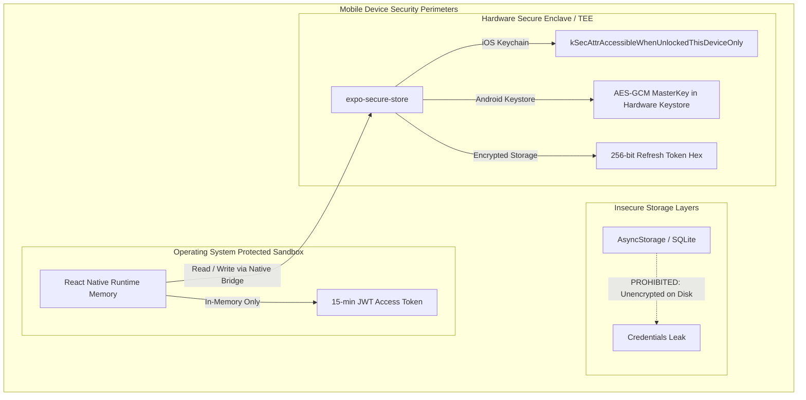
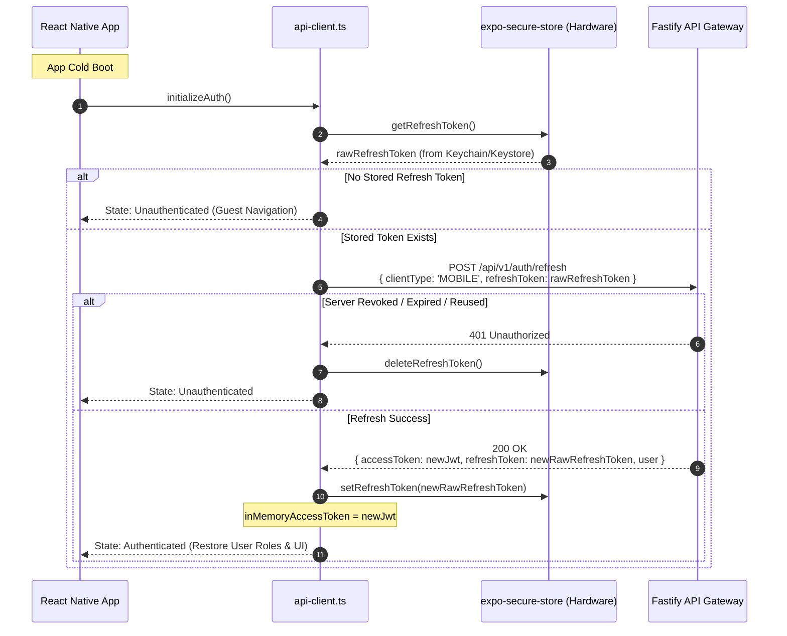
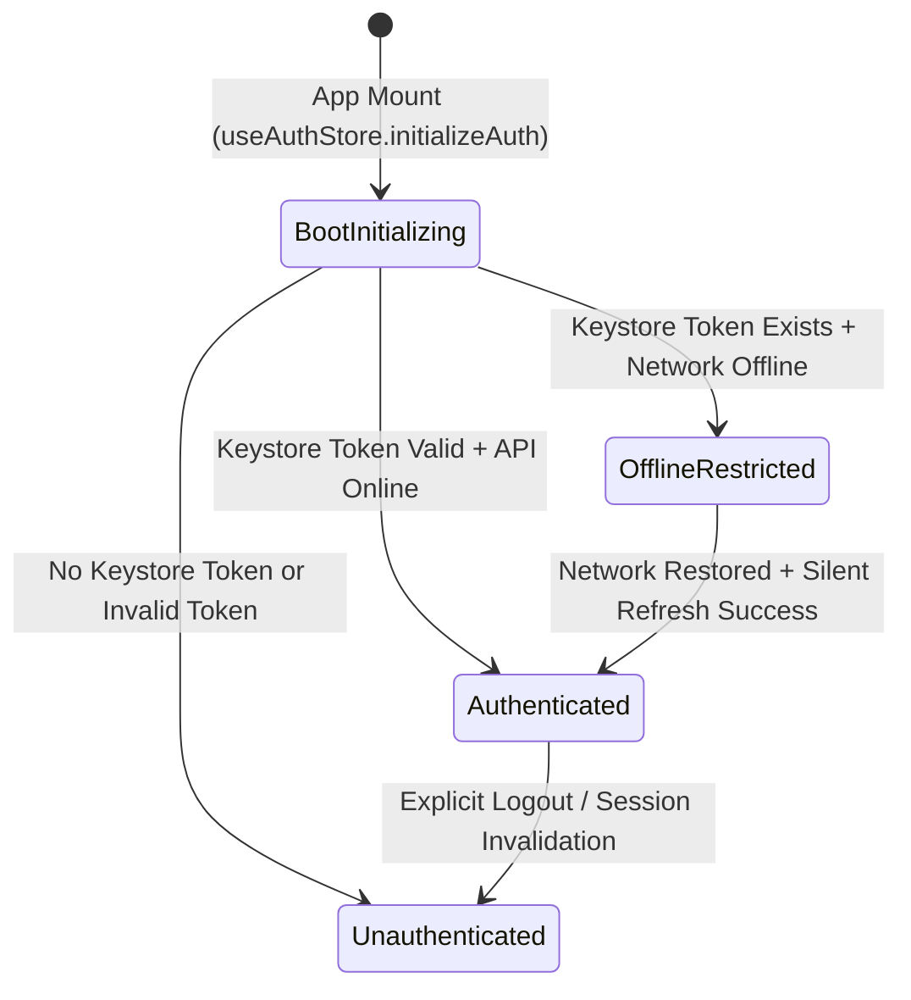

# Mobile Authentication & Hardware-Backed Security Architecture

## 1. Executive Summary & Document Control

| Attribute | Specification Value |
| :--- | :--- |
| **Document ID** | `SEC-ARCH-MOB-08` |
| **Title** | Mobile Application Authentication, Hardware-Backed Keystore Integration, and Credential Storage Architecture |
| **Scope** | React Native / Expo mobile application identity management, `expo-secure-store` hardware isolation, JSON body refresh transport, offline session restoration, and role-based mobile navigation |
| **Status** | Implemented & Tested (EAS cloud binary compilation pending infrastructure provisioning) |
| **Authoritative Spec** | `docs/engineering/phase-1b-specification.md` (Sections 4, 7, 9, 17) |
| **Primary Code Artifacts** | [`secure-storage.service.ts`](file:///d:/luggage-storage/luggage-storage/apps/mobile/src/services/secure-storage.service.ts), [`api-client.ts`](file:///d:/luggage-storage/luggage-storage/apps/mobile/src/services/api-client.ts), [`auth-api.ts`](file:///d:/luggage-storage/luggage-storage/apps/mobile/src/services/auth-api.ts), [`useAuthStore.ts`](file:///d:/luggage-storage/luggage-storage/apps/mobile/src/store/useAuthStore.ts) |
| **Verification Test Suite** | [`useAuthStore.test.ts`](file:///d:/luggage-storage/luggage-storage/apps/mobile/src/store/useAuthStore.test.ts) (27 passing unit/integration tests) |

---

## 2. Mobile Storage Security Architecture

Unlike web browsers that leverage HTTP-only cookies, mobile operating systems provide hardware-isolated security modules (Apple Secure Enclave on iOS, Android Keystore System / TEE on Android).

The platform leverages `expo-secure-store` to achieve bank-grade cryptographic isolation:



### 2.1 Credential Partitioning
1. **Access Token (JWT)**:
   - Resides strictly in JavaScript runtime memory (`let inMemoryAccessToken: string | null = null` in [`api-client.ts`](file:///d:/luggage-storage/luggage-storage/apps/mobile/src/services/api-client.ts#L22)).
   - **Never persisted to disk or flash storage**.
   - If the application is terminated, background-killed, or restarted, the access token is instantly destroyed.
2. **Refresh Token**:
   - Persisted via [`secure-storage.service.ts`](file:///d:/luggage-storage/luggage-storage/apps/mobile/src/services/secure-storage.service.ts) using `expo-secure-store`.
   - **iOS Keychain Accessibility**: Configured with `keychainAccessible: SecureStore.WHEN_UNLOCKED_THIS_DEVICE_ONLY`.
     - Data is accessible only when the device is unlocked by the user.
     - Does not migrate to iCloud backups or new devices during phone restore.
   - **Android Keystore**: Encrypted with AES-256-GCM using keys stored in the Android hardware-backed Keystore system (TEE/StrongBox).
3. **Prohibition of Insecure Storage**:
   - Storing refresh tokens, access tokens, or password hashes in `@react-native-async-storage/async-storage` or unencrypted SQLite is strictly prohibited.

---

## 3. Dual-Transport Model & Mobile Token Refresh Flow

Because mobile environments lack browser cookie semantics and cross-origin cookie security boundaries, the Fastify backend implements a dual-transport model:

- When `clientType: "MOBILE"` is specified, the backend transmits the newly rotated refresh token directly in the JSON response body (`data.refreshToken`).
- The mobile client intercepts this response and writes the token directly into `secureStorage`:



### 3.1 Singleton Mutex in Mobile API Client
Like the web client, [`apps/mobile/src/services/api-client.ts`](file:///d:/luggage-storage/luggage-storage/apps/mobile/src/services/api-client.ts#L43-L101) guards against simultaneous 401 interceptors using a singleton `refreshPromise: Promise<string | null> | null`. All parallel requests share a single refresh network transaction.

---

## 4. Mobile State Lifecycle & Offline Resilience

Mobile applications operate under unpredictable network connectivity. The mobile identity state handles transitions gracefully:



### 4.1 Resilient Logout Flow
Upon user-initiated logout (`authStore.logout()`):
1. Best-effort API call: `POST /api/v1/auth/logout` is dispatched with `{ refreshToken }` to notify the server and mark the session `revoked_at = NOW()`.
2. Hardware wipe: Regardless of network connectivity or API success/failure, `secureStorage.deleteRefreshToken()` is executed immediately.
3. Memory wipe: `inMemoryAccessToken = null` and Zustand store state is reset to `{ user: null, isAuthenticated: false }`.
4. Guarantees that an offline device user cannot be trapped in an un-logoutable state.

---

## 5. Mobile Role-Based Navigation & UI Boundaries

The mobile application serves both Travellers and Luggage Storage Hosts within a unified client binary:

```mermaid
flowchart TD
    UserAuth[useAuthStore.isAuthenticated] --> AuthCheck{Is Authenticated?}
    
    AuthCheck -- No --> AuthStack[Auth Navigator: Login / Register / Forgot Password]
    
    AuthCheck -- Yes --> RoleCheck{User Roles Evaluated}
    RoleCheck -->|hasRole('TRAVELLER')| TravTab[Traveller Tab: Search / Bookings / Profile]
    RoleCheck -->|hasRole('HOST_OWNER') or hasRole('HOST_STAFF')| HostTab[Host Tab: Bag Drop-off / Pick-up / Capacity]
    RoleCheck -->|hasRole('SUPERADMIN') or hasRole('SUPPORT')| AdminNotice[Admin Oversight Notification]
```

- Navigation tabs dynamically evaluate `hasRole("HOST_OWNER")` and `hasRole("HOST_STAFF")`.
- Luggage check-in/out scanner features are hidden and protected from standard travellers.

---

## 6. Build Status & Cloud Pipeline Disclosure

| Architecture Component | Status | Verification & Evidence |
| :--- | :--- | :--- |
| **Mobile TypeScript Codebase** | Implemented & Tested | 27 passing tests in [`useAuthStore.test.ts`](file:///d:/luggage-storage/luggage-storage/apps/mobile/src/store/useAuthStore.test.ts) |
| **Expo Static Web / Bundle Export** | Validated | Clean build via `pnpm --filter @luggage-storage/mobile exec expo export` |
| **Hardware Secure Store Interface** | Implemented | Strict fallback abstraction in [`secure-storage.service.ts`](file:///d:/luggage-storage/luggage-storage/apps/mobile/src/services/secure-storage.service.ts) |
| **EAS Cloud Binary Compilation** | Pending Infrastructure | Requires Apple Developer Team credentials and Google Play Console service account provisioning |

---

## 7. Implementation Evidence & Test Traceability

| Control / Requirement | Implementation Artifact | Verification Test | Test Suite File |
| :--- | :--- | :--- | :--- |
| **Hardware SecureStore Option** | [`SECURE_STORE_OPTIONS`](file:///d:/luggage-storage/luggage-storage/apps/mobile/src/services/secure-storage.service.ts#L6-L8) | `WHEN_UNLOCKED_THIS_DEVICE_ONLY specified` | Inspection & unit mock tests |
| **In-Memory Token Isolation** | [`api-client.ts`](file:///d:/luggage-storage/luggage-storage/apps/mobile/src/services/api-client.ts#L22) | `clears access token on logout` | [`useAuthStore.test.ts`](file:///d:/luggage-storage/luggage-storage/apps/mobile/src/store/useAuthStore.test.ts) |
| **Mobile Refresh Flow** | [`authApi.refresh()`](file:///d:/luggage-storage/luggage-storage/apps/mobile/src/services/auth-api.ts) | `rotates token and updates secure storage` | [`useAuthStore.test.ts`](file:///d:/luggage-storage/luggage-storage/apps/mobile/src/store/useAuthStore.test.ts) |
| **Hardware Storage Deletion on Logout** | [`secureStorage.deleteRefreshToken()`](file:///d:/luggage-storage/luggage-storage/apps/mobile/src/services/secure-storage.service.ts#L66-L76) | `logout deletes refresh token from secure store` | [`useAuthStore.test.ts`](file:///d:/luggage-storage/luggage-storage/apps/mobile/src/store/useAuthStore.test.ts) |
| **Mobile Role Filtering** | [`hasRole()`](file:///d:/luggage-storage/luggage-storage/apps/mobile/src/store/useAuthStore.ts) | `checks host role accurately for navigator` | [`useAuthStore.test.ts`](file:///d:/luggage-storage/luggage-storage/apps/mobile/src/store/useAuthStore.test.ts) |
