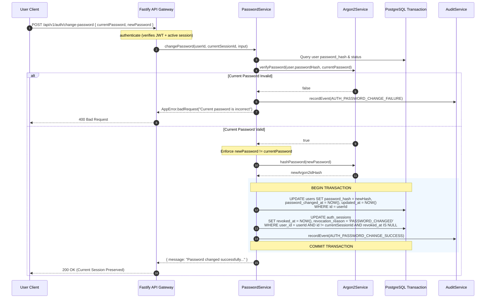
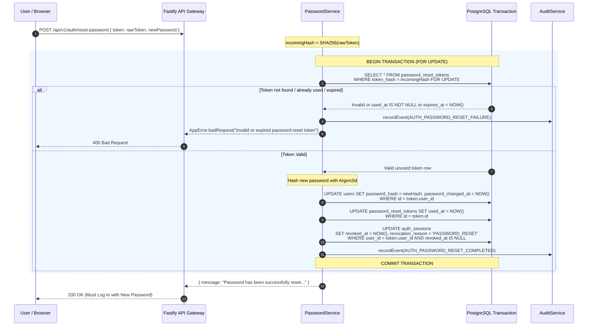

# Password Security & Recovery Architecture

## 1. Executive Summary & Document Control

| Attribute | Specification Value |
| :--- | :--- |
| **Document ID** | `SEC-ARCH-PWD-06` |
| **Title** | Password Policy, Hashing Parameters, Authenticated Mutation, and Enumeration-Resistant Recovery Architecture |
| **Scope** | Password complexity validation, Argon2id storage parameters, sibling session revocation, enumeration-resistant password recovery, token hash verification, and email boundary isolation (OQ-019) |
| **Status** | Implemented & Tested |
| **Authoritative Spec** | `docs/engineering/phase-1b-specification.md` (Sections 2, 4, 10, 17) |
| **Primary Code Artifacts** | [`password.service.ts`](file:///d:/luggage-storage/luggage-storage/apps/api/src/modules/auth/password.service.ts), [`argon2.service.ts`](file:///d:/luggage-storage/luggage-storage/apps/api/src/modules/auth/argon2.service.ts), [`email.service.ts`](file:///d:/luggage-storage/luggage-storage/apps/api/src/modules/email/email.service.ts), [`0005_password_reset.sql`](file:///d:/luggage-storage/luggage-storage/packages/database/src/migrations/0005_password_reset.sql) |
| **Verification Test Suite** | [`password-reset.test.ts`](file:///d:/luggage-storage/luggage-storage/apps/api/src/tests/password-reset.test.ts), [`security.test.ts`](file:///d:/luggage-storage/luggage-storage/apps/api/src/tests/security.test.ts) |

---

## 2. Password Policy & Complexity Requirements

The platform enforces strict password complexity rules across registration, password change, and password reset via Zod schemas in [`contracts/src/auth`](file:///d:/luggage-storage/luggage-storage/packages/contracts/src/auth/index.ts):

| Policy Rule | Technical Constraint | Rationale |
| :--- | :--- | :--- |
| **Minimum Length** | $\ge 8$ characters (max: 128 characters) | Mitigates brute-force search space while capping bcrypt/Argon2 DoS attacks |
| **Uppercase Character** | At least one character in `[A-Z]` | Enhances character set entropy |
| **Lowercase Character** | At least one character in `[a-z]` | Enhances character set entropy |
| **Numeric Character** | At least one character in `[0-9]` | Enhances character set entropy |
| **Special Character** | At least one character in `[!@#$%^&*()_+\-=\[\]{};':"\\|,.<>\/?]` | Prevents dictionary attacks and rainbow table lookups |
| **Password Difference** | New password $\ne$ Current password | Prevents null password changes |

---

## 3. Cryptographic Storage & Hashing Parameters

All passwords are processed through [`Argon2Service`](file:///d:/luggage-storage/luggage-storage/apps/api/src/modules/auth/argon2.service.ts) using the OWASP-recommended **Argon2id** algorithm:

- **Type**: `argon2id` (`type: argon2.argon2id`, format identifier `v=19`).
- **Memory Cost (`m`)**: 65,536 KiB (64 MiB).
- **Time Cost (`t`)**: 3 iterations.
- **Parallelism (`p`)**: 4 threads.
- **Timing Attack Mitigation**: When an account lookup fails during password recovery or login, the service invokes `verifyDummy("dummyPassword123!")` against a precomputed dummy hash, ensuring that non-existent accounts take the same ~60ms processing time as valid accounts.

---

## 4. Authenticated Password Change Workflow

When an authenticated user changes their password (`POST /api/v1/auth/change-password`):



### Key Security Invariant: Sibling Session Revocation
- Sibling active sessions on other devices are **immediately revoked** (`revocation_reason = 'PASSWORD_CHANGED'`).
- The user's **current session is preserved**, allowing uninterrupted navigation without forcing immediate re-authentication.

---

## 5. Enumeration-Resistant Password Recovery (OQ-019)

Password recovery is often targeted for username harvesting and token replay. The platform incorporates multi-layer defenses to prevent account enumeration and token leakage.

### 5.1 Enumeration Resistance & Blind Timing Protection
- The recovery initiation endpoint (`POST /api/v1/auth/forgot-password`) **always returns an identical 200 OK response**:
  ```json
  {
    "success": true,
    "data": {
      "message": "If an account with that email address exists, a password reset link has been sent."
    }
  }
  ```
- Whether the email is valid, invalid, suspended, deactivated, or unverified, the response message and status code remain identical.
- If the email does not exist, the API runs `argon2Service.verifyDummy()` to consume computational time and neutralize side-channel timing analysis.

### 5.2 Cryptographic Token Generation & Storage
- **Entropy**: 256 bits of cryptographically secure randomness generated via `crypto.randomBytes(32).toString('hex')`.
- **Database Storage**: Raw recovery tokens are **never** stored in the database. Only the SHA-256 verifier hash is persisted in `password_reset_tokens.token_hash`.
- **Lifespan**: Strictly limited to 1 hour (3,600 seconds).
- **Single-Use Invalidation**: When a new reset token is requested for a user, all previously issued unused reset tokens for that user are immediately marked invalid.
- **Rate Limiting**: In-memory sliding window limits reset requests to 5 per 15 minutes per normalized email address.

### 5.3 Password Reset Consumption & Session Wipe



- **Complete Session Invalidation**: Unlike password change (which preserves the current session), password reset **revokes all active sessions without exception** (`revocation_reason = 'PASSWORD_RESET'`). The user must authenticate afresh.

---

## 6. Email Boundary Isolation (OQ-019 Resolution)

As resolved in Open Question **OQ-019**, the identity and recovery architecture is strictly decoupled from upstream email vendors:

1. **Email Service Interface ([`email.types.ts`](file:///d:/luggage-storage/luggage-storage/apps/api/src/modules/email/email.types.ts))**:
   - `EmailService` declares abstract delivery methods (`sendPasswordResetEmail`, `sendEmailVerification`).
2. **Provider Independence**:
   - [`EmailService`](file:///d:/luggage-storage/luggage-storage/apps/api/src/modules/email/email.service.ts) implements delivery routing. In development and test environments, a mock email logger captures dispatched tokens without attempting external SMTP or third-party API calls.
   - When an email provider is selected for production (e.g. SendGrid, AWS SES, Postmark), it integrates as a drop-in adapter behind `EmailService` without altering authentication or reset business logic.
3. **Zero Token Disclosure**:
   - The Fastify response envelope never returns the raw reset token or reset URL in the HTTP payload. Dispatched tokens are transmitted solely out-of-band via email.

---

## 7. Implementation Evidence & Test Traceability

| Control / Requirement | Implementation Artifact | Verification Test | Test Suite File |
| :--- | :--- | :--- | :--- |
| **Complexity Policy Validation** | [`RegisterRequestSchema`](file:///d:/luggage-storage/luggage-storage/packages/contracts/src/auth/index.ts) | `rejects passwords without numbers or special chars` | [`contracts.test.ts`](file:///d:/luggage-storage/luggage-storage/packages/contracts/src/index.test.ts) |
| **Argon2id OWASP Cost** | [`argon2Service.hashPassword()`](file:///d:/luggage-storage/luggage-storage/apps/api/src/modules/auth/argon2.service.ts#L10) | `argon2 hash begins with $argon2id$v=19$m=65536` | [`auth.test.ts`](file:///d:/luggage-storage/luggage-storage/apps/api/src/tests/auth.test.ts) |
| **Sibling Session Revocation** | [`passwordService.changePassword()`](file:///d:/luggage-storage/luggage-storage/apps/api/src/modules/auth/password.service.ts#L143-L151) | `password change revokes other sessions but keeps current` | [`security.test.ts`](file:///d:/luggage-storage/luggage-storage/apps/api/src/tests/security.test.ts) |
| **Enumeration Resistance** | [`passwordService.requestPasswordReset()`](file:///d:/luggage-storage/luggage-storage/apps/api/src/modules/auth/password.service.ts#L187-L189) | `forgot-password returns identical 200 OK for nonexistent email` | [`password-reset.test.ts`](file:///d:/luggage-storage/luggage-storage/apps/api/src/tests/password-reset.test.ts) |
| **Blind Timing Protection** | [`argon2Service.verifyDummy()`](file:///d:/luggage-storage/luggage-storage/apps/api/src/modules/auth/argon2.service.ts#L29-L37) | `dummy verification executes for non-existent accounts` | [`security.test.ts`](file:///d:/luggage-storage/luggage-storage/apps/api/src/tests/security.test.ts) |
| **SHA-256 Token Hash Storage** | [`password_reset_tokens.token_hash`](file:///d:/luggage-storage/luggage-storage/packages/database/src/migrations/0005_password_reset.sql) | `token hash stored in DB is 64 hex characters` | [`password-reset.test.ts`](file:///d:/luggage-storage/luggage-storage/apps/api/src/tests/password-reset.test.ts) |
| **Single-Use Replay Defense** | [`passwordService.resetPassword()`](file:///d:/luggage-storage/luggage-storage/apps/api/src/modules/auth/password.service.ts) | `cannot reuse reset token after successful reset` | [`password-reset.test.ts`](file:///d:/luggage-storage/luggage-storage/apps/api/src/tests/password-reset.test.ts) |
| **Reset Session Wipe** | [`passwordService.resetPassword()`](file:///d:/luggage-storage/luggage-storage/apps/api/src/modules/auth/password.service.ts) | `password reset revokes all active sessions for user` | [`password-reset.test.ts`](file:///d:/luggage-storage/luggage-storage/apps/api/src/tests/password-reset.test.ts) |
