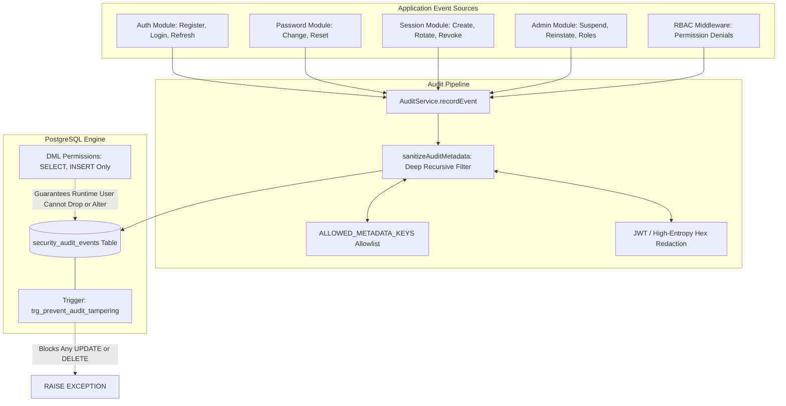

# Security Audit Event Catalogue & Immutability Architecture

## 1. Executive Summary & Document Control

| Attribute | Specification Value |
| :--- | :--- |
| **Document ID** | `SEC-ARCH-AUD-09` |
| **Title** | Canonical Security Audit Event Catalogue, Immutability Controls, and Metadata Sanitization Architecture |
| **Scope** | Platform-wide security telemetry, 24 canonical event taxonomies, trigger-enforced database immutability, automated recursive credential sanitization, transactional consistency, and audit retention lifecycle |
| **Status** | Implemented & Tested |
| **Authoritative Spec** | `docs/engineering/phase-1b-specification.md` (Sections 11, 15, 17) |
| **Primary Code Artifacts** | [`audit.service.ts`](file:///d:/luggage-storage/luggage-storage/apps/api/src/modules/audit/audit.service.ts), [`0006_security_audit_events.sql`](file:///d:/luggage-storage/luggage-storage/packages/database/src/migrations/0006_security_audit_events.sql), [`contracts/src/audit`](file:///d:/luggage-storage/luggage-storage/packages/contracts/src/audit/index.ts) |
| **Verification Test Suite** | [`audit.test.ts`](file:///d:/luggage-storage/luggage-storage/apps/api/src/tests/audit.test.ts) (20 passing integration tests) |

---

## 2. Security Audit Domain Architecture

The platform implements an append-only, tamper-resistant audit architecture that records security-critical events across identity, authentication, session management, access control, and administrative governance:



---

## 3. The 24 Canonical Security Events

Defined authoritatively in [`contracts/src/audit`](file:///d:/luggage-storage/luggage-storage/packages/contracts/src/audit/index.ts):

| Category | Event Type Code | Trigger Condition | Severity | Key Metadata Logged |
| :--- | :--- | :--- | :---: | :--- |
| **Authentication** | `AUTH_REGISTER_SUCCESS` | New user successfully registers | `INFO` | `userId`, `clientType`, `correlationId` |
| **Authentication** | `AUTH_REGISTER_FAILURE` | Registration rejected (e.g. duplicate email) | `WARN` | `email`, `reason`, `correlationId` |
| **Authentication** | `AUTH_LOGIN_SUCCESS` | Successful password authentication | `INFO` | `userId`, `sessionId`, `clientType` |
| **Authentication** | `AUTH_LOGIN_FAILURE` | Invalid credentials or account status check fail | `WARN` | `email`, `reason`, `correlationId` |
| **Password** | `AUTH_PASSWORD_CHANGE_SUCCESS` | Authenticated password successfully changed | `INFO` | `userId`, `sessionId`, `revokedSessions` |
| **Password** | `AUTH_PASSWORD_CHANGE_FAILURE` | Incorrect current password provided | `WARN` | `userId`, `reason` |
| **Password** | `AUTH_PASSWORD_RESET_REQUESTED` | Forgot-password recovery flow initiated | `INFO` | `email`, `reason` (blind to existence) |
| **Password** | `AUTH_PASSWORD_RESET_COMPLETED` | Password reset consumed and updated | `INFO` | `userId`, `resetTokenId`, `sessionsRevoked` |
| **Password** | `AUTH_PASSWORD_RESET_FAILURE` | Expired, invalid, or reused reset token | `WARN` | `reason`, `correlationId` |
| **Session** | `AUTH_SESSION_CREATED` | New session and refresh token issued | `INFO` | `sessionId`, `clientType` |
| **Session** | `AUTH_TOKEN_ROTATED` | Refresh token successfully rotated | `INFO` | `sessionId`, `clientType` |
| **Session** | `AUTH_REFRESH_FAILURE` | Refresh token unknown, invalid, or expired | `WARN` | `reason: TOKEN_NOT_FOUND` |
| **Session** | `AUTH_TOKEN_REUSE_DETECTED` | Consumed refresh token reused (Replay Attack) | `CRITICAL` | `sessionId`, `userId`, `reason: REUSE_DETECTED` |
| **Session** | `AUTH_LOGOUT` | User logged out of single session | `INFO` | `sessionId`, `reason: USER_LOGOUT` |
| **Session** | `AUTH_LOGOUT_ALL` | User logged out of all active devices | `INFO` | `revokedCount`, `userId` |
| **Session** | `AUTH_SESSION_REVOKED` | Specific session revoked by user or admin | `INFO` | `sessionId`, `actorUserId` |
| **Account** | `AUTH_ACCOUNT_SUSPENDED` | Account suspended by administrator | `WARN` | `targetUserId`, `adminId`, `reason` |
| **Account** | `AUTH_ACCOUNT_REINSTATED` | Suspended account restored to active | `INFO` | `targetUserId`, `adminId`, `reason` |
| **Account** | `AUTH_ACCOUNT_DEACTIVATED` | Account deactivated by user or admin | `WARN` | `targetUserId`, `adminId`, `reason` |
| **Account** | `AUTH_ACCOUNT_REACTIVATED` | Deactivated account restored by Superadmin | `INFO` | `targetUserId`, `adminId`, `reason` |
| **Account** | `AUTH_EMAIL_VERIFIED_BY_ADMIN` | Email verified via administrative override | `INFO` | `targetUserId`, `adminId`, `verifiedEmail` |
| **RBAC** | `AUTH_ROLE_ASSIGNED` | Role granted to user account | `INFO` | `targetUserId`, `adminId`, `roleCode` |
| **RBAC** | `AUTH_ROLE_REVOKED` | Role removed from user account | `WARN` | `targetUserId`, `adminId`, `roleCode` |
| **RBAC** | `AUTH_ACCESS_DENIED` | Unauthorized request rejected by RBAC pre-handler | `WARN` | `path`, `method`, `missingPermission`, `roles` |

---

## 4. Audit Record Structure & Disambiguation

The schema in [`0006_security_audit_events.sql`](file:///d:/luggage-storage/luggage-storage/packages/database/src/migrations/0006_security_audit_events.sql) enforces structured record consistency:

| Column | Data Type | Nullable | Description & Constraints |
| :--- | :--- | :---: | :--- |
| `id` | `UUID` | No | Primary Key, `gen_random_uuid()` |
| `user_id` | `UUID` | Yes | Target user associated with the event (NULL for unauthenticated events) |
| `event_type` | `VARCHAR(64)` | No | Canonical event code from 24 defined types |
| `ip_address` | `INET` | Yes | Client IP address parsed from gateway headers |
| `user_agent` | `TEXT` | Yes | Raw or truncated User-Agent header |
| `metadata` | `JSONB` | No | Deep-sanitized contextual details (Default: `'{}'::jsonb`) |
| `created_at` | `TIMESTAMPTZ` | No | Immutable timestamp recorded at transaction execution |

### 4.1 Actor vs Target Disambiguation
For administrative actions (such as role assignment or suspension), naive audit logs often blur the line between the administrator initiating the change and the user affected by it.

The platform enforces explicit actor/target disambiguation in the `metadata` payload:
```json
{
  "adminId": "11111111-1111-1111-1111-111111111111",
  "targetUserId": "22222222-2222-2222-2222-222222222222",
  "roleCode": "HOST_OWNER",
  "action": "ASSIGN_ROLE",
  "correlationId": "req-98765-abcd"
}
```
- `user_id` column stores the target user.
- `metadata.adminId` explicitly records the actor ID.

---

## 5. Automated Deep Metadata Sanitization

To ensure that passwords, raw API secrets, Bearer tokens, and cryptographic keys are never inadvertently logged to disk or database tables, [`sanitizeAuditMetadata()`](file:///d:/luggage-storage/luggage-storage/apps/api/src/modules/audit/audit.service.ts#L71-L120) runs automatically prior to every insert:

```mermaid
flowchart TD
    InMeta[Input Metadata Object] --> KeyLoop{For Each Key/Value}
    
    KeyLoop --> ForbiddenKey{Key matches /password|token|secret|cookie|etc/?}
    ForbiddenKey -- Yes --> AllowlistCheck{Key in ALLOWED_METADATA_KEYS?}
    AllowlistCheck -- No --> RedactKey["Sanitize: [REDACTED]"]
    AllowlistCheck -- Yes --> ValCheck
    ForbiddenKey -- No --> ValCheck{Value Type?}

    ValCheck -->|Nested Object| Recurse[Recursively Sanitize]
    ValCheck -->|JWT String eyJ...| RedactJWT["Sanitize: [REDACTED_JWT]"]
    ValCheck -->|64-char Hex String| HexCheck{Key is an ID or Allowlisted?}
    HexCheck -- No --> RedactHex["Sanitize: [REDACTED_SECRET]"]
    HexCheck -- Yes --> PassVal[Pass Value As-Is]
    ValCheck -->|Primitive Number/Bool/Date| PassVal

    RedactKey --> OutMeta[Clean JSONB Metadata]
    RedactJWT --> OutMeta
    RedactHex --> OutMeta
    PassVal --> OutMeta
    Recurse --> OutMeta
```

- **Explicit Key Allowlist**: Reference IDs such as `sessionId`, `resetTokenId`, `correlationId`, `roleCode`, and `adminId` are explicitly allowlisted so non-secret identifiers are preserved.
- **Value-Level Redaction**: Even if an unexpected key name is used (e.g. `payload`), any value matching a JWT pattern (`eyJ...`) or a 64-character raw hex secret is immediately replaced with `[REDACTED_JWT]` or `[REDACTED_SECRET]`.

---

## 6. Database Immutability & Access Privilege Architecture

### 6.1 Database Trigger (`trg_prevent_audit_tampering`)
To protect against log alteration by compromised application components, a PostgreSQL trigger forbids any `UPDATE` or `DELETE` statement:

```sql
CREATE OR REPLACE FUNCTION prevent_audit_log_tampering()
RETURNS TRIGGER AS $$
BEGIN
    RAISE EXCEPTION 'Audit logs are immutable. UPDATE and DELETE operations are strictly prohibited on security_audit_events table.';
END;
$$ LANGUAGE plpgsql;

CREATE TRIGGER trg_prevent_audit_tampering
BEFORE UPDATE OR DELETE ON security_audit_events
FOR EACH ROW
EXECUTE FUNCTION prevent_audit_log_tampering();
```

### 6.2 Principle of Least Privilege (DML Rights)
The application connects to PostgreSQL using the runtime role `luggage_user`. In migration `0006_security_audit_events.sql`:
```sql
GRANT SELECT, INSERT ON TABLE security_audit_events TO luggage_user;
REVOKE UPDATE, DELETE, TRUNCATE, REFERENCES ON TABLE security_audit_events FROM luggage_user;
```
- Even if an SQL injection vulnerability were introduced in an unrelated endpoint, `luggage_user` lacks `UPDATE`, `DELETE`, and `TRUNCATE` permissions on `security_audit_events`.

---

## 7. Transactional Consistency & Resilience

- **Atomic State Logging**: When recording events inside critical state transitions (such as user suspension or token rotation), `AuditService.recordEvent({ ..., tx })` accepts the active Drizzle transaction (`tx`). If the business operation fails and rolls back, the audit record rolls back with it, preventing phantom audit entries.
- **Fail-Safe Standalone Logging**: When logging non-transactional warnings (such as failed logins or permission denials), any database glitch is logged to Winston and swallowed safely (`throwOnError: false` by default), ensuring that telemetry failures do not break client user flows.

---

## 8. Audit Retention & Archival Strategy

| Tier | Storage Target | Retention Period | Query Access | Purpose |
| :--- | :--- | :---: | :--- | :--- |
| **Hot Storage** | PostgreSQL primary database | 90 Days | Real-time administrative dashboard (`GET /api/v1/admin/audit/events`) | Incident triage, live fraud analysis, user session history |
| **Warm Storage** | PostgreSQL partitioned monthly tables | 365 Days (1 Year) | Read-only reporting replica | Compliance auditing, dispute investigations |
| **Cold Storage** | GCS / S3 Object Storage with WORM (Write Once Read Many) immutability | 7 Years | Forensic extraction only | Regulatory compliance, long-term legal hold |

---

## 9. Implementation Evidence & Test Traceability

| Control / Requirement | Implementation Artifact | Verification Test | Test Suite File |
| :--- | :--- | :--- | :--- |
| **Trigger Immutability** | [`trg_prevent_audit_tampering`](file:///d:/luggage-storage/luggage-storage/packages/database/src/migrations/0006_security_audit_events.sql) | `rejects UPDATE and DELETE on security_audit_events` | [`audit.test.ts`](file:///d:/luggage-storage/luggage-storage/apps/api/src/tests/audit.test.ts) |
| **Deep Metadata Redaction** | [`sanitizeAuditMetadata()`](file:///d:/luggage-storage/luggage-storage/apps/api/src/modules/audit/audit.service.ts#L71) | `redacts passwords, tokens, and raw hex secrets` | [`audit.test.ts`](file:///d:/luggage-storage/luggage-storage/apps/api/src/tests/audit.test.ts) |
| **Transactional Consistency** | [`auditService.recordEvent({ tx })`](file:///d:/luggage-storage/luggage-storage/apps/api/src/modules/audit/audit.service.ts#L134) | `audit record rolls back if transaction aborts` | [`audit.test.ts`](file:///d:/luggage-storage/luggage-storage/apps/api/src/tests/audit.test.ts) |
| **Actor/Target Tracking** | [`AdminService`](file:///d:/luggage-storage/luggage-storage/apps/api/src/modules/admin/admin.service.ts) | `records adminId and targetUserId in suspension audit` | [`admin.test.ts`](file:///d:/luggage-storage/luggage-storage/apps/api/src/tests/admin.test.ts) |
| **Permission Denied Audit** | [`app.ts` pre-handler](file:///d:/luggage-storage/luggage-storage/apps/api/src/app.ts#L141-L157) | `records AUTH_ACCESS_DENIED when permission lacking` | [`audit.test.ts`](file:///d:/luggage-storage/luggage-storage/apps/api/src/tests/audit.test.ts) |
| **Query Audit Trail API** | [`auditService.getRecentEvents()`](file:///d:/luggage-storage/luggage-storage/apps/api/src/modules/audit/audit.service.ts#L205) | `returns paginated audit records for superadmins` | [`audit.test.ts`](file:///d:/luggage-storage/luggage-storage/apps/api/src/tests/audit.test.ts) |
