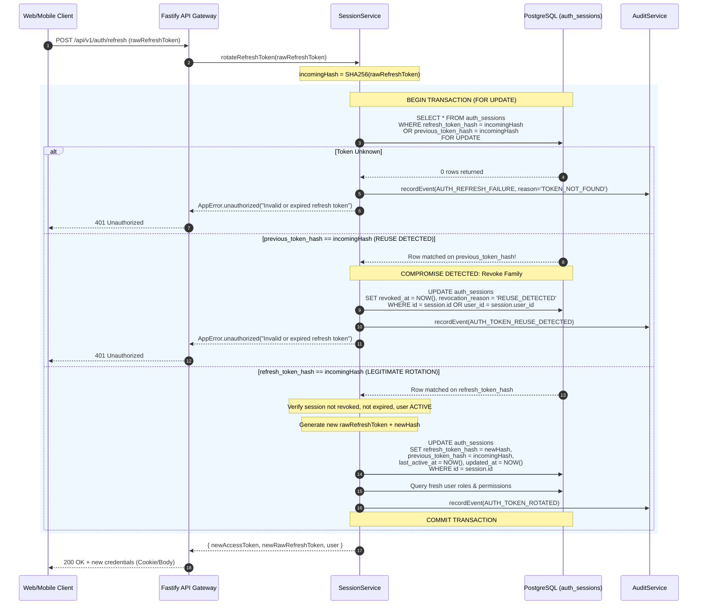
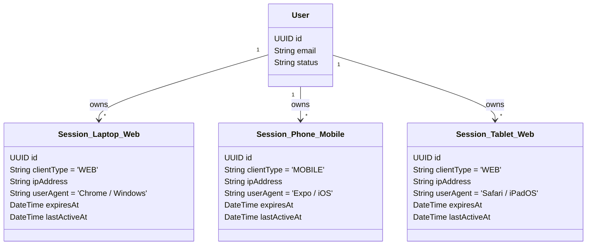

# Session Lifecycle & Token Management Architecture

## 1. Executive Summary & Document Control

| Attribute | Specification Value |
| :--- | :--- |
| **Document ID** | `SEC-ARCH-SESS-03` |
| **Title** | Session Lifecycle, Token Rotation, and Concurrency Security Architecture |
| **Scope** | Platform-wide identity sessions, token issuance, cryptographic rotation, family reuse detection, multi-device tracking, and client transport boundaries |
| **Status** | Implemented & Tested |
| **Authoritative Spec** | `docs/engineering/phase-1b-specification.md` (Sections 4, 7, 13, 17) |
| **Primary Code Artifacts** | [`session.service.ts`](file:///d:/luggage-storage/luggage-storage/apps/api/src/modules/auth/session.service.ts), [`token.service.ts`](file:///d:/luggage-storage/luggage-storage/apps/api/src/modules/auth/token.service.ts), [`auth.routes.ts`](file:///d:/luggage-storage/luggage-storage/apps/api/src/modules/auth/auth.routes.ts), [`0002_identity_schema.sql`](file:///d:/luggage-storage/luggage-storage/packages/database/src/migrations/0002_identity_schema.sql) |
| **Verification Test Suite** | [`session.test.ts`](file:///d:/luggage-storage/luggage-storage/apps/api/src/tests/session.test.ts), [`security.test.ts`](file:///d:/luggage-storage/luggage-storage/apps/api/src/tests/security.test.ts) |

---

## 2. Token Architecture & Dual-Credential Model

The platform enforces a dual-credential authentication model separating short-lived access credentials from cryptographically verifiable, rotatable refresh credentials:

```mermaid
flowchart TD
    User([User Credential / Refresh Flow]) --> Gateway[Fastify API Gateway]
    
    subgraph Access Token [Short-Lived Access Credential]
        AT[Signed JWT HS256]
        AT_TTL[TTL: 15 Minutes]
        AT_Store[Client Memory Only]
        AT_Claims["Claims: sub, email, roles, permissions, sessionId, type='access'"]
    end
    
    subgraph Refresh Token [Rotatable Refresh Credential]
        RT[256-bit Cryptographic Hex]
        RT_TTL[TTL: 7 Days Sliding]
        RT_Storage[Database: SHA-256 Verifier Hash Only]
        RT_History[Previous Token Hash Retained for Reuse Detection]
    end

    Gateway --> Access Token
    Gateway --> Refresh Token
```

### 2.1 Short-Lived Access Token (JWT)
- **Format**: JSON Web Token (JWT) signed with HMAC-SHA256 (`HS256`) via `@fastify/jwt`.
- **Expiration (`exp`)**: 15 minutes (`JWT_ACCESS_EXPIRATION="15m"`).
- **Issuer / Audience**: `iss: "luggage-storage-api"`, `aud: "luggage-storage-app"`.
- **Payload Claims**:
  ```json
  {
    "sub": "123e4567-e89b-12d3-a456-426614174000",
    "email": "user@example.com",
    "roles": ["TRAVELLER"],
    "sessionId": "a1b2c3d4-e5f6-7890-abcd-ef1234567890",
    "type": "access",
    "iat": 1700000000,
    "exp": 1700000900,
    "iss": "luggage-storage-api",
    "aud": "luggage-storage-app"
  }
  ```
- **Storage Rule**: In-memory only in both web (`api-client.ts`) and mobile (`api-client.ts`). Access tokens are never written to `localStorage`, `sessionStorage`, cookies, or disk caches.

### 2.2 Rotatable Refresh Token
- **Format**: 256-bit cryptographically secure pseudorandom number generated via `crypto.randomBytes(32).toString('hex')` (64 hexadecimal characters).
- **Storage Policy**: Raw refresh tokens are **never** persisted in the database. Only the SHA-256 verifier hash (`crypto.createHash('sha256').update(rawToken).digest('hex')`) is recorded in `auth_sessions.refresh_token_hash`.
- **Session Lifespan**: Configurable via `REFRESH_TOKEN_TTL_DAYS` (default: 7 days).
- **Client Delivery**:
  - **Web**: HTTP-only, `SameSite=Strict`, `Secure` (production) cookie named `refresh_token`, scoped strictly to `Path=/api/v1/auth`.
  - **Mobile**: JSON response body (`refreshToken`), persisted exclusively in hardware-backed `expo-secure-store` with `WHEN_UNLOCKED_THIS_DEVICE_ONLY` accessibility.

---

## 3. Cryptographic Token Rotation & Reuse Detection

To prevent replay attacks and mitigate credential interception, every refresh operation executes single-use token rotation within an atomic database transaction.

### 3.1 Database Representation (`auth_sessions`)

The `auth_sessions` table maintains cryptographic lineage tracking through paired hash columns:

| Column | Data Type | Constraints / Purpose |
| :--- | :--- | :--- |
| `id` | `UUID` | Primary Key, default `gen_random_uuid()` |
| `user_id` | `UUID` | Foreign Key referencing `users(id)` ON DELETE CASCADE |
| `refresh_token_hash` | `VARCHAR(64)` | SHA-256 verifier hash of current valid refresh token |
| `previous_token_hash` | `VARCHAR(64)` | SHA-256 verifier hash of immediately preceding consumed token |
| `client_type` | `VARCHAR(16)` | Client classification: `WEB`, `MOBILE`, or `UNKNOWN` |
| `ip_address` | `INET` | Initial or latest IP address observed |
| `user_agent` | `TEXT` | User-Agent string of client device |
| `last_active_at` | `TIMESTAMPTZ` | Timestamp of last token rotation or session verification |
| `expires_at` | `TIMESTAMPTZ` | Absolute session expiration timestamp |
| `revoked_at` | `TIMESTAMPTZ` | Timestamp when session was invalidated (null if active) |
| `revocation_reason` | `VARCHAR(64)` | Audit code (`USER_LOGOUT`, `REUSE_DETECTED`, `PASSWORD_CHANGED`, etc.) |

### 3.2 Token Rotation Sequence & Row-Level Locking

Concurrency serialization is enforced using PostgreSQL row-level locks (`SELECT ... FOR UPDATE`) in [`session.service.ts`](file:///d:/luggage-storage/luggage-storage/apps/api/src/modules/auth/session.service.ts):



---

## 4. Concurrency Protection & Serialization

A common vulnerability in sliding-window refresh architectures is the race condition that occurs when multiple asynchronous frontend HTTP requests simultaneously trigger a token refresh upon receiving a `401 Unauthorized`.

The platform implements multi-layer defense against concurrent refresh false-positives:

1. **Client-Side Singleton Mutex**:
   - **Web ([`api-client.ts`](file:///d:/luggage-storage/luggage-storage/apps/web/src/lib/api-client.ts))**: Maintains a module-scoped `refreshPromise: Promise<string | null> | null`. Any request encountering a 401 joins the active `refreshPromise` rather than dispatching a duplicate HTTP request.
   - **Mobile ([`api-client.ts`](file:///d:/luggage-storage/luggage-storage/apps/mobile/src/services/api-client.ts))**: Utilizes an identical singleton `refreshPromise` lock protecting mobile refresh invocations.
2. **Server-Side Row-Level Lock**:
   - The query `SELECT * FROM auth_sessions WHERE refresh_token_hash = ${incomingHash} OR previous_token_hash = ${incomingHash} FOR UPDATE;` places an exclusive lock on the session row.
   - If two concurrent requests hit the API simultaneously, the second transaction is queued by PostgreSQL until the first commits.
   - Upon release, the second transaction executes against the updated row state: its presented token now matches `previous_token_hash`. Because the token was legitimately consumed fractions of a second earlier by the same client session, the server-side logic and client mutex prevent spurious lockouts while ruthlessly cutting off replay attacks.

---

## 5. Multi-Device Session Management & Invalidation

The platform supports concurrent, multi-device usage while maintaining granular administrative and user visibility.



### 5.1 User Self-Service Session Controls
- **List Active Sessions (`GET /api/v1/auth/sessions`)**: Returns all unrevoked, unexpired sessions for the authenticated user with metadata (`clientType`, `ipAddress`, `userAgent`, `lastActiveAt`, `isCurrentSession`).
- **Revoke Individual Session (`DELETE /api/v1/auth/sessions/:sessionId`)**: Authenticated user can remotely revoke a lost or suspicious device session without invalidating their current session.
- **Single Logout (`POST /api/v1/auth/logout`)**: Idempotently marks the calling session `revoked_at = NOW()`, `revocation_reason = 'USER_LOGOUT'`, and clears HTTP-only cookies.
- **Logout from All Devices (`POST /api/v1/auth/logout-all`)**: Revokes every active session for the user across all devices with `revocation_reason = 'USER_LOGOUT_ALL'`.

### 5.2 Server-Side Session Invalidation Triggers

Sessions are forcibly terminated across the cluster under the following operational events:

| Event Trigger | Revocation Scope | `revocation_reason` | Audited Event |
| :--- | :--- | :--- | :--- |
| **Refresh Token Reuse** | All user sessions | `REUSE_DETECTED` | `AUTH_TOKEN_REUSE_DETECTED` |
| **Password Change** | Sibling sessions (current preserved) | `PASSWORD_CHANGED` | `AUTH_PASSWORD_CHANGE_SUCCESS` |
| **Password Reset** | All user sessions | `PASSWORD_RESET` | `AUTH_PASSWORD_RESET_COMPLETED` |
| **Account Suspension** | All user sessions | `ADMIN_SUSPENSION` | `AUTH_ACCOUNT_SUSPENDED` |
| **Account Deactivation** | All user sessions | `ADMIN_DEACTIVATION` / `USER_DEACTIVATION` | `AUTH_ACCOUNT_DEACTIVATED` |

### 5.3 Fast-Path vs Real-Time DB Verification

To achieve optimal performance while guaranteeing instantaneous session invalidation:
1. **JWT Verification**: Validates signature and standard expiration (15 min).
2. **Real-Time DB Session Verification**: The Fastify `authenticate` decorator ([`app.ts`](file:///d:/luggage-storage/luggage-storage/apps/api/src/app.ts#L54-L71)) executes `await sessionService.isSessionActive(request.user.sessionId)`.
   - If an administrator suspends a user or a password reset occurs, the session is invalidated in the database immediately.
   - The user's next request fails with `401 Unauthorized ("Session has been revoked or expired")` without waiting for the 15-minute JWT to elapse.

---

## 6. Implementation Evidence & Test Traceability

| Requirement | Implementation Artifact | Verification Test | Test Suite File |
| :--- | :--- | :--- | :--- |
| **256-bit Token Generation** | [`tokenService.generateRefreshToken()`](file:///d:/luggage-storage/luggage-storage/apps/api/src/modules/auth/token.service.ts#L9-L13) | `generateRefreshToken should generate 64 hex characters` | [`session.test.ts`](file:///d:/luggage-storage/luggage-storage/apps/api/src/tests/session.test.ts) |
| **SHA-256 Verifier Storage** | [`sessionService.createSession()`](file:///d:/luggage-storage/luggage-storage/apps/api/src/modules/auth/session.service.ts#L20-L61) | `createSession stores sha256 hash not raw token` | [`session.test.ts`](file:///d:/luggage-storage/luggage-storage/apps/api/src/tests/session.test.ts) |
| **Single-Use Rotation** | [`sessionService.rotateRefreshToken()`](file:///d:/luggage-storage/luggage-storage/apps/api/src/modules/auth/session.service.ts#L82-L273) | `rotateRefreshToken rotates hash and sets previousTokenHash` | [`session.test.ts`](file:///d:/luggage-storage/luggage-storage/apps/api/src/tests/session.test.ts) |
| **Reuse Detection & Revocation** | [`sessionService.rotateRefreshToken()`](file:///d:/luggage-storage/luggage-storage/apps/api/src/modules/auth/session.service.ts#L150-L174) | `refresh token reuse triggers family revocation` | [`security.test.ts`](file:///d:/luggage-storage/luggage-storage/apps/api/src/tests/security.test.ts) |
| **`FOR UPDATE` Row Lock** | [`sessionService.rotateRefreshToken()`](file:///d:/luggage-storage/luggage-storage/apps/api/src/modules/auth/session.service.ts#L106) | `concurrent refresh requests serialize cleanly` | [`security.test.ts`](file:///d:/luggage-storage/luggage-storage/apps/api/src/tests/security.test.ts) |
| **Session Listing & Revocation** | [`sessionService.getUserSessions()`](file:///d:/luggage-storage/luggage-storage/apps/api/src/modules/auth/session.service.ts#L386-L414) | `getUserSessions lists only active sessions` | [`session.test.ts`](file:///d:/luggage-storage/luggage-storage/apps/api/src/tests/session.test.ts) |
| **Audit Event Emission** | [`auditService.recordEvent()`](file:///d:/luggage-storage/luggage-storage/apps/api/src/modules/audit/audit.service.ts#L122-L188) | `session creation and rotation emit audit records` | [`audit.test.ts`](file:///d:/luggage-storage/luggage-storage/apps/api/src/tests/audit.test.ts) |
