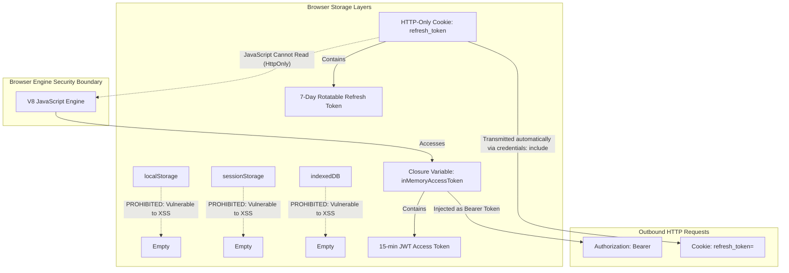
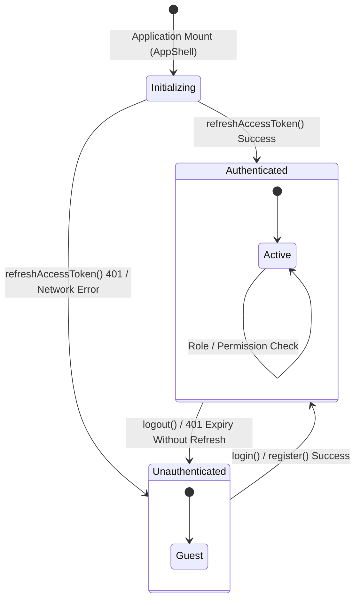

# Web Authentication & Browser Security Architecture

## 1. Executive Summary & Document Control

| Attribute | Specification Value |
| :--- | :--- |
| **Document ID** | `SEC-ARCH-WEB-07` |
| **Title** | Web Application Authentication, Cookie Isolation, and Token Management Architecture |
| **Scope** | Single Page Application (SPA) authentication lifecycle, in-memory credential storage, HTTP-only cookie transport, concurrency mutex serialization, route authorization guards, and XSS/CSRF threat mitigation |
| **Status** | Implemented & Tested |
| **Authoritative Spec** | `docs/engineering/phase-1b-specification.md` (Sections 4, 7, 9, 17) |
| **Primary Code Artifacts** | [`useAuthStore.ts`](file:///d:/luggage-storage/luggage-storage/apps/web/src/store/useAuthStore.ts), [`api-client.ts`](file:///d:/luggage-storage/luggage-storage/apps/web/src/lib/api-client.ts), [`auth-api.ts`](file:///d:/luggage-storage/luggage-storage/apps/web/src/services/auth-api.ts), [`ProtectedRoute.tsx`](file:///d:/luggage-storage/luggage-storage/apps/web/src/components/auth/ProtectedRoute.tsx), [`PermissionGate.tsx`](file:///d:/luggage-storage/luggage-storage/apps/web/src/components/auth/PermissionGate.tsx) |
| **Verification Test Suite** | [`useAuthStore.test.ts`](file:///d:/luggage-storage/luggage-storage/apps/web/src/store/useAuthStore.test.ts) (33 passing unit/integration tests) |

---

## 2. Browser Credential Storage Architecture

To defend against Cross-Site Scripting (XSS) and token theft, the web application strictly avoids storing sensitive tokens in web storage APIs:



### 2.1 In-Memory Access Token
- Managed in a private, unexported module variable `let inMemoryAccessToken: string | null = null` within [`api-client.ts`](file:///d:/luggage-storage/luggage-storage/apps/web/src/lib/api-client.ts#L26).
- Exported setter/getter functions govern access.
- **XSS Defense**: Malicious scripts executing in the DOM cannot extract tokens from `window.localStorage` or `window.sessionStorage`. If an XSS payload executes, it cannot persist token access across page reloads.

### 2.2 HTTP-Only Refresh Token Cookie
- **Cookie Name**: `refresh_token`.
- **Directives**:
  - `HttpOnly`: Strictly blocks all JavaScript access via `document.cookie`.
  - `SameSite=Strict`: Instructs the browser to withhold the cookie from all cross-site requests, mitigating Cross-Site Request Forgery (CSRF).
  - `Secure`: Transmitted solely over HTTPS in production environments.
  - `Path=/api/v1/auth`: Restricts cookie transmission exclusively to authentication endpoints (`/refresh`, `/logout`), ensuring general API requests do not needlessly transmit the refresh credential.

---

## 3. Silent Refresh & Concurrency Mutex Pattern

When the short-lived access token expires (after 15 minutes), the web application performs transparent background refresh rotation without user interruption:

```mermaid
sequenceDiagram
    autonumber
    participant UI as React Components
    participant Client as api-client.ts
    participant Mutex as refreshPromise Mutex
    participant API as Fastify API Gateway

    Note over UI,Client: User triggers multiple concurrent API queries
    par Request A (List Bookings)
        Client->>API: GET /api/v1/bookings (Expired JWT)
        API-->>Client: 401 Unauthorized
    and Request B (User Profile)
        Client->>API: GET /api/v1/users/me (Expired JWT)
        API-->>Client: 401 Unauthorized
    end

    Note over Client: Both requests intercept 401
    Client->>Mutex: refreshAccessToken()
    
    rect rgb(240, 248, 255)
        Note over Mutex: Mutex empty -> Initiates single refresh
        Mutex->>API: POST /api/v1/auth/refresh (Cookie: refresh_token, body: { clientType: 'WEB' })
        Note over Client: Request B detects active refreshPromise and awaits it
        API-->>Mutex: 200 OK + { accessToken: newJwt } (New Cookie set)
        Note over Mutex: inMemoryAccessToken = newJwt; Mutex cleared
    end

    par Retry Request A
        Client->>API: GET /api/v1/bookings (Authorization: Bearer newJwt)
        API-->>Client: 200 OK (Data returned)
        Client-->>UI: Render Bookings
    and Retry Request B
        Client->>API: GET /api/v1/users/me (Authorization: Bearer newJwt)
        API-->>Client: 200 OK (Data returned)
        Client-->>UI: Render Profile
    end
```

### 3.1 Singleton Mutex Implementation ([`api-client.ts`](file:///d:/luggage-storage/luggage-storage/apps/web/src/lib/api-client.ts#L43-L101))
- A module-scoped `refreshPromise` variable acts as a lock.
- If multiple calls to `refreshAccessToken()` occur concurrently, only the first triggers the HTTP POST to `/api/v1/auth/refresh`. All subsequent callers receive and await the identical promise.
- Prevents race conditions that would otherwise cause token reuse false-positives and unwanted session family revocation.

---

## 4. State Management & Teardown Architecture

The authentication state is managed through Zustand in [`useAuthStore.ts`](file:///d:/luggage-storage/luggage-storage/apps/web/src/store/useAuthStore.ts):



### 4.1 Strict Memory Teardown on Logout
Upon invocation of `logout()`:
1. `authApi.logout()` is called, dispatching `POST /api/v1/auth/logout` with `credentials: 'include'`. The Fastify backend revokes the session row and returns a `Set-Cookie` header clearing `refresh_token` (`Max-Age=0`).
2. `clearAccessToken()` is executed immediately, wiping `inMemoryAccessToken = null`.
3. Zustand state is reset to `{ user: null, isAuthenticated: false, error: null }`.
4. The client redirects to `/login`.

---

## 5. Client Route Protection & Authorization Guards

The React application implements granular, role- and permission-aware routing components:

### 5.1 `ProtectedRoute` ([`ProtectedRoute.tsx`](file:///d:/luggage-storage/luggage-storage/apps/web/src/components/auth/ProtectedRoute.tsx))
- Enforces authentication requirement.
- Accepts optional `requiredRoles?: string[]` and `requiredPermissions?: string[]`.
- While authentication status is initializing (`isInitializing: true`), renders an accessible loading spinner to prevent UI flashing.
- If unauthenticated, redirects to `/login?redirect=${currentPath}`.
- If authenticated but missing required permissions or roles, redirects to `/forbidden`.

### 5.2 `PermissionGate` ([`PermissionGate.tsx`](file:///d:/luggage-storage/luggage-storage/apps/web/src/components/auth/PermissionGate.tsx))
- Declarative inline wrapper for UI components:
  ```tsx
  <PermissionGate permission="admin.user.suspend" fallback={null}>
    <Button onClick={handleSuspend}>Suspend User</Button>
  </PermissionGate>
  ```
- Evaluates permissions from the reactive Zustand auth store.

---

## 6. Threat Mitigation Matrix (Web Domain)

| Threat | Attack Vector | Implemented Mitigation | Grounded Code Evidence |
| :--- | :--- | :--- | :--- |
| **Token Theft via XSS** | Injected JavaScript reading `localStorage` | Access token stored in private closure memory variable; refresh token in HTTP-only cookie. | [`api-client.ts`](file:///d:/luggage-storage/luggage-storage/apps/web/src/lib/api-client.ts#L26) |
| **Cross-Site Request Forgery (CSRF)** | Malicious third-party site invoking authenticated endpoints | Refresh cookie set with `SameSite=Strict`. Access tokens sent via `Authorization: Bearer` header. | [`auth.routes.ts`](file:///d:/luggage-storage/luggage-storage/apps/api/src/modules/auth/auth.routes.ts), [`app.ts`](file:///d:/luggage-storage/luggage-storage/apps/api/src/app.ts#L30-L33) |
| **Concurrent Refresh Race** | Spurious token rotation due to simultaneous HTTP 401s | Singleton `refreshPromise` mutex serializes all concurrent refresh requests to a single network call. | [`api-client.ts`](file:///d:/luggage-storage/luggage-storage/apps/web/src/lib/api-client.ts#L56-L101) |
| **Unauthorized View Access** | Guest navigating directly to `/admin` or `/profile` URL | `ProtectedRoute` evaluates auth state and permissions during React Router reconciliation. | [`ProtectedRoute.tsx`](file:///d:/luggage-storage/luggage-storage/apps/web/src/components/auth/ProtectedRoute.tsx) |
| **Session Bleed on Shared PC** | Next user navigating back after logout | In-memory token wiped; cookie cleared with `Max-Age=0`; Zustand store cleared. | [`useAuthStore.ts`](file:///d:/luggage-storage/luggage-storage/apps/web/src/store/useAuthStore.ts#L70-L85) |

---

## 7. Implementation Evidence & Test Traceability

| Control / Requirement | Implementation Artifact | Verification Test | Test Suite File |
| :--- | :--- | :--- | :--- |
| **In-Memory Token Isolation** | [`setAccessToken`, `getAccessToken`](file:///d:/luggage-storage/luggage-storage/apps/web/src/lib/api-client.ts) | `stores token in memory and clears on logout` | [`useAuthStore.test.ts`](file:///d:/luggage-storage/luggage-storage/apps/web/src/store/useAuthStore.test.ts) |
| **Initial Session Restoration** | [`initializeAuth()`](file:///d:/luggage-storage/luggage-storage/apps/web/src/store/useAuthStore.ts) | `restores session on boot via refresh cookie` | [`useAuthStore.test.ts`](file:///d:/luggage-storage/luggage-storage/apps/web/src/store/useAuthStore.test.ts) |
| **Login State Mutation** | [`login()`](file:///d:/luggage-storage/luggage-storage/apps/web/src/store/useAuthStore.ts) | `updates user state and sets authenticated flag` | [`useAuthStore.test.ts`](file:///d:/luggage-storage/luggage-storage/apps/web/src/store/useAuthStore.test.ts) |
| **Logout Teardown** | [`logout()`](file:///d:/luggage-storage/luggage-storage/apps/web/src/store/useAuthStore.ts) | `clears access token and resets user state to null` | [`useAuthStore.test.ts`](file:///d:/luggage-storage/luggage-storage/apps/web/src/store/useAuthStore.test.ts) |
| **Role & Permission Checkers** | [`hasRole()`, `hasPermission()`](file:///d:/luggage-storage/luggage-storage/apps/web/src/store/useAuthStore.ts) | `evaluates role and permission possession accurately` | [`useAuthStore.test.ts`](file:///d:/luggage-storage/luggage-storage/apps/web/src/store/useAuthStore.test.ts) |
| **Route Authorization Guard** | [`ProtectedRoute`](file:///d:/luggage-storage/luggage-storage/apps/web/src/components/auth/ProtectedRoute.tsx) | `blocks unauthenticated users and redirects to login` | [`useAuthStore.test.ts`](file:///d:/luggage-storage/luggage-storage/apps/web/src/store/useAuthStore.test.ts) |
