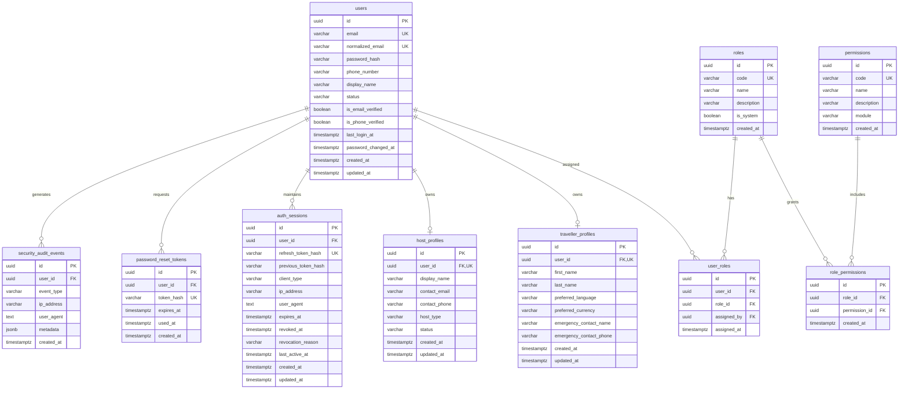
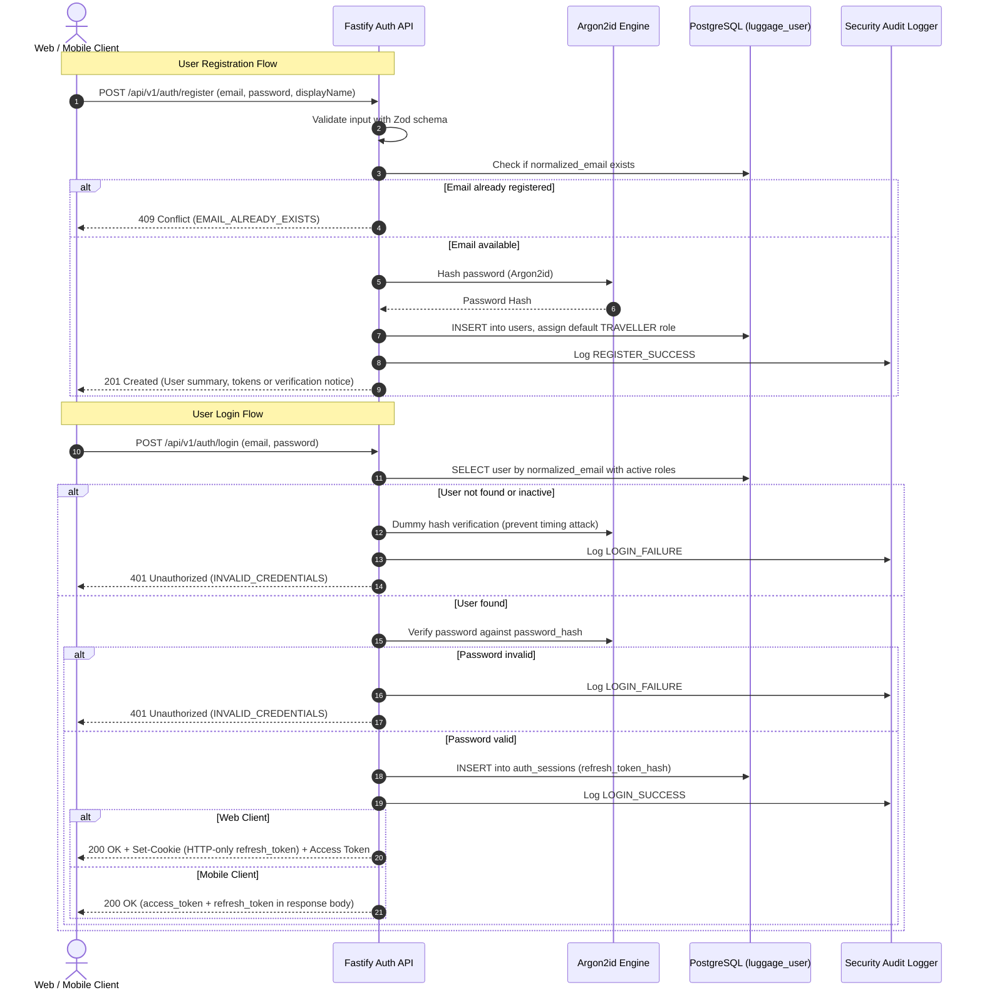

# Phase 1B: Identity, Authentication & Access Control — Architecture & Domain Design

**Project:** Global Luggage Storage Marketplace  
**Phase:** Phase 1B — Identity, Authentication & Access Control  
**Status:** **APPROVED & VALIDATED (WP-01 VERDICT: PASS)**  
**Author:** Principal Identity Architect, Application Security Architect & Database Architect  
**Validation Date:** 2026-11-07  
**Governing Documents:** [docs/product/functional-requirements.md](file:///d:/luggage-storage/luggage-storage/docs/product/functional-requirements.md), [docs/architecture/system-architecture.md](file:///d:/luggage-storage/luggage-storage/docs/architecture/system-architecture.md), [docs/architecture/decisions/ADR-001](file:///d:/luggage-storage/luggage-storage/docs/architecture/decisions/ADR-001-modular-monolithic-backend.md), [docs/architecture/data/logical-erd.md](file:///d:/luggage-storage/luggage-storage/docs/architecture/data/logical-erd.md), [docs/architecture/domain/permissions-and-access-matrix.md](file:///d:/luggage-storage/luggage-storage/docs/architecture/domain/permissions-and-access-matrix.md), [docs/engineering/phase-1b-specification.md](file:///d:/luggage-storage/luggage-storage/docs/engineering/phase-1b-specification.md).

---

## 1. Architectural Mission & Core Principles

Phase 1B implements the foundational identity, authentication, session management, and role-based access control (RBAC) infrastructure for the Global Luggage Storage Marketplace.

### 1.1 Key Principles
1. **Unified Identity (`OQ-007`):** A single `User` entity serves as the root authentication record. One human user maintains a unified identity with the capacity to hold multiple profile contexts (`TravellerProfile`, `HostProfile`) and multiple roles (`TRAVELLER`, `HOST_OWNER`, `HOST_STAFF`, `SUPPORT`, `SUPERADMIN`) without needing separate accounts.
2. **Self-Managed Backend Authentication (`OQ-001`):** Authentication is managed natively within the Fastify backend without reliance on external commercial SaaS identity providers. PostgreSQL acts as the authoritative store for credentials and session state.
3. **Cryptographic Rigor:** Passwords hashed with OWASP-compliant **Argon2id**. Refresh tokens and password reset tokens stored exclusively as cryptographic SHA-256 hashes.
4. **Defense in Depth & Token Rotation:** Short-lived access tokens (15-minute TTL) combined with rotating refresh tokens (7-day TTL). Refresh token reuse triggers immediate family revocation.
5. **Client-Specific Session Security:**
   - **Web Application:** HTTP-only, secure, SameSite cookies preventing JavaScript token access.
   - **Mobile Application:** Bearer tokens delivered in JSON responses, stored securely in hardware-backed `Expo.SecureStore`, rotated on background interceptors.
6. **Separation of Duties (`OQ-011`, `OQ-016`):** Strict boundary isolation between operational customer support staff (`SUPPORT`) and platform administrators (`SUPERADMIN`).
7. **Strict Phase Boundaries:** Zero marketplace business logic (no bookings, spots, payments, custody, payouts, or KYC).

---

## 2. WP-01 Formal Design Validation Verdict

Independent evaluation of this identity architecture against the Phase 1B specification:

| Evaluation Area | Analysis & Verification | Result |
| :--- | :--- | :---: |
| **Identity Model** | Case-preserving `email` with strictly unique `normalized_email`. Clean separation of `TravellerProfile` and `HostProfile` without duplicate credentials. Zero premature host onboarding or KYC logic. | **PASS** |
| **RBAC Architecture** | Multi-role assignment via `user_roles` with composite unique constraints. Granular permissions via `role_permissions`. Clear partition between `SUPPORT` and `SUPERADMIN` (`OQ-011`, `OQ-016`). Zero client privilege escalation. | **PASS** |
| **Session Persistence & Rotation** | Multi-device `auth_sessions`. Refresh tokens stored as SHA-256 hashes. `previous_token_hash` allows atomic rotation and detection of token reuse to revoke session families. Zero plaintext token persistence. | **PASS** |
| **Security Audit Trail** | Append-only `security_audit_events` schema tracking authentication events. Sensitive credentials (passwords, tokens, cookies) strictly excluded from payload metadata. | **PASS** |
| **Referential Integrity** | All foreign keys defined with explicit deletion behaviors (`CASCADE` for profiles/roles, `SET NULL` for audit log user references). | **PASS** |

**VERDICT: PASS — WP-02 DATABASE IMPLEMENTATION AUTHORIZED TO PROCEED**

---

## 3. Domain Model & Entity Architecture

---

## 3. Entity Specifications

### 3.1 `User` (Unified Identity Record)
- **Primary Identifier:** `id` (`UUIDv7` time-ordered primary key).
- **Email Management:**
  - `email`: Preserves user-entered case for communication.
  - `normalized_email`: Stored in lowercase trimmed format with unique index, preventing duplicate registrations like `User@Example.com` and `user@example.com`.
- **Password Hash:** Stored as an Argon2id formatted string (`$argon2id$v=19$m=65536,t=3,p=4$...`). Plaintext passwords never persist.
- **Account Status (`VARCHAR(32)`):**
  - `PENDING_VERIFICATION`: Registered but email unverified.
  - `ACTIVE`: Fully operational.
  - `SUSPENDED`: Temporarily blocked by administrative action.
  - `DEACTIVATED`: User-requested closure.
- **Verification Flags:** `is_email_verified` (boolean), `is_phone_verified` (boolean).
- **Security Audit Timestamps:** `last_login_at`, `password_changed_at`, `created_at`, `updated_at`.

### 3.2 `TravellerProfile` (Traveller Persona Context)
- **Relationship:** One-to-one with `User` (`user_id UNIQUE FK`).
- **Scope:** Contains Traveller-specific preferences and contact information.
- **Fields:** `first_name`, `last_name`, `preferred_language` (e.g. `'en'`), `preferred_currency` (e.g. `'LKR'`), `emergency_contact_name`, `emergency_contact_phone`.
- **Boundary Rule:** Zero booking history or marketplace reservation records belong here.

### 3.3 `HostProfile` (Host Persona Context)
- **Relationship:** One-to-one with `User` (`user_id UNIQUE FK`).
- **Scope:** Represents an individual user's host contact identity.
- **Distinction from Host Business:**
  - `HostProfile` establishes user intent and basic contact details for hosting.
  - `HostBusiness` and physical storage locations belong to Phase 2 (Marketplace Onboarding & KYC under `OQ-002`).
  - Merely creating a `HostProfile` does NOT grant business operating privileges.

### 3.4 Roles & Permissions (Centralized RBAC)
- **System Roles:**
  1. `TRAVELLER`: Standard consumer for storage discovery and booking.
  2. `HOST_OWNER`: Business owner authorized to manage locations, staff, and pricing.
  3. `HOST_STAFF`: Location attendant authorized for check-in / check-out scanning.
  4. `SUPPORT`: Customer support agent with restricted read and ticket handling privileges (`OQ-011`).
  5. `SUPERADMIN`: Full executive platform governance and financial management.
- **Dynamic Mapping:** Users can hold multiple roles simultaneously (`user_roles` join table).
- **Role Scoping:** Roles map to granular permission codes (`role_permissions` join table) such as `auth:me:read`, `locations:read`, `bookings:checkin`.

### 3.5 `AuthSession` (Session & Token Rotation)
- **Session Record:** Independent of User, allowing concurrent sessions across multiple devices (Web desktop, Mobile phone, Tablet).
- **Refresh Token Verification:** The database stores `refresh_token_hash` (SHA-256 hash of the cryptographically random token string). The raw token is sent only once to the client.
- **Lifecycle & Rotation:**
  - Token refresh issues a new raw refresh token and updates `refresh_token_hash`.
  - Old token is invalidated. If an old token is presented again (reuse attempt), all sessions for that user family are revoked immediately and a security alert is logged.
- **Revocation:** `revoked_at` timestamp immediately invalidates session before `expires_at`.

### 3.6 `PasswordResetToken` (Secure Recovery Foundation)
- Stores SHA-256 hash of high-entropy recovery tokens (`token_hash UNIQUE`).
- Strict 1-hour expiration (`expires_at`).
- Single-use enforced by `used_at` timestamp.

### 3.7 `SecurityAuditEvent` (Immutable Audit Trail)
- Logs critical security events with timestamp, event type, actor ID, IP address, user agent, and contextual JSON metadata.
- **Event Types:** `REGISTER_SUCCESS`, `LOGIN_SUCCESS`, `LOGIN_FAILURE`, `LOGOUT`, `TOKEN_ROTATED`, `REFRESH_REUSE_DETECTED`, `PASSWORD_CHANGED`, `PASSWORD_RESET_REQUESTED`, `PASSWORD_RESET_COMPLETED`, `ACCOUNT_SUSPENDED`, `ROLE_ASSIGNED`.
- **Zero Credential Leakage:** Sensitive parameters (passwords, raw tokens, cookie values) are strictly stripped before logging.

---

## 4. Authentication Flow Architecture

---

## 5. Security & Cryptographic Standards

| Component | Standard / Parameter | Rationale |
| :--- | :--- | :--- |
| **Password Hashing** | `Argon2id` (v=19, m=64MB, t=3 iterations, p=4 parallelism) | OWASP recommended algorithm; highly resistant to GPU/ASIC cracking. |
| **Access Token** | JWT (`RS256` or `HS256` HMAC with 256-bit secret), 15-minute TTL | Minimizes exposure window in transit. |
| **Refresh Token** | 256-bit cryptographically secure random string (`crypto.randomBytes(32)`), 7-day TTL | Stored hashed as SHA-256 in PostgreSQL. |
| **Web Cookie** | `HttpOnly; Secure; SameSite=Strict; Path=/api/v1/auth` | Protects refresh token against XSS attacks. |
| **Mobile Storage** | `Expo.SecureStore` | Hardware-backed keystore (iOS Keychain, Android Keystore). |
| **Timing Attack Mitigation** | Constant-time string comparison (`crypto.timingSafeEqual`) and dummy hash verification on invalid user lookup. | Prevents user enumeration via response latency timing. |

---

## 6. Implementation Phasing Traceability

- **WP-01:** This document (`docs/architecture/phase-1b-identity-design.md`) — Completed.
- **WP-02:** Database Implementation (Drizzle schema definition in `apps/api/src/infrastructure/database/schema/identity.ts`, migrations via `luggage_migrator`).
- **WP-03:** Registration and Authentication endpoints (`POST /api/v1/auth/register`, `POST /api/v1/auth/login`).
- **WP-04:** Session Management & Token Rotation (`POST /api/v1/auth/refresh`, `POST /api/v1/auth/logout`).
- **WP-05:** Password Management (`POST /api/v1/auth/password/change`, recovery flow).
- **WP-06:** Account Lifecycle & Status validation.
- **WP-07:** Backend RBAC middleware and permission hooks.
- **WP-08 & WP-09:** Web and Mobile client auth integration.
- **WP-10 to WP-14:** Testing, contracts, audit, and quality gates.
