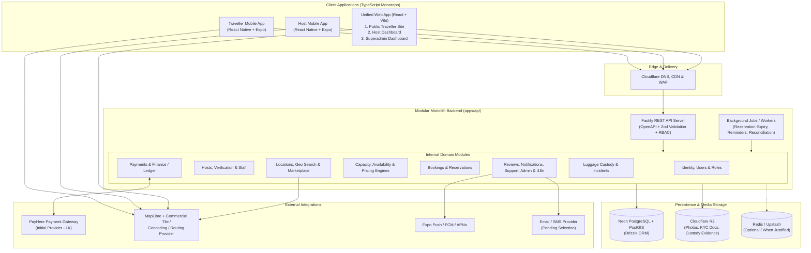
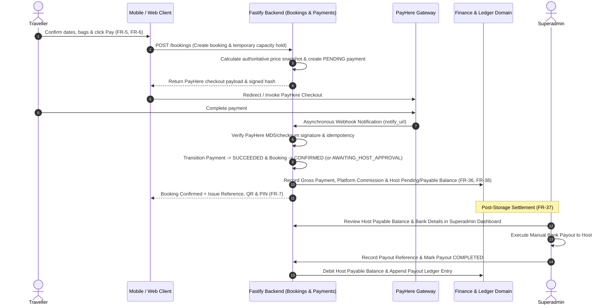

# System Architecture Overview

**Document Status:** Baseline Architecture — Phase 0A
**Source Reference:** [luggage-storage-frs.pdf](../product/source/luggage-storage-frs.pdf)
**Related Documents:**
- [Product Overview](../product/product-overview.md)
- [Application Architecture Boundaries](application-boundaries.md)
- [Backend Domain Architecture Overview](backend-domain-overview.md)
- [Technology Decisions Register](technology-decisions.md)
- [Assumptions and Open Questions](../product/assumptions-and-open-questions.md)

---

## 1. Architectural Philosophy

The **Global Luggage Storage Marketplace** is designed as a **Modular Monolith** built inside a **TypeScript monorepo (`pnpm` workspace + `Turborepo`)**.

This architecture balances two critical requirements:
1. **Enterprise Domain Rigor & Global Readiness:** The platform handles physical custody of travellers' belongings (`FR-8`, `FR-27`–`FR-31`), online payments (`FR-6`), commissions and manual payouts (`FR-36`–`FR-38`), multi-location host businesses (`FR-44`), and international expansion (`FR-14`). It therefore requires strict domain separation, transactional consistency, immutable financial records, and timezone/currency-aware data structures.
2. **Startup Cost & Operational Efficiency:** Rather than introducing premature microservices, Kubernetes clusters, distributed service meshes, or multiple databases, all backend business domains run within a single deployable **Fastify (Node.js + TypeScript)** service backed by a single **PostgreSQL + PostGIS** database, **Cloudflare R2** object storage, and an optional/on-demand background job runner. Each backend domain module is strictly encapsulated so that it can scale independently or be extracted in the future if traffic ever justifies it.

---

## 2. High-Level System Architecture Diagram

---

## 3. Application Components

### 3.1 Mobile Applications (`apps/mobile`)
- **Framework:** React Native with **Expo** (`TypeScript`, `Expo Router`).
- **Dual Application Strategy:** A single shared codebase in `apps/mobile` produces two distinct application binaries and store identities via dynamic Expo configuration (`app.config.ts`) and **Expo EAS**:
  1. **Traveller Mobile Application:** Focused on discovery (`FR-2`–`FR-4`), availability/pricing (`FR-5`), booking/PayHere checkout (`FR-6`), QR/PIN display and directions (`FR-7`), check-in/out presentation (`FR-8`), active bookings (`FR-9`), cancellations/refund status (`FR-10`), reviews (`FR-12`), support (`FR-12`), favourites (`FR-13`), and localization settings (`FR-14`).
  2. **Host Mobile Application:** Focused on host registration and KYC upload (`FR-15`–`FR-18`), single and multi-location setup (`FR-19`, `FR-44`), hours/capacity/availability/pricing (`FR-20`–`FR-23`), booking dashboard and acceptance (`FR-24`–`FR-26`), camera QR/PIN verification, bag check-in and photo evidence (`FR-27`–`FR-29`), check-out and late collection handling (`FR-30`–`FR-32`), earnings/payouts/transactions (`FR-36`–`FR-38`), support/incidents (`FR-40`, `FR-41`), staff accounts UI (`FR-42`), and analytics UI (`FR-43`).
- **Cross-Platform Build Requirement:** Developed on **Windows**; iOS and Android development and production builds are executed via **Expo EAS Cloud Builds**, removing any dependency on local macOS/Xcode hardware. Native modules (`MapLibre React Native`, `expo-camera`, `expo-location`, `expo-notifications`) use **Expo Development Builds** rather than Expo Go.

### 3.2 Web Application (`apps/web`)
- **Framework:** **React + Vite + TypeScript**, styled with **Tailwind CSS** and **shadcn/ui**, routed via **React Router**, with **TanStack Query**, **Zustand**, **React Hook Form**, and **Zod**.
- **Three Segregated Experiences:**
  1. **Public Traveller Website:** SEO-friendly discovery, map/list search (`MapLibre GL JS`), and complete browser-based booking and payment journeys.
  2. **Host Management Dashboard:** Desktop/tablet-optimized management portal for hosts (especially multi-location chains under `FR-44`), covering location setup, capacity/pricing matrices, booking operations, and financial statements.
  3. **Superadmin Dashboard:** Internal operational portal for host verification approvals (`FR-17`), manual host payout execution (`FR-37`), refund processing (`FR-10`), support queues (`FR-12`, `FR-40`), incident investigation (`FR-41`), commission settings, and audit logs.

---

## 4. Backend Architecture (`apps/api`)

- **Runtime & Framework:** **Node.js + TypeScript + Fastify**.
- **API Style:** RESTful JSON APIs with auto-generated **OpenAPI (Swagger)** specifications and shared **Zod** request/response validation schemas.
- **Modular Monolith Structure:**
  - The backend is organized into domain modules (`identity`, `users`, `travellers`, `hosts`, `host-verification`, `locations`, `marketplace`, `geospatial`, `capacity`, `availability`, `pricing`, `bookings`, `payments`, `finance`, `custody`, `reviews`, `notifications`, `support`, `incidents`, `staff`, `analytics`, `administration`, `localization`).
  - Modules communicate through explicit application service interfaces and internal domain events—never by reaching directly into another module's internal repository logic.
- **Background Processing:**
  - Scheduled and asynchronous tasks (expiring unpaid temporary capacity reservations, sending drop-off and collection reminders under `FR-11`/`FR-35`, reconciling payment webhooks) run as structured worker routines within the backend process initially (or via lightweight database/Redis queues when load justifies).

---

## 5. Database & Geospatial Storage

- **Engine:** **PostgreSQL** (initially hosted on **Neon PostgreSQL**) with the **PostGIS** geospatial extension enabled.
- **ORM & Migrations:** **Drizzle ORM** providing type-safe SQL queries and version-controlled schema migrations.
- **Key Architectural Responsibilities:**
  - **Geospatial Indexing (`PostGIS`):** Spatial `GEOGRAPHY(Point, 4326)` columns and `GiST` indexes power radius searches (`FR-2 Location Search`), map viewport queries (`FR-3 Map View`), and distance calculations (`FR-4 Filters`).
  - **Transactional Integrity:** Atomic ACID transactions protect concurrent capacity reservations (`FR-5`, `FR-6`) from double-booking.
  - **Financial Ledger Integrity:** Append-only financial ledger entries track customer payments, platform commissions, refunds, host earnings balances, and manual payouts (`FR-36`–`FR-38`) using exact integer minor units or fixed-precision decimals (never floating-point numbers).
  - **Custody & Audit Logs:** Immutable event logs record every booking state transition and physical custody handoff (`FR-27`–`FR-31`).

---

## 6. File & Media Storage (`Cloudflare R2`)

- **Service:** **Cloudflare R2** (S3-compatible object storage with zero egress fees).
- **Stored Assets:**
  1. **Public/Semi-Public Media:** Storage location photos uploaded by hosts (`FR-19`), served through Cloudflare CDN.
  2. **Restricted Verification Documents:** Host identity (NIC/Passport) and business registration documents (`FR-16`), stored in private buckets and accessible only to the owning Host and authorized Platform Admin/Support staff via short-lived pre-signed URLs.
  3. **Restricted Custody & Incident Evidence:** Check-in luggage photos and tag records (`FR-29`) and incident evidence (`FR-41`), accessible only to the involved Traveller, Host, and Platform Investigators via signed URLs.

---

## 7. Payment Integration Architecture (`PayHere`)

- **Initial Provider:** **PayHere** (`FR-6 Online Payment`, `LK` market).
- **Provider Abstraction:** The `Payments` domain defines a provider-agnostic `PaymentGatewayPort` interface. `PayHereAdapter` is the initial implementation, ensuring future payment providers (Stripe, Adyen, etc.) can be added for new countries without altering core `Bookings` or `Finance` logic.
- **End-to-End Payment & Manual Payout Flow:**

> [!WARNING]
> **Critical Payment Rules:**
> 1. **Never trust client redirects alone:** A booking is confirmed only after the backend verifies the cryptographic signature of PayHere's server-to-server notification (`notify_url`) or verified status API.
> 2. **Commercial Model Verification (`OQ-003`):** PayHere standard merchant checkout collects funds into the platform's merchant account rather than providing automatic marketplace escrow/split payouts. This aligns technically with `FR-37` (*"Will do a manual payout through a superadmin dashboard because of security reasons"*), but commercial/regulatory sign-off with PayHere must be confirmed before live launch.

---

## 8. Maps, Geospatial & Notifications

### 8.1 Maps & Geospatial Services
- **Client Rendering:** **MapLibre React Native** on mobile (`apps/mobile`) and **MapLibre GL JS** on web (`apps/web`).
- **Tile, Geocoding & Routing Provider:** MapLibre is an open-source rendering engine that requires a commercial vector tile, geocoding, and routing provider in production (e.g., MapTiler, Stadia Maps, AWS Location Service, or Google Maps APIs for geocoding/directions handoff). The specific commercial provider is tracked as pending approval (`OQ-018`).
- **Directions Handoff (`FR -7 Directions`):** In addition to in-app map previews, confirmed bookings provide a one-tap deep link to launch turn-by-turn navigation in the traveller's preferred native map application (Google Maps, Apple Maps, Waze) using the host's verified coordinates.

### 8.2 Notifications Architecture (`FR-11`, `FR-35`)
- **Channels:**
  1. **Push Notifications:** Dispatched via **Expo Notifications** (backed by FCM for Android and APNs for iOS) for real-time alerts (new booking, booking accepted, drop-off reminder, collection deadline warning, overdue alert).
  2. **Email Notifications:** Transactional emails for account verification, password resets, booking confirmations, payment receipts, and payout advices (provider pending approval — `OQ-019`).
  3. **In-App Notification Centre:** Persisted in PostgreSQL so Travellers (`FR-11`) and Hosts (`FR-35`) can review notification history inside the mobile and web apps.

---

## 9. Deployment Philosophy & Infrastructure

| Layer | Approved Technology | Deployment Rationale |
| :--- | :--- | :--- |
| **Monorepo & Build Orchestration** | `pnpm` Workspaces + `Turborepo` | Single repository for `apps/mobile`, `apps/web`, `apps/api`, and `packages/*` with cached builds and shared TypeScript contracts |
| **Edge, DNS & CDN** | Cloudflare | Global DNS, DDoS protection, SSL termination, static asset caching, and R2 media delivery |
| **Backend Hosting** | AWS EC2 or cost-effective VPS | Runs the containerized or PM2/systemd Fastify modular monolith and background workers predictably at low monthly cost |
| **Database** | Neon PostgreSQL (with PostGIS) | Managed serverless/autoscaling PostgreSQL with automated backups, branching support, and PostGIS compatibility |
| **Media & Document Storage** | Cloudflare R2 | S3-compatible storage for photos, KYC docs, and check-in evidence without egress bandwidth penalties |
| **Caching / Ephemeral State** | Redis / Upstash *(When Justified)* | Deferred until needed for distributed rate-limiting, session caching, or high-throughput job queues |
| **Mobile Cloud Builds** | Expo Application Services (EAS) | Cloud compilation for Android (`.aab`/`.apk`) and iOS (`.ipa`) from a Windows development environment |
| **CI/CD** | GitHub Actions | Automated linting, type-checking, unit/integration testing, and deployment pipelines |

---

## 10. Architectural Constraints & Scalability Considerations

1. **Strict Module Encapsulation:** Every domain inside `apps/api/src/modules/` exposes a public service facade and keeps its database queries internal. If the `Marketplace` search module or `Notifications` worker ever requires independent horizontal scaling in the future, it can be split out without untangling spaghetti SQL imports.
2. **Stateless API Tier:** The Fastify API server stores no local session state or local disk uploads; all state lives in PostgreSQL/Redis and all files upload directly (or via signed URLs) to Cloudflare R2. This allows horizontal scaling behind a load balancer when traffic grows.
3. **Database Concurrency & Indexing:** High-read discovery endpoints (`FR-2`–`FR-4`) use PostGIS spatial indexes and composite B-tree indexes, while high-contention booking creation (`FR-6`) uses short, targeted database transactions with row-level locking on capacity pools.
4. **Global-Ready Data Primitives:** All timestamps are stored in `UTC` (`TIMESTAMPTZ`) alongside the location's `IANA` timezone string; all monetary figures carry an explicit `ISO 4217` currency code; all country references use `ISO 3166-1 alpha-2`.

