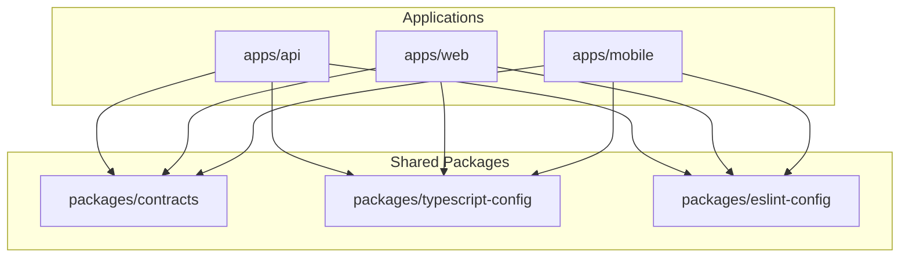

# Phase 1A Engineering Implementation Plan

**Project:** Global Luggage Storage Marketplace  
**Document Type:** Engineering Design & Implementation Plan  
**Phase:** Phase 1A — Engineering Foundation & Repository Architecture  
**Status:** Approved for Implementation  
**Governing Documents:** Product Owner Acceptance Record (`docs/governance/phase-0c-product-owner-acceptance.md`), ADR-001 through ADR-010.

---

## 1. Executive Summary & Objective

Phase 1A establishes the production-oriented engineering foundation for the Global Luggage Storage Marketplace. It converts the approved architecture baseline into a functioning monorepo with:
1. Turborepo and pnpm workspaces.
2. Shared TypeScript, ESLint, and contracts packages.
3. Fastify modular monolith backend bootstrap with database connectivity, structured logging, health checks, and OpenAPI generation.
4. Minimal React + Vite web foundation with Tailwind CSS and responsive application shell.
5. Minimal Expo mobile foundation with Expo Router supporting distinct Traveller and Host navigation paradigms.
6. Local development infrastructure (Docker for PostgreSQL + PostGIS) and CI pipeline (GitHub Actions).

### Critical Governance Boundary:
In strict compliance with the Project Blueprint and Phase 1A mandate, **no marketplace domain logic, bookings, capacity reservations, payments, refunds, host payouts, or KYC workflows will be implemented in Phase 1A**.

---

## 2. Monorepo Repository Structure

The repository is structured as a pnpm workspace orchestrated by Turborepo:

```text
luggage-storage/
├── apps/
│   ├── api/                      # Fastify Modular Monolith Backend
│   │   ├── src/
│   │   │   ├── config/           # Environment validation (Zod)
│   │   │   ├── infrastructure/   # Database (Drizzle), Logger (Pino), HTTP (Fastify)
│   │   │   ├── common/           # Error handlers, middlewares, utility functions
│   │   │   ├── modules/          # Future domain modules (empty placeholders/health)
│   │   │   └── server.ts         # Application entry point & graceful shutdown
│   │   ├── package.json
│   │   └── tsconfig.json
│   │
│   ├── web/                      # React + Vite Public & Admin Web Application
│   │   ├── src/
│   │   │   ├── app/              # Router, providers, global layout
│   │   │   ├── components/ui/    # Minimal design system shell
│   │   │   └── lib/              # API client, state stores
│   │   ├── package.json
│   │   └── vite.config.ts
│   │
│   └── mobile/                   # React Native + Expo Mobile Application
│       ├── app/                  # Expo Router file-based routes
│       │   ├── (traveller)/      # Traveller navigation group
│       │   ├── (host)/           # Host navigation group
│       │   └── _layout.tsx       # Root layout & providers
│       ├── src/                  # State, API client, theme
│       ├── app.json              # Expo configuration
│       └── package.json
│
├── packages/
│   ├── contracts/                # Shared API schemas, DTOs, Zod contracts
│   ├── typescript-config/        # Shared base tsconfig files
│   └── eslint-config/            # Shared ESLint rules
│
├── docs/                         # Authoritative product, architecture, governance docs
├── infrastructure/
│   └── docker/
│       └── docker-compose.yml    # Local PostgreSQL + PostGIS dev database
│
├── .github/
│   └── workflows/
│       └── ci.yml                # Lint, type-check, test, and build CI
│
├── .agents/                      # Engineering agent guidelines
├── package.json                  # Workspace root
├── pnpm-workspace.yaml           # pnpm workspace definition
├── turbo.json                    # Turborepo task pipeline
├── tsconfig.json                 # Root TypeScript config
├── .gitignore                    # Workspace git ignores
└── README.md                     # Engineering onboarding guide
```

---

## 3. Package Mapping & Technology Baseline

| Workspace Member | Category | Approved Technology Baseline | Primary Responsibilities |
| :--- | :--- | :--- | :--- |
| `packages/typescript-config`| Package | TypeScript 5.4+ | Base compiler options for Node, React, and React Native. |
| `packages/eslint-config` | Package | ESLint, TypeScript-ESLint | Shared static analysis rules and code standards. |
| `packages/contracts` | Package | Zod, TypeScript | Shared API request/response types, error envelopes, currency minor units, pagination. |
| `apps/api` | Application | Fastify, Drizzle ORM, PostgreSQL/PostGIS, Zod | Backend HTTP server, health checks, DB connection, OpenAPI spec generation. |
| `apps/web` | Application | React 18+, Vite, Tailwind CSS, TanStack Query, Zustand | Web frontend shell supporting future Traveller, Host, and Admin surfaces. |
| `apps/mobile` | Application | React Native, Expo 51+, Expo Router, Zustand | Shared mobile codebase supporting distinct Traveller and Host navigation identities. |

---

## 4. Dependency Direction & Architectural Boundaries



### Strict Boundary Rules:
1. **No Application-to-Application Dependencies:** `apps/api`, `apps/web`, and `apps/mobile` never import from each other directly.
2. **Contracts Package Decoupling:** `packages/contracts` must not import from any `apps/*` or depend on database ORM models (no Drizzle schema leakage into clients).
3. **No Circular Dependencies:** Turborepo pipeline enforces acyclic directed dependency trees.

---

## 5. Gate-by-Gate Implementation Roadmap

### Gate 3: Monorepo Foundation
- Initialize root `package.json`, `pnpm-workspace.yaml`, and `turbo.json`.
- Create `packages/typescript-config` with base configs (`base.json`, `node.json`, `react.json`).
- Create `packages/contracts` with standard API response envelopes (`ApiResponse<T>`, `ApiErrorResponse`), standard error codes, pagination schemas, and currency minor-unit representations.
- Establish `.gitignore` to prevent committing `node_modules`, build artifacts, `.env` files, or local keys.

### Gate 4: Backend Foundation (`apps/api`)
- Bootstrap Fastify application with `@fastify/cors`, `@fastify/helmet`, `@fastify/sensible`.
- Configure structured logging with `pino`.
- Implement centralized error handling middleware returning standardized `ApiErrorResponse` envelope.
- Implement configuration module using Zod validation against environment variables (`PORT`, `HOST`, `DATABASE_URL`, `NODE_ENV`).
- Configure Drizzle ORM database connection with PostgreSQL client (`postgres` / `pg`).
- Provide PostGIS extension verification check (`SELECT PostGIS_Version()`).
- Implement `/health` and `/ready` endpoints verifying server liveness and database ping.
- Setup `@fastify/swagger` and `@fastify/swagger-ui` for OpenAPI schema auto-generation.
- Create automated unit and integration tests using Vitest.

### Gate 5: Web Foundation (`apps/web`)
- Initialize Vite + React + TypeScript application.
- Configure Tailwind CSS.
- Establish application shell with header, responsive navigation layout, and theme provider.
- Setup React Router with root routes (`/`, `/health`, `/about`).
- Integrate TanStack Query provider and Zustand store.
- Setup shared API client consuming `packages/contracts`.
- Configure build script and verify production bundle generation.

### Gate 6: Mobile Foundation (`apps/mobile`)
- Initialize Expo application with TypeScript and Expo Router.
- Configure `app.json` with distinct application identifier schemes.
- Setup file-based routing with `app/(traveller)` and `app/(host)` route groups.
- Setup theme provider, TanStack Query, and Zustand client state.
- Create EAS build configuration (`eas.json`) documenting cloud build workflows.
- Verify web/node preview on Windows without requiring macOS/Xcode.

### Gate 7: CI, Testing & Independent Verification
- Setup `.github/workflows/ci.yml` running linting, type-checking, automated tests, and application builds.
- Create local `docker-compose.yml` for PostgreSQL 16 with PostGIS 3.
- Execute clean workspace build, lint, type-check, and test runs.
- Document all engineering guides in `docs/engineering/`.

---

## 6. Verification Criteria for Phase 1A Sign-Off

1. `pnpm install` completes cleanly across all workspace members.
2. `pnpm build` successfully compiles all packages and applications via Turborepo.
3. `pnpm lint` and `pnpm typecheck` pass with zero errors.
4. `pnpm test` executes and passes all backend and shared contract tests.
5. Fastify server starts, `/health` returns `{ status: "ok" }`, and `/docs` serves OpenAPI documentation.
6. Zero prohibited business logic (bookings, payments, KYC) is implemented.
