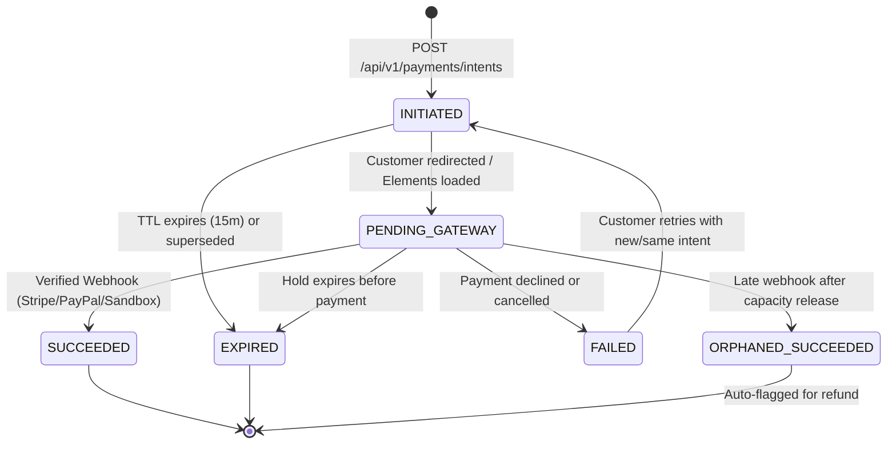
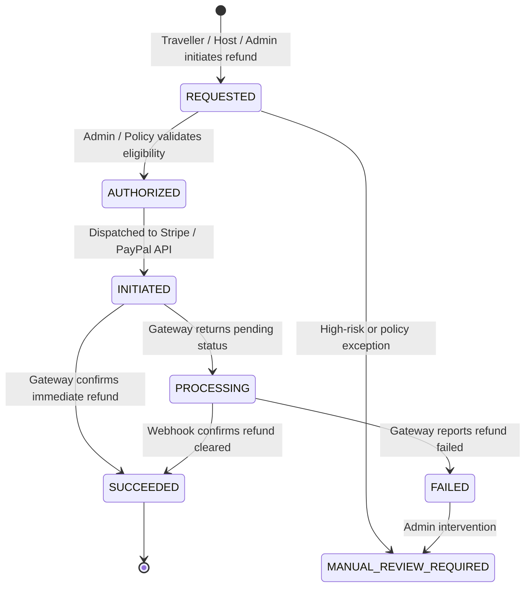

# Payment Lifecycle and State Machine

**Project:** Luggage Storage Marketplace (`kavicastelo/luggage-storage`)  
**Document:** `docs/payment-transformation/07-payment-lifecycle-and-state-machine.md`  
**Initiative:** Payment Infrastructure Transformation  
**Status:** Approved Technical State Machine  

---

## 1. Payment Intent State Machine



### Transition Invariants:
1. **Single Active Intent:** Only one intent in `('INITIATED', 'PENDING_GATEWAY')` can exist per booking at any time. When switching providers (e.g. from Stripe to PayPal), previous active intents are transitioned to `EXPIRED`.
2. **Deterministic Settlement:** Only a cryptographically verified webhook (or authenticated sandbox simulator) can transition an intent to `SUCCEEDED`.
3. **Capacity Check on Settlement:** If a payment succeeds after the 15-minute hold expires, capacity is re-checked. If available, booking confirms; if unavailable, intent moves to `ORPHANED_SUCCEEDED` and automatically schedules a full refund.

---

## 2. Booking State Machine Alignment

```text
[ DRAFT ]
    │
    ▼ Traveller submits booking dates & baggage
[ PENDING_PAYMENT ] ──(Capacity held for 15 minutes)──
    │                                                 │
    ├─► Payment Succeeds (Webhook verified)           ├─► Hold Expires (15m)
    ▼                                                 ▼
[ CONFIRMED ]                                   [ CANCELLED / EXPIRED ]
    │ (Unlocks Custody Pass: QR & PIN)
    ▼ Host scans QR -> Check-in
[ IN_STORAGE ]
    │
    ▼ Host scans QR -> Check-out
[ COMPLETED ]
    │
    ├─► Host Payable marked ELIGIBLE
    └─► Double-entry revenue & payable recorded
```

---

## 3. Refund State Machine (7-Stage OQ-013 Model)



### Automated Gateway Dispatch:
- When a refund is `AUTHORIZED`, the service calls `adapter.createRefund()`.
- Stripe and PayPal execute refunds immediately via API.
- Upon receiving a successful gateway response with `providerRefundId`, status transitions directly to `SUCCEEDED` with `settlementMode = 'PROVIDER_CONFIRMED'`.

