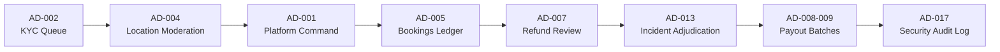

# Phase 2B — Product UI/UX Audit & Redesign Planning
## Document 06: End-to-End User Journey Audit

**Project:** Global Luggage Storage Marketplace (`https://github.com/kavicastelo/luggage-storage`)  
**Audit Document:** `DOC-UX-P2B-006`  
**Reference Document:** `docs/product/ux/navigation-and-journey-maps.md` (`DOC-UX-002`)  
**Date:** November 9, 2026

---

### 1. Journey Audit Framework

Evaluating screens in isolation creates a false sense of completeness. A screen may be visually styled but completely fail to support an end-to-end user goal. This audit assesses three core marketplace journeys from entry to resolution.

---

### 2. Traveller End-to-End Journey Audit

**Target Flow:**  
`Discover Storage` $\rightarrow$ `Search Locations` $\rightarrow$ `Compare Options` $\rightarrow$ `Select Dates & Bags` $\rightarrow$ `Review Pricing` $\rightarrow$ `Payment` $\rightarrow$ `Booking Confirmation` $\rightarrow$ `Luggage Check-in` $\rightarrow$ `Active Custody Tracking` $\rightarrow$ `Collection Handover` $\rightarrow$ `Review Submission`.

#### Detailed Stage Evaluation:

1. **Discovery & Search (`PW-001`, `PW-002`, `TM-011`, `TM-012`):**
   - *Friction:* On Web (`PW-002`), the map is a simulated dark box without panning, zooming, clustering, or real interactive geolocation. On Mobile (`TM-012`), MapLibre is not initialized, rendering a static card list instead.
   - *Terminology Leakage:* Search results display internal codes (`PW-003`, `PW-004`, `WF-007`).
   - *Missing Step:* Travellers cannot filter by operating hour overlaps (e.g. "Open between 8:00 PM and 11:00 PM").
2. **Configuration & Checkout (`PW-004`, `TM-017`–`TM-019`):**
   - *Friction:* Bag selection works, but there is no explanation of bag size dimensions (e.g. cabin bag vs checked bag dimensions in cm/inches).
   - *Anxiety Inducers:* Heavy-handed warnings about "Late Collection Policies (`OQ-015`)" create fear of unexpected penalties.
   - *State Loss:* Going back to search clears selected bag counts and dates.
3. **Payment & Confirmation (`PW-005`, `TM-020`, `TM-024`):**
   - *Dead End:* On Web, `PW-005` renders debug switcher buttons (`State: GATEWAY`, `State: POLLING`, `State: CONFIRMED`). Once in `CONFIRMED` state, clicking `Open Traveller Web Portal` navigates to `/portal/bookings`, but there is no "Add to Apple Wallet / Google Wallet" or downloadable PDF voucher.
   - *Authentication Gate Flaw:* An unauthenticated user can reach checkout, but when asked to sign in, they are redirected to `/login` without an explicit return URL parameter, losing their active booking draft.
4. **Luggage Check-in & Custody Tracking (`TM-028`, `TM-029`):**
   - *Missing Guidance:* The pass displays a QR code and PIN `482910`, but lacks instructions on how to show it to the host attendant or what happens if the phone battery dies.
   - *Photo Evidence Gap:* `TM-029` mentions "photo evidence preview", but no camera photos taken during host check-in are viewable.
5. **Luggage Collection & Post-Trip Review (`TM-030`, `TM-034`):**
   - *Friction:* Completing checkout collection leaves the user on a static pass view. It does not automatically trigger the review prompt (`TM-034`), relying on the traveller to locate the review screen manually.

---

### 3. Host Partner End-to-End Journey Audit

**Target Flow:**  
`Host Onboarding` $\rightarrow$ `KYC Verification` $\rightarrow$ `Location Setup` $\rightarrow$ `Capacity & Zones` $\rightarrow$ `Pricing & Hours` $\rightarrow$ `Incoming Requests` $\rightarrow$ `Luggage Check-in` $\rightarrow$ `Custody Inspection` $\rightarrow$ `Collection Handover` $\rightarrow$ `Overdue Adjudication` $\rightarrow$ `Earnings Payout`.

#### Detailed Stage Evaluation:

1. **Host Onboarding & KYC Submission (`PW-006`, `HM-003`–`HM-005`):**
   - *Friction:* KYC upload buttons on `HM-004` do not trigger native image pickers or document scanners. They merely toggle client state strings.
   - *Confusion:* No guidance on accepted document types (e.g. Sri Lankan Business Registration Certificate requirements).
2. **Location & Schedule Management (`HD-002`–`HD-006`, `HM-009`–`HM-014`):**
   - *Navigation Inconsistency:* In `HD-002` (Location Management), clicking a location opens `HD-003` (Profile), but there are no persistent sub-tabs to move between Schedule (`HD-004`), Capacity (`HD-005`), and Pricing (`HD-006`). The host must return to the main sidebar every time.
   - *Missing Validation:* Operating hours allow invalid configurations (e.g. drop-off time after closing time).
3. **Counter-Mode Custody Handover (`HM-021`–`HM-025`, `HD-009`):**
   - *Critical Missing Capability:* On Mobile (`HM-021`), **there is no camera scanner**. An attendant standing at a counter cannot point their camera at a customer's phone to scan their QR code. They must manually type a 6-digit PIN.
   - *Tag Verification:* `HM-022` provides an input field for physical seal numbers (`SEAL-LK-90211`), but does not offer barcode scanning for fast tag capture.
4. **Overdue Handling & Mandatory Release (`HM-026`–`HM-028`):**
   - *Positive Invariant:* The application correctly adheres to Business Rule `BR-035` and Product Decision `OQ-015`: unpaid overdue fees do not block physical luggage release.
   - *UX Defect:* The button in `HM-028` is labeled `Disputed Release Handover (HM-028)`. Internal legal terminology confuses host staff during a customer confrontation.
5. **Earnings & Payout Ledger (`HD-010`, `HD-011`, `HM-029`):**
   - *Clarity:* The 85% host / 15% platform split is transparently displayed.
   - *Missing Action:* Hosts cannot trigger an on-demand payout request; they are informed that payouts occur weekly via manual admin disbursement.

---

### 4. Superadmin Platform Operations Journey Audit

**Target Flow:**  
`Host KYC Review` $\rightarrow$ `Location Moderation` $\rightarrow$ `Marketplace Oversight` $\rightarrow$ `Booking Ledger` $\rightarrow$ `Refund Queue` $\rightarrow$ `Incident Investigation` $\rightarrow$ `Payout Disbursement` $\rightarrow$ `Audit Log Review`.

#### Detailed Stage Evaluation:

1. **Host Verification & Location Moderation (`AD-002`, `AD-004`):**
   - *Friction:* Reviewers cannot view full-resolution document previews or zoom in on premises photos. Approval/rejection actions are immediate without an audit note prompt.
2. **Platform Monitoring & Bookings Ledger (`AD-001`, `AD-005`):**
   - *Defect:* `AD-001` is overloaded with 18 large screen cards that push real-time marketplace metrics down below the fold.
   - *Missing Tools:* `AD-005` lacks batch export to CSV and advanced filtering by host ID or geographic hub.
3. **Refunds & Financial Settlement (`AD-007`–`AD-010`):**
   - *Positive Logic:* The 7-stage refund tracking aligns with architectural decisions.
   - *Missing Capability:* In `AD-009` (Manual Payout Disbursement), recording a bank reference does not generate a downloadable bank settlement file (e.g. SLIPS format).
4. **Custody Incident & Dispute Adjudication (`AD-013`):**
   - *Severe Failure:* `AD-013` is an empty placeholder card reciting architectural text (`OQ-015 / BR-035 Enforcement`). It does not allow administrators to inspect customer vs host testimony, view bag inspection photos, or issue compensatory vouchers.
5. **Security & Auditability (`AD-017`, `AD-018`):**
   - *Architectural Triumph:* `AD-017` is fully implemented and connected to live PostgreSQL triggers and Fastify endpoints, allowing live querying of immutable security events.

---

### 5. Cross-Journey Summary Matrix

| Journey Aspect | Traveller Experience | Host Partner Experience | Superadmin Operations |
|---|---|---|---|
| **Primary Entry** | Fragmented by screen ID leakages | Confusing developer hub switcher | Card-cluttered command center |
| **Ergonomics** | Poor mobile navigation; no map | No camera QR scanner; slow PIN entry | Good data density; weak inspection tools |
| **Trust Factor** | Low (feels like unverified test site) | Moderate (unclear onboarding requirements) | High (live audit logs and RBAC) |
| **Blocking Defect** | Mobile app is non-navigable switcher | Mobile app lacks camera barcode scanner | AD-013 incident flow is placeholder |
