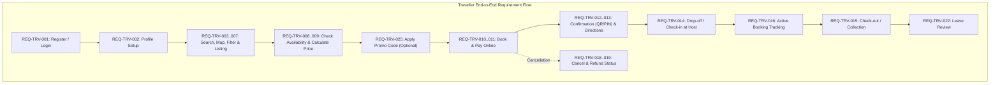

# Normalized Functional Requirements Specification

**Document Title:** Normalized Functional Requirements Specification  
**Project:** Global Luggage Storage Marketplace  
**Phase:** Phase 0B — Requirements Normalization & Traceability  
**Document Status:** Complete Authoritative Baseline  
**Source Document:** `docs/product/source/luggage-storage-frs.pdf`  
**Related Documents:**
- [Requirement Traceability Matrix](requirements-traceability-matrix.md)
- [Workflow and Use-Case Inventory](workflow-inventory.md)
- [Business Rules and Validation Catalogue](business-rules-catalogue.md)
- [Assumptions and Open Questions Register](assumptions-and-open-questions.md)
- [Product Overview](product-overview.md)
- [System Architecture Overview](../architecture/system-architecture.md)

---

## 1. Document Control & Classification Definitions

### 1.1 Purpose and Scope
This document provides the definitive, normalized, and testable functional requirements for the **Global Luggage Storage Marketplace**. It normalizes all **57 original source requirement rows** extracted from the authoritative Functional Requirement Specification (`luggage-storage-frs.pdf`), establishes unambiguous internal identifiers, defines rigorous acceptance criteria in Given/When/Then format, documents application surface allocations, and captures explicit vs. implied functional workflows.

### 1.2 Requirement Classifications
Every requirement in this specification displays three distinct classification attributes:

1. **Original FRS Classification (`Original Classification`):**
   - **`Core MVP (unmarked)`**: Features present in the FRS with an empty/unmarked `MVP?` column, representing foundational launch capabilities (49 source rows).
   - **`Later/MVP`**: Specifically assigned to `FR -10 Refund Status`, indicating dual classification in the source document (1 source row).
   - **`Depends`**: Specifically assigned to `FR-26 Booking Acceptance`, denoting dependency on booking mode configuration (1 source row).
   - **`Recommended`**: Specifically assigned to `FR-29 Check-in Evidence`, indicating recommended operational best practice in the source (1 source row).
   - **`Later`**: Features explicitly classified as `Later` in the source (`FR-13 Favourite Hosts`, `FR-14 Multiple Languages`, `FR -14 Multiple Currencies`, `FR-42 Staff Accounts`, `FR-43 Analytics`) (5 source rows).
2. **Delivery Target (`Delivery Target`):**
   - **`MVP Functional`**: Full end-to-end backend business logic, persistence, and UI implementation targeted for initial launch.
   - **`UI-Complete / Backend-Deferred`**: Complete, navigable UI screens present in initial release; full backend activation deferred.
   - **`Configurable MVP`**: Built with configurable runtime toggles per location or platform policy (e.g., booking modes, evidence policies).
   - **`Pending Decision`**: Delivery scope or operational mechanism contingent on pending product owner decisions.
3. **Implementation Status (`Implementation Status`):**
   - **`Documentation defined`**: Applied uniformly across all requirements in this phase. Zero application code, migrations, or database schemas have been created.

### 1.3 Requirement Origins
- **`EXPLICIT`**: Directly stated in the original FRS document.
- **`IMPLIED`**: Necessary operational capability required to fulfill an explicit FRS requirement (e.g., booking expiration, payment webhook verification, manual payout recording).
- **`PROPOSED`**: Architectural or operational enhancement recommended for marketplace integrity, awaiting formal product owner sign-off.

### 1.4 Application Surface Legend
- **`TM`**: Traveller Mobile Application (`apps/mobile` — Traveller build)
- **`HM`**: Host Mobile Application (`apps/mobile` — Host build)
- **`PW`**: Public Traveller Website (`apps/web` — Public & Traveller zone)
- **`HD`**: Host Web Dashboard (`apps/web` — Host zone)
- **`AD`**: Superadmin Web Dashboard (`apps/web` — Admin zone)
- **`API`**: Backend API & Modular Monolith Services (`apps/api`)

---

## 2. Product Capabilities Overview

The 57 original FRS rows and supporting implied requirements are structured into 15 cohesive functional capability groups:

1. **Identity, Authentication & Profiles** (`REQ-TRV-001`, `REQ-TRV-002`, `REQ-HST-001`, `REQ-HST-004`, `REQ-HST-028`)
2. **Host Verification & Approval** (`REQ-HST-002`, `REQ-HST-003`, `REQ-IMPL-001`)
3. **Storage Location & Business Management** (`REQ-HST-005`, `REQ-HST-030`, `REQ-IMPL-002`)
4. **Marketplace Search, Discovery & Listing Details** (`REQ-TRV-003`, `REQ-TRV-004`, `REQ-TRV-005`, `REQ-TRV-006`, `REQ-TRV-007`)
5. **Configurable Capacity, Availability & Operating Hours** (`REQ-HST-006`, `REQ-HST-007`, `REQ-HST-008`, `REQ-TRV-008`)
6. **Pricing, Discounts & Promotions** (`REQ-TRV-009`, `REQ-TRV-025`, `REQ-HST-009`, `REQ-IMPL-003`)
7. **Booking Engine & Reservation Lifecycle** (`REQ-TRV-010`, `REQ-HST-010`, `REQ-HST-011`, `REQ-HST-012`, `REQ-IMPL-004`, `REQ-IMPL-005`)
8. **Payments, Checkout & Webhook Reconciliation** (`REQ-TRV-011`, `REQ-IMPL-006`, `REQ-IMPL-007`)
9. **Booking Confirmation, Access Tokens & Directions** (`REQ-TRV-012`, `REQ-TRV-013`)
10. **Physical Luggage Custody, Check-In & Evidence** (`REQ-TRV-014`, `REQ-HST-013`, `REQ-HST-014`, `REQ-HST-015`)
11. **Storage Duration, Overdue Management & Collection** (`REQ-TRV-015`, `REQ-TRV-016`, `REQ-HST-016`, `REQ-HST-017`, `REQ-HST-018`)
12. **Cancellations, Refunds & Booking History** (`REQ-TRV-017`, `REQ-TRV-018`, `REQ-TRV-019`, `REQ-HST-019`, `REQ-HST-020`, `REQ-IMPL-008`)
13. **Reviews, Ratings & Customer Feedback** (`REQ-TRV-021`, `REQ-TRV-022`, `REQ-HST-025`, `REQ-IMPL-009`)
14. **Customer Support & Luggage Incidents** (`REQ-TRV-023`, `REQ-HST-026`, `REQ-HST-027`, `REQ-IMPL-010`)
15. **Financial Ledger, Earnings, Payouts & Administration** (`REQ-HST-022`, `REQ-HST-023`, `REQ-HST-024`, `REQ-HST-029`, `REQ-TRV-020`, `REQ-HST-021`, `REQ-TRV-024`, `REQ-TRV-026`, `REQ-TRV-027`, `REQ-IMPL-011` through `REQ-IMPL-015`)

---

## 3. Traveller Requirements Specification (`REQ-TRV-001` to `REQ-TRV-027`)

---

### `REQ-TRV-001` — Account Registration & Login
- **Original FRS Reference:** `FR -1`
- **Original Feature Name:** Account Registration & Login
- **Original Description:** Sign up using email, Google/Apple etc.
- **Original Classification:** Core MVP (unmarked)
- **Delivery Target:** MVP Functional
- **Implementation Status:** Documentation defined
- **Requirement Origin:** EXPLICIT
- **Application Surface:** `TM`, `PW`, `API`
- **Primary Actor:** Guest Visitor / Traveller
- **Supporting Actors:** Identity Provider (Google, Apple OAuth)
- **Preconditions:** User has network access and client application open.
- **Expected Outcome:** User account is created or authenticated; session tokens issued.
- **Normalized Statement:** The system shall enable users to register and authenticate using email and password, Google OAuth, or Apple Sign-In, enforcing password hashing via Argon2id, email verification, and issuance of cryptographically signed JWT sessions.
- **Business Rules:** `BR-001`, `BR-002`, `BR-003`, `BR-004`.
- **Dependencies:** `identity`, `users`, `notifications`.
- **Acceptance Criteria:**
  - **AC-REQ-TRV-001-01:** Given an unauthenticated visitor on TM or PW, when valid email and password meeting security complexity rules are submitted, then a user record is created, a verification email is dispatched, and the user is authenticated.
  - **AC-REQ-TRV-001-02:** Given an unauthenticated visitor, when authenticating via Google or Apple OAuth with verified credentials, then the system matches or creates a unified `User` account and establishes an authenticated session.
  - **AC-REQ-TRV-001-03:** Given invalid login credentials or an unverified email address, when authentication is attempted, then access is denied with a clear, non-leaking error message.
- **Open Questions / Notes:** Self-managed authentication inside Fastify with PostgreSQL sessions and Argon2id password hashing is approved by owner (`OQ-001`). Social login is optional/deferred.

---

### `REQ-TRV-002` — Traveller Profile
- **Original FRS Reference:** `FR-2` *(1st occurrence)*
- **Original Feature Name:** Traveller Profile
- **Original Description:** Name, contact details, booking history and preferences
- **Original Classification:** Core MVP (unmarked)
- **Delivery Target:** MVP Functional
- **Implementation Status:** Documentation defined
- **Requirement Origin:** EXPLICIT
- **Application Surface:** `TM`, `PW`, `API`
- **Primary Actor:** Traveller
- **Supporting Actors:** None
- **Preconditions:** Traveller is authenticated.
- **Expected Outcome:** Traveller profile is updated and retrieved.
- **Normalized Statement:** The system shall allow travellers to view and update their profile details (first name, last name, phone number in E.164 format, emergency contact, communication preferences), view historical bookings, and manage account preferences.
- **Business Rules:** `BR-005`, `BR-006`.
- **Dependencies:** `REQ-TRV-001`, `users`, `travellers`.
- **Acceptance Criteria:**
  - **AC-REQ-TRV-002-01:** Given an authenticated traveller, when updating their contact phone number, then the system validates the number against international E.164 format and saves the record.
  - **AC-REQ-TRV-002-02:** Given an authenticated traveller, when navigating to the profile screen, then personal profile data, preferred language/currency display, and a shortcut to booking history are rendered accurately.
- **Open Questions / Notes:** Unified identity model approved (`OQ-007`).

---

### `REQ-TRV-003` — Location Search
- **Original FRS Reference:** `FR -2` *(2nd occurrence)*
- **Original Feature Name:** Location Search
- **Original Description:** Search storage locations based on destination/current location
- **Original Classification:** Core MVP (unmarked)
- **Delivery Target:** MVP Functional
- **Implementation Status:** Documentation defined
- **Requirement Origin:** EXPLICIT
- **Application Surface:** `TM`, `PW`, `API`
- **Primary Actor:** Guest Visitor / Traveller
- **Supporting Actors:** Geocoding Provider
- **Preconditions:** Device location permissions granted or destination text entered.
- **Expected Outcome:** List of approved storage locations ranked by proximity to query coordinates.
- **Normalized Statement:** The system shall provide geospatial search capabilities allowing users to find active, approved storage locations based on current device GPS coordinates or destination search text (city, address, transit station, or landmark).
- **Business Rules:** `BR-007`, `BR-008`, `BR-009`.
- **Dependencies:** `marketplace`, `geospatial`, `locations`.
- **Acceptance Criteria:**
  - **AC-REQ-TRV-003-01:** Given device location access is permitted, when the user requests nearby search on TM, then locations within the default search radius (e.g., 5 km) are returned, sorted ascending by distance.
  - **AC-REQ-TRV-003-02:** Given a destination text query (e.g., "Fort Railway Station, Colombo"), when submitted on TM or PW, then geocoding resolves coordinates and returns matching storage locations within that geographic area.
  - **AC-REQ-TRV-003-03:** Given location search results, then only locations belonging to approved hosts (`FR-17`) with active status are visible to the public.
- **Open Questions / Notes:** Geocoding provider selection pending (`OQ-018`).

---

### `REQ-TRV-004` — Map View
- **Original FRS Reference:** `FR-3` *(1st occurrence, highlighted in FRS)*
- **Original Feature Name:** Map View
- **Original Description:** See nearby Hosts on a map
- **Original Classification:** Core MVP (unmarked)
- **Delivery Target:** MVP Functional
- **Implementation Status:** Documentation defined
- **Requirement Origin:** EXPLICIT
- **Application Surface:** `TM`, `PW`, `API`
- **Primary Actor:** Guest Visitor / Traveller
- **Supporting Actors:** Map Tile Provider (MapLibre)
- **Preconditions:** User has executed a search or opened the discovery view.
- **Expected Outcome:** Interactive vector map displaying storage location pins.
- **Normalized Statement:** The system shall display search results on an interactive vector map using MapLibre (React Native on mobile, GL JS on web), rendering location pins or clusters with price badges, opening status, and approximate location circles.
- **Business Rules:** `BR-009`, `BR-010`, `BR-011`.
- **Dependencies:** `REQ-TRV-003`, `marketplace`, `geospatial`.
- **Acceptance Criteria:**
  - **AC-REQ-TRV-004-01:** Given search coordinates, when map view is rendered, then vector map tiles load smoothly and pins represent all available storage locations in the visible viewport.
  - **AC-REQ-TRV-004-02:** Given a user taps or clicks a map pin, then an informational summary card displays the approximate location, starting price, user rating, and a link to listing details.
  - **AC-REQ-TRV-004-03:** Given public discovery mode, then storage location pins display generalized area circles rather than exposing exact storefront street numbers prior to confirmed booking (`BR-010`, `OQ-012`).
- **Open Questions / Notes:** Address privacy masking baseline is approved by owner (`OQ-012`): approximate discovery location shown publicly; exact address disclosed exclusively upon confirmed booking. Specific coordinate jitter radius (e.g. 150-300m) is a proposed policy pending owner approval.

---

### `REQ-TRV-005` — Host Listings
- **Original FRS Reference:** `FR -3` *(2nd occurrence)*
- **Original Feature Name:** Host Listings
- **Original Description:** View available luggage-storage locations
- **Original Classification:** Core MVP (unmarked)
- **Delivery Target:** MVP Functional
- **Implementation Status:** Documentation defined
- **Requirement Origin:** EXPLICIT
- **Application Surface:** `TM`, `PW`, `API`
- **Primary Actor:** Guest Visitor / Traveller
- **Supporting Actors:** None
- **Preconditions:** User has searched a location.
- **Expected Outcome:** Scrollable list of storage locations with key metrics.
- **Normalized Statement:** The system shall render a paginated or virtualized list view of available storage locations, presenting thumbnail photos, business archetype, distance from search origin, operating hours indicator (Open/Closed), average rating, review count, and base pricing.
- **Business Rules:** `BR-007`, `BR-011`.
- **Dependencies:** `REQ-TRV-003`, `marketplace`, `locations`.
- **Acceptance Criteria:**
  - **AC-REQ-TRV-005-01:** Given active search results, when toggling from Map View to List View, then the list displays identical matching locations with distance, rating, price, and thumbnail.
  - **AC-REQ-TRV-005-02:** Given zero available locations within the search radius, then a helpful empty state is shown with options to expand search distance.
- **Open Questions / Notes:** Mandatory custody verification approved by owner (`OQ-014`): QR/PIN scanning server-side verified; manual PIN entry fallback with audit logging.

---

### `REQ-TRV-006` — Filters
- **Original FRS Reference:** `FR-4` *(1st occurrence)*
- **Original Feature Name:** Filters
- **Original Description:** Filter by distance, price, opening hours, rating, availability etc.
- **Original Classification:** Core MVP (unmarked)
- **Delivery Target:** MVP Functional
- **Implementation Status:** Documentation defined
- **Requirement Origin:** EXPLICIT
- **Application Surface:** `TM`, `PW`, `API`
- **Primary Actor:** Guest Visitor / Traveller
- **Supporting Actors:** None
- **Preconditions:** Search results list or map is displayed.
- **Expected Outcome:** Search results dynamically filtered according to user criteria.
- **Normalized Statement:** The system shall allow travellers to filter search results by maximum distance, maximum price, specific opening hours (e.g., Open Now, 24/7), minimum star rating, real-time availability for selected dates/times, and available facilities (e.g., CCTV, elevator, ground floor).
- **Business Rules:** `BR-012`, `BR-013`.
- **Dependencies:** `REQ-TRV-003`, `REQ-TRV-005`, `marketplace`.
- **Acceptance Criteria:**
  - **AC-REQ-TRV-006-01:** Given search results, when the user sets a filter for "Rating: 4.5+ Stars", then only locations with an average verified rating >= 4.5 are displayed.
  - **AC-REQ-TRV-006-02:** Given search results, when the user sets "Open Now", then locations whose current local operating schedule indicates closed status are filtered out.
  - **AC-REQ-TRV-006-03:** Given multiple active filters, when applied, then criteria are combined conjunctively (AND logic).
- **Open Questions / Notes:** Mandatory custody verification approved by owner (`OQ-014`): QR/PIN scanning server-side verified; manual PIN entry fallback with audit logging.

---

### `REQ-TRV-007` — Host Details
- **Original FRS Reference:** `FR -4` *(2nd occurrence)*
- **Original Feature Name:** Host Details
- **Original Description:** Address/approximate location, photos, opening hours, facilities, restrictions, reviews
- **Original Classification:** Core MVP (unmarked)
- **Delivery Target:** MVP Functional
- **Implementation Status:** Documentation defined
- **Requirement Origin:** EXPLICIT
- **Application Surface:** `TM`, `PW`, `API`
- **Primary Actor:** Guest Visitor / Traveller
- **Supporting Actors:** None
- **Preconditions:** User selects a specific storage location from search results.
- **Expected Outcome:** Comprehensive location details page rendered.
- **Normalized Statement:** The system shall render a detailed listing view for a storage location containing photo gallery, approximate location/neighborhood, weekly operating schedules, drop-off/collection time limits, storage facilities (e.g., CCTV, locked room), prohibited item restrictions, verified reviews, and host profile summary.
- **Business Rules:** `BR-011`, `BR-014`, `BR-015`.
- **Dependencies:** `locations`, `reviews`, `availability`.
- **Acceptance Criteria:**
  - **AC-REQ-TRV-007-01:** Given an unbooked traveller viewing Host Details, then the exact street address and store signage name are masked (`BR-010`, `OQ-012`), displaying the neighborhood description and approximate area map prior to confirmed booking.
  - **AC-REQ-TRV-007-02:** Given a location listing, when viewing opening hours, then daily schedules and temporary closure exceptions are clearly shown in the location's local timezone.
  - **AC-REQ-TRV-007-03:** Given a location listing, then storage restrictions (e.g., no flammable goods, maximum bag weight) and security facilities are explicitly listed.
- **Open Questions / Notes:** Storage address masking baseline approved by owner (`OQ-012`): exact street address is masked until booking confirmation. Automatic unmasking of storefront name, entrance photos, and host phone upon confirmation are proposed policies pending owner approval.

---

### `REQ-TRV-008` — Availability Check
- **Original FRS Reference:** `FR-5` *(1st occurrence)*
- **Original Feature Name:** Availability Check
- **Original Description:** Select date, drop-off time, collection time and number/type of bags
- **Original Classification:** Core MVP (unmarked)
- **Delivery Target:** MVP Functional
- **Implementation Status:** Documentation defined
- **Requirement Origin:** EXPLICIT
- **Application Surface:** `TM`, `PW`, `API`
- **Primary Actor:** Guest Visitor / Traveller
- **Supporting Actors:** None
- **Preconditions:** Traveller is on the booking configuration step for a chosen location.
- **Expected Outcome:** Verification of capacity and operating hours for selected schedule.
- **Normalized Statement:** The system shall allow travellers to specify drop-off date/time, collection date/time, and bag counts per category, and validate that the location is open at both endpoints and possesses sufficient unreserved storage capacity across the entire duration.
- **Business Rules:** `BR-016`, `BR-017`, `BR-018`, `BR-019`.
- **Dependencies:** `capacity`, `availability`, `locations`.
- **Acceptance Criteria:**
  - **AC-REQ-TRV-008-01:** Given drop-off and collection times where the host is closed according to its schedule, when validated, then the system rejects the selection and displays the host's permitted drop-off/collection hours.
  - **AC-REQ-TRV-008-02:** Given a bag count that exceeds the host's unreserved capacity pool for the requested period, when checked, then the system alerts the traveller that capacity is unavailable for the selected bag count.
  - **AC-REQ-TRV-008-03:** Given valid hours and available capacity, when checked, then the system returns an availability confirmation token enabling price calculation.
- **Open Questions / Notes:** Mandatory custody verification approved by owner (`OQ-014`): QR/PIN scanning server-side verified; manual PIN entry fallback with audit logging.

---

### `REQ-TRV-009` — Price Calculation
- **Original FRS Reference:** `FR -5` *(2nd occurrence)*
- **Original Feature Name:** Price Calculation
- **Original Description:** Automatically calculate storage price
- **Original Classification:** Core MVP (unmarked)
- **Delivery Target:** MVP Functional
- **Implementation Status:** Documentation defined
- **Requirement Origin:** EXPLICIT
- **Application Surface:** `TM`, `PW`, `API`
- **Primary Actor:** Traveller
- **Supporting Actors:** None
- **Preconditions:** Valid dates, times, and bag quantities selected.
- **Expected Outcome:** Transparent, itemized price breakdown generated server-side.
- **Normalized Statement:** The system shall automatically compute an itemized price breakdown on the server based on the host's active pricing policy, duration, bag categories, applicable minimum charges, platform service fees, and taxes, returning exact monetary minor units.
- **Business Rules:** `BR-020`, `BR-021`, `BR-022`.
- **Dependencies:** `REQ-TRV-008`, `pricing`, `localization`.
- **Acceptance Criteria:**
  - **AC-REQ-TRV-009-01:** Given 2 medium bags stored for 24 hours at LKR 500/bag/day with a 10% platform fee, when calculated, then the API returns an itemized breakdown: Subtotal = LKR 1,000, Platform Fee = LKR 100, Total = LKR 1,100.
  - **AC-REQ-TRV-009-02:** Given any client-submitted price data, then the backend ignores client-side totals and recalculates authoritative pricing exclusively on the server.
- **Open Questions / Notes:** Currency LKR default confirmed (`OQ-008`).

---

### `REQ-TRV-010` — Booking
- **Original FRS Reference:** `FR-6` *(1st occurrence)*
- **Original Feature Name:** Booking
- **Original Description:** Reserve luggage space for selected period
- **Original Classification:** Core MVP (unmarked)
- **Delivery Target:** MVP Functional
- **Implementation Status:** Documentation defined
- **Requirement Origin:** EXPLICIT
- **Application Surface:** `TM`, `PW`, `API`
- **Primary Actor:** Traveller
- **Supporting Actors:** Host
- **Preconditions:** Traveller is authenticated; valid availability and price snapshot generated.
- **Expected Outcome:** Booking record created; temporary capacity hold placed.
- **Normalized Statement:** The system shall allow an authenticated traveller to initiate a booking, placing an atomic, time-limited capacity reservation on the host's inventory pool and transitioning the booking into `PAYMENT_PENDING` state.
- **Business Rules:** `BR-018`, `BR-023`, `BR-024`.
- **Dependencies:** `REQ-TRV-001`, `REQ-TRV-008`, `REQ-TRV-009`, `bookings`, `capacity`.
- **Acceptance Criteria:**
  - **AC-REQ-TRV-010-01:** Given an authenticated traveller submitting a booking request, when capacity is available, then the system atomically creates a `capacity_reservation` with an expiration window (e.g., 15 minutes) and creates a booking record.
  - **AC-REQ-TRV-010-02:** Given competing concurrent bookings for the last remaining slot, when two travellers submit simultaneously, then database row locking ensures exactly one succeeds and the other receives an "insufficient capacity" error.
- **Open Questions / Notes:** Both Instant and Host Approval modes approved by owner, configurable per storage location (`OQ-004`). In Host Approval mode, host has 15-minute default SLA to respond, and traveller has 10-minute default payment SLA after acceptance. No payment is captured upfront.

---

### `REQ-TRV-011` — Online Payment
- **Original FRS Reference:** `FR -6` *(2nd occurrence)*
- **Original Feature Name:** Online Payment
- **Original Description:** Pay securely through the app
- **Original Classification:** Core MVP (unmarked)
- **Delivery Target:** MVP Functional
- **Implementation Status:** Documentation defined
- **Requirement Origin:** EXPLICIT
- **Application Surface:** `TM`, `PW`, `API`
- **Primary Actor:** Traveller
- **Supporting Actors:** PayHere Payment Gateway
- **Preconditions:** Booking record in `PAYMENT_PENDING` state with active capacity hold.
- **Expected Outcome:** Payment session initiated via PayHere; transaction reconciled.
- **Normalized Statement:** The system shall securely initiate payment checkout via PayHere, passing server-signed parameters (order ID, amount, currency, hash), receive asynchronous webhook notifications, verify signature checksums, and update payment state.
- **Business Rules:** `BR-025`, `BR-026`, `BR-027`, `BR-028`.
- **Dependencies:** `REQ-TRV-010`, `payments`, `finance`.
- **Acceptance Criteria:**
  - **AC-REQ-TRV-011-01:** Given a pending booking, when checkout is launched, then the client opens PayHere SDK/Checkout using server-generated payload and cryptographic checksum.
  - **AC-REQ-TRV-011-02:** Given a PayHere webhook notification with status code 2 (SUCCESS) and valid MD5 signature, when processed by the backend, then the payment transitions to `SUCCEEDED` and the booking transitions to `CONFIRMED` (Instant) or `AWAITING_HOST_APPROVAL` (Approval mode).
  - **AC-REQ-TRV-011-03:** Given a client browser return redirect without webhook verification, then the system displays "Processing Payment" and never marks the booking confirmed until server verification completes.
- **Open Questions / Notes:** Owner approved pay-at-checkout for both instant and host-approval modes (`OQ-004`).

---

### `REQ-TRV-012` — Booking Confirmation
- **Original FRS Reference:** `FR-7` *(1st occurrence)*
- **Original Feature Name:** Booking Confirmation
- **Original Description:** Receive booking reference/QR code/PIN
- **Original Classification:** Core MVP (unmarked)
- **Delivery Target:** MVP Functional
- **Implementation Status:** Documentation defined
- **Requirement Origin:** EXPLICIT
- **Application Surface:** `TM`, `PW`, `API`
- **Primary Actor:** Traveller
- **Supporting Actors:** Host
- **Preconditions:** Booking is confirmed and payment succeeded.
- **Expected Outcome:** Confirmation screen displayed with unique reference, QR code, and backup PIN.
- **Normalized Statement:** The system shall generate and present a confirmed booking view containing a human-readable booking reference, a dynamic non-sensitive QR code, a 4-to-6 digit backup PIN, and drop-off instructions.
- **Business Rules:** `BR-029`, `BR-030`.
- **Dependencies:** `REQ-TRV-011`, `custody`, `bookings`.
- **Acceptance Criteria:**
  - **AC-REQ-TRV-012-01:** Given a confirmed booking, when viewed on TM or PW, then a unique reference code (e.g., `BK-8942-LK`), an opaque QR code image, and a numerical PIN are rendered clearly.
  - **AC-REQ-TRV-012-02:** Given QR code generation, then the encoded payload contains an opaque random custody token and no plain personal identification data.
- **Open Questions / Notes:** Mandatory custody verification approved by owner (`OQ-014`): QR/PIN scanning server-side verified; manual PIN entry fallback with audit logging.

---

### `REQ-TRV-013` — Directions
- **Original FRS Reference:** `FR -7` *(2nd occurrence, highlighted in FRS)*
- **Original Feature Name:** Directions
- **Original Description:** Navigate to the Host location
- **Original Classification:** Core MVP (unmarked)
- **Delivery Target:** MVP Functional
- **Implementation Status:** Documentation defined
- **Requirement Origin:** EXPLICIT
- **Application Surface:** `TM`, `PW`, `API`
- **Primary Actor:** Traveller
- **Supporting Actors:** Native Map App (Google Maps, Apple Maps, Waze)
- **Preconditions:** Booking is confirmed (`REQ-TRV-012`).
- **Expected Outcome:** Full verified address, host storefront details, and one-tap turn-by-turn navigation available.
- **Normalized Statement:** Upon booking confirmation, the system shall unmask the exact street address, host business name, and entrance photos, and provide a one-tap deep-link to launch turn-by-turn directions in external navigation applications (Google Maps, Apple Maps).
- **Business Rules:** `BR-011`, `BR-031`.
- **Dependencies:** `REQ-TRV-012`, `locations`, `geospatial`.
- **Acceptance Criteria:**
  - **AC-REQ-TRV-013-01:** Given a confirmed booking, when the traveller views booking details, then the full exact street address, postal code, and store signage name are visible.
  - **AC-REQ-TRV-013-02:** Given the traveller taps "Get Directions", then the app dispatches an OS intent launching native Google Maps or Apple Maps with the exact verified latitude/longitude coordinates.
- **Open Questions / Notes:** Masking release upon confirmation confirmed (`OQ-012`).

---

### `REQ-TRV-014` — Check-in / Bag Drop
- **Original FRS Reference:** `FR-8` *(1st occurrence)*
- **Original Feature Name:** Check-in / Bag Drop
- **Original Description:** Verify booking when handing luggage to Host
- **Original Classification:** Core MVP (unmarked)
- **Delivery Target:** MVP Functional
- **Implementation Status:** Documentation defined
- **Requirement Origin:** EXPLICIT
- **Application Surface:** `TM`, `PW`, `API`
- **Primary Actor:** Traveller
- **Supporting Actors:** Host (`REQ-HST-013`)
- **Preconditions:** Traveller is physically at the host location during the drop-off window.
- **Expected Outcome:** QR code or PIN presented for host scanning/entry; booking updates to `CHECKED_IN`.
- **Normalized Statement:** The system shall allow the traveller to present their booking QR code or PIN to the host at bag drop-off and receive real-time confirmation that luggage custody has been transferred.
- **Business Rules:** `BR-032`, `BR-033`.
- **Dependencies:** `REQ-TRV-012`, `REQ-HST-013`, `custody`.
- **Acceptance Criteria:**
  - **AC-REQ-TRV-014-01:** Given the traveller arrives at the host location, when opening TM, then the active booking screen displays the QR code in high-brightness mode with an accessible PIN.
  - **AC-REQ-TRV-014-02:** Given the host completes check-in verification, when the custody event succeeds, then the traveller's UI updates within 5 seconds to `CHECKED_IN` status with a confirmation timestamp.
- **Open Questions / Notes:** Mandatory custody verification approved by owner (`OQ-014`): QR/PIN scanning server-side verified; manual PIN entry fallback with audit logging.

---

### `REQ-TRV-015` — Check-out / Collection
- **Original FRS Reference:** `FR -8` *(2nd occurrence)*
- **Original Feature Name:** Check-out / Collection
- **Original Description:** Secure verification when retrieving luggage
- **Original Classification:** Core MVP (unmarked)
- **Delivery Target:** MVP Functional
- **Implementation Status:** Documentation defined
- **Requirement Origin:** EXPLICIT
- **Application Surface:** `TM`, `PW`, `API`
- **Primary Actor:** Traveller
- **Supporting Actors:** Host (`REQ-HST-016`)
- **Preconditions:** Luggage is currently in `CHECKED_IN` custody state.
- **Expected Outcome:** Secure identity verification performed; custody released; booking completed.
- **Normalized Statement:** The system shall facilitate secure luggage collection by requiring the traveller to present their check-out verification token (QR/PIN) to the host, ensuring bags are released only to the authenticated owner.
- **Business Rules:** `BR-034`, `BR-035`.
- **Dependencies:** `REQ-HST-016`, `custody`.
- **Acceptance Criteria:**
  - **AC-REQ-TRV-015-01:** Given an active checked-in booking, when the traveller requests collection, then TM displays the collection verification token.
  - **AC-REQ-TRV-015-02:** Given successful host check-out verification, then the traveller app transitions the booking to `COMPLETED` and prompts for review submission.
- **Open Questions / Notes:** Mandatory custody verification approved by owner (`OQ-014`): QR/PIN scanning server-side verified; manual PIN entry fallback with audit logging.

---

### `REQ-TRV-016` — Active Booking
- **Original FRS Reference:** `FR-9` *(1st occurrence)*
- **Original Feature Name:** Active Booking
- **Original Description:** See current storage details and collection deadline
- **Original Classification:** Core MVP (unmarked)
- **Delivery Target:** MVP Functional
- **Implementation Status:** Documentation defined
- **Requirement Origin:** EXPLICIT
- **Application Surface:** `TM`, `PW`, `API`
- **Primary Actor:** Traveller
- **Supporting Actors:** None
- **Preconditions:** Traveller has at least one booking in `CONFIRMED` or `CHECKED_IN` status.
- **Expected Outcome:** Persistent tracker showing host contact, bag count, and collection deadline countdown.
- **Normalized Statement:** The system shall provide an active booking tracking card/screen displaying current custody status, number of bags stored, host contact details, location address, and an unambiguous countdown to the collection deadline.
- **Business Rules:** `BR-036`.
- **Dependencies:** `bookings`, `custody`.
- **Acceptance Criteria:**
  - **AC-REQ-TRV-016-01:** Given a checked-in booking, when viewed on TM, then a countdown timer indicates exact hours and minutes remaining before the host's collection deadline.
  - **AC-REQ-TRV-016-02:** Given a booking approaching the collection deadline (e.g., 60 minutes remaining), then the active booking card highlights an alert banner reminding the traveller to collect luggage.
- **Open Questions / Notes:** Mandatory custody verification approved by owner (`OQ-014`): QR/PIN scanning server-side verified; manual PIN entry fallback with audit logging.

---

### `REQ-TRV-017` — Booking History
- **Original FRS Reference:** `FR -9` *(2nd occurrence)*
- **Original Feature Name:** Booking History
- **Original Description:** Previous/completed/cancelled bookings
- **Original Classification:** Core MVP (unmarked)
- **Delivery Target:** MVP Functional
- **Implementation Status:** Documentation defined
- **Requirement Origin:** EXPLICIT
- **Application Surface:** `TM`, `PW`, `API`
- **Primary Actor:** Traveller
- **Supporting Actors:** None
- **Preconditions:** Traveller is authenticated.
- **Expected Outcome:** Categorized list of past and upcoming bookings.
- **Normalized Statement:** The system shall display the traveller's complete booking history organized into Upcoming, Active, Completed, and Cancelled tabs, showing booking references, dates, host names, bag counts, amounts paid, and receipt downloads.
- **Business Rules:** `BR-037`.
- **Dependencies:** `bookings`.
- **Acceptance Criteria:**
  - **AC-REQ-TRV-017-01:** Given an authenticated traveller, when navigating to Booking History, then bookings are accurately segregated across tabs based on their lifecycle state.
  - **AC-REQ-TRV-017-02:** Given any past completed booking, when selected, then the traveller can view full transaction breakdown and check-in/out timestamps.
- **Open Questions / Notes:** Mandatory custody verification approved by owner (`OQ-014`): QR/PIN scanning server-side verified; manual PIN entry fallback with audit logging.

---

### `REQ-TRV-018` — Cancellation
- **Original FRS Reference:** `FR-10` *(1st occurrence)*
- **Original Feature Name:** Cancellation
- **Original Description:** Cancel according to cancellation policy
- **Original Classification:** Core MVP (unmarked)
- **Delivery Target:** MVP Functional
- **Implementation Status:** Documentation defined
- **Requirement Origin:** EXPLICIT
- **Application Surface:** `TM`, `PW`, `API`
- **Primary Actor:** Traveller
- **Supporting Actors:** None
- **Preconditions:** Booking is in `CONFIRMED` or `AWAITING_HOST_APPROVAL` state (prior to check-in).
- **Expected Outcome:** Booking cancelled; capacity released; refund initiated if eligible.
- **Normalized Statement:** The system shall allow travellers to cancel a booking prior to check-in in accordance with the host's or platform's cancellation policy, immediately releasing the reserved capacity and recording a cancellation event.
- **Business Rules:** `BR-038`, `BR-039`.
- **Dependencies:** `bookings`, `capacity`, `finance`.
- **Acceptance Criteria:**
  - **AC-REQ-TRV-018-01:** Given a confirmed booking cancelled within the free cancellation window, when confirmed by the traveller, then the booking transitions to `CANCELLED`, capacity is released to the pool, and an automated full refund record is generated.
  - **AC-REQ-TRV-018-02:** Given a booking where check-in has already occurred, when cancellation is attempted, then the action is rejected by the system.
- **Open Questions / Notes:** Policy ownership pending owner decision (`OQ-009`).

---

### `REQ-TRV-019` — Refund Status
- **Original FRS Reference:** `FR -10` *(2nd occurrence)*
- **Original Feature Name:** Refund Status
- **Original Description:** See whether refund is pending/completed
- **Original Classification:** Later/MVP
- **Delivery Target:** MVP Functional (UI + Status Tracking)
- **Implementation Status:** Documentation defined
- **Requirement Origin:** EXPLICIT
- **Application Surface:** `TM`, `PW`, `AD`, `API`
- **Primary Actor:** Traveller
- **Supporting Actors:** Superadmin / Payment Gateway
- **Preconditions:** A cancelled booking has an associated refund record.
- **Expected Outcome:** Real-time visibility into whether a refund is `PENDING`, `PROCESSING`, or `COMPLETED`.
- **Normalized Statement:** The system shall track and display refund status for cancelled bookings, providing clear visibility to travellers regarding refund eligibility, approval status, and completion timestamp.
- **Business Rules:** `BR-040`, `BR-041`.
- **Dependencies:** `REQ-TRV-018`, `payments`, `finance`.
- **Acceptance Criteria:**
  - **AC-REQ-TRV-019-01:** Given a cancelled booking eligible for a refund, when viewed by the traveller, then a dedicated status indicator displays whether the refund is `PENDING_REVIEW`, `PROCESSING`, or `COMPLETED`.
  - **AC-REQ-TRV-019-02:** Given a refund marked `COMPLETED` by Superadmin or gateway webhook, then the payment method credited and completion date are displayed.
- **Open Questions / Notes:** Dual source classification `Later/MVP` resolved to functional tracking in initial launch (`OQ-013`).

---

### `REQ-TRV-020` — Notifications
- **Original FRS Reference:** `FR-11` *(1st occurrence)*
- **Original Feature Name:** Notifications
- **Original Description:** Booking confirmation, drop-off reminder, collection reminder etc.
- **Original Classification:** Core MVP (unmarked)
- **Delivery Target:** MVP Functional
- **Implementation Status:** Documentation defined
- **Requirement Origin:** EXPLICIT
- **Application Surface:** `TM`, `PW`, `API`
- **Primary Actor:** Traveller
- **Supporting Actors:** Expo Notifications (FCM / APNs)
- **Preconditions:** Traveller has active bookings and notification preferences enabled.
- **Expected Outcome:** Push, email, and in-app notifications delivered at key lifecycle milestones.
- **Normalized Statement:** The system shall deliver automated multi-channel notifications (push, transactional email, in-app feed) to travellers for booking confirmation, host acceptance/rejection, drop-off reminders (2 hours prior), collection reminders (1 hour prior), and overdue alerts.
- **Business Rules:** `BR-042`, `BR-043`.
- **Dependencies:** `notifications`, `bookings`.
- **Acceptance Criteria:**
  - **AC-REQ-TRV-020-01:** Given a newly confirmed booking, then a confirmation notification with booking reference and QR code link is delivered via push and email within 60 seconds.
  - **AC-REQ-TRV-020-02:** Given an active booking 60 minutes before collection deadline, when scheduled background jobs run, then a reminder push notification is dispatched to the traveller's device.
- **Open Questions / Notes:** Mandatory custody verification approved by owner (`OQ-014`): QR/PIN scanning server-side verified; manual PIN entry fallback with audit logging.

---

### `REQ-TRV-021` — Host Reviews & Ratings
- **Original FRS Reference:** `FR -11` *(2nd occurrence)*
- **Original Feature Name:** Host Reviews & Ratings
- **Original Description:** View reviews before booking
- **Original Classification:** Core MVP (unmarked)
- **Delivery Target:** MVP Functional
- **Implementation Status:** Documentation defined
- **Requirement Origin:** EXPLICIT
- **Application Surface:** `TM`, `PW`, `API`
- **Primary Actor:** Guest Visitor / Traveller
- **Supporting Actors:** None
- **Preconditions:** Storage location listing has published reviews.
- **Expected Outcome:** Verified reviews and star ratings displayed on listing details.
- **Normalized Statement:** The system shall calculate and display aggregate star ratings (1.0 to 5.0) and display verified traveller reviews, showing reviewer first name, rating, date, and review comment on the host details page.
- **Business Rules:** `BR-044`, `BR-045`.
- **Dependencies:** `reviews`, `locations`.
- **Acceptance Criteria:**
  - **AC-REQ-TRV-021-01:** Given a storage location with reviews, when viewed by a traveller, then the aggregate average rating and total review count are displayed prominently.
  - **AC-REQ-TRV-021-02:** Given review listings, then only reviews from verified completed bookings (`COMPLETED`) that have passed platform moderation are visible.
- **Open Questions / Notes:** Mandatory custody verification approved by owner (`OQ-014`): QR/PIN scanning server-side verified; manual PIN entry fallback with audit logging.

---

### `REQ-TRV-022` — Leave Review
- **Original FRS Reference:** `FR-12` *(1st occurrence)*
- **Original Feature Name:** Leave Review
- **Original Description:** Rate Host after collection and for app
- **Original Classification:** Core MVP (unmarked)
- **Delivery Target:** MVP Functional
- **Implementation Status:** Documentation defined
- **Requirement Origin:** EXPLICIT
- **Application Surface:** `TM`, `PW`, `API`
- **Primary Actor:** Traveller
- **Supporting Actors:** None
- **Preconditions:** Booking status is `COMPLETED`; traveller has not yet reviewed the booking.
- **Expected Outcome:** Host rating/review submitted; optional separate app rating submitted.
- **Normalized Statement:** The system shall allow travellers to submit a 1-to-5 star rating and written review for the host following luggage collection, while providing a separate optional mechanism to submit app feedback/rating for the platform.
- **Business Rules:** `BR-044`, `BR-046`.
- **Dependencies:** `REQ-TRV-015`, `reviews`.
- **Acceptance Criteria:**
  - **AC-REQ-TRV-022-01:** Given a completed booking, when the traveller submits a host rating and comment, then the review is recorded, linked to the booking ID, and factored into the host's aggregate rating.
  - **AC-REQ-TRV-022-02:** Given the review submission interface, then host review inputs (publicly displayed) are explicitly separated from app feedback inputs (internal platform quality).
- **Open Questions / Notes:** Support/review separation confirmed (`OQ-016`).

---

### `REQ-TRV-023` — Customer Support
- **Original FRS Reference:** `FR -12` *(2nd occurrence)*
- **Original Feature Name:** Customer Support
- **Original Description:** Report issues or contact platform support. Should be seperated
- **Original Classification:** Core MVP (unmarked)
- **Delivery Target:** MVP Functional
- **Implementation Status:** Documentation defined
- **Requirement Origin:** EXPLICIT
- **Application Surface:** `TM`, `PW`, `AD`, `API`
- **Primary Actor:** Traveller
- **Supporting Actors:** Platform Support Staff (`ACT-04`)
- **Preconditions:** Traveller has an account or active booking inquiry.
- **Expected Outcome:** Support ticket created and tracked separately from reviews.
- **Normalized Statement:** The system shall provide structured customer support capabilities allowing travellers to open support tickets for booking issues, luggage concerns, or general inquiries, segregating operational issue reporting from general inquiries and reviews.
- **Business Rules:** `BR-047`, `BR-048`.
- **Dependencies:** `support`, `users`, `bookings`.
- **Acceptance Criteria:**
  - **AC-REQ-TRV-023-01:** Given a traveller experiencing a booking issue, when submitting a support request, then the ticket requires selecting an issue category, optional booking attachment, and description.
  - **AC-REQ-TRV-023-02:** Given a submitted ticket, then it routes to the Superadmin/Support dashboard queue (`AD`) with SLA tracking and status visible to the traveller.
- **Open Questions / Notes:** Four-part separation confirmed in `OQ-016`.

---

### `REQ-TRV-024` — Favourite Hosts
- **Original FRS Reference:** `FR-13` *(1st occurrence)*
- **Original Feature Name:** Favourite Hosts
- **Original Description:** Save preferred storage locations
- **Original Classification:** Later
- **Delivery Target:** UI-Complete / Backend-Deferred
- **Implementation Status:** Documentation defined
- **Requirement Origin:** EXPLICIT
- **Application Surface:** `TM`, `PW`, `API`
- **Primary Actor:** Traveller
- **Supporting Actors:** None
- **Preconditions:** Traveller is authenticated.
- **Expected Outcome:** Ability to bookmark and view saved storage locations.
- **Normalized Statement:** The system shall allow travellers to bookmark preferred storage locations and view a curated list of saved favourites on their account portal.
- **Business Rules:** `BR-049`.
- **Dependencies:** `travellers`, `locations`.
- **Acceptance Criteria:**
  - **AC-REQ-TRV-024-01:** Given an authenticated traveller on TM or PW, when viewing any storage location, then a heart/bookmark icon allows toggling favourite status.
  - **AC-REQ-TRV-024-02:** Given saved locations, when navigating to the "Favourites" screen, then all bookmarked locations are listed with current availability indicators.
- **Open Questions / Notes:** UI-complete screen present in initial release; full backend sync in Phase 11.

---

### `REQ-TRV-025` — Promo Codes
- **Original FRS Reference:** `FR -13` *(2nd occurrence)*
- **Original Feature Name:** Promo Codes
- **Original Description:** Apply discounts/offers
- **Original Classification:** Core MVP (unmarked)
- **Delivery Target:** MVP Functional
- **Implementation Status:** Documentation defined
- **Requirement Origin:** EXPLICIT
- **Application Surface:** `TM`, `PW`, `API`
- **Primary Actor:** Traveller
- **Supporting Actors:** None
- **Preconditions:** Traveller is on the checkout/pricing screen (`REQ-TRV-009`).
- **Expected Outcome:** Valid promo code discounts total price; invalid code rejected.
- **Normalized Statement:** The system shall allow travellers to apply promotional discount codes during checkout, validating code validity, date ranges, usage limits, minimum order values, and currency compatibility on the server.
- **Business Rules:** `BR-050`, `BR-051`.
- **Dependencies:** `pricing`, `REQ-TRV-009`.
- **Acceptance Criteria:**
  - **AC-REQ-TRV-025-01:** Given an active 10% discount promo code, when entered by a traveller on checkout, then the backend validates the code and recalculates the total with a visible discount deduction line.
  - **AC-REQ-TRV-025-02:** Given an expired, exhausted, or invalid code, when submitted, then the system rejects the code with a clear error and preserves the original price.
- **Open Questions / Notes:** Funding source (platform vs host) logged in `OQ-005`.

---

### `REQ-TRV-026` — Multiple Languages
- **Original FRS Reference:** `FR-14` *(1st occurrence)*
- **Original Feature Name:** Multiple Languages
- **Original Description:** Traveller-friendly localization
- **Original Classification:** Later
- **Delivery Target:** UI-Complete / Backend-Deferred
- **Implementation Status:** Documentation defined
- **Requirement Origin:** EXPLICIT
- **Application Surface:** `TM`, `PW`, `HD`, `API`
- **Primary Actor:** Traveller / Host
- **Supporting Actors:** None
- **Preconditions:** Client application settings opened.
- **Expected Outcome:** Language selector UI available; architecture supports BCP 47 locales.
- **Normalized Statement:** The system shall provide a language preference selector in user settings and support localized UI text via translation dictionaries (BCP 47), launching with English (`en`) in MVP and foundation ready for multi-language activation.
- **Business Rules:** `BR-052`.
- **Dependencies:** `localization`, `@luggage/i18n`.
- **Acceptance Criteria:**
  - **AC-REQ-TRV-026-01:** Given the Settings screen on TM or PW, then a Language Selector is present displaying English as active and upcoming languages as preview options.
  - **AC-REQ-TRV-026-02:** Given all client UI screens, then no user-facing strings are hardcoded in application logic; all strings reference localization resource keys.
- **Open Questions / Notes:** Deferred to Phase 11 for non-English translations (`ADR-010`).

---

### `REQ-TRV-027` — Multiple Currencies
- **Original FRS Reference:** `FR -14` *(2nd occurrence)*
- **Original Feature Name:** Multiple Currencies
- **Original Description:** Display/pay in preferred currency
- **Original Classification:** Later
- **Delivery Target:** UI-Complete / Backend-Deferred
- **Implementation Status:** Documentation defined
- **Requirement Origin:** EXPLICIT
- **Application Surface:** `TM`, `PW`, `API`
- **Primary Actor:** Traveller
- **Supporting Actors:** None
- **Preconditions:** Client application settings opened.
- **Expected Outcome:** Currency selector UI available; architecture supports ISO 4217 currencies.
- **Normalized Statement:** The system shall provide a currency selector in settings and support currency-aware monetary data structures (ISO 4217), operating with Sri Lankan Rupee (`LKR`) in initial launch with architecture ready for multi-currency display.
- **Business Rules:** `BR-021`, `BR-053`.
- **Dependencies:** `localization`, `pricing`.
- **Acceptance Criteria:**
  - **AC-REQ-TRV-027-01:** Given client settings on TM or PW, then a Currency selector is rendered displaying LKR as default operational currency.
  - **AC-REQ-TRV-027-02:** Given all price calculations and financial ledger entries, then every monetary figure is explicitly stored with an ISO 4217 currency identifier.
- **Open Questions / Notes:** Deferred to Phase 11 for multi-currency FX settlement (`ADR-010`).

---

## 4. Host Requirements Specification (`REQ-HST-001` to `REQ-HST-030`)

```mermaid
flowchart TD
    subgraph HostJourney["Host Partner End-to-End Requirement Flow"]
        H01["REQ-HST-001: Host Registration"] --> H02["REQ-HST-002: KYC / Document Upload"]
        H02 --> H03["REQ-HST-003: Platform Approval"]
        H03 --> H04["REQ-HST-004..005: Profile & Location Setup"]
        H04 --> H05["REQ-HST-006..009: Hours, Capacity, Availability & Pricing"]
        H05 --> H06["REQ-HST-010..012: Dashboard & Booking Acceptance"]
        H06 --> H07["REQ-HST-013..015: Check-in, Bag Verify & Evidence"]
        H07 --> H08["REQ-HST-016..018: Check-out, Complete & Overdue Charges"]
        H08 --> H09["REQ-HST-022..024: Earnings, Payout Info & Transactions"]
    end
```

---

### `REQ-HST-001` — Host Registration
- **Original FRS Reference:** `FR-15`
- **Original Feature Name:** Host Registration
- **Original Description:** Apply to become a storage Host
- **Original Classification:** Core MVP (unmarked)
- **Delivery Target:** MVP Functional
- **Implementation Status:** Documentation defined
- **Requirement Origin:** EXPLICIT
- **Application Surface:** `HM`, `PW`, `HD`, `API`
- **Primary Actor:** Host Applicant
- **Supporting Actors:** None
- **Preconditions:** User has an account or registers as a new business partner.
- **Expected Outcome:** Host organization record created in `APPLICANT` status.
- **Normalized Statement:** The system shall allow prospective storage partners to apply as a Host, capturing legal business/individual name, primary contact, business type, and operating city.
- **Business Rules:** `BR-054`, `BR-055`.
- **Dependencies:** `hosts`, `users`.
- **Acceptance Criteria:**
  - **AC-REQ-HST-001-01:** Given an authenticated user, when completing the host registration wizard, then a `Host` entity is created linked to the user as `OWNER` with status `APPLICANT`.
  - **AC-REQ-HST-001-02:** Given an applicant host, then the system restricts the host from publishing bookable storage locations until identity verification is approved.
- **Open Questions / Notes:** Mandatory custody verification approved by owner (`OQ-014`): QR/PIN scanning server-side verified; manual PIN entry fallback with audit logging.

---

### `REQ-HST-002` — Identity/Business Verification
- **Original FRS Reference:** `FR-16`
- **Original Feature Name:** Identity/Business Verification
- **Original Description:** Submit required identity/business information
- **Original Classification:** Core MVP (unmarked)
- **Delivery Target:** MVP Functional
- **Implementation Status:** Documentation defined
- **Requirement Origin:** EXPLICIT
- **Application Surface:** `HM`, `HD`, `API`
- **Primary Actor:** Host Applicant / Owner
- **Supporting Actors:** Cloudflare R2
- **Preconditions:** Host application created (`REQ-HST-001`).
- **Expected Outcome:** Verification documents uploaded to private R2 storage; submission queued.
- **Normalized Statement:** The system shall require hosts to submit identity and business verification documents (government ID, business registration certificate, proof of premises), securely storing files in private Cloudflare R2 object storage accessible only via signed URLs.
- **Business Rules:** `BR-056`, `BR-057`.
- **Dependencies:** `REQ-HST-001`, `host-verification`.
- **Acceptance Criteria:**
  - **AC-REQ-HST-002-01:** Given an applicant host, when uploading verification files, then client validates allowed MIME types (PDF, JPEG, PNG) and maximum file size (10 MB).
  - **AC-REQ-HST-002-02:** Given uploaded verification documents, then files are stored in the private R2 bucket with unguessable UUID keys and never exposed via public URLs.
- **Open Questions / Notes:** Exact document checklist pending owner confirmation (`OQ-002`).

---

### `REQ-HST-003` — Host Approval
- **Original FRS Reference:** `FR-17`
- **Original Feature Name:** Host Approval
- **Original Description:** Platform approves Host before listing goes live
- **Original Classification:** Core MVP (unmarked)
- **Delivery Target:** MVP Functional
- **Implementation Status:** Documentation defined
- **Requirement Origin:** EXPLICIT
- **Application Surface:** `AD`, `HM`, `HD`, `API`
- **Primary Actor:** Platform Superadmin (`ACT-05`) / Platform Support (`ACT-04`)
- **Supporting Actors:** Host Owner
- **Preconditions:** Host has submitted verification documents (`REQ-HST-002`).
- **Expected Outcome:** Host application approved or rejected with feedback; listings activated upon approval.
- **Normalized Statement:** The system shall enforce a mandatory platform approval gate, preventing host storage locations from appearing in public marketplace discovery until authorized platform personnel review documents and approve the host.
- **Business Rules:** `BR-058`, `BR-059`.
- **Dependencies:** `REQ-HST-002`, `host-verification`, `administration`.
- **Acceptance Criteria:**
  - **AC-REQ-HST-003-01:** Given a pending host application in Superadmin Dashboard (`AD`), when an administrator approves the host, then the host status transitions to `APPROVED` and an approval notification is dispatched.
  - **AC-REQ-HST-003-02:** Given an unapproved or rejected host, then any locations created by the host remain invisible to marketplace search (`REQ-TRV-003`).
  - **AC-REQ-HST-003-03:** Given a rejection by an administrator, then feedback reasons are recorded and displayed to the host on HM/HD with re-upload capabilities.
- **Open Questions / Notes:** Support staff approval authority pending confirmation (`OQ-011`).

---

### `REQ-HST-004` — Host Profile
- **Original FRS Reference:** `FR-18`
- **Original Feature Name:** Host Profile
- **Original Description:** Business/location information and contact details
- **Original Classification:** Core MVP (unmarked)
- **Delivery Target:** MVP Functional
- **Implementation Status:** Documentation defined
- **Requirement Origin:** EXPLICIT
- **Application Surface:** `HM`, `HD`, `API`
- **Primary Actor:** Host Owner
- **Supporting Actors:** None
- **Preconditions:** Host account exists.
- **Expected Outcome:** Business profile information updated and retrieved.
- **Normalized Statement:** The system shall allow hosts to manage their business profile, including business display name, contact phone, business email, business archetype description, and emergency contact details.
- **Business Rules:** `BR-055`, `BR-060`.
- **Dependencies:** `hosts`.
- **Acceptance Criteria:**
  - **AC-REQ-HST-004-01:** Given an authenticated host, when updating business contact information, then the system validates email and E.164 phone formats before saving.
  - **AC-REQ-HST-004-02:** Given business profile updates, then changes are logged in the host audit trail.
- **Open Questions / Notes:** Mandatory custody verification approved by owner (`OQ-014`): QR/PIN scanning server-side verified; manual PIN entry fallback with audit logging.

---

### `REQ-HST-005` — Storage Location Setup
- **Original FRS Reference:** `FR-19`
- **Original Feature Name:** Storage Location Setup
- **Original Description:** Add address, photos and description
- **Original Classification:** Core MVP (unmarked)
- **Delivery Target:** MVP Functional
- **Implementation Status:** Documentation defined
- **Requirement Origin:** EXPLICIT
- **Application Surface:** `HM`, `HD`, `API`
- **Primary Actor:** Host Owner
- **Supporting Actors:** None
- **Preconditions:** Host is approved (`REQ-HST-003`).
- **Expected Outcome:** Physical storage location created with coordinates, photos, and descriptions.
- **Normalized Statement:** The system shall enable hosts to configure physical storage locations, including full street address, pin placement on map, entrance/storage area photos, storage facilities, and prohibited item restrictions.
- **Business Rules:** `BR-014`, `BR-015`, `BR-061`.
- **Dependencies:** `locations`, `Cloudflare R2`.
- **Acceptance Criteria:**
  - **AC-REQ-HST-005-01:** Given location creation, when the host enters an address, then coordinates are captured and saved in PostGIS `GEOGRAPHY(Point, 4326)` format with an associated IANA timezone.
  - **AC-REQ-HST-005-02:** Given location photos uploaded by the host, then photos are processed, stored in Cloudflare R2, and linked to the location record.
- **Open Questions / Notes:** Mandatory custody verification approved by owner (`OQ-014`): QR/PIN scanning server-side verified; manual PIN entry fallback with audit logging.

---

### `REQ-HST-006` — Opening Hours
- **Original FRS Reference:** `FR-20`
- **Original Feature Name:** Opening Hours
- **Original Description:** Define available storage hours
- **Original Classification:** Core MVP (unmarked)
- **Delivery Target:** MVP Functional
- **Implementation Status:** Documentation defined
- **Requirement Origin:** EXPLICIT
- **Application Surface:** `HM`, `HD`, `API`
- **Primary Actor:** Host Owner
- **Supporting Actors:** None
- **Preconditions:** Storage location created (`REQ-HST-005`).
- **Expected Outcome:** Weekly recurring schedule configured per day.
- **Normalized Statement:** The system shall allow hosts to configure weekly operating schedules for each location, supporting distinct open/close times per day of the week, multiple shifts, and separate luggage drop-off/collection windows.
- **Business Rules:** `BR-016`, `BR-062`.
- **Dependencies:** `REQ-HST-005`, `availability`.
- **Acceptance Criteria:**
  - **AC-REQ-HST-006-01:** Given a storage location, when the host configures hours (e.g., Mon–Fri 08:00–20:00), then schedule intervals are validated to ensure close time is after open time.
  - **AC-REQ-HST-006-02:** Given operating hours, then all times are evaluated against the storage location's local IANA timezone (`ADR-010`).
- **Open Questions / Notes:** Mandatory custody verification approved by owner (`OQ-014`): QR/PIN scanning server-side verified; manual PIN entry fallback with audit logging.

---

### `REQ-HST-007` — Storage Capacity
- **Original FRS Reference:** `FR-21`
- **Original Feature Name:** Storage Capacity
- **Original Description:** Specify how many bags can be stored
- **Original Classification:** Core MVP (unmarked)
- **Delivery Target:** MVP Functional
- **Implementation Status:** Documentation defined
- **Requirement Origin:** EXPLICIT
- **Application Surface:** `HM`, `HD`, `API`
- **Primary Actor:** Host Owner
- **Supporting Actors:** None
- **Preconditions:** Storage location created (`REQ-HST-005`).
- **Expected Outcome:** Capacity inventory model established.
- **Normalized Statement:** The system shall allow hosts to define storage capacity limits using configurable models, including simple total bag counts, limits per bag category (Small, Medium, Large, Oversized), or storage zone capacities.
- **Business Rules:** `BR-017`, `BR-063`.
- **Dependencies:** `REQ-HST-005`, `capacity`.
- **Acceptance Criteria:**
  - **AC-REQ-HST-007-01:** Given a small shop host using simple capacity, when set to 20 bags, then total concurrent active reservations cannot exceed 20.
  - **AC-REQ-HST-007-02:** Given a host using category capacity, when limits are configured (e.g., 10 Medium, 5 Large), then reservations are validated against category-specific pools.
- **Open Questions / Notes:** Standard categories logged in `OQ-006`.

---

### `REQ-HST-008` — Availability Management
- **Original FRS Reference:** `FR-22`
- **Original Feature Name:** Availability Management
- **Original Description:** Block dates/times or temporarily stop bookings
- **Original Classification:** Core MVP (unmarked)
- **Delivery Target:** MVP Functional
- **Implementation Status:** Documentation defined
- **Requirement Origin:** EXPLICIT
- **Application Surface:** `HM`, `HD`, `API`
- **Primary Actor:** Host Owner / Host Staff
- **Supporting Actors:** None
- **Preconditions:** Storage location active.
- **Expected Outcome:** Dates/times blocked; emergency stop-booking switch operational.
- **Normalized Statement:** The system shall enable hosts to block specific dates or time intervals (e.g., holidays, maintenance) and provide an immediate emergency pause toggle ("Stop Bookings") to temporarily halt new reservations without deleting schedules.
- **Business Rules:** `BR-064`, `BR-065`.
- **Dependencies:** `availability`.
- **Acceptance Criteria:**
  - **AC-REQ-HST-008-01:** Given a host blocking a specific date (e.g., Poya holiday), when a traveller searches for that date, then the location is shown as unavailable.
  - **AC-REQ-HST-008-02:** Given the host toggles "Stop Bookings" to ON, then all instant and approval bookings for that location are immediately blocked for new checkouts.
- **Open Questions / Notes:** Mandatory custody verification approved by owner (`OQ-014`): QR/PIN scanning server-side verified; manual PIN entry fallback with audit logging.

---

### `REQ-HST-009` — Pricing
- **Original FRS Reference:** `FR-23`
- **Original Feature Name:** Pricing
- **Original Description:** View/configure storage pricing depending on your business model
- **Original Classification:** Core MVP (unmarked)
- **Delivery Target:** MVP Functional
- **Implementation Status:** Documentation defined
- **Requirement Origin:** EXPLICIT
- **Application Surface:** `HM`, `HD`, `API`
- **Primary Actor:** Host Owner
- **Supporting Actors:** None
- **Preconditions:** Storage location created (`REQ-HST-005`).
- **Expected Outcome:** Pricing policy configured and saved.
- **Normalized Statement:** The system shall allow hosts to configure their storage pricing structure within platform boundaries, supporting daily rates, hourly rates, bag category tiers, minimum booking charges, and duration discounts.
- **Business Rules:** `BR-020`, `BR-066`.
- **Dependencies:** `pricing`.
- **Acceptance Criteria:**
  - **AC-REQ-HST-009-01:** Given a host configuring a daily rate of LKR 600 per bag, when saved, then subsequent booking quotes reflect this rate.
  - **AC-REQ-HST-009-02:** Given an existing confirmed booking, when a host changes pricing, then already confirmed bookings retain their original `PriceSnapshot` without modification.
- **Open Questions / Notes:** Pricing boundaries logged in `OQ-005`.

---

### `REQ-HST-010` — Booking Dashboard
- **Original FRS Reference:** `FR-24`
- **Original Feature Name:** Booking Dashboard
- **Original Description:** See today's/upcoming bookings
- **Original Classification:** Core MVP (unmarked)
- **Delivery Target:** MVP Functional
- **Implementation Status:** Documentation defined
- **Requirement Origin:** EXPLICIT
- **Application Surface:** `HM`, `HD`, `API`
- **Primary Actor:** Host Owner / Host Staff
- **Supporting Actors:** None
- **Preconditions:** Host is authenticated and approved.
- **Expected Outcome:** Operational dashboard showing today's arrivals, active bags, collections, and overdue bags.
- **Normalized Statement:** The system shall provide an operational dashboard displaying today's expected drop-offs, currently stored bags, upcoming collections, overdue bags, and pending approval requests.
- **Business Rules:** `BR-067`.
- **Dependencies:** `bookings`, `custody`.
- **Acceptance Criteria:**
  - **AC-REQ-HST-010-01:** Given active bookings for today, when the host opens HM or HD, then distinct metric cards show "Expected Drop-offs", "Currently in Storage", and "Collections Due Today".
  - **AC-REQ-TRV-010-02:** Given any overdue bags, then an urgent alert card highlights the booking references at the top of the dashboard.
- **Open Questions / Notes:** Mandatory custody verification approved by owner (`OQ-014`): QR/PIN scanning server-side verified; manual PIN entry fallback with audit logging.

---

### `REQ-HST-011` — Booking Details
- **Original FRS Reference:** `FR-25`
- **Original Feature Name:** Booking Details
- **Original Description:** Traveller, number of bags, drop-off/collection times etc.
- **Original Classification:** Core MVP (unmarked)
- **Delivery Target:** MVP Functional
- **Implementation Status:** Documentation defined
- **Requirement Origin:** EXPLICIT
- **Application Surface:** `HM`, `HD`, `API`
- **Primary Actor:** Host Owner / Host Staff
- **Supporting Actors:** None
- **Preconditions:** Host selects a specific booking.
- **Expected Outcome:** Detailed operational booking view rendered.
- **Normalized Statement:** The system shall display full operational booking details to the host, including traveller name, contact phone, number and categories of bags, drop-off/collection schedule, payment status, check-in/out timestamps, and customer notes.
- **Business Rules:** `BR-068`.
- **Dependencies:** `bookings`, `custody`.
- **Acceptance Criteria:**
  - **AC-REQ-HST-011-01:** Given a host viewing booking details, then traveller contact information, bag count breakdown, and scheduled collection time are rendered.
  - **AC-REQ-HST-011-02:** Given check-in has occurred, then recorded bag tags and check-in photos are visible in the booking detail view.
- **Open Questions / Notes:** Mandatory custody verification approved by owner (`OQ-014`): QR/PIN scanning server-side verified; manual PIN entry fallback with audit logging.

---

### `REQ-HST-012` — Booking Acceptance
- **Original FRS Reference:** `FR-26`
- **Original Feature Name:** Booking Acceptance
- **Original Description:** Accept booking if you're not using instant booking
- **Original Classification:** Depends
- **Delivery Target:** Configurable MVP
- **Implementation Status:** Documentation defined
- **Requirement Origin:** EXPLICIT
- **Application Surface:** `HM`, `HD`, `API`
- **Primary Actor:** Host Owner / Host Staff
- **Supporting Actors:** Traveller, Payment Gateway
- **Preconditions:** Location booking mode is set to `HOST_APPROVAL`; booking request is in `AWAITING_HOST_APPROVAL` state with temporary capacity hold; no payment has been captured yet.
- **Expected Outcome:** Host accepts or rejects booking within 15-minute default SLA; if accepted, traveller receives payment request; if rejected/expired, capacity hold is released with zero payment captured.
- **Normalized Statement:** For storage locations configured for Host Approval mode, the system shall notify the host of booking requests and allow the host to accept or reject the request within a configurable default SLA window of 15 minutes (`OQ-004`). Accepting the request dispatches a payment request to the traveller with a 10-minute payment SLA; rejecting or expiring the request immediately releases the capacity reservation hold.
- **Business Rules:** `BR-023`, `BR-069`, `BR-070`.
- **Dependencies:** `bookings`, `capacity`, `notifications`.
- **Acceptance Criteria:**
  - **AC-REQ-HST-012-01:** Given a booking request in `AWAITING_HOST_APPROVAL`, when the host accepts within the 15-minute timeout window, then the booking transitions to `AWAITING_TRAVELLER_PAYMENT` and an immediate payment request notification is dispatched to the traveller with a 10-minute payment countdown (`OQ-004`).
  - **AC-REQ-HST-012-02:** Given a booking request in `AWAITING_HOST_APPROVAL`, when the host rejects or the 15-minute timer expires, then the booking transitions to `REJECTED` or `EXPIRED`, the temporary capacity hold is released, and no payment transaction is processed (`OQ-004`).
  - **AC-REQ-HST-012-03:** Given a host-accepted request where the traveller completes payment within 10 minutes, when payment is verified, then the booking transitions to `CONFIRMED` and QR/PIN custody tokens are issued (`OQ-004`).
- **Open Questions / Notes:** Owner decision approved (`OQ-004`): Both modes configurable per location; 15-minute host SLA default; 10-minute traveller payment SLA default; no upfront capture or pre-authorization hold dependency in initial release.

---

### `REQ-HST-013` — Check-in Traveller
- **Original FRS Reference:** `FR-27`
- **Original Feature Name:** Check-in Traveller
- **Original Description:** Verify booking at luggage drop-off
- **Original Classification:** Core MVP (unmarked)
- **Delivery Target:** MVP Functional
- **Implementation Status:** Documentation defined
- **Requirement Origin:** EXPLICIT
- **Application Surface:** `HM`, `HD`, `API`
- **Primary Actor:** Host Owner / Host Staff
- **Supporting Actors:** Traveller
- **Preconditions:** Traveller is at the host location; booking is `CONFIRMED`.
- **Expected Outcome:** Booking verified via camera QR scan or numerical PIN entry.
- **Normalized Statement:** The system shall enable the host to verify a traveller's booking at drop-off by scanning the traveller's presented QR code using device camera (`expo-camera`) or entering the backup numerical PIN.
- **Business Rules:** `BR-032`, `BR-071`.
- **Dependencies:** `REQ-TRV-012`, `custody`.
- **Acceptance Criteria:**
  - **AC-REQ-HST-013-01:** Given a host scanning a valid booking QR code on HM, when the token is verified by the backend, then the app displays the traveller's name and authorized bag count.
  - **AC-REQ-HST-013-02:** Given a camera scan failure, when the host manually inputs the 4-to-6 digit backup PIN, then the backend validates the PIN with rate limiting against brute force.
- **Open Questions / Notes:** Mandatory custody verification approved by owner (`OQ-014`): QR/PIN scanning server-side verified; manual PIN entry fallback with audit logging.

---

### `REQ-HST-014` — Bag Verification
- **Original FRS Reference:** `FR-28`
- **Original Feature Name:** Bag Verification
- **Original Description:** Confirm number/type of bags received
- **Original Classification:** Core MVP (unmarked)
- **Delivery Target:** MVP Functional
- **Implementation Status:** Documentation defined
- **Requirement Origin:** EXPLICIT
- **Application Surface:** `HM`, `HD`, `API`
- **Primary Actor:** Host Owner / Host Staff
- **Supporting Actors:** Traveller
- **Preconditions:** Booking QR/PIN verified (`REQ-HST-013`).
- **Expected Outcome:** Physical bag count and categories confirmed before custody transfer.
- **Normalized Statement:** The system shall require the host to verify and confirm the exact number and categories of physical bags handed over by the traveller against the booked reservation items.
- **Business Rules:** `BR-072`, `BR-073`.
- **Dependencies:** `REQ-HST-013`, `custody`.
- **Acceptance Criteria:**
  - **AC-REQ-HST-014-01:** Given physical bags match the reservation, when the host checks off each bag item, then the check-in wizard advances to evidence capture.
  - **AC-REQ-HST-014-02:** Given a discrepancy (e.g., traveller brought 3 bags instead of 2), then the system flags the mismatch, requiring an extra bag modification/payment or host adjustment before check-in completion.
- **Open Questions / Notes:** Mandatory custody verification approved by owner (`OQ-014`): QR/PIN scanning server-side verified; manual PIN entry fallback with audit logging.

---

### `REQ-HST-015` — Check-in Evidence
- **Original FRS Reference:** `FR-29`
- **Original Feature Name:** Check-in Evidence
- **Original Description:** Photo/tag/QR/PIN confirmation
- **Original Classification:** Recommended
- **Delivery Target:** Configurable MVP
- **Implementation Status:** Documentation defined
- **Requirement Origin:** EXPLICIT
- **Application Surface:** `HM`, `HD`, `API`
- **Primary Actor:** Host Owner / Host Staff
- **Supporting Actors:** Cloudflare R2
- **Preconditions:** Bag count confirmed (`REQ-HST-014`).
- **Expected Outcome:** Photo evidence captured when utilized; physical tag numbers recorded; custody record sealed.
- **Normalized Statement:** The system shall support capturing check-in evidence, including luggage photographs, physical luggage tag IDs, and digital confirmation timestamps, securely storing photos in private Cloudflare R2 storage linked to the custody audit log. Photographic evidence is supported in MVP, optional by default across storage locations, and configurable as mandatory per location by host setting or platform policy (`OQ-014`).
- **Business Rules:** `BR-074`, `BR-075`.
- **Dependencies:** `REQ-HST-014`, `custody`, `Cloudflare R2`.
- **Acceptance Criteria:**
  - **AC-REQ-HST-015-01:** Given the check-in wizard on HM, when the host captures a photo of the received bags, then the photo is uploaded to private R2 storage and attached to the check-in record.
  - **AC-REQ-HST-015-02:** Given a storage location where photo evidence is configured as mandatory (`BR-074`, `OQ-014`), when completing check-in, then the host cannot mark check-in complete without capturing at least one evidence photograph.
  - **AC-REQ-HST-015-03:** Given a storage location with default settings (optional photo evidence per `OQ-014`), when completing check-in, then the host can complete check-in with verified bag counts and skip photo upload.
- **Open Questions / Notes:** Owner decision approved (`OQ-014`): Photo capture supported in MVP; optional by default; configurable as mandatory per location.

---

### `REQ-HST-016` — Check-out Verification
- **Original FRS Reference:** `FR-30`
- **Original Feature Name:** Check-out Verification
- **Original Description:** Verify traveller before releasing luggage
- **Original Classification:** Core MVP (unmarked)
- **Delivery Target:** MVP Functional
- **Implementation Status:** Documentation defined
- **Requirement Origin:** EXPLICIT
- **Application Surface:** `HM`, `HD`, `API`
- **Primary Actor:** Host Owner / Host Staff
- **Supporting Actors:** Traveller
- **Preconditions:** Booking status is `CHECKED_IN`; traveller arrives for retrieval.
- **Expected Outcome:** Identity and collection token verified before luggage handoff.
- **Normalized Statement:** The system shall enforce verification of the traveller before releasing stored luggage, requiring scanning of the traveller's check-out verification token or PIN confirmation.
- **Business Rules:** `BR-034`, `BR-076`.
- **Dependencies:** `REQ-TRV-015`, `custody`.
- **Acceptance Criteria:**
  - **AC-REQ-HST-016-01:** Given a traveller presenting their collection QR/PIN, when scanned or entered by the host, then the system confirms valid collection credentials and displays the registered bag tags/photos for physical cross-check.
  - **AC-REQ-HST-016-02:** Given an invalid or mismatched token, then the system displays an unauthorized warning and prevents booking completion.
- **Open Questions / Notes:** Mandatory custody verification approved by owner (`OQ-014`): QR/PIN scanning server-side verified; manual PIN entry fallback with audit logging.

---

### `REQ-HST-017` — Mark Booking Complete
- **Original FRS Reference:** `FR-31`
- **Original Feature Name:** Mark Booking Complete
- **Original Description:** Confirm successful collection
- **Original Classification:** Core MVP (unmarked)
- **Delivery Target:** MVP Functional
- **Implementation Status:** Documentation defined
- **Requirement Origin:** EXPLICIT
- **Application Surface:** `HM`, `HD`, `API`
- **Primary Actor:** Host Owner / Host Staff
- **Supporting Actors:** None
- **Preconditions:** Check-out verification successful (`REQ-HST-016`); any overdue fees resolved.
- **Expected Outcome:** Booking transitions to `COMPLETED`; custody ended; host earnings unlocked.
- **Normalized Statement:** The system shall allow the host to confirm final release of luggage, transitioning the booking to `COMPLETED`, recording the check-out timestamp, terminating physical custody, and moving host earnings to payable balance.
- **Business Rules:** `BR-035`, `BR-077`.
- **Dependencies:** `REQ-HST-016`, `custody`, `finance`.
- **Acceptance Criteria:**
  - **AC-REQ-HST-017-01:** Given check-out verification succeeds and no overdue balance is owed, when the host taps "Confirm Release & Complete", then the booking state transitions to `COMPLETED`.
  - **AC-REQ-HST-017-02:** Given completion, then the host's ledger balance updates net host earnings from pending to available for payout.
- **Open Questions / Notes:** Mandatory custody verification approved by owner (`OQ-014`): QR/PIN scanning server-side verified; manual PIN entry fallback with audit logging.

---

### `REQ-HST-018` — Late Collection Handling
- **Original FRS Reference:** `FR-32`
- **Original Feature Name:** Late Collection Handling
- **Original Description:** Flag overdue luggage / calculate additional charges
- **Original Classification:** Core MVP (unmarked)
- **Delivery Target:** MVP Functional
- **Implementation Status:** Documentation defined
- **Requirement Origin:** EXPLICIT
- **Application Surface:** `HM`, `HD`, `API`
- **Primary Actor:** Host Owner / Host Staff
- **Supporting Actors:** Traveller, Superadmin
- **Preconditions:** Current time exceeds collection deadline + configured grace period (default 30 mins).
- **Expected Outcome:** Booking flagged `OVERDUE`; additional charges computed; settled via in-app payment; physical custody return strictly decoupled from payment status.
- **Normalized Statement:** The system shall automatically detect and flag bookings that exceed collection deadline + grace period as `OVERDUE`, calculating additional charges disclosed before booking. Overdue fee settlement is conducted exclusively via in-app payment through the platform payment gateway (`OQ-015`). Cash collection at the counter is strictly prohibited from platform reconciliation.
- **Custody Decoupling Principle:** Physical luggage custody return and overdue fee settlement are strictly separated (`OQ-015`). A disputed or unpaid overdue fee must not prevent or delay the traveller from collecting their belongings. The platform does not assert a possessory lien over luggage.
- **Business Rules:** `BR-078`, `BR-079`.
- **Dependencies:** `custody`, `pricing`, `payments`, `finance`.
- **Acceptance Criteria:**
  - **AC-REQ-HST-018-01:** Given a booking exceeding collection deadline + grace period, then background workers automatically transition booking to `OVERDUE` and dispatch alerts to traveller and host (`BR-078`, `OQ-015`).
  - **AC-REQ-HST-018-02:** Given an overdue booking presented for retrieval, when the host verifies custody tokens (`REQ-HST-016`), then the system completes luggage check-out and records handoff regardless of whether the overdue fee has been paid (`BR-079`, `OQ-015`).
  - **AC-REQ-HST-018-03:** Given an overdue booking at check-out, then the system generates an in-app overdue payment request for the traveller; if unpaid or disputed, the charge is logged as an outstanding receivable and flagged for platform support review without withholding the traveller's property (`BR-079`, `OQ-015`).
- **Open Questions / Notes:** Owner decision approved (`OQ-015`): In-app payment only for overdue settlement in MVP; cash excluded; physical luggage return is strictly decoupled from overdue payment status.

---

### `REQ-HST-019` — Booking History
- **Original FRS Reference:** `FR-33`
- **Original Feature Name:** Booking History
- **Original Description:** View previous bookings
- **Original Classification:** Core MVP (unmarked)
- **Delivery Target:** MVP Functional
- **Implementation Status:** Documentation defined
- **Requirement Origin:** EXPLICIT
- **Application Surface:** `HM`, `HD`, `API`
- **Primary Actor:** Host Owner / Host Staff
- **Supporting Actors:** None
- **Preconditions:** Host is authenticated.
- **Expected Outcome:** Filterable history of past bookings across all owned locations.
- **Normalized Statement:** The system shall provide hosts with a historical record of all completed, cancelled, and rejected bookings, filterable by date range, storage location, and booking status.
- **Business Rules:** `BR-080`.
- **Dependencies:** `bookings`.
- **Acceptance Criteria:**
  - **AC-REQ-HST-019-01:** Given an authenticated host, when accessing Booking History, then records display booking reference, traveller name, bag count, duration, and final earnings.
  - **AC-REQ-HST-019-02:** Given a multi-location host (`REQ-HST-030`), then bookings can be filtered across all branches or for a single specific branch.
- **Open Questions / Notes:** Mandatory custody verification approved by owner (`OQ-014`): QR/PIN scanning server-side verified; manual PIN entry fallback with audit logging.

---

### `REQ-HST-020` — Cancellation Handling
- **Original FRS Reference:** `FR-34`
- **Original Feature Name:** Cancellation Handling
- **Original Description:** Host cancellation according to platform rules
- **Original Classification:** Core MVP (unmarked)
- **Delivery Target:** MVP Functional
- **Implementation Status:** Documentation defined
- **Requirement Origin:** EXPLICIT
- **Application Surface:** `HM`, `HD`, `API`
- **Primary Actor:** Host Owner
- **Supporting Actors:** Traveller, Superadmin
- **Preconditions:** Booking is `CONFIRMED` prior to drop-off.
- **Expected Outcome:** Booking cancelled under platform rules; traveller fully refunded; host penalty audit recorded.
- **Normalized Statement:** The system shall allow hosts to cancel an upcoming confirmed booking only in accordance with strict platform cancellation rules, requiring a stated reason, immediately refunding the traveller 100%, and logging the cancellation for administrative audit.
- **Business Rules:** `BR-081`, `BR-082`.
- **Dependencies:** `bookings`, `finance`, `notifications`.
- **Acceptance Criteria:**
  - **AC-REQ-HST-020-01:** Given a host-initiated cancellation prior to check-in, when submitted with a mandatory reason, then the booking transitions to `CANCELLED_BY_HOST`, capacity is released, and a 100% full refund is queued for the traveller.
  - **AC-REQ-HST-020-02:** Given repeated host-initiated cancellations, then the platform flags the host account for administrative review in Superadmin Dashboard (`AD`).
- **Open Questions / Notes:** Host cancellation policy details logged in `OQ-009`.

---

### `REQ-HST-021` — Notifications
- **Original FRS Reference:** `FR-35`
- **Original Feature Name:** Notifications
- **Original Description:** New booking, upcoming arrival, collection etc.
- **Original Classification:** Core MVP (unmarked)
- **Delivery Target:** MVP Functional
- **Implementation Status:** Documentation defined
- **Requirement Origin:** EXPLICIT
- **Application Surface:** `HM`, `HD`, `API`
- **Primary Actor:** Host Owner / Host Staff
- **Supporting Actors:** Expo Notifications
- **Preconditions:** Host has active locations and registered devices.
- **Expected Outcome:** Real-time push and in-app alerts dispatched for operational events.
- **Normalized Statement:** The system shall deliver real-time notifications to hosts for new booking requests, confirmed bookings, upcoming traveller arrivals (30 minutes prior), collection deadlines, overdue bags, and payout updates.
- **Business Rules:** `BR-042`, `BR-083`.
- **Dependencies:** `notifications`, `bookings`.
- **Acceptance Criteria:**
  - **AC-REQ-HST-021-01:** Given a new booking confirmed for a host's location, then an immediate push notification and in-app alert are dispatched to all active devices registered to that host.
  - **AC-REQ-HST-021-02:** Given a booking request in Host Approval mode, then an urgent push notification alerting the host of the pending approval request is delivered.
- **Open Questions / Notes:** Mandatory custody verification approved by owner (`OQ-014`): QR/PIN scanning server-side verified; manual PIN entry fallback with audit logging.

---

### `REQ-HST-022` — Earnings Dashboard
- **Original FRS Reference:** `FR-36`
- **Original Feature Name:** Earnings Dashboard
- **Original Description:** Booking revenue and Host earnings
- **Original Classification:** Core MVP (unmarked)
- **Delivery Target:** MVP Functional
- **Implementation Status:** Documentation defined
- **Requirement Origin:** EXPLICIT
- **Application Surface:** `HM`, `HD`, `API`
- **Primary Actor:** Host Owner
- **Supporting Actors:** None
- **Preconditions:** Host is authenticated and has received completed bookings.
- **Expected Outcome:** Financial dashboard showing gross revenue, platform commission deducted, net earnings, and payable balance.
- **Normalized Statement:** The system shall provide hosts with a dedicated earnings dashboard presenting gross booking revenue, platform commission deductions, net host earnings, currently pending balances, and total paid-out amounts.
- **Business Rules:** `BR-084`, `BR-085`.
- **Dependencies:** `finance`.
- **Acceptance Criteria:**
  - **AC-REQ-HST-022-01:** Given completed bookings, when the host opens the Earnings Dashboard, then gross revenue, platform commission withheld, and net host earnings are clearly itemized.
  - **AC-REQ-HST-022-02:** Given Host Staff accounts (`REQ-HST-028`), then access to the Earnings Dashboard is restricted to Host Owners.
- **Open Questions / Notes:** Commission structure logged in `OQ-005`.

---

### `REQ-HST-023` — Payout Management
- **Original FRS Reference:** `FR-37`
- **Original Feature Name:** Payout Management
- **Original Description:** Bank/payment account and payout status- Will do a manual payout through a superadmin dashboard becuase of secruity reasons
- **Original Classification:** Core MVP (unmarked)
- **Delivery Target:** MVP Functional (Manual Superadmin Disbursement)
- **Implementation Status:** Documentation defined
- **Requirement Origin:** EXPLICIT
- **Application Surface:** `HM`, `HD`, `AD`, `API`
- **Primary Actor:** Host Owner (Configures Account) / Superadmin (Executes Payout)
- **Supporting Actors:** None
- **Preconditions:** Host has accumulated payable earnings balance.
- **Expected Outcome:** Host configures bank details; Superadmin reviews balance and records manual payout.
- **Normalized Statement:** The system shall allow hosts to register and maintain verified bank payout beneficiary details, track payout statuses, and enable Superadministrators to execute and record manual bank transfer payouts through the Superadmin dashboard.
- **Business Rules:** `BR-086`, `BR-087`, `BR-088`.
- **Dependencies:** `finance`, `administration`.
- **Acceptance Criteria:**
  - **AC-REQ-HST-023-01:** Given an authenticated host owner, when entering bank account details (bank name, branch code, account number, beneficiary name), then details are validated and saved securely.
  - **AC-REQ-HST-023-02:** Given a host payable balance, when Superadmin executes a manual bank transfer outside the platform, then the administrator records the external bank transfer reference in `AD`, transitioning payout status to `COMPLETED` and debiting the host's payable balance (`ADR-008`).
- **Open Questions / Notes:** PayHere commercial feasibility confirmed as manual payout (`OQ-003`).

---

### `REQ-HST-024` — Transaction History
- **Original FRS Reference:** `FR-38`
- **Original Feature Name:** Transaction History
- **Original Description:** View payments, platform commission and payouts
- **Original Classification:** Core MVP (unmarked)
- **Delivery Target:** MVP Functional
- **Implementation Status:** Documentation defined
- **Requirement Origin:** EXPLICIT
- **Application Surface:** `HM`, `HD`, `API`
- **Primary Actor:** Host Owner
- **Supporting Actors:** None
- **Preconditions:** Host has financial transactions recorded.
- **Expected Outcome:** Immutable ledger statement of credits, debits, commissions, and payouts.
- **Normalized Statement:** The system shall provide hosts with an itemized, downloadable transaction ledger displaying every customer payment credit, platform commission debit, refund deduction, and manual payout disbursement with date, booking reference, and net impact.
- **Business Rules:** `BR-085`, `BR-089`.
- **Dependencies:** `finance`.
- **Acceptance Criteria:**
  - **AC-REQ-HST-024-01:** Given financial ledger activity, when viewed on HD or HM, then entries display exact transaction type (Credit: Booking, Debit: Commission, Debit: Payout), gross amount, commission, and running balance.
  - **AC-REQ-HST-024-02:** Given HD interface, then hosts can export transaction history to CSV format for accounting reconciliation.
- **Open Questions / Notes:** Mandatory custody verification approved by owner (`OQ-014`): QR/PIN scanning server-side verified; manual PIN entry fallback with audit logging.

---

### `REQ-HST-025` — Reviews & Ratings
- **Original FRS Reference:** `FR-39`
- **Original Feature Name:** Reviews & Ratings
- **Original Description:** See ratings/reviews received
- **Original Classification:** Core MVP (unmarked)
- **Delivery Target:** MVP Functional
- **Implementation Status:** Documentation defined
- **Requirement Origin:** EXPLICIT
- **Application Surface:** `HM`, `HD`, `API`
- **Primary Actor:** Host Owner / Host Staff
- **Supporting Actors:** None
- **Preconditions:** Storage locations have received traveller reviews.
- **Expected Outcome:** Host reviews list displayed with rating breakdown.
- **Normalized Statement:** The system shall allow hosts to monitor all ratings and reviews received across their locations, view customer comments, and report inappropriate or abusive reviews for administrative moderation.
- **Business Rules:** `BR-044`, `BR-090`.
- **Dependencies:** `reviews`, `locations`.
- **Acceptance Criteria:**
  - **AC-REQ-HST-025-01:** Given reviews submitted by travellers, when viewed by the host, then reviews are listed chronologically with star rating, date, and storage location.
  - **AC-REQ-HST-025-02:** Given an abusive review, when the host taps "Report Review", then a moderation ticket is submitted to the Superadmin moderation queue (`AD`).
- **Open Questions / Notes:** Mandatory custody verification approved by owner (`OQ-014`): QR/PIN scanning server-side verified; manual PIN entry fallback with audit logging.

---

### `REQ-HST-026` — Support
- **Original FRS Reference:** `FR-40`
- **Original Feature Name:** Support
- **Original Description:** Report traveller/booking/luggage issues
- **Original Classification:** Core MVP (unmarked)
- **Delivery Target:** MVP Functional
- **Implementation Status:** Documentation defined
- **Requirement Origin:** EXPLICIT
- **Application Surface:** `HM`, `HD`, `AD`, `API`
- **Primary Actor:** Host Owner / Host Staff
- **Supporting Actors:** Platform Support Staff (`ACT-04`)
- **Preconditions:** Host is authenticated.
- **Expected Outcome:** Partner support ticket created and tracked.
- **Normalized Statement:** The system shall provide a dedicated host support interface allowing storage partners to report traveller disputes, operational issues, payment inquiries, or system errors to the platform support team.
- **Business Rules:** `BR-048`, `BR-091`.
- **Dependencies:** `support`.
- **Acceptance Criteria:**
  - **AC-REQ-HST-026-01:** Given a host experiencing an operational issue, when opening a support ticket on HM or HD, then the request is categorized, assigned a tracking number, and routed to the platform operations desk.
  - **AC-REQ-HST-026-02:** Given ongoing support tickets, then host and platform support staff can exchange messages within the ticket thread.
- **Open Questions / Notes:** Mandatory custody verification approved by owner (`OQ-014`): QR/PIN scanning server-side verified; manual PIN entry fallback with audit logging.

---

### `REQ-HST-027` — Incident Reporting
- **Original FRS Reference:** `FR-41`
- **Original Feature Name:** Incident Reporting
- **Original Description:** Report lost/damaged/unclaimed luggage
- **Original Classification:** Core MVP (unmarked)
- **Delivery Target:** MVP Functional
- **Implementation Status:** Documentation defined
- **Requirement Origin:** EXPLICIT
- **Application Surface:** `HM`, `HD`, `AD`, `API`
- **Primary Actor:** Host Owner / Host Staff
- **Supporting Actors:** Superadmin / Platform Investigators
- **Preconditions:** Incident involves a specific booking or stored luggage.
- **Expected Outcome:** Formal incident report filed; custody evidence locked; investigation opened.
- **Normalized Statement:** The system shall provide a formal incident reporting workflow for lost, damaged, tampered, or unclaimed luggage, immediately placing the associated booking under legal-hold status, preserving check-in/out evidence, and alerting Superadmin investigators.
- **Business Rules:** `BR-092`, `BR-093`.
- **Dependencies:** `custody`, `incidents`, `administration`.
- **Acceptance Criteria:**
  - **AC-REQ-HST-027-01:** Given an incident reported by a host (e.g., damaged suitcase or unclaimed luggage past 48 hours), when submitted with photographs and description, then an `Incident` entity is created with severity rating.
  - **AC-REQ-HST-027-02:** Given an active incident report, then all associated check-in evidence photos (`REQ-HST-015`) and booking audit logs are permanently locked against deletion.
- **Open Questions / Notes:** Mandatory custody verification approved by owner (`OQ-014`): QR/PIN scanning server-side verified; manual PIN entry fallback with audit logging.

---

### `REQ-HST-028` — Staff Accounts
- **Original FRS Reference:** `FR-42`
- **Original Feature Name:** Staff Accounts
- **Original Description:** Allow employees to handle check-in/out
- **Original Classification:** Later
- **Delivery Target:** UI-Complete / Backend-Deferred
- **Implementation Status:** Documentation defined
- **Requirement Origin:** EXPLICIT
- **Application Surface:** `HM`, `HD`, `API`
- **Primary Actor:** Host Owner
- **Supporting Actors:** Host Staff (`ACT-03`)
- **Preconditions:** Host is approved and manages one or more locations.
- **Expected Outcome:** Staff management interface available; staff invitations and location assignments managed.
- **Normalized Statement:** The system shall allow hosts to invite staff members and assign them to specific storage locations with restricted permissions limited to check-in, bag verification, and check-out, while hiding financial earnings and bank account settings.
- **Business Rules:** `BR-094`, `BR-095`.
- **Dependencies:** `staff`, `hosts`, `locations`.
- **Acceptance Criteria:**
  - **AC-REQ-HST-028-01:** Given Host settings on HM or HD, then a "Staff Management" screen exists displaying current employee accounts and an "Invite Staff" interface.
  - **AC-REQ-HST-028-02:** Given check-in/out domain schemas, then audit records store an `acted_by_user_id` foreign key ensuring zero schema rework when staff backend logic activates in Phase 11.
- **Open Questions / Notes:** Deferred to Phase 11 for full role activation; UI complete in MVP.

---

### `REQ-HST-029` — Analytics
- **Original FRS Reference:** `FR-43`
- **Original Feature Name:** Analytics
- **Original Description:** Occupancy, bookings, revenue, busiest periods etc.
- **Original Classification:** Later
- **Delivery Target:** UI-Complete / Backend-Deferred
- **Implementation Status:** Documentation defined
- **Requirement Origin:** EXPLICIT
- **Application Surface:** `HM`, `HD`, `API`
- **Primary Actor:** Host Owner
- **Supporting Actors:** None
- **Preconditions:** Host has operating history.
- **Expected Outcome:** Operational and financial charts displayed with clearly marked preview states.
- **Normalized Statement:** The system shall provide analytical dashboards presenting storage occupancy trends, peak drop-off/collection hours, booking volume over time, and revenue growth.
- **Business Rules:** `BR-096`.
- **Dependencies:** `analytics`.
- **Acceptance Criteria:**
  - **AC-REQ-HST-029-01:** Given the Host Web Dashboard (`HD`), then an "Analytics" navigation section renders responsive charts showing occupancy, revenue, and peak hours.
  - **AC-REQ-HST-029-02:** Given Phase 0B classification, then screens use genuine UI preview states and never display fabricated financial figures as live records.
- **Open Questions / Notes:** Deferred to Phase 11 backend activation; UI complete in MVP.

---

### `REQ-HST-030` — Multiple Locations
- **Original FRS Reference:** `FR-44`
- **Original Feature Name:** Multiple Locations
- **Original Description:** One Host manages several storage locations ( Ex. Barista )
- **Original Classification:** Core MVP (unmarked)
- **Delivery Target:** MVP Functional
- **Implementation Status:** Documentation defined
- **Requirement Origin:** EXPLICIT
- **Application Surface:** `HM`, `HD`, `AD`, `API`
- **Primary Actor:** Host Owner
- **Supporting Actors:** None
- **Preconditions:** Host account is active.
- **Expected Outcome:** Single host organization can create, configure, and monitor multiple distinct storage locations.
- **Normalized Statement:** The system shall support multi-location business models, allowing a single host organization (e.g., a coffee chain like Barista) to manage multiple independent physical storage locations, each with its own coordinates, schedules, capacity pools, and staff assignments.
- **Business Rules:** `BR-097`, `BR-098`.
- **Dependencies:** `hosts`, `locations`, `REQ-HST-005`.
- **Acceptance Criteria:**
  - **AC-REQ-HST-030-01:** Given an authenticated host owner, when on HD or HM, then a location switcher allows switching between branches or adding a new branch location under the same corporate host identity.
  - **AC-REQ-HST-030-02:** Given a multi-location host, then each location maintains independent operating hours (`FR-20`), capacity pools (`FR-21`), and pricing policies (`FR-23`), while financial earnings can be viewed consolidated or per branch.
- **Open Questions / Notes:** Explicitly highlighted in FRS row 44.

---

## 5. Implied Operational Requirements (`REQ-IMPL-001` to `REQ-IMPL-015`)

To ensure that the 57 explicit FRS requirements are fully operational, the following **15 implied requirements** are formally specified:

| Proposed ID | Feature Name | Origin | Application Surface | Why Necessary (Source Traceability) |
| :--- | :--- | :---: | :---: | :--- |
| `REQ-IMPL-001` | Host Re-Verification on Profile Edit | `IMPLIED` | `HM`, `HD`, `AD`, `API` | Necessary to prevent hosts from altering legal entity details after approval (`FR-16`, `FR-17`). |
| `REQ-IMPL-002` | Location Status & Moderation Life-cycle | `IMPLIED` | `HD`, `AD`, `API` | Necessary to allow Superadmin to deactivate rogue or unsafe storage locations (`FR-17`, `FR-19`, `FR-44`). |
| `REQ-IMPL-003` | Price Breakdown Snapshot Persistence | `IMPLIED` | `API` | Necessary to guarantee that subsequent host price edits never retroactively change past or active bookings (`FR-5`, `FR-23`). |
| `REQ-IMPL-004` | Capacity Reservation Expiration Worker | `IMPLIED` | `API` | Necessary to release inventory held during uncompleted checkout sessions (`FR-5`, `FR-6`, `FR-21`). |
| `REQ-IMPL-005` | Booking State Machine Guardrails | `IMPLIED` | `API` | Necessary to reject invalid state transitions (e.g., completing a booking without check-out verification) (`FR-6`, `FR-8`, `FR-27`, `FR-31`). |
| `REQ-IMPL-006` | Payment Webhook Idempotency & Checksum | `IMPLIED` | `API` | Necessary to prevent duplicate booking confirmation or balance crediting upon repeated PayHere webhook retries (`FR-6`, `FR-38`). |
| `REQ-IMPL-007` | Payment Provider Abstraction Layer | `IMPLIED` | `API` | Necessary to fulfill global readiness mandate and isolate PayHere behind a reusable gateway port (`FR-6`, `ADR-008`, `ADR-010`). |
| `REQ-IMPL-008` | Automated Refund Trigger on Host Rejection | `IMPLIED` | `API` | Owner decision in `OQ-004` & `OQ-009`: Host-approval rejection releases hold without capture; for confirmed bookings cancelled by host or platform, automated 100% refund is initiated (`FR-6`, `FR-26`, `OQ-009`). |
| `REQ-IMPL-009` | Review Moderation Queue | `IMPLIED` | `AD`, `API` | Necessary to allow platform administrators to review reported reviews and remove abusive/fraudulent content (`FR-12`, `FR-39`). |
| `REQ-IMPL-010` | Custody Evidence Legal Hold on Incident | `IMPLIED` | `API`, `AD` | Necessary to lock check-in photos and audit logs when lost/damaged luggage is reported (`FR-29`, `FR-41`). |
| `REQ-IMPL-011` | Immutable Financial Ledger Journal | `IMPLIED` | `API`, `AD` | Necessary to maintain an auditable double-entry record of gross payments, commissions, and manual payouts (`FR-36`, `FR-37`, `FR-38`). |
| `REQ-IMPL-012` | Manual Payout Authorization & Reference Log | `IMPLIED` | `AD`, `API` | Necessary to implement the Superadmin manual payout workflow mandated in `FR-37` with external bank transaction references. |
| `REQ-IMPL-013` | Platform Commission Policy Engine | `IMPLIED` | `AD`, `API` | Necessary to configure and calculate platform commission splits across hosts and regions (`FR-36`, `FR-38`). |
| `REQ-IMPL-014` | Superadmin RBAC & Audit Log | `IMPLIED` | `AD`, `API` | Necessary to separate Platform Support Staff (`ACT-04`) from Superadmin (`ACT-05`) and log administrative overrides (`FR-17`, `FR-37`). |
| `REQ-IMPL-015` | Global Configuration Engine | `IMPLIED` | `AD`, `API` | Necessary to manage active countries, currencies, and localized operational parameters (`FR-14`, `ADR-010`). |

---

### Detailed Implied Requirement Specifications

#### `REQ-IMPL-003` — Price Breakdown Snapshot Persistence
- **Origin:** `IMPLIED` (Required by `FR -5 Price Calculation` & `FR-23 Pricing`)
- **Application Surface:** `API`
- **Normalized Statement:** Whenever a booking is initiated, the system shall compute and persist an immutable `PriceSnapshot` entity recording base rate, bag counts, hourly/daily units, duration tiers, promo discounts, platform service fees, taxes, and currency code, ensuring that future edits to host pricing policies never modify already booked transactions.
- **Acceptance Criteria:**
  - **AC-REQ-IMPL-003-01:** Given an existing booking, when the host subsequently updates their storage price per bag from LKR 500 to LKR 800, then querying the existing booking returns the exact original LKR 500 rate snapshot.

#### `REQ-IMPL-004` — Capacity Reservation Expiration Worker
- **Origin:** `IMPLIED` (Required by `FR-5 Availability Check`, `FR-6 Booking` & `FR-21 Storage Capacity`)
- **Application Surface:** `API`
- **Normalized Statement:** The system shall execute an automated background worker that periodically detects temporary capacity reservations whose payment timeout has elapsed without completed checkout, automatically releasing the reserved slots back to the host's capacity pool and transitioning the booking to `EXPIRED`.
- **Acceptance Criteria:**
  - **AC-REQ-IMPL-004-01:** Given a temporary reservation with a 15-minute checkout hold, when 15 minutes elapse without successful PayHere payment confirmation, then the worker marks the hold expired and increments available capacity.

#### `REQ-IMPL-005` — Booking State Machine Guardrails
- **Origin:** `IMPLIED` (Required by `FR-6 Booking`, `FR-8 Check-in/out`, `FR-27`, `FR-31`)
- **Application Surface:** `API`
- **Normalized Statement:** The system shall enforce a formal finite state machine for bookings (`DRAFT` → `PAYMENT_PENDING` → `AWAITING_HOST_APPROVAL` / `CONFIRMED` → `CHECKED_IN` → `COMPLETED`), rejecting illegal state skips (such as completing a booking without verified check-out) and logging every transition in an immutable event journal.
- **Acceptance Criteria:**
  - **AC-REQ-IMPL-005-01:** Given a booking in `CONFIRMED` state, when an API request attempts to mark the booking `COMPLETED` without an intervening `CHECKED_IN` custody transition, then the request is rejected with a 409 Conflict error.

#### `REQ-IMPL-006` — Payment Webhook Idempotency & Checksum
- **Origin:** `IMPLIED` (Required by `FR -6 Online Payment`, `FR-38 Transaction History`)
- **Application Surface:** `API`
- **Normalized Statement:** The system shall verify the cryptographic signature of incoming PayHere webhooks, store webhook payloads in an idempotency log, and process payment confirmations exactly once, rejecting replayed or altered webhook notifications.
- **Acceptance Criteria:**
  - **AC-REQ-IMPL-006-01:** Given duplicate identical PayHere webhook notifications sent for the same payment reference, then the backend processes the first, logs the second as duplicate, and avoids double-crediting host earnings.

#### `REQ-IMPL-011` — Immutable Financial Ledger Journal
- **Origin:** `IMPLIED` (Required by `FR-36 Earnings Dashboard`, `FR-37 Payout Management`, `FR-38 Transaction History`)
- **Application Surface:** `API`, `AD`
- **Normalized Statement:** The system shall record all financial events (customer payments, platform commissions, refunds, overdue fees, host earnings credits, manual payouts) in an append-only, double-entry financial ledger, guaranteeing that host balances and platform liabilities are mathematically auditable at all times.
- **Acceptance Criteria:**
  - **AC-REQ-IMPL-011-01:** Given any financial ledger entry, then the record is append-only (`INSERT` only); updates or deletions to ledger rows are prohibited by database constraints.

#### `REQ-IMPL-012` — Manual Payout Authorization & Reference Log
- **Origin:** `IMPLIED` (Directly required to implement `FR-37 Payout Management`)
- **Application Surface:** `AD`, `API`
- **Normalized Statement:** The system shall provide an administrative payout queue in the Superadmin Dashboard allowing administrators to inspect host payable balances, verify bank details, generate bank transfer disbursement batches, record external bank transaction references, and debit host balances upon confirmed disbursement.
- **Acceptance Criteria:**
  - **AC-REQ-IMPL-012-01:** Given a host payable balance of LKR 25,000, when a Superadmin executes a manual payout in `AD` and enters external bank reference `SL-TX-98421`, then the payout transitions to `COMPLETED`, the host's payable balance is debited by LKR 25,000, and a ledger entry is appended.

