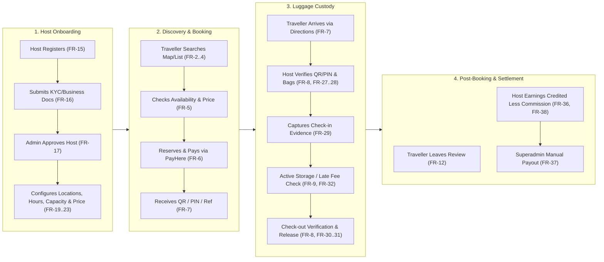

# Product Overview — Global Luggage Storage Marketplace

**Document Status:** Baseline Architecture — Phase 0A
**Source Reference:** [luggage-storage-frs.pdf](source/luggage-storage-frs.pdf)
**Related Documents:**
- [Product Scope and Application Boundaries](product-scope-and-boundaries.md)
- [User Roles and Actor Model](user-roles-and-actors.md)
- [Assumptions and Open Questions](assumptions-and-open-questions.md)
- [System Architecture Overview](../architecture/system-architecture.md)
- [Phase 0A Summary](../architecture/phase-0a-summary.md)

---

## 1. Product Vision

The **Global Luggage Storage Marketplace** is a multi-sided platform connecting travellers who need secure, short-term or multi-day luggage storage with verified local businesses and approved storage operators ("Hosts").

By transforming underutilized physical space in retail shops, hotels, restaurants, cafes, travel agencies, and dedicated storage facilities into bookable, insured/verified storage points, the platform removes the friction of carrying luggage before hotel check-in, after check-out, or during transit layovers.

Although the platform's initial commercial launch is in **Sri Lanka**, its foundational domain models, data schemas, localization structures, and integration interfaces are designed from day one as an **international, multi-country, multi-currency, and multi-language marketplace**.

---

## 2. Product Objectives

The platform is architected to achieve ten core product objectives:

1. **Location Discovery:** Enable travellers to discover nearby luggage-storage locations using geospatial search, destination queries, interactive maps, and list views (`FR-2 Location Search`, `FR-3 Map View`, `FR-3 Host Listings`).
2. **Comparison & Transparency:** Allow travellers to compare hosts based on distance, pricing, operating hours, ratings, reviews, facilities, and storage restrictions (`FR-4 Filters`, `FR-4 Host Details`, `FR-11 Host Reviews & Ratings`).
3. **Configurable Reservation:** Enable travellers to check real-time availability for specific dates, drop-off/collection times, and bag types/counts, and reserve space seamlessly (`FR-5 Availability Check`, `FR-5 Price Calculation`, `FR-6 Booking`).
4. **Secure Digital Payments:** Process online payments through supported regional payment providers (initially PayHere for Sri Lanka) with server-authoritative pricing and promo code support (`FR-6 Online Payment`, `FR-13 Promo Codes`).
5. **Flexible Host Operations:** Empower diverse host businesses—from single-counter shops to multi-branch chains (`FR-44 Multiple Locations`, e.g., Barista)—to configure storage locations, opening hours, capacity models, availability blocks, and pricing rules (`FR-19` through `FR-23`).
6. **Booking Lifecycle Management:** Enable hosts to monitor daily and upcoming bookings and support both instant-booking and host-approval workflows (`FR-24 Booking Dashboard`, `FR-25 Booking Details`, `FR-26 Booking Acceptance`).
7. **Verifiable Luggage Custody:** Provide a secure, tamper-evident custody chain for physical belongings using booking references, QR codes, and PIN verification at check-in and check-out, supported by bag verification, check-in photo/tag evidence, and late collection handling (`FR-7`, `FR-8`, `FR-27` through `FR-32`).
8. **Platform Governance & Administration:** Provide platform administrators (Superadmin and Platform Staff) with comprehensive operational control over host verification/approval (`FR-16`, `FR-17`), booking investigations, transaction monitoring, refunds (`FR-10`), incident handling (`FR-41`), and manual payout execution (`FR-37`).
9. **Financial Integrity & Ledgering:** Accurately calculate and track booking revenue, platform commissions, host net earnings, refunds, and manual payout disbursements (`FR-36`, `FR-37`, `FR-38`).
10. **Global Scalability:** Support seamless expansion into additional countries, languages (`FR-14 Multiple Languages`), currencies (`FR-14 Multiple Currencies`), timezones, regulatory regimes, and payment gateways without re-architecting core modules.

---

## 3. Target Users & Host Business Archetypes

### 3.1 Travellers
- **International & Domestic Tourists:** Travellers arriving early before accommodation check-in or departing late after check-out.
- **Transit & Day-Trip Travellers:** Passengers passing through transport hubs (train stations, bus terminals, ferry ports, city centres) who need temporary bag storage for a few hours.
- **Digital Nomads & Business Visitors:** Travellers carrying electronics, backpacks, or oversized equipment (surfboards, sports gear) requiring verified security and specific facility features.

### 3.2 Storage Hosts
The platform explicitly supports diverse host operational profiles rather than assuming a single standardized storefront:
- **Small Retail Shops & Cafes:** Fixed, simple bag-count capacity with straightforward daily or hourly pricing.
- **Hotels & Guesthouses:** Dedicated luggage rooms offering 24/7 or extended-hour storage to non-guests.
- **Restaurants & Travel Agencies:** Time-windowed drop-off and collection aligned with kitchen/office hours.
- **Dedicated Luggage-Storage Operators:** Multi-category capacity (small, medium, large, oversized/special items) and physical storage zones (`Zone A`, `Zone B`, high-security lockers).
- **Multi-Location Chains & Franchises (`FR-44`):** Single corporate host identity managing multiple physical outlets across cities (e.g., coffee shop chains like Barista) with centralized financial oversight and branch-level staff operations (`FR-42`).

### 3.3 Platform Operations Team
- **Superadministrators:** Platform owners managing system configurations, financial settlements, manual payouts (`FR-37`), and commission models.
- **Platform Support & Operations Staff:** Personnel reviewing host verification documents (`FR-16`, `FR-17`), resolving traveller and host support tickets (`FR-12`, `FR-40`), and investigating luggage incidents (`FR-41`).

---

## 4. Initial Market vs. Long-Term Market Strategy

| Dimension | Initial Launch Market (Sri Lanka) | Long-Term Global Architecture |
| :--- | :--- | :--- |
| **Geography** | Sri Lanka (`LK`) — key tourist and transit hubs (Colombo, Kandy, Galle, Ella, Negombo, etc.) | Multi-country (`ISO 3166-1 alpha-2`), dynamic country activation |
| **Currency** | Sri Lankan Rupee (`LKR`) default operational currency | Multi-currency (`ISO 4217`) display and settlement (`FR-14`) |
| **Language** | English (`en`) primary initial interface | Multi-language (`BCP 47`) localized UI and content (`FR-14`) |
| **Timezone** | `Asia/Colombo` (`UTC+05:30`) | Location-specific `IANA` timezones with `UTC` storage instants |
| **Payments** | PayHere payment gateway (`FR-6`) | Provider-agnostic payment abstraction supporting Stripe, Adyen, Razorpay, etc. |
| **Payouts** | Manual payout processing via Superadmin dashboard (`FR-37`) | Configurable payout workflows (manual bank transfer, automated split settlement, or local payout rails per country) |
| **Addresses & Phones** | Sri Lankan address conventions & `+94` numbers | Country-aware address schemas & `E.164` international phone numbers |

> [!IMPORTANT]
> **Architectural Constraint:** No core domain module, database table, or API contract may hardcode Sri Lanka (`LK`), `LKR`, `Asia/Colombo`, or PayHere-specific assumptions. Sri Lanka is the initial commercial configuration applied to a global-ready schema.

---

## 5. Product Boundaries & Core Marketplace Model

### 5.1 Core Marketplace Model
The platform operates as a **managed, transaction-enabled marketplace**:
1. **Supply Onboarding & Curation:** Hosts register (`FR-15`), submit identity and business verification documents (`FR-16`), and configure their storage locations (`FR-19`–`FR-23`). Listings do not become publicly bookable until approved by the platform (`FR-17`).
2. **Search & Discovery:** Travellers search by destination or current GPS coordinates (`FR-2`). To protect host security and prevent off-platform circumvention, listings may display approximate location details during discovery while providing exact address and navigation directions (`FR-7`) according to platform disclosure rules (see `OQ-012` in [Assumptions and Open Questions](assumptions-and-open-questions.md)).
3. **Reservation & Payment Collection:** Travellers select dates, drop-off/collection times, and bag quantities (`FR-5`). The backend calculates authoritative pricing (`FR-5`) and initiates online checkout (`FR-6`). The platform collects the gross booking amount from the traveller via the payment provider.
4. **Physical Custody Lifecycle:** Upon confirmation, the traveller receives a unique booking reference, QR code, and PIN (`FR-7`). At drop-off, the host verifies the booking (`FR-8`, `FR-27`), verifies bag count/type (`FR-28`), records optional/recommended check-in evidence (`FR-29`), and accepts custody. At collection, both parties complete check-out verification (`FR-8`, `FR-30`), handle any late collection charges (`FR-32`), and mark the booking complete (`FR-31`).
5. **Commission & Settlement:** The platform deducts its agreed commission from the gross booking revenue, credits the host's net earnings balance (`FR-36`, `FR-38`), and disburses funds to the host's registered bank/payment account via Superadmin manual payout (`FR-37`).

---

## 6. Main Application Experiences

The platform delivers three distinct application suites backed by a single modular monolithic API:

1. **Traveller Mobile Application (`apps/mobile` — Traveller identity):** Optimized for on-the-go discovery, map navigation, booking, PayHere checkout, QR/PIN presentation at drop-off/collection, active booking tracking, reviews, and customer support.
2. **Host Mobile Application (`apps/mobile` — Host identity):** Optimized for store-floor operations including QR scanning, PIN verification, camera-based check-in photo evidence, bag tagging, instant booking notifications, booking acceptance, and quick availability/capacity management.
3. **Unified Web Application (`apps/web`):** A React + Vite single-page application partitioned into three isolated experience zones:
   - **Public Traveller Website:** SEO-friendly location landing pages, browser-based search, map discovery, and full web booking/checkout for travellers who prefer not to install a mobile app.
   - **Host Management Dashboard:** Desktop/tablet-optimized interface for complex multi-location configuration (`FR-44`), pricing matrices, capacity rules, staff management (`FR-42`), financial statements (`FR-36`, `FR-38`), and analytics (`FR-43`).
   - **Superadmin & Operations Dashboard:** Platform-wide administration including host verification approval (`FR-17`), manual payout execution (`FR-37`), refund management (`FR-10`), incident investigation (`FR-41`), support queues (`FR-12`, `FR-40`), and system settings.

---

## 7. Primary Business Workflows

---

## 8. Foundational Product Principles

1. **Global-Ready by Design:** Every location, monetary value, phone number, address, and timestamp is stored with explicit country, currency, locale, and timezone metadata.
2. **Configuration Over Hardcoding:** Storage capacity (simple count, per-bag category, storage zones, unit rules), operating schedules, pricing models, and booking policies (instant vs. approval-based) are driven by versioned host configurations.
3. **UI-Complete Initial Release:** Every screen required across all FRS requirements—including those classified as `MVP`, `Later`, `Later/MVP`, `Recommended`, and `Depends`—must exist, be navigable, and represent its design state in the initial release.
4. **Separation of Booking, Payment, and Custody:** A reservation (`Booking`), a financial transaction (`Payment`), and physical possession of bags (`Custody`) have independent state machines and lifecycles.
5. **Security & Evidentiary Trust:** Because physical belongings and financial funds are at stake, server-side validation, RBAC, resource ownership checks, immutable financial ledgers, and auditable custody trails are mandatory.
6. **Startup Cost Efficiency:** A modular monolith on a single PostgreSQL + PostGIS database with Cloudflare R2 media storage avoids premature microservice and Kubernetes complexity while preserving clean module boundaries.

---

## 9. Complete FRS Traceability & Classification Register

### 9.1 Ambiguity Note on Original FRS Numbering
In the source document (`docs/product/source/luggage-storage-frs.pdf`), **Index numbers `FR-2` through `FR-14` are each used twice** in the Traveller Features table (27 Traveller rows share 14 FR numbers, while Host Features use `FR-15` through `FR-44` uniquely, totaling **57 distinct requirement rows**). Furthermore, formatting spacing varies in the original table (e.g., `FR -1` vs `FR-2`).

Per Phase 0A source fidelity rules:
- The original FR numbers, feature names, descriptions, and `MVP?` column values are preserved verbatim below.
- Unique internal identifiers (e.g., `REQ-TRV-001` through `REQ-TRV-027` and `REQ-HST-001` through `REQ-HST-030`) are proposed as a cross-reference key for Phase 0B requirements management so no requirement is lost or conflated due to duplicate `FR-x` labels.

### 9.2 Traveller Features (27 Source Rows)

| Proposed Unique ID | Original FRS Index | Feature | Original Description | Original `MVP?` Column | Initial Release UI Status | Initial Release Backend Status |
| :--- | :--- | :--- | :--- | :--- | :--- | :--- |
| `REQ-TRV-001` | `FR -1` | Account Registration & Login | Sign up using email, Google/Apple etc. | *(Blank — Core MVP)* | Complete | Functional |
| `REQ-TRV-002` | `FR-2` *(1st)* | Traveller Profile | Name, contact details, booking history and preferences | *(Blank — Core MVP)* | Complete | Functional |
| `REQ-TRV-003` | `FR -2` *(2nd)* | Location Search | Search storage locations based on destination/current location | *(Blank — Core MVP)* | Complete | Functional |
| `REQ-TRV-004` | `FR-3` *(1st)* *(Highlighted)* | Map View | See nearby Hosts on a map | *(Blank — Core MVP)* | Complete | Functional |
| `REQ-TRV-005` | `FR -3` *(2nd)* | Host Listings | View available luggage-storage locations | *(Blank — Core MVP)* | Complete | Functional |
| `REQ-TRV-006` | `FR-4` *(1st)* | Filters | Filter by distance, price, opening hours, rating, availability etc. | *(Blank — Core MVP)* | Complete | Functional |
| `REQ-TRV-007` | `FR -4` *(2nd)* | Host Details | Address/approximate location, photos, opening hours, facilities, restrictions, reviews | *(Blank — Core MVP)* | Complete | Functional |
| `REQ-TRV-008` | `FR-5` *(1st)* | Availability Check | Select date, drop-off time, collection time and number/type of bags | *(Blank — Core MVP)* | Complete | Functional |
| `REQ-TRV-009` | `FR -5` *(2nd)* | Price Calculation | Automatically calculate storage price | *(Blank — Core MVP)* | Complete | Functional |
| `REQ-TRV-010` | `FR-6` *(1st)* | Booking | Reserve luggage space for selected period | *(Blank — Core MVP)* | Complete | Functional |
| `REQ-TRV-011` | `FR -6` *(2nd)* | Online Payment | Pay securely through the app | *(Blank — Core MVP)* | Complete | Functional |
| `REQ-TRV-012` | `FR-7` *(1st)* | Booking Confirmation | Receive booking reference/QR code/PIN | *(Blank — Core MVP)* | Complete | Functional |
| `REQ-TRV-013` | `FR -7` *(2nd)* *(Highlighted)* | Directions | Navigate to the Host location | *(Blank — Core MVP)* | Complete | Functional |
| `REQ-TRV-014` | `FR-8` *(1st)* | Check-in / Bag Drop | Verify booking when handing luggage to Host | *(Blank — Core MVP)* | Complete | Functional |
| `REQ-TRV-015` | `FR -8` *(2nd)* | Check-out / Collection | Secure verification when retrieving luggage | *(Blank — Core MVP)* | Complete | Functional |
| `REQ-TRV-016` | `FR-9` *(1st)* | Active Booking | See current storage details and collection deadline | *(Blank — Core MVP)* | Complete | Functional |
| `REQ-TRV-017` | `FR -9` *(2nd)* | Booking History | Previous/completed/cancelled bookings | *(Blank — Core MVP)* | Complete | Functional |
| `REQ-TRV-018` | `FR-10` *(1st)* | Cancellation | Cancel according to cancellation policy | *(Blank — Core MVP)* | Complete | Functional |
| `REQ-TRV-019` | `FR -10` *(2nd)* | Refund Status | See whether refund is pending/completed | `Later/MVP` | Complete | Pending Owner Decision (`OQ-009` / `OQ-013`) |
| `REQ-TRV-020` | `FR-11` *(1st)* | Notifications | Booking confirmation, drop-off reminder, collection reminder etc. | *(Blank — Core MVP)* | Complete | Functional |
| `REQ-TRV-021` | `FR -11` *(2nd)* | Host Reviews & Ratings | View reviews before booking | *(Blank — Core MVP)* | Complete | Functional |
| `REQ-TRV-022` | `FR-12` *(1st)* | Leave Review | Rate Host after collection and for app | *(Blank — Core MVP)* | Complete | Functional |
| `REQ-TRV-023` | `FR -12` *(2nd)* | Customer Support | Report issues or contact platform support. Should be seperated | *(Blank — Core MVP)* | Complete | Functional |
| `REQ-TRV-024` | `FR-13` *(1st)* | Favourite Hosts | Save preferred storage locations | `Later` | Complete (UI-Only / Preview) | Deferred (`Later`) |
| `REQ-TRV-025` | `FR -13` *(2nd)* | Promo Codes | Apply discounts/offers | *(Blank — Core MVP)* | Complete | Functional |
| `REQ-TRV-026` | `FR-14` *(1st)* | Multiple Languages | Traveller-friendly localization | `Later` | Complete (UI-Only / Foundation) | Deferred (`Later` — English MVP) |
| `REQ-TRV-027` | `FR -14` *(2nd)* | Multiple Currencies | Display/pay in preferred currency | `Later` | Complete (UI-Only / Foundation) | Deferred (`Later` — LKR MVP) |

### 9.3 Host Features (30 Source Rows)

| Proposed Unique ID | Original FRS Index | Feature | Original Description | Original `MVP?` Column | Initial Release UI Status | Initial Release Backend Status |
| :--- | :--- | :--- | :--- | :--- | :--- | :--- |
| `REQ-HST-001` | `FR-15` | Host Registration | Apply to become a storage Host | *(Blank — Core MVP)* | Complete | Functional |
| `REQ-HST-002` | `FR-16` | Identity/Business Verification | Submit required identity/business information | *(Blank — Core MVP)* | Complete | Functional |
| `REQ-HST-003` | `FR-17` | Host Approval | Platform approves Host before listing goes live | *(Blank — Core MVP)* | Complete | Functional |
| `REQ-HST-004` | `FR-18` | Host Profile | Business/location information and contact details | *(Blank — Core MVP)* | Complete | Functional |
| `REQ-HST-005` | `FR-19` | Storage Location Setup | Add address, photos and description | *(Blank — Core MVP)* | Complete | Functional |
| `REQ-HST-006` | `FR-20` | Opening Hours | Define available storage hours | *(Blank — Core MVP)* | Complete | Functional |
| `REQ-HST-007` | `FR-21` | Storage Capacity | Specify how many bags can be stored | *(Blank — Core MVP)* | Complete | Functional |
| `REQ-HST-008` | `FR-22` | Availability Management | Block dates/times or temporarily stop bookings | *(Blank — Core MVP)* | Complete | Functional |
| `REQ-HST-009` | `FR-23` | Pricing | View/configure storage pricing depending on your business model | *(Blank — Core MVP)* | Complete | Functional |
| `REQ-HST-010` | `FR-24` | Booking Dashboard | See today's/upcoming bookings | *(Blank — Core MVP)* | Complete | Functional |
| `REQ-HST-011` | `FR-25` | Booking Details | Traveller, number of bags, drop-off/collection times etc. | *(Blank — Core MVP)* | Complete | Functional |
| `REQ-HST-012` | `FR-26` | Booking Acceptance | Accept booking if you're not using instant booking | `Depends` | Complete | Configurable (`OQ-004`) |
| `REQ-HST-013` | `FR-27` | Check-in Traveller | Verify booking at luggage drop-off | *(Blank — Core MVP)* | Complete | Functional |
| `REQ-HST-014` | `FR-28` | Bag Verification | Confirm number/type of bags received | *(Blank — Core MVP)* | Complete | Functional |
| `REQ-HST-015` | `FR-29` | Check-in Evidence | Photo/tag/QR/PIN confirmation | `Recommended` | Complete | Functional / Configurable (`OQ-014`) |
| `REQ-HST-016` | `FR-30` | Check-out Verification | Verify traveller before releasing luggage | *(Blank — Core MVP)* | Complete | Functional |
| `REQ-HST-017` | `FR-31` | Mark Booking Complete | Confirm successful collection | *(Blank — Core MVP)* | Complete | Functional |
| `REQ-HST-018` | `FR-32` | Late Collection Handling | Flag overdue luggage / calculate additional charges | *(Blank — Core MVP)* | Complete | Functional |
| `REQ-HST-019` | `FR-33` | Booking History | View previous bookings | *(Blank — Core MVP)* | Complete | Functional |
| `REQ-HST-020` | `FR-34` | Cancellation Handling | Host cancellation according to platform rules | *(Blank — Core MVP)* | Complete | Functional |
| `REQ-HST-021` | `FR-35` | Notifications | New booking, upcoming arrival, collection etc. | *(Blank — Core MVP)* | Complete | Functional |
| `REQ-HST-022` | `FR-36` | Earnings Dashboard | Booking revenue and Host earnings | *(Blank — Core MVP)* | Complete | Functional |
| `REQ-HST-023` | `FR-37` | Payout Management | Bank/payment account and payout status- Will do a manual payout through a superadmin dashboard becuase of secruity reasons | *(Blank — Core MVP)* | Complete | Functional (Manual via Superadmin) |
| `REQ-HST-024` | `FR-38` | Transaction History | View payments, platform commission and payouts | *(Blank — Core MVP)* | Complete | Functional |
| `REQ-HST-025` | `FR-39` | Reviews & Ratings | See ratings/reviews received | *(Blank — Core MVP)* | Complete | Functional |
| `REQ-HST-026` | `FR-40` | Support | Report traveller/booking/luggage issues | *(Blank — Core MVP)* | Complete | Functional |
| `REQ-HST-027` | `FR-41` | Incident Reporting | Report lost/damaged/unclaimed luggage | *(Blank — Core MVP)* | Complete | Functional |
| `REQ-HST-028` | `FR-42` | Staff Accounts | Allow employees to handle check-in/out | `Later` | Complete (UI-Only / Preview) | Deferred (`Later`) |
| `REQ-HST-029` | `FR-43` | Analytics | Occupancy, bookings, revenue, busiest periods etc. | `Later` | Complete (UI-Only / Preview) | Deferred (`Later`) |
| `REQ-HST-030` | `FR-44` | Multiple Locations | One Host manages several storage locations ( Ex. Barista ) | *(Blank — Core MVP)* | Complete | Functional |

---

## 10. MVP Scope vs. Later-Feature Philosophy

### 10.1 Two-Dimensional Completion Model
In accordance with the product owner's mandate, the platform separates feature readiness into two explicit dimensions:

1. **UI/UX Implementation Status:** **100% of screens identified in the FRS** across Traveller Mobile, Host Mobile, Public Web, Host Web Dashboard, and Superadmin Web Dashboard must be designed, built, and navigable in the initial release. Users must never encounter broken links, unstyled placeholders, or dead-end navigation.
2. **Functional Backend Implementation Status:**
   - **Core MVP rows (unmarked in `MVP?` column):** Require full end-to-end backend business logic, persistence, validation, and integration.
   - **`Later` features (`FR-13 Favourite Hosts`, `FR-14 Multiple Languages`, `FR-14 Multiple Currencies`, `FR-42 Staff Accounts`, `FR-43 Analytics`):** Must have complete UI screens and architectural hooks (such as locale/currency columns in schemas and staff RBAC placeholders), while full backend workflows may be activated in Phase 11 without schema breaking changes. UI screens for unactivated backend features must clearly communicate their preview/coming-soon status and must never display fabricated financial or operational data as real records.
   - **`Later/MVP` (`FR-10 Refund Status`), `Depends` (`FR-26 Booking Acceptance`), and `Recommended` (`FR-29 Check-in Evidence`):** Architectural support is included from the outset; exact MVP activation rules are tracked for product owner confirmation in [Assumptions and Open Questions](assumptions-and-open-questions.md).

---

## 11. Known Limitations & Unresolved Questions

The following high-priority business and technical items require explicit owner review before implementation of the affected domains (tracked in detail in [Assumptions and Open Questions](assumptions-and-open-questions.md)):

1. **Authentication Provider (`OQ-001`):** Whether to use self-managed JWT/session authentication in Fastify (e.g., Lucia/custom + Arctic OAuth) or a managed provider (Clerk, Supabase Auth, Better Auth, Firebase Auth).
2. **PayHere Commercial & Regulatory Model (`OQ-003`):** Verification with PayHere and Sri Lankan legal advisors that collecting full traveller payments into the platform's merchant account and disbursing manual host payouts (`FR-37`) complies with PayHere merchant terms and CBSL aggregation rules.
3. **Host Verification Documents (`OQ-002`):** Exact KYC and business registration documents required for Sri Lankan individual vs. corporate hosts (`FR-16`).
4. **Booking Mode Policy (`OQ-004`):** Whether hosts can freely toggle between Instant Booking and Host Approval (`FR-26`), and what the approval timeout SLA is.
5. **Cancellation, Refund & Late Collection Rules (`OQ-009`, `OQ-013`, `OQ-015`):** Whether cancellation policies and late collection fees (`FR-10`, `FR-32`, `FR-34`) are platform-standardized or host-configurable, and how `FR-10 Refund Status` (`Later/MVP`) is scoped for initial launch.
6. **Customer Support Separation (`OQ-016`):** `FR -12 Customer Support` specifies *"Report issues or contact platform support. Should be seperated"*—confirming the exact separation between booking/host issue reporting, app feedback (`FR-12 Leave Review`), and general platform support.

