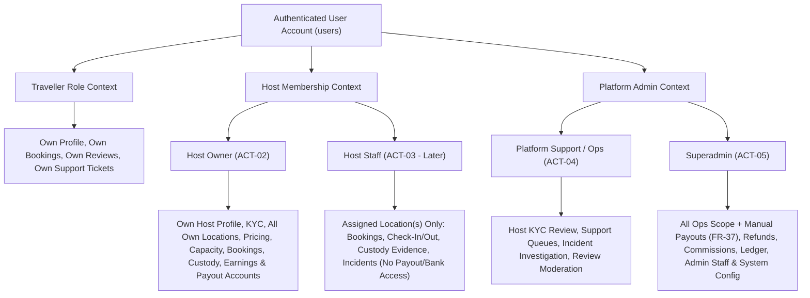

# User Roles and Actor Model

**Document Status:** Baseline Architecture — Phase 0A (Proposed Role Model — Pending Owner Approval on Flagged Items)
**Source Reference:** [luggage-storage-frs.pdf](source/luggage-storage-frs.pdf)
**Related Documents:**
- [Product Overview](product-overview.md)
- [Product Scope and Application Boundaries](product-scope-and-boundaries.md)
- [Application Architecture Boundaries](../architecture/application-boundaries.md)
- [Assumptions and Open Questions](assumptions-and-open-questions.md)

---

## 1. Purpose

This document defines the actors, roles, application access rules, high-level permission boundaries, and multi-role identity considerations for the **Global Luggage Storage Marketplace**.

> [!NOTE]
> The FRS explicitly defines functional requirements for **Travellers** (`FR-1` to `FR-14`), **Hosts** (`FR-15` to `FR-44`), **Host Staff Accounts** (`FR-42` — marked `Later`), and **Superadmin / Platform Operations** (`FR-17 Host Approval`, `FR-37 Payout Management`, `FR-12`/`FR-40` Support). Where fine-grained RBAC rules are not explicitly dictated by the FRS, this document establishes a **proposed role model** and flags specific decisions requiring product owner approval in Section 9.

---

## 2. Identified Actors Overview

The system recognizes **six primary actor classifications** (one unauthenticated visitor state and five authenticated role categories):

| Actor ID | Actor Name | Category | FRS Basis | Initial Release Status |
| :--- | :--- | :--- | :--- | :--- |
| `ACT-00` | **Public / Guest Visitor** | External (Unauthenticated) | `FR-2`, `FR-3`, `FR-4`, `FR-5`, `FR-11` | Functional (Discovery & browsing before auth) |
| `ACT-01` | **Traveller** | External Customer | `FR-1` through `FR-14` | Functional (Core MVP) |
| `ACT-02` | **Host (Owner / Primary Manager)** | External Partner | `FR-15` through `FR-44` | Functional (Core MVP) |
| `ACT-03` | **Host Employee / Staff** | External Partner Staff | `FR-42 Staff Accounts` (`Later`) | UI-Complete in initial release; Functional in Phase 11 |
| `ACT-04` | **Platform Support / Operations Staff** | Internal Platform Staff | `FR-12`, `FR-16`, `FR-17`, `FR-40`, `FR-41` | Functional (Proposed separation from Superadmin) |
| `ACT-05` | **Platform Superadministrator** | Internal Platform Owner | `FR-17`, `FR-37`, all platform oversight | Functional (Core MVP) |

---

## 3. Detailed Role Descriptions & Responsibilities

### 3.1 Public / Guest Visitor (`ACT-00`)
- **Description:** Any unauthenticated user browsing the Public Website or opening the Traveller Mobile App prior to sign-in.
- **Main Responsibilities / Capabilities:**
  - Search storage locations by destination or GPS location (`FR-2`).
  - Browse the interactive map and location listings (`FR-3`).
  - Filter listings and view Host Details, photos, opening hours, facilities, restrictions, and reviews (`FR-4`, `FR-11`).
  - Check availability and preview calculated prices (`FR-5`).
- **Boundary:** Must authenticate as a **Traveller** (`FR-1`) to complete a booking (`FR-6`), make a payment (`FR-6`), access booking QR/PIN codes (`FR-7`), or submit reviews/support tickets (`FR-12`).

### 3.2 Traveller (`ACT-01`)
- **Description:** An authenticated individual booking temporary luggage storage.
- **Main Responsibilities:**
  - Manage traveller profile, contact details, and preferences (`FR-2`).
  - Reserve storage space and pay online via the supported payment provider (`FR-6`, `FR-13 Promo Codes`).
  - Present booking reference, QR code, or PIN at luggage drop-off (`FR-7`, `FR-8`) and collection (`FR-8`).
  - Adhere to host operating hours and collection deadlines (`FR-9`, `FR-32`).
  - Cancel bookings according to cancellation policy (`FR-10`) and track refund status (`FR-10`).
  - Rate and review hosts after collection and provide app feedback (`FR-12`).
  - Report booking/luggage issues or contact platform support (`FR-12`).

### 3.3 Host (`ACT-02`)
- **Description:** A verified individual or business (retail shop, hotel, restaurant, cafe, travel agency, dedicated storage operator, or multi-location chain) offering luggage storage space.
- **Lifecycle Sub-States:**
  1. `APPLICANT` (`FR-15`, `FR-16`): Registered and submitting KYC/business verification documents. Cannot receive public bookings.
  2. `APPROVED / ACTIVE` (`FR-17`): Verified by the platform; permitted to publish approved locations and accept bookings.
  3. `REJECTED / SUSPENDED`: Blocked from receiving new bookings due to failed verification or policy violations.
- **Main Responsibilities:**
  - Maintain accurate business profile, verification documents, and payout bank details (`FR-16`, `FR-18`, `FR-37`).
  - Configure one or multiple storage locations (`FR-19`, `FR-44`), opening hours (`FR-20`), storage capacity (`FR-21`), availability blocks (`FR-22`), and pricing rules (`FR-23`).
  - Monitor daily/upcoming bookings (`FR-24`, `FR-25`) and accept/reject bookings when operating in manual approval mode (`FR-26`).
  - Perform physical custody verification at drop-off (`FR-27`), verify bag counts/types (`FR-28`), capture check-in evidence (`FR-29`), and verify traveller identity at check-out (`FR-30`, `FR-31`).
  - Flag overdue luggage and handle late collection charges (`FR-32`).
  - Report traveller/booking issues (`FR-40`) and formal luggage incidents (`FR-41`).
  - Manage host employee/staff accounts (`FR-42` — `Later`) and review operational analytics (`FR-43` — `Later`).

### 3.4 Host Employee / Staff (`ACT-03` — `FR-42`, Classified `Later`)
- **Description:** An employee or store attendant working for a Host business (for example, a barista or front-desk clerk at one branch of a multi-location host).
- **Architectural Place:**
  - Explicitly distinct from **Platform Staff**. Host Staff belong to a specific `Host` organization and are scoped to one or more assigned `StorageLocations`.
  - Per `FR-42` (*"Allow employees to handle check-in/out — Later"*), their primary operational role is store-floor execution: viewing the branch's daily bookings (`FR-24`, `FR-25`), verifying travellers at check-in (`FR-27`), verifying bags (`FR-28`), capturing check-in evidence (`FR-29`), verifying collection (`FR-30`, `FR-31`), and flagging overdue bags (`FR-32`).
  - **Restricted from Host Owner Actions:** Unless explicitly granted elevated manager permissions in a future phase, Host Staff must **not** modify payout bank accounts (`FR-37`), view host-wide net earnings/payouts (`FR-36`, `FR-38`), delete locations, or alter legal verification details (`FR-16`).

### 3.5 Platform Support / Operations Staff (`ACT-04` — Proposed Internal Role)
- **Description:** Internal team members employed by the platform to handle day-to-day operational queues without holding unrestricted system/financial authority.
- **Main Responsibilities:**
  - Review host KYC and business verification submissions and recommend or execute host approvals (`FR-16`, `FR-17`).
  - Triage and resolve Traveller Customer Support tickets (`FR-12`) and Host Support reports (`FR-40`).
  - Investigate lost, damaged, or unclaimed luggage incidents (`FR-41`) using custody evidence logs (`FR-29`).
  - Moderate reported reviews (`FR-11`, `FR-39`).
- **Restricted from Superadmin-Only Actions:** Cannot execute manual payouts (`FR-37`), alter platform commission structures, modify system-wide country/currency settings, or manage other administrator accounts.

### 3.6 Platform Superadministrator (`ACT-05`)
- **Description:** Highest-privilege internal authority responsible for platform governance, financial settlement, and system configuration.
- **Main Responsibilities:**
  - Full access to all Platform Support/Operations capabilities (`FR-17`, support, incidents, moderation).
  - Execute and record **manual host payouts** (`FR-37`) after verifying host payable balances and bank details.
  - Approve and process traveller **refunds** (`FR-10`) and reconcile PayHere payment exceptions.
  - Configure platform commission models, promotional campaigns (`FR-13`), countries, currencies, languages, and system-wide policies.
  - Manage internal Platform Staff accounts (`ACT-04`) and audit logs.

---

## 4. Application Access Matrix

| Actor / Role | Traveller Mobile App (`apps/mobile`) | Host Mobile App (`apps/mobile`) | Public Website (`apps/web`) | Host Web Dashboard (`apps/web`) | Superadmin Web Dashboard (`apps/web`) |
| :--- | :---: | :---: | :---: | :---: | :---: |
| **Guest Visitor (`ACT-00`)** | Browse / Search Only | Login / Register Screen Only | Browse / Search Only | Redirect to Login | Redirect to Login |
| **Traveller (`ACT-01`)** | **Full Access** | Can apply to become Host (`FR-15`) | **Full Access** | Can apply to become Host (`FR-15`) | Denied (`403`) |
| **Host (`ACT-02`)** | Allowed (as Traveller) | **Full Access** | Allowed (as Traveller) | **Full Access** | Denied (`403`) |
| **Host Staff (`ACT-03` — `Later`)** | Allowed (if personal Traveller) | **Scoped Operational Access** (`Later`) | Allowed (if personal Traveller) | **Scoped Operational Access** (`Later`) | Denied (`403`) |
| **Platform Support Staff (`ACT-04`)** | Denied (Use personal account) | Denied | Public View | Denied (Uses Admin Impersonation/View if needed) | **Scoped Admin Access** |
| **Superadmin (`ACT-05`)** | Denied (Use personal account) | Denied | Public View | Denied (Uses Admin View) | **Full Unrestricted Access** |

---

## 5. High-Level Permission Boundaries & Ownership Rules

### 5.1 Strict Resource Isolation Rules
1. **Traveller Isolation:** A Traveller can only read or mutate their own `TravellerProfile`, `Bookings`, `Payments`, `Refunds`, `Reviews`, and `SupportTickets`.
2. **Host Tenant Isolation:** Every Host-owned resource (`StorageLocation`, `CapacityPool`, `PricingPolicy`, `Booking` from host view, `HostBalance`, `PayoutAccount`) is strictly scoped by `host_id`. A Host can never view or modify another Host's records by manipulating resource UUIDs in API requests.
3. **Location-Level Isolation for Host Staff (`Later`):** When `FR-42 Staff Accounts` is activated, staff permissions must be scoped not only to `host_id` but also to an explicit set of `location_id` assignments (critical for multi-location chains under `FR-44`).
4. **Platform vs. Host Boundary:**
   - **Host Owns:** Physical premises, location descriptions/photos (`FR-19`), opening hours (`FR-20`), storage capacity (`FR-21`), availability blocks (`FR-22`), host pricing selection within platform bounds (`FR-23`), physical luggage check-in/out execution (`FR-27`–`FR-31`), and payout beneficiary bank details (`FR-37`).
   - **Platform Owns:** Host approval activation (`FR-17`), authoritative price calculation (`FR -5`), payment collection (`FR-6`), QR/PIN generation (`FR-7`), commission deduction (`FR-38`), manual payout execution (`FR-37`), refund disbursement (`FR-10`), and global catalog/policy settings.

---

## 6. Multi-Role Account Architecture & Role Switching

### 6.1 Unified Identity with Role Contexts
A single human user may legitimately be **both a Traveller and a Host** (for example, a shop owner in Galle who hosts luggage at their shop and also uses the platform as a Traveller when visiting Colombo or travelling abroad).

To support this cleanly without forcing users to register duplicate email addresses or phone numbers:
- **Single Core Identity (`users` table):** Authentication credentials (email, phone, password hash, Google/Apple OAuth links) belong to a unified `User` identity.
- **Attached Role Profiles:**
  - A user automatically acquires or activates a `Traveller` profile when using Traveller surfaces.
  - A user who applies via `FR-15 Host Registration` creates an associated `Host` entity (or `HostMembership` record linking `user_id` to `host_id` with role `OWNER`).
- **Role Switching Across Applications:**
  - **On Mobile:** Because Traveller (`com.yourbrand.traveller`) and Host (`com.yourbrand.host`) are distributed as separate application builds from the shared `apps/mobile` workspace, a user can log into either app with the same credentials. Each app requests tokens/contexts scoped to its respective experience.
  - **On Web (`apps/web`):** Authenticated users who hold both `TRAVELLER` and `HOST` roles can switch between the Public/Traveller portal and the Host Dashboard (`/host/*`) via an explicit workspace/role switcher in the navigation header without re-authenticating.
  - **Platform Admin Accounts (`ACT-04`, `ACT-05`):** For security and audit hygiene, internal Superadmin and Platform Staff accounts should require MFA and operate in an isolated administrative context (`/admin/*`).

---

## 7. Host Staff vs. Platform Staff Distinction

A frequent source of architectural defects in marketplaces is conflating partner employees with platform employees. This architecture enforces a hard boundary:

| Dimension | Host Employee / Staff (`ACT-03` — `FR-42`) | Platform Support / Admin Staff (`ACT-04` / `ACT-05`) |
| :--- | :--- | :--- |
| **Employer / Organization** | Employed by an external Host business (e.g., a cafe or hotel) | Employed by the Luggage Storage Marketplace platform |
| **Data Scope** | Restricted to their employer's `host_id` and assigned `location_id`(s) | Cross-platform visibility across hosts, travellers, and bookings (role-permitting) |
| **Primary Interface** | Host Mobile App & Host Web Dashboard | Superadmin Web Dashboard (`/admin/*`) |
| **Core Tasks** | Scanning QR/PIN at check-in (`FR-27`), verifying bags (`FR-28`), recording photo/tag evidence (`FR-29`), releasing bags (`FR-30`) | Approving new Hosts (`FR-17`), resolving platform support tickets (`FR-12`, `FR-40`), investigating incidents (`FR-41`), executing manual payouts (`FR-37` — Superadmin only) |
| **FRS Release Phase** | `Later` (`FR-42`) — UI present in initial release; backend deferred | Core MVP (required for `FR-17` Host Approval and `FR-37` Manual Payouts) |

---

## 8. High-Level Permission Matrix (Proposed)

*Legend:* `F` = Full / Execute, `R` = Read Only, `S` = Scoped to Own/Assigned Resource, `-` = No Access, `L` = Deferred to `Later` Phase (`FR-42`).

| Capability / Domain Action | Guest (`ACT-00`) | Traveller (`ACT-01`) | Host Owner (`ACT-02`) | Host Staff (`ACT-03`) | Platform Support (`ACT-04`) | Superadmin (`ACT-05`) |
| :--- | :---: | :---: | :---: | :---: | :---: | :---: |
| Search & view public host listings (`FR-2`–`FR-5`) | `R` | `R` | `R` | `R` | `R` | `R` |
| Create booking & pay online (`FR-6`) | `-` | `F (S)` | `-` *(via Traveller role)* | `-` | `-` | `-` |
| Cancel booking (`FR-10`, `FR-34`) | `-` | `F (S)` | `F (S)` *(per policy)* | `-` | `F` *(Assisted)* | `F` |
| Apply as Host & upload KYC (`FR-15`, `FR-16`) | `-` | `F` *(Onboards)* | `F (S)` | `-` | `R` | `R` |
| Approve / reject Host application (`FR-17`) | `-` | `-` | `-` | `-` | `F` *(Proposed)* | `F` |
| Configure locations, hours, capacity, price (`FR-19`–`FR-23`, `FR-44`) | `-` | `-` | `F (S)` | `R (L)` | `R` | `F` *(Moderation)* |
| Accept / reject booking (`FR-26`) | `-` | `-` | `F (S)` | `F (S, L)` | `R` | `F` |
| Verify check-in/out & record custody evidence (`FR-27`–`FR-32`) | `-` | `R (S)` *(Presents QR/PIN)* | `F (S)` | `F (S, L)` | `R` | `R` |
| View Host earnings & transaction history (`FR-36`, `FR-38`) | `-` | `-` | `R (S)` | `-` | `R` | `R` |
| Configure Host payout bank account (`FR-37`) | `-` | `-` | `F (S)` | `-` | `R` | `R` |
| Execute manual Host payouts (`FR-37`) | `-` | `-` | `-` | `-` | `-` | **`F` (Exclusive)** |
| Process traveller refunds (`FR-10`) | `-` | `R (S)` | `R (S)` | `-` | `R / Recommend` | **`F`** |
| Manage support tickets & incidents (`FR-12`, `FR-40`, `FR-41`) | `-` | `F (S)` | `F (S)` | `F (S, L)` | `F` | `F` |
| Manage Host Staff accounts (`FR-42`) | `-` | `-` | `F (S, L)` | `-` | `R` | `F` |
| Configure commissions, promo codes & global settings | `-` | `-` | `-` | `-` | `-` | **`F` (Exclusive)** |

---

## 9. Unresolved Role Decisions Requiring Owner Approval

The following role and permission questions are logged in [Assumptions and Open Questions](assumptions-and-open-questions.md) and require explicit product owner confirmation before Phase 3 (Identity & Account Management):

1. **Single Identity vs. Separate Accounts (`OQ-007`):** Confirm whether the proposed unified `User` identity (allowing a single email/phone login to act as both Traveller and Host via role contexts) is approved, or if the owner prefers strictly separate accounts.
2. **Platform Support Staff Authority (`OQ-011`):** Confirm whether internal Platform Support Staff (`ACT-04`) should be permitted to approve Host applications (`FR-17`) and trigger refunds (`FR-10`), or whether both actions must be restricted exclusively to the Superadmin (`ACT-05`).
3. **Host Staff Granularity for Future Phase (`OQ-017`):** When `FR-42 Staff Accounts` is activated in Phase 11, confirm whether Host Staff have a single fixed role (`Check-In/Out Attendant`) or multiple sub-roles (e.g., `Branch Manager` vs. `Attendant`), and whether staff can accept/reject bookings (`FR-26`) and report incidents (`FR-41`).

