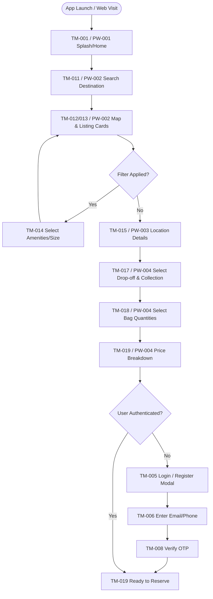
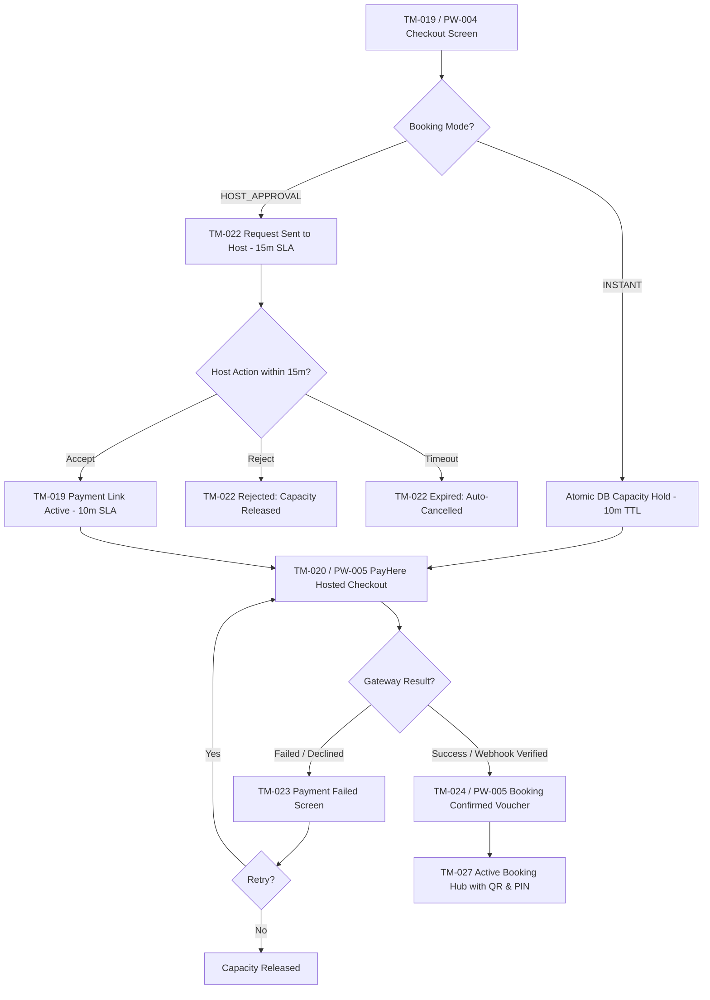
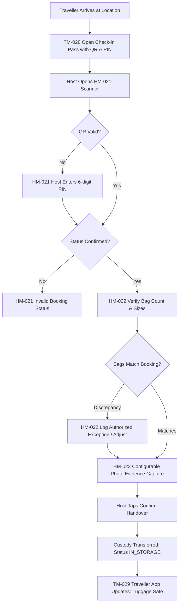
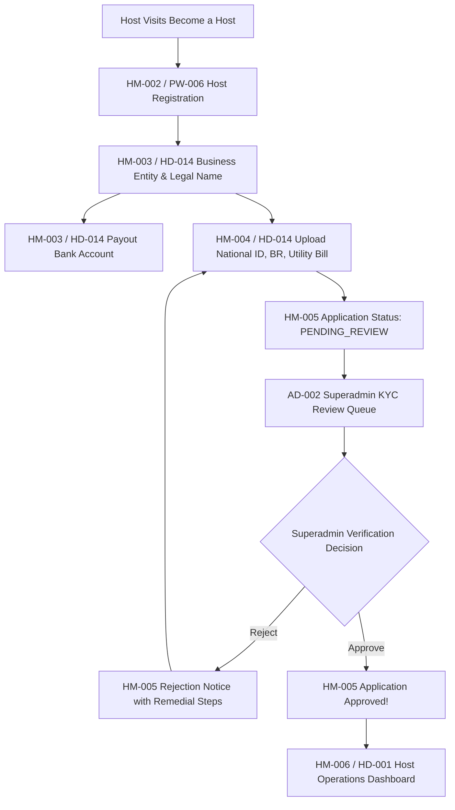
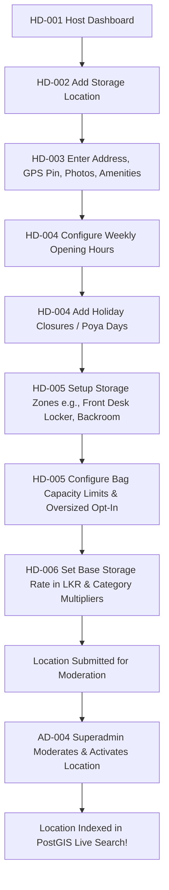
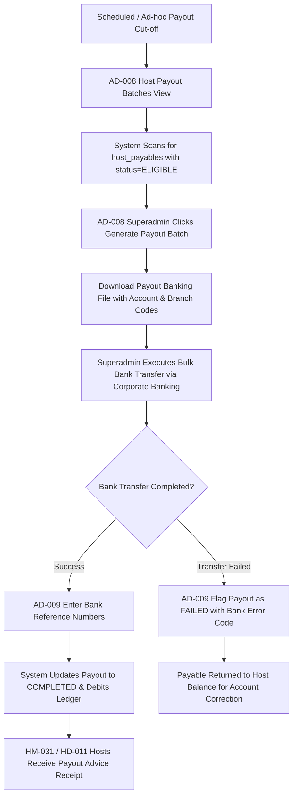
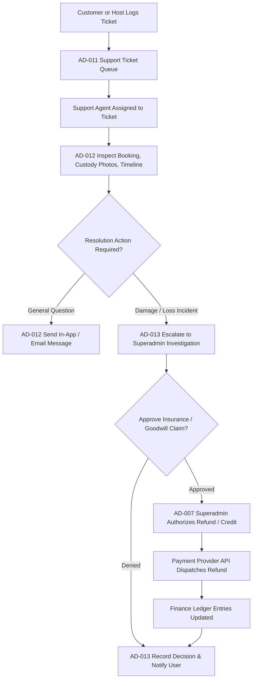

# Navigation and User Journey Maps

**Project:** Global Luggage Storage Marketplace  
**Document Type:** UX Architecture & User Journey Specification  
**Status:** Approved Phase 0C Baseline  
**Governing Documents:** FRS, Technical Blueprint Section 6, Master Screen Registry (`master-screen-registry.md`), Screen-to-Workflow Matrix (`screen-to-workflow-matrix.md`).

---

## 1. Executive Summary & Flow Conventions

This document maps the primary and secondary navigation flows, operational loops, exception branches, and error recovery paths across the marketplace.

### Architectural Journey Principles:
1. **End-to-End Resilience:** Every user journey explicitly models failure paths (e.g., payment declined, capacity conflict, host rejection, overdue bags, disputed fees, refund failure).
2. **Decoupled Handover Recovery:** Luggage handover can complete safely even under cellular network disconnects via offline QR/PIN caching and store-and-forward sync.
3. **The No Possessory Lien Invariant:** The collection journey strictly separates bag release from disputed fee collection (`BR-035`, `BR-061`).

---

## 2. Core Traveller Journeys

### 2.1 Journey 1: Anonymous Visitor to Registration & Booking



---

### 2.2 Journey 2: Instant Booking vs. Host Approval Checkout & Payment



---

### 2.3 Journey 3: Check-in, Bag Storage & Handover



---

### 2.4 Journey 4: Collection, Overdue Handling & Decoupled Release

```mermaid
flowchart TD
    ReturnTraveller[Traveller Returns to Collect Luggage] --> PresentCheckout[TM-030 Present Collection QR / PIN Fallback]
    PresentCheckout --> HostScanOut[Host Scans QR or Enters PIN Fallback via HM-024]
    
    HostScanOut --> TimeCheck{Collection Time Window?}
    TimeCheck -- On Time / Within Configurable Grace Period --> ReleaseBags[HM-025 Reconcile Bag Count & Hand Over Bags]
    
    TimeCheck -- Overdue Past Configurable Grace --> OverdueNotice[HM-026 Overdue Alert Screen]
    OverdueNotice --> GenCharge[HM-027 Request In-App Overdue Fee per Disclosed Policy]
    GenCharge --> TravPayPrompt[TM-029 Traveller Prompted to Pay Overdue In-App]
    
    TravPayPrompt --> OverduePaymentDecision{Traveller Pays Overdue Fee?}
    OverduePaymentDecision -- Paid Online --> ReleaseBags
    OverduePaymentDecision -- Refuses / Disputes --> DecoupledRelease[HM-028 Disputed Release Handover]
    
    DecoupledRelease --> ReleaseBags
    Note over DecoupledRelease,ReleaseBags: INVARIANT: Host MUST Release Bags! No Hostage Luggage!
    DecoupledRelease --> SupportFlag[System Flags Account & Logs Support Incident]
    
    ReleaseBags --> MarkComplete[HM-025 Booking Completed]
    MarkComplete --> ReviewPrompt[TM-034 Traveller Promoted to Leave Review]
    MarkComplete --> AccrueEarnings[Finance Domain: 85% Host Payable Accrued]
```

---

## 3. Host Partner Journeys

### 3.1 Journey 5: Host Onboarding, KYC & Approval



---

### 3.2 Journey 6: Location Setup, Capacity & Schedule Configuration



---

## 4. Superadmin & Platform Governance Journeys

### 4.1 Journey 7: Host Payout Run & Manual Bank Disbursement



---

### 4.2 Journey 8: Customer Dispute & Incident Resolution


