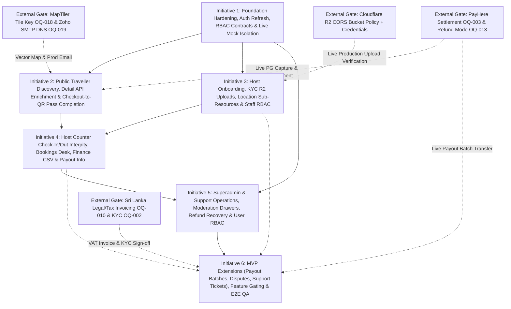

# Web Platform Implementation Blueprint (Primary Deliverable)

> **Document Classification:** Principal Architecture & Engineering Implementation Blueprint  
> **Repository Snapshot:** `dev` branch, commit `b09fa68` (clean working tree)  
> **Target Audience:** Implementation Engineering Team (hand-off specification bridging [01](file:///d:/luggage-storage/luggage-storage/docs/web-platform/01-web-platform-current-state-assessment.md)–[05](file:///d:/luggage-storage/luggage-storage/docs/web-platform/05-web-security-and-data-integrity-review.md) and [07](file:///d:/luggage-storage/luggage-storage/docs/web-platform/07-web-platform-execution-roadmap.md))  
> **Rule of Authority:** PostgreSQL/PostGIS via Fastify (`apps/api`) and `@luggage-storage/contracts` remain the sole sources of marketplace truth. Every live screen across Traveller, Host, and Admin portals must render only authoritative server data or honest empty/error states.

---

## A. Architectural Direction & Mandatory Preservation Constraints

### A.1 Preserved Stack & Explicit Boundaries
The implementation **must preserve** all approved platform decisions without architectural churn:

| Layer | Preserved Technology / Pattern | Mandatory Boundary |
| --- | --- | --- |
| Workspace | `pnpm` workspace + Turborepo monorepo | Keep existing `apps/api`, `apps/web`, `apps/mobile`, `packages/contracts` layout; do not introduce new services or microservices. |
| Backend | Fastify 5 (`apps/api`) + Drizzle ORM + PostgreSQL / PostGIS | Extend existing route modules and services strictly where missing sub-resource operations, RBAC middleware, or DTO enrichments are needed. |
| Contracts | `@luggage-storage/contracts` + Zod schemas | Synchronize missing Phase B RBAC permissions and detail schemas in `packages/contracts`; do not duplicate validation schemas manually in `apps/web`. |
| Frontend Core | React 18 + Vite + React Router v6 + Tailwind CSS | Modularize oversized monolithic page files; preserve existing visual shell and styling tokens. |
| State & Data | Zustand (`useAuthStore` + new `useHostContextStore`) + TanStack Query v5 (`@tanstack/react-query` already mounted in [App.tsx](file:///d:/luggage-storage/luggage-storage/apps/web/src/app/App.tsx)) + `react-hook-form` (already in `apps/web/package.json`) | Migrate ad-hoc `useEffect` + `DEMO_*` `useState` patterns to typed TanStack Query hooks + Zod resolvers. |
| Auth & Session | In-memory JWT + `HttpOnly` `SameSite=Strict` refresh cookie rotation (`auth.routes.ts`) | Fix client transport header bugs and stale JWT role transitions; never store refresh/access tokens in `localStorage`. |
| Storage & Payments | Cloudflare R2 (`upload_intents`) & PayHere `PaymentGatewayPort` (`WEB` `DIRECT_POST`) | Add direct browser R2 binary `PUT` uploader + dev mock binary route; preserve PayHere HMAC/MD5 webhook authority. |

**Only Permitted Package Additions in `apps/web`:**
1. **`qrcode`** (runtime dependency) — generates scannable SVG/Canvas QR matrices from `issuedPass.qrToken` in `PW-005` and `PW-011` (`GAP-012`).
2. **`jsdom` + `@testing-library/react`** (devDependencies) — enables React component/RBAC/form integration tests in Vitest beyond the current `environment: "node"` limitation in [vitest.config.ts](file:///d:/luggage-storage/luggage-storage/apps/web/vitest.config.ts#L1-L16).

---

### A.2 Decomposition of Monolithic Page Modules
All three surface files ([PublicMarketplacePages.tsx](file:///d:/luggage-storage/luggage-storage/apps/web/src/pages/PublicMarketplacePages.tsx) 3,480+ lines, [HostDashboardPages.tsx](file:///d:/luggage-storage/luggage-storage/apps/web/src/pages/HostDashboardPages.tsx) 3,833+ lines, [AdminDashboardPages.tsx](file:///d:/luggage-storage/luggage-storage/apps/web/src/pages/AdminDashboardPages.tsx) 1,698+ lines) mix layout shells, mock adapters, API orchestration, state machines, and form rendering. During implementation, decompose each surface incrementally into feature-sliced modules while keeping router exports intact:

```text
apps/web/src/
  lib/
    api-client.ts              # Hardened JSON header logic, refresh/retry parse guards, /api/v1 base
    r2-uploader.ts             # Direct binary PUT to R2 presigned URL (no Bearer/JSON injection) + confirm
    csv-export.ts              # RFC-4180 client CSV generator for HD-010 payables
    formatters.ts              # LKR minor-unit money formatting, Asia/Colombo date helpers
  hooks/
    queries/
      query-keys.ts            # Central hierarchical TanStack Query key factory
      use-discovery.ts         # Public discovery, detail & availability hooks
      use-traveller-bookings.ts# Quotes, booking create, list, detail, cancel, custody pass, exceptions
      use-host-portal.ts       # Businesses, locations, schedule, capacity, pricing, bookings, custody, finance, staff
      use-admin-portal.ts      # Metrics, hosts, KYC, moderation, bookings, payments, refunds, ledger, disputes, audit, users/RBAC
  store/
    useAuthStore.ts            # Server-verified logout/logoutAll, refreshUser(), hasPermission/hasAnyPermission
    useHostContextStore.ts     # Selected businessId + locationId synced with live host APIs
  components/
    auth/
      PermissionGate.tsx       # Declarative permission guard wrapping nav links & mutation buttons
    custody/
      CustodyQrPassCard.tsx    # Shared qrcode matrix renderer + 15m TTL timer + Regenerate + 6-digit PIN
    feedback/
      QueryStateView.tsx       # Unified skeleton / honest empty state / correlation-ID error + Retry boundary
  features/
    preview/                   # Isolated ?preview=demo data adapter (never imported by live feature pages)
    traveller/                 # Landing, Search, Detail, Checkout, Confirmation, Bookings Portal, Account
    host/                      # Onboarding, Layout, Overview, Locations, Schedule, Capacity, Pricing, Bookings, Counter Desk, Finance, Payouts, Staff
    admin/                     # Layout, Metrics, Hosts, KYC Review, Moderation, Bookings, Payments, Refunds, Payouts, Ledger, Support, Disputes, Audit, Users/RBAC
```

---

### A.3 Root API Client, Auth Store & Contract Hardening
1. **`api-client.ts` Header & Parsing Fix (`GAP-001`, `SEC-01`, `SEC-02`)**:
   - In [api-client.ts](file:///d:/luggage-storage/luggage-storage/apps/web/src/lib/api-client.ts#L112-L115), set `"Content-Type": "application/json"` **strictly** when `options?.body !== undefined && !(options.body instanceof FormData) && !(options.body instanceof Blob)`. Never send `"Content-Type": "application/json"` with zero body bytes (fixes `400 FST_ERR_CTP_EMPTY_JSON_BODY` on `logout`, `logoutAll`, `revokeSession`, `submitLocationForReview`, and `disableLocation`).
   - Fix [`api-client.ts:86-88`](file:///d:/luggage-storage/luggage-storage/apps/web/src/lib/api-client.ts#L86-L88) to invoke `onAuthFailure()` on malformed HTTP 200 refresh payloads and wrap `retryResponse.json()` ([L145](file:///d:/luggage-storage/luggage-storage/apps/web/src/lib/api-client.ts#L145)) in structured safe JSON parsing returning typed `ApiClientError`.
   - Standardize all client API base URLs to `/api/v1/*` and update [`auth.routes.ts:32-40`](file:///d:/luggage-storage/luggage-storage/apps/api/src/modules/auth/auth.routes.ts#L32-L40) `getCookieConfig` so logout/refresh clear cookie paths cleanly without leaving dual `/` vs `/api/v1/auth` cookies.
2. **`useAuthStore.ts` Guaranteed Logout (`GAP-001`, `SEC-01`)**:
   - Remove empty `catch {}` blocks at [useAuthStore.ts:165-188](file:///d:/luggage-storage/luggage-storage/apps/web/src/store/useAuthStore.ts#L165-L188). Perform `await authApi.logout()` / `await authApi.logoutAll()`, clear client state, and rethrow or surface warning banners if network revocation fails so users on shared kiosks are never deceived by zombie sessions resurrected on page reload by `initAuth()` ([L82-L109](file:///d:/luggage-storage/luggage-storage/apps/web/src/store/useAuthStore.ts#L82-L109)).
3. **Sync RBAC Constants in `@luggage-storage/contracts` (`SEC-04`, `GAP-030`, `GAP-033`)**:
   - Extend [packages/contracts/src/rbac/index.ts](file:///d:/luggage-storage/luggage-storage/packages/contracts/src/rbac/index.ts#L15-L75) `SYSTEM_PERMISSIONS` to include all Phase B permission strings already enforced in [admin-phase-b.routes.ts](file:///d:/luggage-storage/luggage-storage/apps/api/src/modules/admin/admin-phase-b.routes.ts#L1-L217), [bookings.routes.ts](file:///d:/luggage-storage/luggage-storage/apps/api/src/modules/bookings/bookings.routes.ts#L1-L368), [custody.routes.ts](file:///d:/luggage-storage/luggage-storage/apps/api/src/modules/custody/custody.routes.ts#L1-L127), and support seeds (`support.ticket.*`).
4. **R2 Binary Upload Client + Dev Mock Upload Endpoint (`GAP-019`, `SEC-10`)**:
   - Build `r2-uploader.ts`: (1) call `POST /api/v1/uploads/presigned-url` (`purpose: "HOST_VERIFICATION" | "LOCATION_IMAGE"` + `"CUSTODY_EVIDENCE"` if enabled), (2) execute plain `fetch(presignedUrl, { method: "PUT", headers: { "Content-Type": file.type }, body: file })` **without** `Authorization` Bearer tokens, and (3) call `POST /api/v1/uploads/confirm` returning authoritative `fileKey`/`documentId`.
   - On backend local dev mode (when `InMemoryStorageAdapter` stubs upload URLs), add a safe dev-only `PUT` route matching the stub URL inside [uploads.routes.ts](file:///d:/luggage-storage/luggage-storage/apps/api/src/modules/uploads/uploads.routes.ts#L1-L98) so local integration verification of KYC & photo uploads never hits `404`.

---

## B. Public Traveller Website Completion Plan (`PW-001`–`PW-011`, Auth & Profile)

### B.1 Navigation, Auth & Profile Hygiene (`GAP-004`–`GAP-006`, `SEC-05`, `SEC-06`, `SEC-09`)
- **`AppShell.tsx` Responsive Drawer & Portal Routing**:
  - Replace desktop-only `hidden lg:flex` ([AppShell.tsx:40](file:///d:/luggage-storage/luggage-storage/apps/web/src/components/layout/AppShell.tsx#L40)) with an accessible mobile toggle + slide-over navigation drawer (`aria-expanded`, `Escape` handling).
  - Replace hardcoded `"Host Portal"` ([L90-95](file:///d:/luggage-storage/luggage-storage/apps/web/src/components/layout/AppShell.tsx#L90-L95)) with `"Become a Host"` (`/become-a-host`) for guests/travellers and `"Host Portal"` (`/host/dashboard`) when holding `hosts.location.read` or `hosts.custody.operate`.
  - Update `"Admin"` link ([L102-110](file:///d:/luggage-storage/luggage-storage/apps/web/src/components/layout/AppShell.tsx#L102-L110)) so `SUPPORT` routes directly to `/admin/bookings` (permitted workspace) rather than `AD-001` (`/admin`).
- **Route Guards in `App.tsx`**:
  - Wrap `/booking/confirm`, `/checkout/payhere/return`, `/checkout/payhere/cancel`, `/portal`, and `/portal/bookings` inside `ProtectedRoute` ([App.tsx:105-108](file:///d:/luggage-storage/luggage-storage/apps/web/src/app/App.tsx#L105-L108)).
  - Remove `(PW-001)` / `(PW-002)` internal dev spec IDs from [NotFoundPage.tsx](file:///d:/luggage-storage/luggage-storage/apps/web/src/pages/NotFoundPage.tsx#L20-L26).
- **`VerifyEmailPage.tsx` & Editable `/profile` (`WF-TRV-14`, `WF-TRV-17`)**:
  - After email verification succeeds in [VerifyEmailPage.tsx](file:///d:/luggage-storage/luggage-storage/apps/web/src/pages/VerifyEmailPage.tsx), invoke `useAuthStore.getState().refreshUser()` so `emailVerified` reflects live state synchronously.
  - Register Fastify endpoints (`GET/PATCH /api/v1/identity/profile`) wired to existing `UserProfileResponseDataSchema` and `UpdateProfileRequestSchema` in [packages/contracts/src/identity/index.ts](file:///d:/luggage-storage/luggage-storage/packages/contracts/src/identity/index.ts#L52-L106) and `traveller_profiles` table.
  - Update [ProfilePage.tsx](file:///d:/luggage-storage/luggage-storage/apps/web/src/pages/ProfilePage.tsx#L135-L213) to allow editing display name, phone, and traveller emergency contact while removing raw internal `sessionId` UUIDs and flat permission slug dumps from non-admin customer profiles.

### B.2 Discovery, Search & Authoritative Location Detail (`PW-001`–`PW-003`, `GAP-007`–`GAP-010`, `DI-02`)
- **Landing Page (`PW-001`)**:
  - Replace hardcoded `DEMO_LOCATIONS.slice(0, 3)` and static date `"2026-11-10"` ([PublicMarketplacePages.tsx:149-158, 332](file:///d:/luggage-storage/luggage-storage/apps/web/src/pages/PublicMarketplacePages.tsx#L149-L158)) with `useDiscoveryLocations({ limit: 3 })`, dynamic current/tomorrow defaults in `Asia/Colombo` / browser local time, real hub count copy, and live UUID routing `/locations/:id`. If 0 active locations exist, display an honest "Launching Soon in Sri Lanka" state.
- **Search & Availability (`PW-002`, `WF-TRV-02`, `WF-TRV-03`)**:
  - Synchronize URL search parameters (`searchTerm`, `city`, `dropOffAt`, `collectionAt`, `smallBags`, `mediumBags`, `largeBags`, `oversizedBags`, `only24Hours`, `onlyClimateControl`, `sortBy`).
  - Wire `useAvailabilitySearch` (`GET /api/v1/availability/search`) whenever drop-off/collection timestamps and bag counts are selected; use `GET /api/v1/discovery/locations` (`searchTerm`, `acceptsOversized`, geo coordinates) for browse queries.
  - Remove the buggy early-return at [`PublicMarketplacePages.tsx:574-576`](file:///d:/luggage-storage/luggage-storage/apps/web/src/pages/PublicMarketplacePages.tsx#L574-L576) so amenity filters and sort order actually filter/sort live API results.
  - Remove the fake CSS grid pseudo-map (`L785-852`). Integrate MapLibre GL JS behind `VITE_MAPTILER_KEY` (`OQ-018`); when the tile key is unconfigured in local/staging builds, render an honest toggle-disabled coordinate list view with approximate radius notice rather than synthetic grid blocks.
- **Authoritative Location Detail (`PW-003`, `WF-TRV-04`, `GAP-010`)**:
  - **Backend Enrichment**: Extend `getPublicLocationDetails` in [discovery.service.ts](file:///d:/luggage-storage/luggage-storage/apps/api/src/modules/discovery/discovery.service.ts#L218-L313) to return `openingHours[]` (weekly schedule), `upcomingExceptions[]`, `pricingPolicy` (`pricingUnit`, `baseRateMinor`, bag-category multipliers via `DEFAULT_CATEGORY_MULTIPLIERS_BPS`), `capacitySummary` (`maxCapacity`, active pool counts), `images[]`, and `acceptsOversized`, while preserving `OQ-012` coarse coordinate rounding (`toFixed(2)`) and suppressing exact street address pre-payment.
  - **Delete Fabrication Adapter**: Delete `mapPublicLocationToItem` (`PublicMarketplacePages.tsx:95-140`) from live routes—eliminating hardcoded `hasInsurance: true`, `insuranceLimitLkr: 250000`, `45/50` stock, `30`-min grace period, and invented hourly rates—and remove `.catch(() => {})` `DEMO_LOCATIONS[0]` fallback (`L886`).

### B.3 Checkout, PayHere Return, Custody QR Pass & Bookings Portal (`PW-004`, `PW-005`, `PW-011`, `GAP-011`–`GAP-016`, `DI-04`)
- **Authoritative Checkout (`PW-004`)**:
  - Default timestamps relative to current clock (`now + 1h` drop-off, `now + 5h` collection). Debounce `POST /api/v1/bookings/quote` (`300ms`).
  - Persist draft bag/schedule form state in `sessionStorage` keyed by `locationId`; when an unauthenticated user clicks Reserve (`L1273`), navigate via `navigate("/login", { state: { from: location } })` and restore draft upon return.
  - Prefill traveller payer fields cleanly from `/api/v1/auth/me`, submit `POST /api/v1/bookings` with deterministic `idempotencyKey`, obtain `POST /api/v1/payments/intents` (`WEB` `DIRECT_POST`), and submit via `submitPayhereCheckoutForm`.
- **Payment Return & Reconciliation (`PW-005`, `WF-TRV-08`, `SEC-11`)**:
  - On `/booking/confirm` and `/checkout/payhere/return`, require `bookingId` query/route param (redirect/404 when missing, deleting fake `#LS-2026-8841` rendering at `L2311-2433`).
  - Poll `GET /api/v1/payments/checkout-status` and `GET /api/v1/bookings/:bookingId` cleanly (showing `"Verifying Payment with PayHere..."`) until server transitions status from `PENDING_PAYMENT`. Never treat URL return params alone as proof of payment.
- **Bookings Portal, Tiered Refunds & Exception Reporting (`PW-011`, `WF-TRV-09`–`WF-TRV-13`)**:
  - Bind directly to `GET /api/v1/bookings` & `GET /api/v1/bookings/:bookingId`. Delete `useState(DEMO_BOOKINGS)` ([L3090](file:///d:/luggage-storage/luggage-storage/apps/web/src/pages/PublicMarketplacePages.tsx#L3090)) and `if (res.bookings.length > 0)` ([L3104](file:///d:/luggage-storage/luggage-storage/apps/web/src/pages/PublicMarketplacePages.tsx#L3104)).
  - **Fix Status Mapping Bug (`GAP-014`)**: Remove `PENDING_PAYMENT -> "CONFIRMED"` (`L3037`, `L3299`). Render `PENDING_PAYMENT` in `"Awaiting Payment"` with `holdExpiresAt` countdown + `"Complete Payment"` retry CTA and disable Custody Pass actions until `CONFIRMED` / `IN_STORAGE`.
  - **Real Scannable QR Pass (`GAP-012`)**: Build `<CustodyQrPassCard />` using `qrcode` to encode `issuedPass.qrToken` into a scannable SVG/Canvas matrix (replacing decorative Lucide `<QrCode />` icons at `L2263`, `L2379`, `L3483`), show live 15-minute expiration timer, display 6-digit `verificationPin`, and include a `"Regenerate Pass"` button calling `POST /api/v1/bookings/:bookingId/custody-pass`.
  - **Fix Financial & Invoice Views (`GAP-015`, `SEC-07`)**: Render actual `refundSummary.amountMinor` and canonical `REFUND_STATUSES` in Refunds tab instead of 100% `totalAmountLkr` (`L3426`); keep `EXPIRED`/`REJECTED` unpaid bookings in History rather than Refunds; replace dead `"Download VAT Invoice"` (`L3399`) with printable server-backed `"Booking Summary Receipt"` until `OQ-010` tax rules clear. On backend [bookings.service.ts:481-483](file:///d:/luggage-storage/luggage-storage/apps/api/src/modules/bookings/bookings.service.ts#L481-L483), omit `commissionRateBps`, `platformCommissionMinor`, and `hostPayableMinor` unless caller holds `hosts.finance.read` (owner) or `admin.finance.read`.
  - **Exception Filing (`GAP-016`)**: Add `"Report Problem / Exception"` modal in `PW-011` calling `marketplaceApi.reportBookingException` (`POST /api/v1/bookings/:bookingId/exceptions`). On `/contact` (`PW-009`), replace fake `#TKT-COL-2026-441` local confirmation with honest direct contact details initially, switching to `POST /api/v1/support/tickets` once Initiative 6 ships Support backend.

---

## C. Host Web Dashboard Completion Plan (`HD-001`–`HD-014` & `/host/onboarding`)

### C.1 Onboarding Unblock, Context Switcher & RBAC Isolation (`GAP-002`, `GAP-017`, `GAP-018`, `SEC-03`–`SEC-05`, `SEC-08`)
- **Pre-Host Onboarding Route (`/host/onboarding`)**:
  - Mount `/host/onboarding` protected for authenticated `TRAVELLER` accounts outside the `HOST_OWNER | HOST_STAFF` `/host/*` route group ([App.tsx:113-116](file:///d:/luggage-storage/luggage-storage/apps/web/src/app/App.tsx#L113-L116)).
  - Upon `POST /api/v1/hosts/businesses` `201` success, immediately execute silent `/api/v1/auth/refresh` + `refreshUser()` before redirecting to `/host/settings` (`HD-014`) KYC upload, clearing stale `roles: ["TRAVELLER"]` tokens (`SEC-03`).
  - Also harden [uploads.service.ts:51](file:///d:/luggage-storage/luggage-storage/apps/api/src/modules/uploads/uploads.service.ts#L51) and [ledger.service.ts:413](file:///d:/luggage-storage/luggage-storage/apps/api/src/modules/finance/ledger.service.ts#L413) to resolve business ownership / DB roles directly rather than failing `403` on freshly upgraded owners.
- **Persistent `useHostContextStore` (`GAP-017`)**:
  - Replace zero-API `HostDashboardLayout` (`loc-cmb-fort-01`, `DEMO_LOCATIONS`, `"Sample Host Partner Profile"`, role preview widget at [HostDashboardPages.tsx:122-332](file:///d:/luggage-storage/luggage-storage/apps/web/src/pages/HostDashboardPages.tsx#L122-L332)) with `useHostContextStore` hydrated from `GET /api/v1/hosts/businesses` + `GET /api/v1/hosts/locations`.
  - Fix backend `getOwnedLocations` (`locations.service.ts:173-221`) so `HOST_STAFF` receives active assigned venues via `host_staff_memberships`. Show honest zero-venue onboarding CTA when `locations.length === 0`.
- **Host Security & Nav Prefix Bypass Fix (`SEC-04`, `SEC-05`, `GAP-018`)**:
  - On API: add `app.requirePermission(...)` preHandlers across all routes in [locations.routes.ts](file:///d:/luggage-storage/luggage-storage/apps/api/src/modules/locations/locations.routes.ts#L15-L332), [capacity.routes.ts](file:///d:/luggage-storage/luggage-storage/apps/api/src/modules/capacity/capacity.routes.ts#L11-L109), and [pricing.routes.ts](file:///d:/luggage-storage/luggage-storage/apps/api/src/modules/pricing/pricing.routes.ts#L10-L74). Split `getLocationById` (read access for owner, scoped `HOST_STAFF`, `SUPERADMIN`, read-only `SUPPORT`) from new `assertLocationWriteAccess` (owner or `SUPERADMIN` only—**rejecting `SUPPORT` with `403`**).
  - On Web: replace ordered `.startsWith` matching ([HostDashboardPages.tsx:188-214](file:///d:/luggage-storage/luggage-storage/apps/web/src/pages/HostDashboardPages.tsx#L188-L214)) with longest-prefix/exact route matching + `<PermissionGate>` guards so `HOST_STAFF` is blocked from `HD-003`–`HD-006`, `HD-010`, `HD-011`, `HD-013`, `HD-014` and from Net Cleared Earnings cards on `HD-001` (`L632-642`, enforcing `OQ-017`).

### C.2 Business KYC, Location Lifecycle, Schedule, Capacity & Pricing (`HD-002`–`HD-006`, `HD-014`, `GAP-019`–`GAP-021`)
- **Business Profile & R2 KYC Upload (`HD-014`)**:
  - Wire `getBusinessById` and `updateBusiness` (`PATCH /api/v1/hosts/businesses/:businessId`). Map both business `PENDING_VERIFICATION` ([hosts.service.ts:379](file:///d:/luggage-storage/luggage-storage/apps/api/src/modules/hosts/hosts.service.ts#L379)) and verification `PENDING_REVIEW` / `MORE_INFO_REQUIRED` / `APPROVED` / `REJECTED` accurately (`SEC-08`).
  - Implement document uploader using `r2-uploader.ts` (`HOST_VERIFICATION`), display uploaded BRN/TIN/ID files with presigned preview links, and wire `POST /api/v1/hosts/businesses/:id/verification`. Remove fake `"Ceylon Transit Hospitality"` cards (`L3596-3659`).
- **Location Create, Readiness Gate & Sub-Resources (`HD-002`–`HD-006`)**:
  - **Fix Premature Submit (`HD-002:977`)**: `createLocation` creates `DRAFT` and routes directly to `/host/locations/:id/edit` without calling `/submit`. Expose an explicit `"Submit for Review"` CTA gated on Location Readiness Checks (weekly hours set, >=1 capacity pool > 0, valid pricing policy, business `ACTIVE` or submission prompt).
  - **Add Missing Backend Sub-Resource Mutations**: Add `PATCH /api/v1/hosts/locations/:locationId/zones/:zoneId`, `DELETE .../zones/:zoneId`, `DELETE .../exceptions/:exceptionId`, and `DELETE .../media/:mediaId` in `locations.routes.ts` / `locations.service.ts`.
  - **Wire All 4 Host Config Screens**:
    - `HD-003` Location Edit & Media: `getLocationById`, `updateLocation`, `disableLocation` (using fixed bodyless client!), R2 photo upload (`LOCATION_IMAGE`) -> `addLocationMedia` + delete.
    - `HD-004` Operating Hours & Exceptions: `setOpeningHours`, `addOpeningHoursException`, plus delete exception.
    - `HD-005` Storage Zones & Capacity Pools: `createStorageZone`, edit/delete zone, `getCapacityPools`, `createCapacityPool`, `updateCapacityPool` (removing dead `"Configure Zone Limits"` / no-op modals at `L1702`, `L1761`).
    - `HD-006` Pricing Configuration: `getPricingPolicy` & `configurePricingPolicy` bound to `PricingPolicySchema` (`CALENDAR_DAY` vs `24_HOUR_BLOCK` minor units and bag-category multipliers, removing fictional hourly/cap sliders at `L1779-1914`).

### C.3 Bookings, Counter Check-In/Out Custody Fix, Finance, Payouts & Staff (`HD-001`, `HD-007`–`HD-013`, `GAP-022`–`GAP-027`, `DI-01`)
- **Live Overview & Bookings (`HD-001`, `HD-007`, `HD-008`)**:
  - Hydrate `HD-001` solely from `GET /api/v1/hosts/bookings` + (for `hosts.finance.read`) `GET /api/v1/hosts/finance/summary`.
  - Fix `mapHostBookingToRecord` (`L70-84`) so all 11 statuses map accurately (`PENDING_PAYMENT` never looks ready for drop-off). Add `getHostBookingDetail` (`GET /api/v1/hosts/bookings/:bookingId`) to `marketplaceApi`, replace hardcoded reject/cancel notes (`L1994-2003`) with explicit modal inputs, remove fake 4-step custody timeline fallback (`L2216-2277`), and wire host `reportBookingException`.
- **CRITICAL Custody Desk Rewrite (`HD-009`, `GAP-022`, `GAP-023`, `DI-01`)**:
  1. **Remove Corrupt `exceptionNotes` at `HostDashboardPages.tsx:2387`**: Never pass `"Released via Host Counter Web Desk"` on normal check-out! Omit `exceptionNotes` by default so `custody.service.ts:747-757` sets `RELEASED_TO_TRAVELLER`, `COMPLETED`, `host_payables.status = "ELIGIBLE"`, and posts the 85%/15% double-entry revenue split. Add an explicit optional `"Report Missing/Damaged Bag Exception"` toggle + required description textarea ONLY when an actual handover discrepancy occurs.
  2. **Eliminate Fake `setTimeout` & Enable `LS-*` Reference Resolution**: Delete `L2405-2413` `setTimeout` simulation completely from authenticated mode. Accept `?ref=` & `?mode=` search params (from `HD-001`/`HD-007` deep links), resolve human `LS-*` codes via `GET /api/v1/hosts/bookings?search=...` to `bookingId`, pre-populate expected bags and live `zoneId` options from `/hosts/locations/:id`, allow staff to assign real bag tags/seals/zones and upload optional bag evidence photos (`CUSTODY_EVIDENCE` upload purpose if enabled), and assert `verifiedBagCount` on `completeCheckIn`. Retain clean overdue notice banner honoring `OQ-015` Zero Possessory Lien (never block collection).
- **Finance, Payouts & Staff (`HD-010`–`HD-013`)**:
  - `HD-010` Finance: remove `L2684`/`L2830` synthetic `LKR 217,058` fallbacks, filter by active `businessId`, and implement real RFC-4180 CSV download (`L2728`) via `csv-export.ts`.
  - `HD-011` Payouts: fix `hosts.service.ts:429` (`ADMIN_FINANCIAL` dead role string), wrap `getBusinessPayoutDetails` (`GET /api/v1/hosts/businesses/:id/payout-details`) in `marketplaceApi`, wire bank update to `PATCH /api/v1/hosts/businesses/:id`, and render settlement batches once Initiative 6 `payout_batches` ships (removing dead `"Download Sample PDF"` at `L2979`).
  - `HD-013` Staff Management: create backend `GET/POST/PATCH/DELETE /api/v1/hosts/businesses/:businessId/staff` over existing `host_staff_memberships` table (`hosts.ts:131-154`) and wire `HD-013` cleanly (`L3197-3399`).
  - `HD-012` Host Reviews: remove fake guest reviews and simulated replies (`L3054-3192`); replace with clean feature-gated notice until backend Reviews module exists.

---

## D. Superadmin & Support Dashboard Completion Plan (`AD-001`–`AD-018`)

### D.1 Permission-Driven Layout & `SUPPORT` Role Alignment (`GAP-005`, `GAP-033`, `SEC-05`)
- Replace binary `superadminOnly: true` nav flags ([AdminDashboardPages.tsx:77-94](file:///d:/luggage-storage/luggage-storage/apps/web/src/pages/AdminDashboardPages.tsx#L77-L94)) with `requiredPermissions[]` checked against `useAuthStore.hasAnyPermission`:
  - `SUPPORT` receives read-only sidebar access to `AD-002` (`admin.host.read`), `AD-004` (`admin.location.read`), `AD-005` (`admin.booking.read`), `AD-006` (`admin.payment.read`), `AD-007` (`admin.refund.read`), `AD-011`/`012` (`support.ticket.read` / `manage` in Initiative 6), `AD-013` (if `admin.booking.read`), and `AD-018` (`admin.user.read`).
  - Wrap mutation CTAs (`Approve`/`Reject` KYC, `Approve`/`Reject` location, `Admin Cancel` at [L727](file:///d:/luggage-storage/luggage-storage/apps/web/src/pages/AdminDashboardPages.tsx#L727), refund state transitions, user suspend/role mutations) in `<PermissionGate>` matching backend `SUPERADMIN` permissions (`admin.host.verify`, `admin.location.moderate`, `admin.booking.manage`, `admin.refund.manage`, `admin.user.manage`, `admin.role.assign`) so `SUPPORT` never sees actionable controls that `403`.
- Create `GET /api/v1/admin/metrics/summary` (`admin.booking.read` / `admin.financial.manage`) returning role-appropriate live platform KPIs for `AD-001`, and remove fake `LKR 4,280,000` numbers & developer `WEB_ADMIN_SCREENS` directory (`L223-440`).

### D.2 Oversight, Verification, Moderation & Global Operations (`AD-002`–`AD-007`, `AD-010`, `AD-013`, `AD-017`, `AD-018`)
- **Blind Moderation Fix (`AD-002`, `AD-004`, `GAP-028`, `GAP-029`)**:
  - Enrich `GET /api/v1/admin/verifications` (`host-verification.routes.ts`) and `GET /api/v1/admin/locations/moderation-queue` (`location-moderation.routes.ts`) to include business legal/trade name, location title, owner email, and `?status=` filter (`PENDING_REVIEW`, `APPROVED`, `REJECTED`, `ALL`).
  - In `AD-002`, build Verification Inspection Drawer calling `getVerificationDetails` (`marketplace-api.ts:648`) and clickable `getDocumentDownloadUrl` (`900s` R2 links) + mandatory moderator note input (`L334`).
  - In `AD-004`, build Location Inspection Drawer calling `getLocationById` (`marketplace-api.ts:166`) displaying R2 photos, exact address/coordinates, opening hours, capacity pools, pricing policy, plus structured rejection feedback input (`L525`). Allow `ADMIN_LOCATION_READ` on backend `GET /hosts/locations/:locationId` while keeping write methods blocked for `SUPPORT`.
- **Host Directory (`AD-003`, `GAP-034`)**: Add backend `GET /api/v1/admin/hosts`, `GET /api/v1/admin/hosts/:businessId`, and `POST /api/v1/admin/hosts/:businessId/suspend` | `/reinstate` and wire `AD-003` (removing `DEMO_LOCATIONS` table).
- **Bookings, Payments & Full Refund Transitions (`AD-005`–`AD-007`, `AD-010`, `GAP-031`, `GAP-032`)**:
  - Add search, booking status filter, pagination, `getAdminBookingDetail`, and `getAdminBookingCustody` drawer to `AD-005`; add `bookingId` search & pagination to `AD-006`; add date/type/booking filters + debit==credit trial balance verification to `AD-010`.
  - **Fix Refund Transitions (`AD-007:900-915`)**: Replace linear `nextRefundStage` with an allowed-transition selector over `REFUND_STATUSES` enabling `PROCESSING -> SUCCEEDED | MANUAL_REVIEW_REQUIRED | FAILED` and `MANUAL_REVIEW_REQUIRED -> SUCCEEDED | FAILED`, capturing `gatewayRefundReference`, `failureReason`, and moderator notes.
  - Delete all `DEMO_BOOKINGS`, `#RFD-8799`, `JRN-901..903`, and static audit line fallbacks across `AD-005`, `AD-006`, `AD-007`, `AD-010`, and `AD-017` (`L1639-1656`).
- **Disputes & Incidents (`AD-013`, `GAP-035`)**:
  - Wire `AD-013` list to live `GET /api/v1/admin/bookings?status=DISPUTED` + `GET /api/v1/admin/bookings/:id/custody`.
  - Add backend `POST /api/v1/admin/bookings/:bookingId/resolve-dispute` allowing `SUPERADMIN` (`admin.booking.manage`) to adjudicate disputed custody outcomes (`COMPLETED` + release `host_payables` from `ON_HOLD -> ELIGIBLE` with revenue split, or `CANCELLED`/refund resolution) with immutable audit trail.
- **Audit Log & Full User/RBAC Governance (`AD-017`, `AD-018`, `GAP-030`, `SEC-12`)**:
  - `AD-017`: Update `listAdminAuditEvents` in [auth-api.ts:169-185](file:///d:/luggage-storage/luggage-storage/apps/web/src/services/auth-api.ts#L169-L185) to forward `res.pagination` and `from`/`to`/`userId` query params; expose full backend `SecurityEventType` filters and `GET /api/v1/admin/audit-events/:eventId` detail drawer.
  - `AD-018`: Add all 12 missing client wrappers in `auth-api.ts` for [admin.routes.ts:40-543](file:///d:/luggage-storage/luggage-storage/apps/api/src/modules/admin/admin.routes.ts#L40-L543) (`listUsers`, `getUserDetail`, `suspendUser`, `reinstateUser`, `deactivateUser`, `reactivateUser`, `verifyUserEmail`, `listRoles`, `listPermissions`, `getUserPermissions`, `assignRole`, `revokeRole`) and build the complete searchable User & RBAC Governance workspace respecting backend last-Superadmin protection.

### D.3 MVP Core Extensions vs Cleanly Feature-Gated Modules (`AD-008`, `AD-009`, `AD-011`, `AD-012`, `AD-014`–`AD-016`, `GAP-036`)
| Module | Decision | Implementation Plan |
| --- | --- | --- |
| `AD-008` & `AD-009` Payout Batches & Manual Disbursement | **Implement for MVP (with external settlement gate)** | Add `payout_batches` + `payout_batch_items` schema/migration, `POST /api/v1/admin/payouts/batches`, `GET .../batches`, and `POST .../batches/:id/disburse` transitioning grouped `ELIGIBLE` `host_payables -> PAID` + posting ledger payout entries. Keep automated bank push gated until `OQ-003` (PayHere settlement) & `OQ-010` (tax/VAT) are approved. |
| `AD-011`, `AD-012` & `PW-009` Support Tickets | **Implement in Initiative 6** | Add `support_tickets` + `support_ticket_messages` schema & endpoints guarded by seeded `support.ticket.read` / `support.ticket.manage` permissions (`POST /api/v1/support/tickets`, `GET/PATCH /api/v1/admin/support/tickets*`), replacing `/contact` local fake `#TKT-COL-2026-441` and `AD-011` static `TKT-9042`. |
| `AD-014` Reviews & `AD-015` Promotions | **Cleanly Feature-Gate (Post-MVP)** | No DB schema/APIs exist and `discovery.service.ts` intentionally returns `averageRating: null, reviewCount: 0`. Hide from production primary sidebar behind feature flags (`VITE_FEATURE_REVIEWS=false`, `VITE_FEATURE_PROMOTIONS=false`) or clean roadmap status notice—zero simulated CRUD. |
| `AD-016` Platform Settings (`L1485-1553`) | **Convert Fake Controls to Read-Only Authoritative View** | Remove unsaved interactive dropdowns/inputs (`L1485-1553`); display verified backend commission split (`85%` host / `15%` platform), OQ-009 refund tiers, and OQ-015 zero-possessory-lien rules read-only until a persisted `platform_settings` module is commissioned post-MVP. |

---

## E. Cross-Cutting Engineering & Quality Standards

1. **Centralized TanStack Query Keys & Invalidations (`query-keys.ts`)**:
   - Bookings create/cancel/checkin/checkout invalidates: `["bookings"]`, `["booking", id]`, `["host", "bookings"]`, `["host", "finance"]`, `["discovery"]`, `["availability"]`.
   - Host business/location/capacity/pricing/moderation mutations invalidate: `["host", "businesses"]`, `["host", "locations"]`, `["admin", "verifications"]`, `["admin", "moderation"]`, `["discovery"]`.
   - Admin user/role mutations invalidate: `["admin", "users"]`, `["admin", "user", id]`, `["admin", "audit"]`.
2. **Error Handling & Zero `.catch(() => {})`**: Every failed API call must surface an explicit alert banner with server `message`, HTTP status, `correlationId` (if returned), and a Retry button (`QueryStateView`).
3. **Validation Parity**: All Web forms (`react-hook-form`) use Zod schemas imported from `@luggage-storage/contracts` (`zodResolver`) and integer minor units (`amount * 100` converted strictly at form boundaries; server calculates/verifies all totals).
4. **Timezone & Currency Formatting (`formatters.ts`)**: Format LKR using minor-unit division (`LKR ${(minor / 100).toLocaleString("en-LK", { minimumFractionDigits: 2 })}`); represent drop-off/collection timestamps explicitly in ISO-8601 with venue timezone display (`Asia/Colombo`).
5. **Responsive & Accessible UX**: Implement keyboard-accessible drawers (`Escape` close, focus trap/return), visible focus outlines, proper button/link semantics (`button` vs `a`), and responsive tables/cards below `lg`.

---

## F. Mock-Data Elimination & Isolated `?preview=demo` Architecture

- **Preservation of `AUD-007` Route Guard**: Keep [demo-preview.ts](file:///d:/luggage-storage/luggage-storage/apps/web/src/config/demo-preview.ts) gating `?preview=demo` (`VITE_ENABLE_DEMO_PREVIEW !== "true"` disables preview routes completely in production).
- **Hard Removal of Live `DEMO_*` Imports**:
  - **Forbidden** in all `features/{traveller,host,admin}/` modules: importing `DEMO_LOCATIONS`, `DEMO_BOOKINGS`, or `mock-marketplace.ts` ([GAP-003](file:///d:/luggage-storage/luggage-storage/docs/web-platform/04-web-ux-operational-gap-register.md#L36-L47), [GAP-032](file:///d:/luggage-storage/luggage-storage/docs/web-platform/04-web-ux-operational-gap-register.md#L425-L436)). Add an automated ESLint `no-restricted-imports` rule or Vitest static import check failing CI if any live page/component imports `src/data/mock-marketplace`.
- **Isolated Preview Adapter (`features/preview/`)**: Only when `isDemoPreviewMode()` evaluates `true` inside an explicitly permitted `?preview=demo` session may `PreviewDataProvider` swap query hooks cleanly for UI showcase purposes, displaying a persistent non-dismissible `"DEMO PREVIEW MODE — SYNTHETIC DATA"` banner. Authentic logged-in sessions can **never** fall back to demo rows on `0` records or HTTP errors.

---

## G. Authoritative Data Matrix (12 Platform Domains)

| # | Domain | Authoritative Backend Source | Contract / DTO | Must Never Be Hardcoded / Fabricated in Web UI |
| --- | --- | --- | --- | --- |
| 1 | Discovery & Map Locations | `GET /api/v1/discovery/locations`, `GET .../locations/:locationId` (`storage_locations`, `host_businesses`) | `SearchLocationsQuerySchema`, `PublicStorageLocation` | Featured 3 hubs, `DEMO_LOCATIONS`, `distanceKm: 1.0`, street address pre-payment, ratings (`null`/`0` until live reviews) |
| 2 | Availability & Capacity Pools | `GET /api/v1/availability/search`, `GET /api/v1/hosts/locations/:id/capacity-pools` (`storage_capacity_pools`) | `AvailabilitySearchQuerySchema`, `CapacityPool` | `45/50` remaining capacity, `50` total capacity (`mapPublicLocationToItem`) |
| 3 | Pricing Quotations & Policies | `POST /api/v1/bookings/quote`, `GET/PUT /api/v1/hosts/locations/:id/pricing` (`pricing_policies`, `pricing_tier_rates`) | `PricingPolicySchema`, `DEFAULT_CATEGORY_MULTIPLIERS_BPS`, `PRICING_UNITS` | Hourly/daily-cap pricing tiers (`baseRateMinor / 600`), 30-min grace period, client-side total math |
| 4 | Bookings & Status Lifecycle | `POST/GET /api/v1/bookings*`, `GET/POST /api/v1/hosts/bookings*`, `GET/POST /api/v1/admin/bookings*` | `BookingStatus`, `BookingDetail` | `PENDING_PAYMENT -> "CONFIRMED"`, `#LS-2026-8841`, booking approval/rejection without server write |
| 5 | Payments & Webhook Verification | `POST /api/v1/payments/intents`, `GET /api/v1/payments/checkout-status`, PayHere `notify_url` | `PaymentIntent`, `AdminPaymentTransaction` | Treating `?return_url` query params as confirmed paid status without polling authoritative API |
| 6 | Custody Tokens, QR/PIN & Events | `POST /api/v1/bookings/:id/custody-pass`, `POST /api/v1/hosts/custody/*`, `GET /api/v1/hosts/custody/:id` | `CUSTODY_OPERATIONS`, `CustodyRecordDetail` | Decorative Lucide `<QrCode />` SVG, fake `700ms` check-out `setTimeout`, forced `"Released via Host Counter Web Desk"` `exceptionNotes`, fake 4-step timeline |
| 7 | Cancellations & Refunds | `POST /api/v1/bookings/:id/cancel`, `GET /api/v1/admin/refunds`, `POST /api/v1/admin/refunds/:id/transition` | `REFUND_STATUSES`, `refundSummary` | Hardcoded 100% `totalAmountLkr` refunds, `EXPIRED`/`REJECTED` listed as refunds, mock 7-stage labels |
| 8 | Host Businesses & KYC Verification | `POST/GET/PATCH /api/v1/hosts/businesses*`, `GET .../payout-details`, `POST/GET /api/v1/uploads/*`, `GET/POST /api/v1/admin/verifications*` | `HostBusiness`, `HostVerification` | `"Ceylon Transit Hospitality"`, `"Sample Host Partner Profile"`, `"ACTIVE"` override over `"PENDING_VERIFICATION"`/`"PENDING_REVIEW"` |
| 9 | Storage Locations, Hours, Exceptions & Zones | `POST/GET/PATCH/DELETE /api/v1/hosts/locations*` (`storage_locations`, `opening_hours`, `opening_hours_exceptions`, `storage_zones`) | `StorageLocation`, `OpeningHours`, `StorageZone` | Default `loc-cmb-fort-01`, simulated save toasts on `HD-003`–`HD-005`, `hasInsurance: true` (`LKR 250,000`) |
| 10 | Double-Entry Ledger, Payables & Payouts | `GET /api/v1/hosts/finance/summary`, `GET /api/v1/admin/finance/ledger`, new `/admin/payouts/*` | `HostFinanceSummary`, `AdminLedgerEntry` | `LKR 217,058 / 184,500`, `JRN-901..903`, showing Net Cleared Earnings to `HOST_STAFF` or commission bps to `TRAVELLER` |
| 11 | Users, Roles, Permissions & Audit Events | `POST/GET/DELETE /api/v1/auth/*`, `/identity/profile`, `/admin/users*`, `/admin/roles*`, `/admin/permissions`, `/admin/audit-events*` | `SYSTEM_PERMISSIONS`, `UserProfileResponseDataSchema`, `SecurityEventType` | Silent client-only logout, read-only `/profile` UUID/permission leaks, `ADMIN_LOGIN_SUCCESS` sample audit strings |
| 12 | Disputes, Incidents & Support Tickets | `POST /api/v1/bookings/:id/exceptions`, `POST /api/v1/admin/bookings/:id/resolve-dispute`, `/support/tickets*` | `BookingExceptionRequest`, `SupportTicket` | Fake `#TKT-COL-2026-441` / `TKT-9042`, static placeholder `AD-013` notice |

---

## H. End-to-End Acceptance Criteria (`AC-01` to `AC-20`)

1. **`AC-01` (Real Logout & Cookie Revocation):** *Given* an authenticated user on any portal, *When* clicking Sign Out or Revoke Session, *Then* `POST /api/v1/auth/logout` (or `DELETE .../sessions/:id`) sends zero JSON `Content-Type` header on empty body and returns `200`, *Persisted DB State:* `auth_sessions.revoked_at` is non-null, `refresh_token` cookie is cleared, and refreshing the page remains signed out.
2. **`AC-02` (Role-Free Signup & Profile Update):** *Given* an authenticated `TRAVELLER`, *When* editing display name, phone, and emergency contact on `/profile` and verifying email, *Then* `PATCH /api/v1/identity/profile` persists changes and `/verify-email` refreshes auth store, *Persisted DB State:* `users` & `traveller_profiles` updated; `roles` remains `TRAVELLER`.
3. **`AC-03` (Live Landing & Filtered Search):** *Given* active venues in PostgreSQL and `VITE_ENABLE_DEMO_PREVIEW=false`, *When* searching `/` -> `/search` with `only24Hours=true`, `acceptsOversized=true`, dates, and `sortBy`, *Then* `GET /api/v1/availability/search` executes cleanly with zero `DEMO_LOCATIONS` rows shown when results are empty, *Verification:* Empty DB shows honest launch message; active DB returns exact matching pools.
4. **`AC-04` (Authoritative Location Detail Privacy & Data):** *Given* an `ACTIVE` venue, *When* loading `PW-003` `/locations/:id`, *Then* real weekly hours, upcoming exceptions, R2 images, pool capacities, `CALENDAR_DAY`/`24_HOUR_BLOCK` pricing tiers, and coarse rounded coordinates display without `"LKR 250,000"` insurance or `45/50` fabrications, *Verification:* Exact street address absent from public API JSON pre-booking.
5. **`AC-05` (Checkout Auth Preservation & Debounced Quote):** *Given* a guest selecting tomorrow's dates and bags on `PW-004`, *When* submitting booking while signed out, signing in on `/login`, and returning, *Then* `/checkout/:id` preserves dates/bags, calls debounced `POST /bookings/quote`, creates `PENDING_PAYMENT` booking (`POST /bookings` + `idempotencyKey`), and submits PayHere form (`POST /payments/intents`), *Persisted DB State:* `bookings` & `payment_intents` created with server minor-unit snapshot.
6. **`AC-06` (PayHere Return & Accurate `PENDING_PAYMENT` State):** *Given* an unpaid booking returning via `/checkout/payhere/cancel` or pending webhook, *When* viewing `PW-005` or `PW-011`, *Then* UI displays `"Awaiting Payment"` with `holdExpiresAt` and `"Complete Payment"` button (never `"CONFIRMED"`), *Persisted DB State:* `bookings.status` transitions to `CONFIRMED` only upon PayHere `notify_url` capture, unlocking exact street address without exposing `commissionRateBps` (`BR-095`).
7. **`AC-07` (Cryptographic QR Custody Pass & Regeneration):** *Given* a `CONFIRMED` booking, *When* viewing `PW-005` or `PW-011` Custody Pass, *Then* `POST /api/v1/bookings/:id/custody-pass` returns `{ qrToken, verificationPin }`, rendered `<svg>`/`<canvas>` QR decodes strictly to `qrToken`, countdown runs 15m, and `"Regenerate Pass"` rotates the token, *Persisted DB State:* hashed token written to `custody_tokens`.
8. **`AC-08` (Tiered Cancellation Refund Display):** *Given* a `CONFIRMED` booking cancelled inside the 50% `OQ-009` refund window, *When* `POST /api/v1/bookings/:id/cancel` succeeds and Refunds tab opens in `PW-011`, *Then* Refunds displays 50% `refundSummary.amountMinor` (never 100% `totalAmountLkr`) and backend `REFUND_STATUSES`, *Persisted DB State:* `refund_records` + reversal `journal_entries` balanced (`sum(debit) === sum(credit)`).
9. **`AC-09` (Traveller Exception Filing):** *Given* an active/completed booking in `PW-011`, *When* submitting `"Report Problem"` with notes, *Then* `POST /api/v1/bookings/:id/exceptions` succeeds, *Persisted DB State:* `bookings.status = "DISPUTED"`, `host_payables.status = "ON_HOLD"`.
10. **`AC-10` (Traveller -> Host Onboarding & Fresh JWT Claims):** *Given* an authenticated verified `TRAVELLER`, *When* completing `/host/onboarding` (`POST /hosts/businesses`), *Then* client rotates refresh token + calls `refreshUser()` automatically and opens `HD-014` without `403`, *Persisted DB State:* `host_businesses` (`DRAFT`) and `HOST_OWNER` `user_roles` created.
11. **`AC-11` (Real R2 KYC Upload & Verification Submit):** *Given* a `DRAFT` host business on `HD-014`, *When* selecting BRN/TIN PDFs/images and submitting verification, *Then* browser requests presigned URL (`UPLOAD_INITIATE`), sends plain binary `PUT` directly to R2/dev endpoint, confirms upload (`POST /uploads/confirm`), and invokes `POST /hosts/businesses/:id/verification`, *Persisted DB State:* `upload_intents` confirmed, `host_verifications.status = "PENDING_REVIEW"`, `host_businesses.status = "PENDING_VERIFICATION"`.
12. **`AC-12` (Decoupled Location Draft -> Checklist -> Moderation Submit):** *Given* an `ACTIVE` host business on `HD-002`–`HD-006`, *When* creating a draft location, adding hours/exceptions/zones/capacity/pricing/R2 photos, and clicking `"Submit for Review"`, *Then* `createLocation` creates `DRAFT` without failing on `/submit`, each tab persists via API + reload shows saved state, and explicit `/submit` succeeds (`200`), *Persisted DB State:* `opening_hours`, `storage_zones`, `storage_capacity_pools`, `pricing_policies`, `location_media`, `storage_locations.status = "PENDING_APPROVAL"`.
13. **`AC-13` (Host Context Switching & Zero Demo Fallbacks):** *Given* a host owner with 2 businesses/locations and another newly verified host with 0 locations, *When* signing in to `/host/*`, *Then* `useHostContextStore` populates real businesses/locations (never `loc-cmb-fort-01` or `DEMO_BOOKINGS`), and 0-record lists show clean empty prompts, *Verification:* switching location updates `HD-007`/`HD-010` queries deterministically.
14. **`AC-14` (`HOST_STAFF` Strict Privilege Isolation):** *Given* an authenticated `HOST_STAFF` assigned to Location A only, *When* visiting `/host/dashboard` or navigating directly to `/host/locations/:id/pricing` or `/host/finance`, *Then* Web hides/blocks `HD-003`–`HD-006`, `HD-010`, `HD-011`, `HD-013`, `HD-014` and Net Earnings KPIs (`OQ-017`), and API returns `403` + `AUTH_ACCESS_DENIED` on direct owner-endpoint requests, *Verification:* Location B bookings/custody also return `403`.
15. **`AC-15` (Human `LS-*` Check-In Without Simulation):** *Given* counter staff on `HD-009` entering `LS-...` human booking reference (or navigating via `?ref=...`) with `QR`/`PIN` token, `zoneId`, and verified bag tags, *When* clicking Check-In, *Then* client resolves UUID via `/hosts/bookings`, calls `POST /api/v1/hosts/custody/:id/check-in` with `verifiedBagCount`, and executes zero `setTimeout` stubs, *Persisted DB State:* `custody_records.status = "IN_STORAGE"`, `bookings.status = "IN_STORAGE"`, `bag_custody_items` & `custody_events` persisted.
16. **`AC-16` (Clean Check-Out Financial & Custody Integrity):** *Given* an `IN_STORAGE` booking checked out cleanly via `HD-009` with discrepancy toggle OFF (including overdue pickup respecting `OQ-015` Zero Possessory Lien), *When* submitting Check-Out, *Then* request omits `exceptionNotes`, *Persisted DB State:* `custody_records.status = "RELEASED_TO_TRAVELLER"`, `bookings.status = "COMPLETED"`, `host_payables.status = "ELIGIBLE"`, and balanced 85%/15% `journal_entries` written. Re-running with explicit discrepancy toggle ON writes `DISPUTED_RELEASE` + `ON_HOLD`.
17. **`AC-17` (`SUPPORT` Read-Only Admin Enforcement & Location Write Block):** *Given* an authenticated `SUPPORT` user, *When* clicking `"Admin"` in `AppShell` and attempting both oversight reads and forbidden writes, *Then* `SUPPORT` opens `/admin/bookings` cleanly, views read-only lists in `AD-002`/`004`/`005`/`006`/`007`/`018` without `Admin Cancel` buttons, and API rejects any `PATCH/POST/DELETE` on host locations, capacity, pricing, verifications, bookings cancel, or refunds with `403` + `AUTH_ACCESS_DENIED`, *Persisted DB State:* zero host/booking rows modified.
18. **`AC-18` (Document-Backed KYC & Location Moderation):** *Given* pending verification and location submissions in `AD-002` & `AD-004`, *When* `SUPERADMIN` opens each inspection drawer, *Then* `AD-002` loads business profile + `getDocumentDownloadUrl` R2 signed document preview and `AD-004` loads photos, map pin, hours, capacity, and pricing before writing approval/rejection notes, *Persisted DB State:* `host_businesses.status = "ACTIVE"` / `storage_locations.status = "ACTIVE"`, audit log appended (`DOCUMENT_ACCESSED` + review event).
19. **`AC-19` (Full Refund Recovery & Dispute Adjudication):** *Given* a `PROCESSING` refund in `AD-007` and a `DISPUTED` booking in `AD-013`, *When* `SUPERADMIN` transitions refund -> `MANUAL_REVIEW_REQUIRED` -> `FAILED` (or `SUCCEEDED`) and resolves the dispute in `AD-013`, *Then* UI exposes non-linear recovery actions and custody timeline, *Persisted DB State:* `refund_records.status` & `host_payables` (`ELIGIBLE` or `CANCELLED`/refunded) + balanced ledger updates persisted.
20. **`AC-20` (`AD-018` User & RBAC Administration + Last-Superadmin Guard):** *Given* `SUPERADMIN` on `AD-018`, *When* searching users, suspending a user, assigning `SUPPORT` to another user, and attempting to strip the last `SUPERADMIN` role, *Then* user suspension & role assignment persist cleanly (`auth_sessions` revoked on suspend), while removing the last `SUPERADMIN` fails safely (`400`/`409`) with explanatory error banner, *Persisted DB State:* `users`, `user_roles`, `auth_sessions`, `security_audit_events` updated accurately.

---

## I. Technical Dependency Graph



**Critical Execution Ordering Rules:**
- **Initiative 1 unlocks everything else**: fixing `api-client.ts` empty-body headers, hardening `useAuthStore` logout, adding `requirePermission` + rejecting `SUPPORT` host-location writes (`locations.service.ts`), extracting `DEMO_*` out of live modules, and scaffolding TanStack Query + `qrcode` + `@testing-library/react`.
- **Initiatives 2 and 3 can proceed in parallel once Initiative 1 merges**: Traveller checkout/QR pass (`I2`) and Host onboarding/location/KYC configuration (`I3`) touch largely disjoint feature modules, both feeding real active hubs and real paid bookings into **Initiative 4** (`HD-009` check-in/out & finance).
- **Initiative 5 follows Initiatives 1 & 3/4 cleanly**: Blind moderation drawers (`AD-002`/`004`) require real R2 KYC & location assets (`I3`), while real refund/dispute workflows (`AD-007`/`AD-013`) depend on corrected checkout/custody states (`I4`). (`AD-018` user/RBAC governance can start anytime after `I1` contract permissions merge.)
- **Initiative 6 closes remaining MVP capabilities** (`AD-008`/`009` payout batches, `AD-013` dispute adjudication endpoint if deferred from `I5`, `PW-009`/`AD-011`/`012` support tickets, `AD-014`–`016` feature gating, and full Vitest + Playwright E2E acceptance suite).

---

## J. Risks, External Blockers & Mitigation Controls

| Blocker / Risk | Current State (`OQ-*`) | Operational Impact | Concrete Mitigation During Implementation |
| --- | --- | --- | --- |
| **PayHere Marketplace Settlement & Live Keys** | `OQ-003` (`BLOCKED`, `VENDOR_CONFIRMATION_REQUIRED`) | Live LKR checkout & automated marketplace payout settlement cannot execute in production until merchant approval arrives. | Keep PayHere `WEB` `DIRECT_POST` + HMAC/MD5 webhook architecture intact; test end-to-end against PayHere sandbox (`PaymentGatewayPort` + dev simulator) while waiting for merchant production credentials. |
| **PayHere Manual vs Automated Refunds** | `OQ-013` (Open) | Determines whether `AD-007` triggers automated gateway refund calls or logs manual merchant-portal refund references. | Design `AD-007` around full manual/hybrid state machine (`REQUESTED`..`MANUAL_REVIEW_REQUIRED`/`FAILED`/`SUCCEEDED`) requiring `gatewayRefundReference`, supporting both workflows cleanly. |
| **Sri Lanka Tax / VAT / WHT & KYC Legal Checklist** | `OQ-010` (`BLOCKED`, `LEGAL/TAX_REVIEW`), `OQ-002` | Prohibits issuing formal `"VAT Invoice"` tax documents (`PW-011:3399`) or hardcoding final statutory BRN/WHT rules without counsel sign-off. | Replace premature `"VAT Invoice"` button with `"Booking Summary Receipt"`; keep KYC upload checklist extensible (`upload_intents` + `host_verification_documents`). |
| **Cloudflare R2 Web-Origin `PUT` CORS** | `UNVERIFIED` (infra setting) | Browser `PUT` to presigned R2 URLs will fail CORS preflight unless production/staging buckets whitelist Web origin `PUT` + `Content-Type` headers (distinct from Fastify `isCorsOriginAllowed`). | Add dev mock `PUT` handler for local `InMemoryStorageAdapter` testing + include explicit R2 bucket CORS verification step (`VRF-07`) in deployment runbook. |
| **MapTiler Commercial Key & Zoho Mail DNS** | `OQ-018`, `OQ-019` | Vector map tiles and production transactional emails degrade without commercial keys / SPF-DKIM-DMARC verification. | Render MapLibre cleanly behind `VITE_MAPTILER_KEY` with graceful non-pseudo-grid fallback when unset; validate Zoho SMTP in staging cutover. |
| **Host Staff Financial/Scope Governance & Ticket Schema** | `OQ-017`, `OQ-016`, `OQ-020` (SMS Deferred) | Defines exact staff visibility bounds (`OQ-017`—no revenue/bank details) and support ticket SLA scope (`OQ-016`); SMS OTP remains deferred (`OQ-020`). | Enforce `hosts.finance.read` + `bookings.service.ts` commission redaction; build minimal `support_tickets` CRUD aligned with seeded `support.ticket.*` permissions; leave SMS OTP out of MVP. |
| **Refactor Regression Across 8,800+ Monolithic Web Lines** | Internal Engineering Risk | Splitting `PublicMarketplacePages`, `HostDashboardPages`, and `AdminDashboardPages` without DOM tests can break existing routes or props. | Install `jsdom` + `@testing-library/react` in Initiative 1 and keep router re-exports backward-compatible as slices extract sequentially. |

